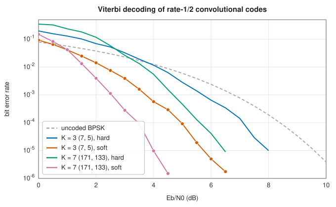

# Convolutional codes and the Viterbi algorithm

<div class="entry-summary">

| | |
|---|---|
| **Problem** | Encode a continuous bit stream with a short shift register, and decode it with maximum likelihood using soft channel information |
| **Devised by** | Peter Elias (1955), convolutional codes; Andrew Viterbi (1967), the decoding algorithm; Jim Omura (1969) and David Forney (1973), its interpretation as dynamic programming on a trellis |
| **Accuracy** | Viterbi decoding is maximum-likelihood over the whole sequence; the K = 7 code with soft decisions reaches $10^{-5}$ at about 4 dB, 5.5 dB better than uncoded BPSK (figure below) |
| **Cost** | $O(2^{K-1})$ add-compare-select operations per information bit, and $O(L\,2^{K-1})$ memory for $L$ bits |
| **API** | [`ConvolutionalCode`](../../api/lib_jsl_information/forward_error_correction/convolutional/struct.ConvolutionalCode.html) (`new`, `nasa_k7`, `encode`, `decode_soft`, `decode_hard`, `outputs`, `tail_len`) |

</div>

## Overview

A block code encodes each block of data separately. A **convolutional code** has no blocks: it
encodes a continuous stream, and each output bit depends on the current input bit and on several
previous ones.

The encoder is a shift register. It remembers the last $K - 1$ input bits, and for each new
input bit it emits $n$ output bits (so the rate is $1/n$). Each output bit is the parity (XOR) of
a fixed subset of the current input and the remembered bits; the subsets are specified by the
**generator polynomials**. The number $K$ is the **constraint length**. Because every input bit
influences $K$ successive groups of outputs, the information about each bit is spread over a
stretch of the transmitted stream, and an error can be corrected from the bits around it.

The decoder exploits the encoder's structure. The encoder is a finite-state machine with
$2^{K-1}$ states (the contents of its memory), and its possible behaviours over time can be
drawn as a graph called a **trellis**. Every possible message is a path through the trellis.
The **Viterbi algorithm** finds the path whose output is closest to what was received. It works
equally well on hard bit decisions or on **soft** reliabilities.

## History

Peter Elias introduced convolutional codes in 1955. Early decoders were sequential (Wozencraft 1957, Fano 1963). Andrew Viterbi's 1967 algorithm was first presented as a proof device. Jim Omura recognised it as dynamic programming, and David Forney (1973) showed it was maximum-likelihood. With the
NASA standard $K = 7$, rate-1/2 code, generators 171 and 133 octal, it flew on Voyager (concatenated with Reed-Solomon) and became the inner code of satellite TV, 802.11a/g Wi-Fi and GSM. Viterbi co-founded Qualcomm. Turbo codes (1993) and LDPC codes later surpassed it, but the trellis idea lives on in their decoders and in equalisers.

## The idea

### The encoder

For constraint length $K$, the register holds the current input and the $K - 1$ previous ones.
Generator $g_j$ is a $K$-bit mask, whose most significant bit multiplies the newest input; output
$j$ is the parity of the register bits selected by the mask. Generators are conventionally
written in octal.

**An example.** The classic $K = 3$ code has generators $(7, 5)$ in octal, that is $111$ and
$101$ in binary. With input $u$ and the two previous inputs $s_1$ (most recent) and $s_2$, the
two outputs are $u \oplus s_1 \oplus s_2$ and $u \oplus s_2$. Starting from an empty register,
the input $1, 0, 1, 1$ is encoded as follows:

| input $u$ | memory $s_1s_2$ | outputs |
|---|---|---|
| 1 | 00 | 11 |
| 0 | 10 | 10 |
| 1 | 01 | 00 |
| 1 | 10 | 01 |

The four states are the four possible contents of the memory. From each state there are two
transitions, one for each input bit, each labelled with its pair of output bits; drawing the
states at successive times, joined by these transitions, gives the trellis.

**Distance.** The measure of a convolutional code's strength is its **free distance**: the
smallest number of positions in which two different output sequences can differ. For the
$(7, 5)$ code it is 5, so two errors within a constraint span can be corrected. The $K = 7$ code
has free distance 10.

**Termination.** Appending $K - 1$ zeros to the message returns the register to the all-zero
state. This costs a little rate, but the decoder then knows where the path ends, which protects
the last bits of the message as well as the rest.

### Maximum-likelihood decoding on the trellis

**What to minimise.** The best decoder chooses the codeword that is most likely to have
produced the received signal. For each transmitted bit $c_i$, the demodulator supplies a
[log-likelihood ratio](../comms/modulation.md#soft-demapping)
$L_i = \ln P(c_i = 0)/P(c_i = 1)$, positive when the bit looks like a 0. Compared with the
all-zero codeword, a candidate codeword changes the log-likelihood by $-L_i$ for every position
where it has a 1. So the most likely codeword is the one that minimises the cost

$$
\sum_{i:\,c_i = 1}L_i ,
$$

the total evidence it contradicts. With hard decisions, $L_i = \pm1$, this is equivalent to
minimising the Hamming distance from the received bits.

**Why dynamic programming applies.** A message of $N$ bits corresponds to one of $2^N$ paths
through the trellis, too many to try. But the cost is a sum of contributions from the successive
transitions of the path. If two paths arrive at the same state at the same time, their futures
are identical, so whichever has the higher cost so far can never win and may be discarded. This
is the [principle of optimality](../optimization/dynamic-programming.md#bellmans-principle), and
the resulting procedure is the Viterbi algorithm (the same one that
[decodes hidden Markov models](../learning/hidden-markov-models.md#the-viterbi-algorithm)).

**The algorithm.** For each state, keep only the cheapest path reaching it, the **survivor**,
with its cost. At each time step:

1. **Add.** Extend every survivor by both possible input bits, adding the cost of the output
   bits on each transition.
2. **Compare.** Two candidate paths enter each new state.
3. **Select.** Keep the cheaper as the new survivor and record which it was.

At the end, trace back from the zero state (or from the cheapest state, if the code was not
terminated) through the recorded choices to read off the message. The work per bit is
proportional to the number of states, $2^{K-1}$, which is why practical constraint lengths are
small.



Soft decisions are worth about 2 dB over hard ones, a classic rule of thumb that the figure confirms. The larger constraint length gains almost 2 dB more, at 16 times the decoding work. {{#include ../generated/coding/viterbi_facts.md}}

## Algorithm

1. **Encode**: for each bit (and the tail zeros), form the register, emit the parity of each generator mask, shift.
2. **Decode**: path metrics start at 0 for state 0 and $\infty$ elsewhere; for each step and state, add the branch costs for inputs 0 and 1 and keep the smaller metric for each next state with its predecessor; trace back from state 0; drop the tail.

## Implementation

```rust,ignore
{{#include ../../../crates/information/src/forward_error_correction/convolutional.rs:viterbi}}
```

- `decode_hard` maps bits to LLRs of ±1 and calls `decode_soft`.
- The decoder keeps the full survivor history and traces back once at the end. Streaming decoders instead trace back over a fixed window of about $5K$ steps.

## In practice

```rust,ignore
{{#include ../../../crates/information/examples/coding_convolutional.rs}}
```

```text
K = 3 (7, 5): 7 bits -> 18 coded bits [1, 1, 1, 0, 0, 0, 0, 1, 0, 1, 1, 1, 1, 1, 1, 0, 1, 1]
hard Viterbi with 2 bit errors: [1, 0, 1, 1, 0, 0, 1]
soft Viterbi with 4 weak errors: [1, 0, 1, 1, 0, 0, 1]
NASA K = 7: 2 outputs per bit, 6 tail bits
```

Four wrong but weak values are outvoted by their reliable neighbours in the soft decoder.

**Strengths**

- Simple encoders; optimal, soft-input decoding at a cost that is linear in the length.
- Natural for streams; well understood performance (union bounds from the distance spectrum).

**Weaknesses**

- Decoding cost grows as $2^K$, which limits the distance achievable; several dB from capacity.
- Errors at the output come in bursts, which an outer code (such as Reed-Solomon) must handle.

## Exercises

1. Draw the state diagram and trellis of the $K = 3$ $(7, 5)$ code, and find its free distance.
2. Show that minimising $\sum_{c_i = 1}L_i$ is equivalent to maximising the likelihood of the codeword.
3. Encode 1011 with the $(7, 5)$ code, flip one bit, and run the Viterbi algorithm by hand.
4. Puncture the $K = 7$ code to rate 2/3 by deleting every fourth coded bit, and decode by setting the missing LLRs to zero.
5. Estimate the bit error rate at high SNR from the free distance: $P_b \approx c\,Q\big(\sqrt{2d_{\text{free}}RE_b/N_0}\big)$.

## Further reading

- A. J. Viterbi, "Error bounds for convolutional codes and an asymptotically optimum decoding algorithm", *IEEE Transactions on Information Theory* 13 (1967) 260–269.
- G. D. Forney, "The Viterbi algorithm", *Proceedings of the IEEE* 61 (1973) 268–278.
- P. Elias, "Coding for noisy channels", *IRE Convention Record* 3, part 4 (1955) 37–46.
- S. Lin and D. J. Costello, *Error Control Coding*, 2nd ed., Pearson, 2004, chapter 12.
