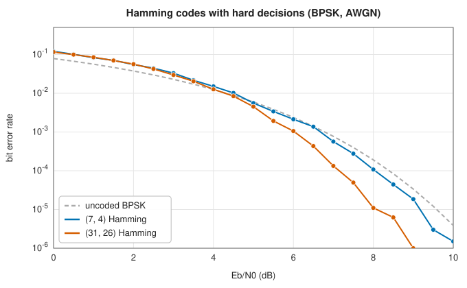

# Linear block codes and Hamming codes

<div class="entry-summary">

| | |
|---|---|
| **Problem** | Add redundant bits to a block of data so that a receiver can detect and correct bit errors |
| **Devised by** | Richard Hamming (1950); Marcel Golay (1949), the general construction from parity-check matrices |
| **Accuracy** | Corrects every single-bit error; the extended (SECDED) code also detects every double error (exhaustive table below) |
| **Cost** | $O(n)$ per codeword to encode and decode; the syndrome is the XOR of the positions of the set bits |
| **API** | [`HammingCode`](../../api/lib_jsl_information/forward_error_correction/hamming/struct.HammingCode.html) (`new`, `new_extended`, `encode`, `decode`, `n`, `k`), [`HammingDecoded`](../../api/lib_jsl_information/forward_error_correction/hamming/struct.HammingDecoded.html), [`HammingStatus`](../../api/lib_jsl_information/forward_error_correction/hamming/enum.HammingStatus.html) |

</div>

## Overview

A noisy channel flips bits. An error-correcting code protects data by adding redundancy in a
structured way, so that the receiver can tell what was sent even when some bits arrive wrong.
The vocabulary of the subject is introduced here and used throughout the chapter.

- A **block code** maps each block of $k$ data bits to an $n$-bit **codeword**, with $n > k$. Of
  the $2^n$ possible words of length $n$, only $2^k$ are codewords. The **rate** $k/n$ is the
  fraction of transmitted bits that carry data.
- The **Hamming distance** between two words is the number of positions in which they differ.
  The **minimum distance** $d$ of a code is the smallest distance between two different
  codewords. It decides the power of the code. If fewer than $d$ bits are flipped, the result
  cannot be another codeword, so up to $d - 1$ errors are always *detected*. And if at most
  $\lfloor (d - 1)/2\rfloor$ bits are flipped, the received word is still closer to the codeword
  that was sent than to any other, so that many errors can be *corrected* by choosing the nearest
  codeword.
- A code is **linear** if the bitwise sum (XOR) of any two codewords is again a codeword.
  Arithmetic on bits is modulo 2 throughout: $1 + 1 = 0$. A linear code can be described by a
  **parity-check matrix** $H$: a word $c$ is a codeword exactly when $Hc = 0$, that is, when it
  passes every parity check (each row of $H$ lists a set of positions whose bits must sum to 0).
- If the received word is $r = c + e$, where $e$ has a 1 wherever an error occurred, its
  **syndrome** is $Hr = Hc + He = He$. The syndrome depends only on the error, not on the
  codeword, and is zero when no check fails. Decoding a linear code means deducing the error
  from the syndrome.

The **Hamming codes** are the simplest nontrivial case. They have $d = 3$, and so correct any
single error in a block, using only $\log_2(n + 1)$ parity bits.

## History

Richard Hamming, at Bell Labs in the late 1940s, was frustrated that the relay computers stopped at weekend errors instead of correcting them. He devised the codes that bear his name, published in 1950 after a patent was filed. Marcel Golay's one-page 1949 paper had already described the $(7, 4)$ code and the general parity-check construction, as well as the perfect
Golay codes. Hamming codes, extended with an overall parity bit to give **SECDED** (single error correction, double error detection), protect computer memory to this day.

## The idea

### The parity-check matrix

Suppose a single bit, in position $p$, is flipped. The error vector $e$ has a single 1, so the
syndrome $He$ is simply column $p$ of $H$. To correct every single error, the decoder must be
able to tell from the syndrome *which* position was hit. That requires all the columns of $H$ to
be different from each other, and none to be zero (a zero column would make that error
invisible).

With $r$ parity checks, the columns are binary vectors of length $r$, and there are $2^r - 1$
nonzero ones. Hamming's construction uses them all: the columns of $H$ are all the nonzero
binary $r$-vectors. This gives the longest possible code for $r$ checks, of length
$n = 2^r - 1$, with $k = n - r$ data bits: $(7, 4)$, $(15, 11)$, $(31, 26)$, and so on. The
fraction of redundancy shrinks as the code grows.

**The minimum distance is 3.** In a linear code the minimum distance equals the smallest number
of 1s in a nonzero codeword. A codeword with $w$ ones is a set of $w$ columns of $H$ that sum to
zero. One column cannot (none is zero); two cannot (no two are equal); but three can, for
example the columns $001$, $010$ and $011$. So $d = 3$.

**A convenient ordering.** Let column $p$ be the number $p$ written in binary. Then the syndrome
of a single error at position $p$ **is** the number $p$: the decoder computes the syndrome and
flips the bit it names. Computing the syndrome is also simple, since $Hr$ is the sum of the
columns at which $r$ has a 1: it is the XOR of the positions of the received 1 bits.

Encoding is made equally simple by placing the parity bits at the power-of-two positions
$1, 2, 4, \ldots$, whose columns have a single 1. Put the data in the other positions, and set
the parity bit at position $2^i$ so that bit $i$ of the syndrome is 0.

**An example with the (7, 4) code.** The data bits $1, 0, 1, 1$ go to positions 3, 5, 6, 7.

- Parity bit 1 checks the positions whose binary form has its lowest bit set, 1, 3, 5, 7. The
  data bits there are $1, 0, 1$, which sum to 0, so the parity bit is 0.
- Parity bit 2 checks positions 2, 3, 6, 7, with data $1, 1, 1$: the parity bit is 1.
- Parity bit 4 checks positions 4, 5, 6, 7, with data $0, 1, 1$: the parity bit is 0.

The codeword is $0\,1\,1\,0\,0\,1\,1$. Its 1 bits are at positions 2, 3, 6 and 7, and
$2 \oplus 3 \oplus 6 \oplus 7 = 0$, as it should be. Now suppose position 5 is flipped in
transit. The 1 bits are then at 2, 3, 5, 6, 7, and their XOR is 5: the syndrome names the
flipped bit.

### Perfect codes and the extended code

Around each codeword, draw the "sphere" of words at distance at most 1 from it: the codeword
itself and the $n$ words obtained by flipping one bit, $n + 1$ words in all. Since $d = 3$ the
spheres do not overlap. There are $2^k$ of them, containing $2^k(n + 1) = 2^k2^r = 2^n$ words:
every word of length $n$ lies in exactly one sphere. Codes with this property are called
**perfect**; no space is wasted.

Perfection has a drawback. Every received word decodes to some codeword, so the decoder never
reports failure. If two bits are flipped, the received word lies in the sphere of a *wrong*
codeword, and the decoder "corrects" a third bit, making matters worse.

The **extended** Hamming code appends one more bit, an overall parity check on the whole word,
which raises the distance to $d = 4$. The decoder can then distinguish the two cases. A single
error makes the overall parity odd. A double error leaves the overall parity even but gives a
nonzero syndrome, which is reported as detected but not correctable:

{{#include ../generated/coding/hamming_outcomes.md}}

### On a noisy channel



With hard decisions on BPSK over additive white Gaussian noise, the $(7, 4)$ code gains little. Its rate of 4/7 costs 2.4 dB of energy per bit, which it barely wins back by correcting single errors: about half a decibel at $10^{-6}$. The longer $(31, 26)$ code, of higher rate, gains about 1.5 dB. Real gains need longer codes with larger distance and soft decisions, the subjects of the following entries.

## Algorithm

1. **Encode**: data into the non-power-of-two positions; syndrome of the data bits; set parity bit $2^i$ to syndrome bit $i$; (extended) append the overall parity.
2. **Decode**: syndrome $s$ = XOR of the positions of set bits; overall parity (extended). If $s = 0$ and the parity is even, no error. If the parity is odd, flip bit $s$ (or the parity bit if $s = 0$). If $s \ne 0$ and the parity is even, report a double error.

## Implementation

```rust,ignore
{{#include ../../../crates/information/src/forward_error_correction/hamming.rs:hamming_decode}}
```

- Bits are `u8` values 0 or 1; `r` ranges from 2 to 20, so codes up to $(2^{20} - 1, 2^{20} - 21)$.
- After a detected double error the returned data is the uncorrected best effort.

## In practice

```rust,ignore
{{#include ../../../crates/information/examples/coding_hamming.rs}}
```

```text
(7,4): data [1, 0, 1, 1] -> codeword [0, 1, 1, 0, 0, 1, 1]
one error at index 4: Corrected(4), data [1, 0, 1, 1]
(8,4) with two errors: DoubleErrorDetected
r = 6: (63, 57) code, rate 0.905
```

**Strengths**

- Trivial encoding and decoding with the minimum redundancy for single-error correction; SECDED adds double-error detection for one more bit.

**Weaknesses**

- Distance 3 or 4 only; little coding gain on noisy channels; no use of soft information.

## Exercises

1. Write $H$ and a generator matrix $G$ for the $(7, 4)$ code, and check $HG^{\mathsf T} = 0$.
2. Show that a linear code's minimum distance is the smallest weight of a nonzero codeword.
3. Prove that Hamming codes are perfect, and that the extended code has $d = 4$.
4. Find the probability of a decoding error for the $(7, 4)$ code on a binary symmetric channel with crossover $p$.
5. Show that the Hamming bound $2^{n-k} \ge \sum_{i \le t}\binom{n}{i}$ holds for every $t$-error-correcting binary code.

## Further reading

- R. W. Hamming, "Error detecting and error correcting codes", *Bell System Technical Journal* 29 (1950) 147–160.
- M. J. E. Golay, "Notes on digital coding", *Proceedings of the IRE* 37 (1949) 657.
- S. Lin and D. J. Costello, *Error Control Coding*, 2nd ed., Pearson, 2004, chapters 3–4.
- F. J. MacWilliams and N. J. A. Sloane, *The Theory of Error-Correcting Codes*, North-Holland, 1977.
