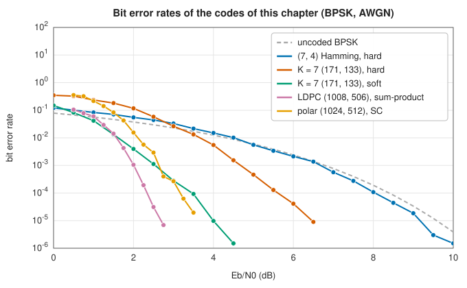

# Error-correcting codes

Shannon's channel coding theorem (1948) promised that data can be sent through a noisy channel with as few errors as desired, at any rate below the channel's capacity, by coding long enough blocks. It did not say how. This chapter follows seventy years of answers, from Hamming's single-error-correcting codes through the algebraic
Reed-Solomon codes and the trellis-decoded convolutional codes to the two families that come close to the promise: LDPC codes with iterative decoding, and polar codes. The [previous chapter](../information/index.md) measured information. This one protects it.

## The central questions

- **How much redundancy, how much protection?** A code's rate $k/n$ and minimum distance $d$ trade against each other; the bounds of Hamming, Singleton and Shannon say how far.
- **Bits or symbols?** Binary codes fix scattered bit errors; Reed-Solomon codes fix bytes, which suits bursts.
- **Hard or soft?** Decoders that use the channel's reliabilities gain about 2 dB over those that see only bits.
- **How close to capacity, at what cost?** Longer codes and iterative decoders approach the limit; algebraic decoders are cheap and exact but further away.

All curves are bit error rates for BPSK over additive white Gaussian noise, against the energy per information bit. For rate 1/2 the Shannon limit is about 0.19 dB, and for any rate it is at least −1.59 dB.

## Testing

Reed-Solomon parity bytes are compared with the Python `reedsolo` package (version 1.7.0), configured with the same field and generator, by `book/generator/data/make_coding_refs.py`. The other codes are checked against their defining properties: exhaustive error patterns for Hamming codes, error rates against theory, and genie-aided channel reliabilities for polar codes.
Writing this chapter fixed one problem. The **polar code construction** ranked the bit channels in bit-reversed order, so information bits went on the wrong channels.

## In the library

All of these are in `lib_jsl_information::forward_error_correction` ([API reference](../../api/lib_jsl_information/forward_error_correction/index.html)). Bits are `u8` values 0 or 1, and soft inputs are log-likelihood ratios $\ln P(0)/P(1)$.

| You need | Use | Entry |
|---|---|---|
| Single-error correction, double-error detection | `HammingCode` | [Hamming codes](hamming.md) |
| Byte-error and burst correction | `ReedSolomon` | [Reed-Solomon codes](reed-solomon.md) |
| A streaming code with soft maximum-likelihood decoding | `ConvolutionalCode` | [Convolutional codes](convolutional.md) |
| Near-capacity performance for long blocks | `LdpcCode` | [LDPC codes](ldpc.md) |
| A capacity-achieving construction with simple decoding | `PolarCode` | [Polar codes](polar.md) |
