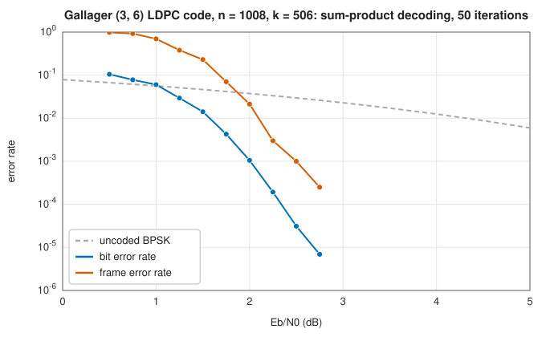
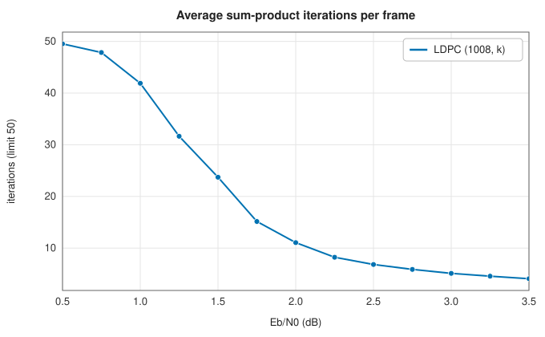

# Low-density parity-check codes

<div class="entry-summary">

| | |
|---|---|
| **Problem** | Approach the Shannon limit with long codes whose parity checks are sparse, decoded iteratively by passing probabilities along a graph |
| **Devised by** | Robert Gallager (1960, thesis 1963); rediscovered by David MacKay and Radford Neal (1996); Tom Richardson and Rüdiger Urbanke (2001), density evolution and optimised irregular codes |
| **Accuracy** | A regular (3, 6) code of length 1008 reaches a bit error rate of $10^{-5}$ at about 2.7 dB, 2.5 dB from the rate-1/2 Shannon limit (figure below) |
| **Cost** | $O(E)$ per iteration for $E$ edges of the graph, with tens of iterations; encoding here $O(nk)$ from the reduced parity-check matrix |
| **Read first** | [Linear block codes and Hamming codes](hamming.md), [Modulation: constellations, OFDM and FM](../comms/modulation.md) |
| **API** | [`LdpcCode`](../../api/lib_jsl_information/forward_error_correction/ldpc/struct.LdpcCode.html) (`new`, `gallager`, `encode`, `decode`, `extract_info`, `is_codeword`, `info_positions`), [`LdpcDecoded`](../../api/lib_jsl_information/forward_error_correction/ldpc/struct.LdpcDecoded.html) |

</div>

## Overview

An **LDPC code** is a linear code whose parity-check matrix $H$ is **sparse**: each check involves a few bits, and each bit a few checks. Draw it as a bipartite **Tanner graph** of variable nodes (bits) and check nodes, with an edge wherever $H$ has a 1. The decoder passes messages along the edges. Each bit tells
each of its checks what it believes, based on the channel and its other checks; each check tells each bit what its other bits imply. After a few dozen rounds the beliefs settle on a codeword. Long LDPC codes come within a fraction of a decibel of capacity, and they carry Wi-Fi, 5G data channels, DVB-S2 and 10 Gb Ethernet.

## History

Robert Gallager invented LDPC codes and iterative probabilistic decoding in his 1960 MIT thesis, published as a monograph in 1963. Computers of the day could not exploit them, and they were forgotten for thirty years, apart from Michael Tanner's graph description (1981). After turbo codes (1993) showed that iterative decoding works,
David MacKay and Radford Neal (1996) rediscovered Gallager's codes and showed how close to capacity they come. Tom Richardson, Amin Shokrollahi and Rüdiger Urbanke (2001) developed **density evolution** to optimise irregular codes, and Sae-Young Chung, David Forney, Richardson and Urbanke (2001) designed one within 0.0045 dB of the limit for very long blocks.

## The idea

### Gallager's construction

A regular $(w_c, w_r)$ code has $w_c$ ones in every column and $w_r$ in every row. Gallager stacked $w_c$ blocks. The first block's rows each cover $w_r$ consecutive positions, and each further block is a random column permutation of the first. [`LdpcCode::gallager`](../../api/lib_jsl_information/forward_error_correction/ldpc/struct.LdpcCode.html#method.gallager) builds it from a seed.
The design rate is $1 - w_c/w_r$. The true dimension is $n$ minus the rank of $H$, which Gauss-Jordan elimination over GF(2) finds while also yielding a systematic encoder. {{#include ../generated/coding/ldpc_facts.md}}

### Belief propagation

Finding the nearest codeword of a long code by search is impossible. Belief propagation instead
lets the bits and the checks improve their estimates of one another, a little at a time, using
only local computations.

**The quantities.** Each bit's uncertainty is expressed as a
[log-likelihood ratio](../comms/modulation.md#soft-demapping) (LLR), $\ln P(0)/P(1)$: positive
means "probably 0", negative "probably 1", and the magnitude is the confidence. Variable $v$
starts with its channel value $L_v$, what the received signal says about that bit alone.
**Messages** are LLRs sent along the edges of the Tanner graph, in both directions.

**The key rule: extrinsic information.** A message sent along an edge never uses the message
that arrived on that same edge. A bit tells a check what it has learned *from everyone else*,
and a check tells a bit what its *other* bits imply. Otherwise a node would be told its own
opinion back and grow more and more confident on no new evidence.

Each iteration has three steps.

- **Check to variable.** A check says that its bits sum to zero (modulo 2), so any one of them
  equals the XOR of the others. Check $c$ therefore tells variable $v$ what the other bits of the
  check imply about it. The LLR of an XOR of independent bits is given by the "tanh rule":

  $$
  m_{c\to v} = 2\tanh^{-1}\prod_{v' \ne v}\tanh\frac{m_{v'\to c}}{2}.
  $$

  The formula behaves as common sense suggests. Its sign is the product of the signs of the
  incoming messages: an XOR is 1 when an odd number of its inputs are. Its magnitude is a little
  less than the smallest incoming magnitude: a conclusion drawn from several bits is no more
  reliable than the least reliable of them.
- **Variable to check.** Independent pieces of evidence about a bit combine by adding their
  LLRs. Variable $v$ tells check $c$ the sum of its channel value and the messages from its
  *other* checks: $m_{v\to c} = L_v + \sum_{c' \ne c} m_{c'\to v}$.
- **Decide.** The bit's overall belief uses all its checks: bit $v$ is 1 if
  $L_v + \sum_c m_{c\to v} < 0$. If the decisions satisfy every check, they form a codeword and
  decoding stops.

**Why it works, and when.** If the Tanner graph has no cycles, the evidence arriving at a node
along different edges comes from disjoint parts of the graph and really is independent, and this
procedure computes the exact posterior probability of every bit (it is then called the
**sum-product algorithm**). The graphs of good codes do have cycles, so evidence eventually
returns to where it started and is counted twice. But if the cycles are long, the messages stay
nearly independent for many iterations, and the decoder works almost as well. This is one reason
sparse matrices are wanted: few edges mean few short cycles. The other is cost, since each
iteration takes work proportional to the number of edges.



<p class="caption" id="fig-19-5"><strong>Figure 19.5.</strong> LDPC BER.</p>

The curve falls steeply once the noise is below the code's threshold: the **waterfall**. Near it, decoding needs many iterations; well above it, a few suffice:



<p class="caption" id="fig-19-6"><strong>Figure 19.6.</strong> LDPC iterations.</p>

## Algorithm

**Construction** of a systematic encoder from the parity-check matrix $H$, with $m$ rows and
$n$ columns.

1. Reduce a dense copy of $H$ by Gauss-Jordan elimination over GF(2): for each row, find a
   column with a 1 to serve as its pivot, and XOR the row into every other row that has a 1
   in that column. Rows that become zero are redundant checks.
2. The pivot columns are the **parity** positions, and the remaining columns the
   **information** positions. Each reduced row now expresses one parity bit as the XOR of
   some information bits.

**Encoding**: place the information bits in the information positions, and compute each parity
bit as the XOR of the information bits that appear in its reduced row.

**Decoding**, from the channel LLRs.

1. Take hard decisions from the channel values. If they satisfy every check, return them: no
   iteration is needed.
2. Initialise every variable-to-check message to the channel value of its variable.
3. **Check update**: for every check and each of its variables, compute the message from the
   others by the tanh rule.
4. **Variable update**: for every variable, add the channel value and all the incoming check
   messages to get its total; the message to each check is the total minus the message that
   came from that check.
5. **Decide**: take the sign of each total. If the decisions satisfy every check, return them.
6. If the iteration limit has been reached, return the decisions with a failure flag;
   otherwise go to 3.

Updating all the checks and then all the variables in each iteration is the **flooding**
schedule. An iteration costs time proportional to the number of 1s in $H$.

## Implementation

```rust,ignore
{{#include ../../../crates/information/src/forward_error_correction/ldpc.rs:check_node}}
```

- Messages are clamped before `tanh` and `atanh` to stay finite.
- `decode` reports whether it converged and how many iterations it took; on failure it returns the last hard decision.
- Any parity-check matrix can be supplied to `LdpcCode::new` as lists of positions; redundant checks are allowed.

## In practice

```rust,ignore
{{#include ../../../crates/information/examples/coding_ldpc.rs}}
```

```text
Gallager (3, 6) code: n = 96, k = 50, 48 checks
codeword satisfies every check: true
8 errors: converged true, after 32 iterations, info recovered true
```

**Strengths**

- Near-capacity performance for long blocks; decoding is parallel and its cost linear in the length.
- The decoder knows when it has succeeded (all checks satisfied).

**Weaknesses**

- Short codes perform less well, and random constructions have error floors from small trapping sets.
- Dense-matrix construction and encoding here cost $O(n^2)$ memory and $O(nk)$ time; structured (quasi-cyclic) codes avoid this.

## Exercises

1. Derive the check-node update from $P(\text{XOR} = 0) = \tfrac12\big(1 + \prod(1 - 2p_i)\big)$.
2. Show that the min-sum approximation $m_{c\to v} \approx \prod\operatorname{sgn} \cdot \min|m|$ overestimates the reliability.
3. Show that a $(w_c, w_r)$ regular code has rate at least $1 - w_c/w_r$.
4. Decode a (7, 4) Hamming code by belief propagation on its Tanner graph, and explain why its short cycles hurt.
5. Find the threshold of the (3, 6) ensemble on the binary erasure channel by density evolution, $x_{\ell+1} = \varepsilon\big(1 - (1 - x_\ell)^5\big)^2$.

<details>
<summary>Hints and answers</summary>

1. If bit $i$ is 1 with probability $p_i$, the XOR of independent bits is 1 with probability $\tfrac12(1 - \prod(1 - 2p_i))$, so the probability of 0 is $\tfrac12(1 + \prod(1 - 2p_i))$. Converting to LLRs gives the tanh rule $\tanh(L/2) = \prod\tanh(L_i/2)$.
2. $|\prod\tanh(L_i/2)| \le \min|\tanh(L_i/2)|$ and $2\operatorname{artanh}$ of the product is smaller in magnitude than the minimum $|L_i|$, so min-sum, which uses the minimum, overestimates the reliability.
3. A regular code with column weight $w_c$ and row weight $w_r$ has $n w_c/w_r$ check equations, which may not be independent, so $n - k \le nw_c/w_r$ and $k/n \ge 1 - w_c/w_r$.
4. Short cycles in the Tanner graph make messages return to the node they came from, so the independence assumption behind belief propagation fails and the decoder overcounts evidence; the Hamming code's Tanner graph has many 4-cycles.
5. Iterate $x_{\ell+1} = \varepsilon(1 - (1 - x_\ell)^5)^2$ from $x_0 = \varepsilon$: it converges to 0 for $\varepsilon < \varepsilon^* \approx 0.4294$ and gets stuck at a positive fixed point for $\varepsilon > \varepsilon^*$.

</details>

## Further reading

- R. G. Gallager, *Low-Density Parity-Check Codes*, MIT Press, 1963.
- D. J. C. MacKay, "Good error-correcting codes based on very sparse matrices", *IEEE Transactions on Information Theory* 45 (1999) 399–431.
- T. Richardson and R. Urbanke, *Modern Coding Theory*, Cambridge University Press, 2008.
- D. J. C. MacKay, *Information Theory, Inference, and Learning Algorithms*, Cambridge University Press, 2003, chapter 47.
