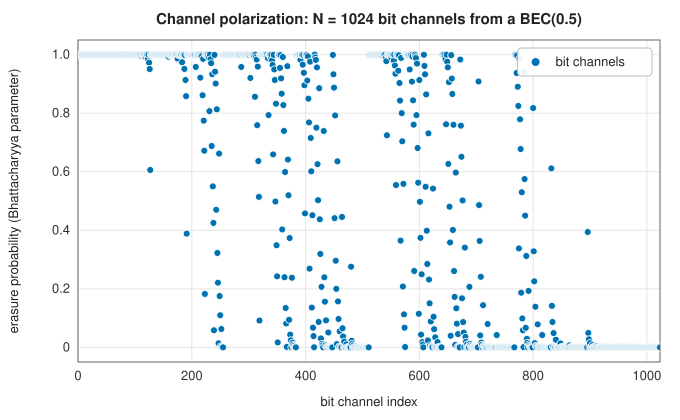
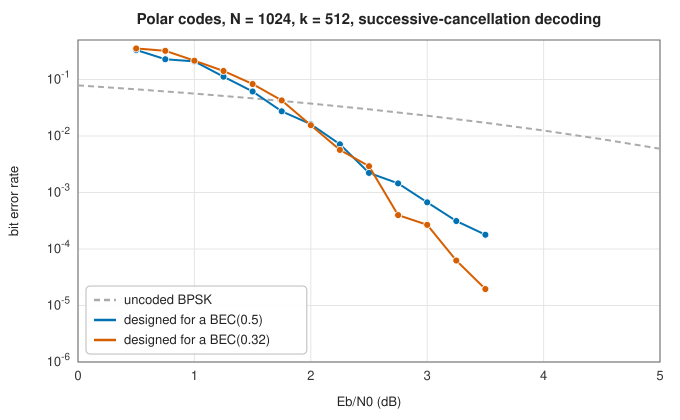

# Polar codes

<div class="entry-summary">

| | |
|---|---|
| **Problem** | Build codes that provably achieve the capacity of symmetric binary channels, with $O(N\log N)$ encoding and decoding |
| **Devised by** | Erdal Arıkan (2009); Ido Tal and Alexander Vardy (2011–15), list decoding |
| **Accuracy** | Capacity-achieving as $N \to \infty$; at $N = 1024$, rate 1/2, successive cancellation reaches a bit error rate of $10^{-4}$ near 3 dB (figure below) |
| **Cost** | $O(N\log N)$ for encoding and for successive-cancellation decoding; the code construction costs $O(N\log N)$ |
| **API** | [`PolarCode`](../../api/lib_jsl_information/forward_error_correction/polar/struct.PolarCode.html) (`new`, `encode`, `decode`, `decode_hard`, `info_positions`, `n`, `k`) |

</div>

## Overview

A **polar code** transforms $N = 2^m$ uses of a channel so that, seen by a decoder that decides one input bit at a time, the $N$ synthesized **bit channels** **polarize**. Most become almost perfect and the rest almost useless, and the fraction of good ones tends to the channel capacity. Information goes on the $k$ most reliable bit channels.
The others are **frozen** to known zeros. Encoding is a butterfly network like the FFT's, and **successive-cancellation** (SC) decoding walks the same network recursively. Polar codes were the first codes proven to achieve capacity with low complexity, and with list decoding they protect the control channels of 5G.

## History

Erdal Arıkan of Bilkent University introduced channel polarization in 2009, building on his study of sequential decoding's cutoff rate. He proved that polar codes with SC decoding achieve the capacity of any binary-input symmetric memoryless channel. At practical lengths SC decoding was weaker than LDPC or turbo decoding. Ido Tal and
Alexander Vardy's **list decoding** (2011, published 2015), with a CRC to pick from the list, closed the gap. In 2016 3GPP adopted polar codes for the 5G control channels.

## The idea

### The polarizing transform

Combine two independent uses of a channel $W$ by sending $(u_1 \oplus u_2, u_2)$. Deciding $u_1$ first, with $u_2$ unknown, faces a worse channel $W^-$. Deciding $u_2$ with $u_1$ known sees two noisy copies of it, a better channel $W^+$. Capacity is conserved, $I(W^-) + I(W^+) = 2I(W)$. Repeating the step $m$ times gives the transform
$x = u\,F^{\otimes m}$ with $F = \begin{pmatrix}1 & 0\\1 & 1\end{pmatrix}$, computed by $m$ butterfly stages. The library uses the natural order, without Arıkan's bit-reversal permutation, so the first split decides the most significant bit of a channel's index.

### Choosing the frozen set

For a binary erasure channel the polarized erasure probabilities follow exactly: $W^-$ erases with probability $2z - z^2$ and $W^+$ with $z^2$. For other channels these **Bhattacharyya parameters** are upper bounds. The library designs a code by running this recursion from a design erasure probability and freezing the $N - k$ worst channels. A lower design value suits a higher signal-to-noise ratio.



{{#include ../generated/coding/polar_facts.md}} The rest of the channels are still in between at this length; polarization is slow, which is why short polar codes need better decoders than SC.

### Successive cancellation

Decode the bits in index order, each using the channel outputs and the decisions already made. Recursively, for a block of LLRs split into halves $a$ and $b$:

- decode the first half from $f(a, b) = \operatorname{sgn}a\,\operatorname{sgn}b\,\min(|a|, |b|)$ (min-sum for the XOR);
- re-encode its decisions $\hat v$, and decode the second half from $g = b + (-1)^{\hat v}a$;
- return the re-encoded partial sums of both halves.

Frozen bits are set to zero whatever the LLR. A wrong early decision is never revisited, which is SC's weakness. List decoders keep the $L$ best paths instead.



The design matters: a code designed for a BEC(0.32), closer to the operating point, beats one designed for a BEC(0.5) at higher signal-to-noise ratios.

## Algorithm

1. **Construct**: Bhattacharyya recursion from the design erasure probability; take the $k$ smallest as information positions.
2. **Encode**: place the information bits; apply the $m$ butterfly stages $x_i \mathrel{\oplus}= x_{i + \ell}$.
3. **Decode**: recursive SC with the $f$ and $g$ updates; read the decisions at the information positions.

## Implementation

```rust,ignore
{{#include ../../../crates/information/src/forward_error_correction/polar.rs:sc_decode}}
```

- Writing this chapter fixed the construction, which ranked the bit channels in bit-reversed order and so placed information on the wrong channels.
- Lengths up to $2^{20}$ are supported; decoding takes soft LLRs or hard bits.

## In practice

```rust,ignore
{{#include ../../../crates/information/examples/coding_polar.rs}}
```

```text
N = 8, k = 4: information on channels [3, 5, 6, 7]
codeword [1, 0, 1, 0, 0, 1, 0, 1]
one flipped bit, SC decoding: [1, 0, 1, 1]
N = 1024, k = 512, 41 erasures: recovered true
```

The (8, 4) polar code designed for a BEC(0.5) is the (8, 4) Reed-Muller code, with information on channels 3, 5, 6 and 7.

**Strengths**

- Provably capacity-achieving; explicit construction; simple $O(N\log N)$ encoder and decoder; any rate by choosing $k$.

**Weaknesses**

- SC decoding is weak at short and moderate lengths, and sequential, so slow in hardware; list decoding (not provided here) is needed for competitive performance.
- The construction depends on the channel; the BEC design is an approximation for AWGN.

## Exercises

1. Show that for a BEC($\varepsilon$), $W^-$ and $W^+$ are BECs with erasure probabilities $2\varepsilon - \varepsilon^2$ and $\varepsilon^2$, and that capacity is conserved.
2. Show that $F^{\otimes m}$ is its own inverse over GF(2).
3. Verify that the (8, 4) polar code with information channels 3, 5, 6, 7 is the first-order Reed-Muller code.
4. Count the operations of SC decoding and show that it is $O(N\log N)$.
5. Implement CRC-aided list decoding with $L = 4$ and compare its error rate with SC's.

## Further reading

- E. Arıkan, "Channel polarization: a method for constructing capacity-achieving codes for symmetric binary-input memoryless channels", *IEEE Transactions on Information Theory* 55 (2009) 3051–3073.
- I. Tal and A. Vardy, "List decoding of polar codes", *IEEE Transactions on Information Theory* 61 (2015) 2213–2226.
- E. Şaşoğlu, "Polarization and polar codes", *Foundations and Trends in Communications and Information Theory* 8 (2012) 259–381.
