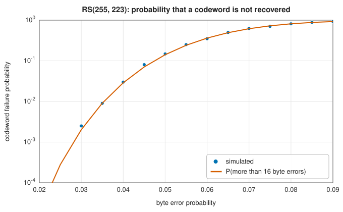

# Reed-Solomon codes

<div class="entry-summary">

| | |
|---|---|
| **Problem** | Correct errors in whole bytes (symbols) rather than bits, so that bursts of corrupted bits cost no more than a few symbol errors |
| **Devised by** | Irving Reed and Gustave Solomon (1960); Elwyn Berlekamp (1968) and James Massey (1969), the decoding algorithm; Robert Chien (1964), the root search |
| **Accuracy** | Corrects any $\lfloor (n - k)/2\rfloor$ byte errors, the most possible for the redundancy (MDS); parity bytes identical to the `reedsolo` package (table below) |
| **Cost** | Encoding $O(n(n - k))$ field multiplications; decoding $O(n(n - k))$ for the syndromes and the Chien search plus $O((n - k)^2)$ for Berlekamp-Massey |
| **API** | [`ReedSolomon`](../../api/lib_jsl_information/forward_error_correction/reed_solomon/struct.ReedSolomon.html) (`new`, `encode`, `parity`, `decode`, `correct`, `error_capacity`) |

</div>

## Overview

Hamming codes work on bits and correct one of them. **Reed-Solomon** (RS) codes work on whole
bytes and correct many, by a construction based on polynomials.

The idea is a familiar one. A polynomial of degree less than $k$ is determined by its values at
any $k$ points. So let the $k$ message bytes be the coefficients of such a polynomial, and
transmit its values at $n > k$ points. The extra $n - k$ values are redundant: any $k$ correct
values would be enough to recover the polynomial. Two *different* polynomials of degree below
$k$ can agree at no more than $k - 1$ points (their difference would otherwise have too many
roots), so two codewords differ in at least $n - k + 1$ positions. That is the largest minimum
distance any code with these parameters can have.

With that distance an RS code corrects $t = \lfloor (n - k)/2\rfloor$ byte errors, wherever they
are and however many bits of each byte are wrong. This makes RS codes especially good against
**bursts**, runs of consecutive bit errors: a burst of up to $8(t - 1) + 1$ bits never touches
more than $t$ bytes. The library uses the *systematic* form of the code, in which the codeword is
the message itself followed by $n - k$ parity bytes.

For the arithmetic to work, the bytes must be elements of a number system in which one can add,
subtract, multiply and divide, a **field**, with exactly 256 elements. That is the finite field
GF(256).

## History

Irving Reed and Gustave Solomon, at MIT Lincoln Laboratory, published their five-page paper in 1960. Decoding was impractical until Elwyn Berlekamp's algorithm (1968), which James Massey (1969) recast as the synthesis of the shortest linear feedback shift register generating the syndromes. Robert Chien's search for the error locations (1964) completed the decoder.
RS codes were then used everywhere: Voyager's images (concatenated with a convolutional code), compact discs (two cross-interleaved RS codes), DVDs, QR codes, DSL and RAID 6. RS(255, 223) became the CCSDS deep-space standard.

## The idea

### The field GF(256)

Ordinary integer arithmetic modulo 256 will not do, because division is not always possible in
it (2 has no inverse). The field GF(256) is built differently. A byte is read as a polynomial of
degree below 8 whose coefficients are its bits; for example $00010011$ is $x^4 + x + 1$.

- **Addition** adds the polynomials, with coefficients modulo 2. That is the XOR of the bytes.
  Every element is its own negative, so subtraction is the same operation.
- **Multiplication** multiplies the polynomials and takes the remainder on division by a fixed
  polynomial of degree 8, here $x^8 + x^4 + x^3 + x^2 + 1$ (0x11D), which keeps the result within
  eight bits. Because this polynomial cannot be factored, every nonzero element has an inverse,
  just as the integers modulo a prime do.

The polynomial is also **primitive**, which means that the powers of the element $\alpha = x$ (the
byte 2) run through all 255 nonzero elements before repeating. Every nonzero element is thus
$\alpha^i$ for some $i$, its "logarithm". Multiplication becomes addition of logarithms modulo
255, done with two small tables.

### Systematic encoding

In the systematic form, the code is described through polynomial roots. Regard a word of $n$
bytes as the coefficients of a polynomial $c(x)$ of degree below $n$. The codewords are defined
to be the polynomials that vanish at $n - k$ consecutive powers of $\alpha$, that is, the
multiples of the **generator polynomial**

$$
g(x) = \prod_{j=0}^{n-k-1}(x - \alpha^j) .
$$

To encode a message polynomial $m(x)$ so that its bytes appear unchanged in the codeword, shift
it up by $n - k$ places, $m(x)\,x^{n-k}$, leaving room for the parity bytes, and divide by
$g(x)$. Subtracting the remainder makes the result exactly divisible:

$$
c(x) = m(x)\,x^{n-k} - \big(m(x)\,x^{n-k} \bmod g(x)\big) .
$$

The remainder has degree below $n - k$, so it occupies only the low positions: those are the
parity bytes, and the high positions still hold the message. The division is carried out by a
shift register over GF(256). Codes may be **shortened** to any $n \le 255$ by fixing leading
message bytes at zero and not sending them.

### Decoding

The received polynomial is $r(x) = c(x) + e(x)$, where the error polynomial $e(x)$ has a nonzero
coefficient at each corrupted position. Suppose there are $\nu$ errors, at positions
$i_1, \ldots, i_\nu$ with values $e_1, \ldots, e_\nu$. The decoder must find both the positions and
the values: $2\nu$ unknowns. It has $n - k$ equations, which is why it can handle $\nu \le t$.

1. **Syndromes.** Evaluate the received polynomial at the roots of $g$: $S_j = r(\alpha^j)$ for
   $j = 0, \ldots, n - k - 1$. Since every codeword vanishes there, $S_j = e(\alpha^j)$: as with
   Hamming codes, the syndromes depend only on the errors. If all are zero there is no
   detectable error. Otherwise, writing $X_\ell = \alpha^{i_\ell}$ for the **error locators**,

$$
S_j = \sum_{\ell=1}^\nu e_\ell X_\ell^j .
$$

   These equations are nonlinear in the unknown $X_\ell$, and solving them directly is hard. The
   classical method solves for the locations first, by a detour.
2. **Error-locator polynomial.** Define the polynomial whose roots are the inverses of the
   locators, $\sigma(x) = \prod_\ell(1 - X_\ell x) = 1 + \sigma_1x + \cdots + \sigma_\nu x^\nu$. Each
   syndrome is a sum of powers $X_\ell^j$, and such sums satisfy a *linear recurrence* whose
   coefficients are those of $\sigma$:
   $S_j + \sigma_1S_{j-1} + \cdots + \sigma_\nu S_{j-\nu} = 0$. (This is the same fact that
   [Prony's method](../interpolation/trigonometric.md#pronys-method) rests on.) The
   **Berlekamp-Massey** algorithm finds the shortest recurrence that generates the observed
   syndromes, and hence $\sigma$. If its length $\nu$ exceeds $t$, the word is uncorrectable.
3. **Chien search.** Find the roots of $\sigma$ by trying every candidate: evaluate it at
   $\alpha^{-i}$ for each position $i$. A zero means position $i$ is in error. If fewer than
   $\nu$ roots are found within the codeword, the word is uncorrectable.
4. **Error values.** With the locators known, the syndrome equations are *linear* in the values
   $e_\ell$. Solve them (here by Gauss-Jordan elimination; Forney's formula is the usual faster
   alternative) and subtract the errors from the received word.

With more than $t$ errors the decoder usually reports failure. Rarely, the corrupted word lies
within distance $t$ of a different codeword, and the decoder returns a wrong message.



The simulated failure rate follows the binomial probability of more than 16 byte errors. {{#include ../generated/coding/rs_facts.md}}

{{#include ../generated/coding/rs_reference.md}}

## Algorithm

1. **Encode**: shift-register division of the message by $g$; append the remainder.
2. **Decode**: syndromes; Berlekamp-Massey for $\sigma$; Chien search; solve for the values; correct; return the message part.

## Implementation

```rust,ignore
{{#include ../../../crates/information/src/forward_error_correction/reed_solomon.rs:berlekamp_massey}}
```

- `decode` returns the message and the number of corrected bytes; `correct` returns the whole codeword.
- The conventions (0x11D, $\alpha = 2$, first root $\alpha^0$) are those of QR codes and of the `reedsolo` Python package. CCSDS uses a different field polynomial and first root, so its codewords differ.

## In practice

```rust,ignore
{{#include ../../../crates/information/examples/coding_reed_solomon.rs}}
```

```text
RS(255, 223): 32 parity bytes, corrects 16 byte errors
16-byte burst: 16 bytes corrected, message recovered: true
17 errors: Err(RuntimeError("Reed-Solomon word is uncorrectable."))
RS(20, 12): 2 errors corrected -> "Hello, RS!!!"
```

**Strengths**

- Maximum distance for the redundancy; corrects bursts; flexible lengths by shortening.

**Weaknesses**

- Symbol-oriented: scattered single-bit errors each cost a whole byte; hard-decision decoding uses no soft information.
- This decoder does not take erasure positions, which would double the number of correctable symbols.

## Exercises

1. Show that an $(n, k)$ code has $d \le n - k + 1$ (the Singleton bound), and that RS codes meet it.
2. Compute $g(x)$ for $n - k = 2$ over GF(256) and encode a 3-byte message by hand.
3. Show that the syndromes of an error pattern are a sum of geometric sequences, and why the locator polynomial generates them.
4. Derive Forney's formula for the error values from the error evaluator polynomial.
5. Show that $e$ errors and $f$ erasures are correctable when $2e + f \le n - k$.

## Further reading

- I. S. Reed and G. Solomon, "Polynomial codes over certain finite fields", *Journal of the Society for Industrial and Applied Mathematics* 8 (1960) 300–304.
- J. L. Massey, "Shift-register synthesis and BCH decoding", *IEEE Transactions on Information Theory* 15 (1969) 122–127.
- E. R. Berlekamp, *Algebraic Coding Theory*, McGraw-Hill, 1968.
- S. B. Wicker and V. K. Bhargava (eds.), *Reed-Solomon Codes and Their Applications*, IEEE Press, 1994.
