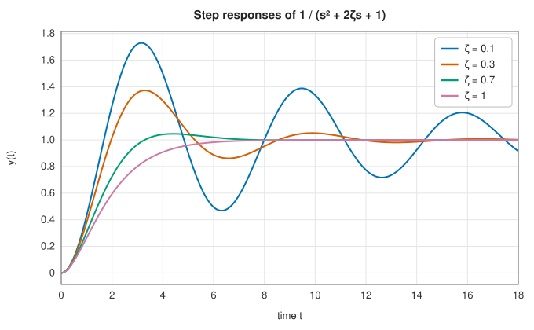
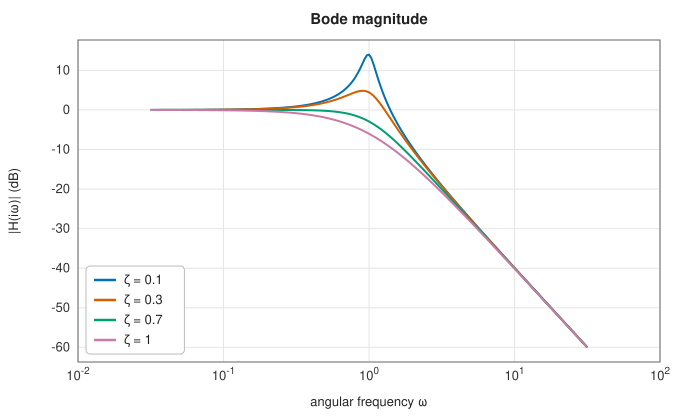
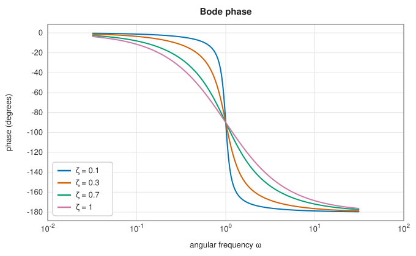
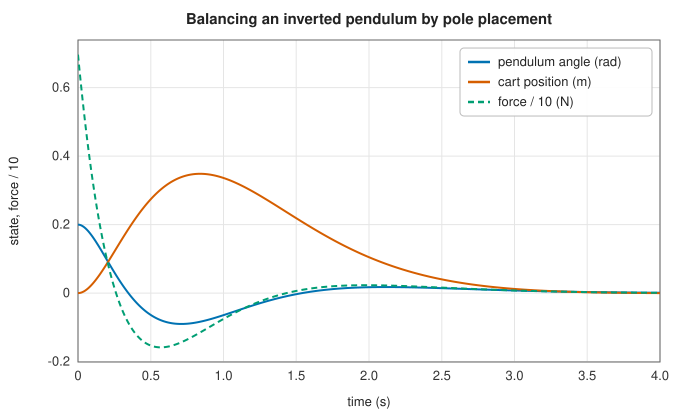

# Continuous-time systems

<div class="entry-summary">

| | |
|---|---|
| **Problem** | Model a linear system $\dot{\mathbf x} = A\mathbf x + B\mathbf u$, $\mathbf y = C\mathbf x + D\mathbf u$ in continuous time: convert between transfer functions and state space, simulate its response to sampled inputs, compute its frequency response, discretise it for a digital controller, and place its poles by state feedback |
| **Devised by** | Oliver Heaviside (1880s), operational calculus; Hendrik Bode (1940), frequency-response plots; Rudolf Kálmán (1960), state space; Arnold Tustin (1947), the bilinear transform; Jan Kautsky, Nancy Nichols and Paul Van Dooren (1985), robust pole placement |
| **Accuracy** | Simulation is exact for inputs held constant or linear between samples; agrees with `scipy.signal` to $10^{-13}$ or better |
| **Cost** | Simulation: one matrix exponential of size $n + 2m$, then $O(n^2 + nm)$ per step. Frequency response: one $n \times n$ solve per frequency. Pole placement: $O(n^3)$ per sweep |
| **Read first** | [Control: state-space models, PID controllers and the Kalman filter](controls.md), [Matrix functions and matrix equations](../linear_algebra/matrix-equations.md) |
| **API** | [`ContinuousStateSpace`](../../api/lib_jsl_dsp/continuous/lti/struct.ContinuousStateSpace.html) (`lsim`, `step`, `impulse`, `freqresp`, `bode`, `discretize`, `poles`), [`tf2ss`](../../api/lib_jsl_dsp/continuous/lti/fn.tf2ss.html), [`ss2tf`](../../api/lib_jsl_dsp/continuous/lti/fn.ss2tf.html), [`place_poles`](../../api/lib_jsl_dsp/continuous/lti/fn.place_poles.html), [`Discretization`](../../api/lib_jsl_dsp/continuous/lti/enum.Discretization.html), [`InputHold`](../../api/lib_jsl_dsp/continuous/lti/enum.InputHold.html) |

</div>

## Overview

Physical systems evolve in continuous time: a motor, a circuit or a vehicle obeys differential equations. The [previous
entry](controls.md) worked with discrete-time models, which a computer runs one sample at a time. This one connects them to
the continuous world. A linear time-invariant system has two standard descriptions:

- a **transfer function** $H(s) = \dfrac{b_0s^m + \cdots + b_m}{a_0s^n + \cdots + a_n}$, the Laplace transform of its impulse response, which describes
  one input and one output;
- a **state-space model** $\dot{\mathbf x} = A\mathbf x + B\mathbf u$, $\mathbf y = C\mathbf x + D\mathbf u$, which describes any number of inputs and outputs, and from which
  $H(s) = C(sI - A)^{-1}B + D$.

The library provides SciPy's operations on them: conversions (`tf2ss`, `ss2tf`), simulation (`lsim`, `step`, `impulse`), the
frequency response (`freqresp`, `bode`), discretisation (`cont2discrete`) and pole placement (`place_poles`).

## History

Oliver Heaviside's operational calculus of the 1880s, later justified by the Laplace transform, turned linear differential
equations into algebra and gave engineers the transfer function. At Bell Labs, Harry Nyquist (1932) and Hendrik Bode (1940)
analysed feedback amplifiers through their frequency response, and Bode's plots of gain and phase against log frequency
remain the standard way to read a system. Arnold Tustin (1947) proposed the bilinear substitution that maps continuous
designs to sampled ones. Rudolf Kálmán's state-space theory (1960) showed that with full state feedback the poles of a
controllable system can be placed anywhere. Jan Kautsky, Nancy Nichols and Paul Van Dooren (1985) showed how to use the
remaining freedom with several inputs to make the placement robust. André Tits and Yaguang Yang (1996) improved their
method, and theirs is SciPy's default.

## The idea

### Transfer functions and state space

A transfer function of order $n$ has many state-space forms. The **controllable canonical form** (SciPy's `tf2ss`) writes the
denominator into the first row of $A$:

$$
A = \begin{bmatrix} -a_1 & -a_2 & \cdots & -a_n \\ 1 & 0 & \cdots & 0 \\ & \ddots & & \vdots \\ 0 & \cdots & 1 & 0 \end{bmatrix}, \quad B = \begin{bmatrix} 1 \\ 0 \\ \vdots \\ 0 \end{bmatrix}, \quad D = b_0, \quad C_j = b_j - b_0a_j ,
$$

with $a_0 = 1$ and the numerator padded to $n + 1$ coefficients. In the other direction (`ss2tf`), the denominator is $\det(sI - A)$, the
characteristic polynomial. A numerator follows from the determinant identity $\det(sI - A + BC_k) = \det(sI - A)\,(1 + C_k(sI - A)^{-1}B)$:
it is $\det(sI - A + BC_k) + (D_k - 1)\det(sI - A)$. Both polynomials are formed from eigenvalues.

### Exact simulation

Between samples, the solution of $\dot{\mathbf x} = A\mathbf x + B\mathbf u$ is

$$
\mathbf x(t + T) = e^{AT}\mathbf x(t) + \int_0^T e^{A(T-\tau)}B\,\mathbf u(t + \tau)\,d\tau .
$$

If the input is held constant over the step (a **zero-order hold**) or varies linearly between samples, the integral has a closed
form, and one [matrix exponential](../linear_algebra/matrix-equations.md#the-matrix-exponential) of an augmented matrix gives all its pieces at once. For a linear input:

$$
\exp\left(\begin{bmatrix} AT & BT & 0 \\ 0 & 0 & I \\ 0 & 0 & 0 \end{bmatrix}\right) = \begin{bmatrix} \Phi & \Gamma_1 & \Gamma_2 \\ 0 & I & I \\ 0 & 0 & I \end{bmatrix}, \qquad \mathbf x_{k+1} = \Phi\mathbf x_k + (\Gamma_1 - \Gamma_2)\mathbf u_k + \Gamma_2\mathbf u_{k+1} .
$$

The simulation is then a recurrence, exact up to rounding for inputs of that shape and with no step-size error to control. The
step response holds a constant input. The impulse response $C e^{At}B$ starts from $\mathbf x(0) = B$ with no input.



<p class="caption" id="fig-16-17"><strong>Figure 16.17.</strong> Step responses.</p>

### Frequency response

A sinusoidal input $e^{i\omega t}$ produces, once transients have decayed, the output $H(i\omega)e^{i\omega t}$, with $H(i\omega) = C(i\omega I - A)^{-1}B + D$. The **Bode
diagram** plots $20\log_{10}|H(i\omega)|$ in decibels and the phase $\arg H(i\omega)$ against $\log\omega$. On these axes each pole and zero contributes a
straight-line asymptote, and the resonance of a lightly damped pair stands out as a peak of height about $-20\log_{10}(2\zeta)$ dB:



<p class="caption" id="fig-16-18"><strong>Figure 16.18.</strong> Bode magnitude.</p>



<p class="caption" id="fig-16-19"><strong>Figure 16.19.</strong> Bode phase.</p>

The phase is unwrapped, so that it falls continuously from 0 to $-180°$ instead of jumping by $360°$.

### Discretisation

A digital controller sees the system only at the samples $t_k = kT$, through a converter that holds its output between them. The
discrete model depends on that hold:

- **Zero-order hold** (`zoh`): $A_d = e^{AT}$ and $B_d = \int_0^T e^{A\tau}d\tau\,B$, exact when the input is piecewise constant, as from a digital-to-analogue converter.
- **First-order hold** (`foh`): exact for piecewise-linear inputs. The state is redefined to absorb the ramp, which changes $B_d$ and $D_d$.
- **Impulse invariance**: the discrete impulse response equals the continuous one sampled, times $T$.
- The **generalised bilinear transform** approximates $\dot{\mathbf x}$ by a difference that mixes the two ends of the step:
  $\mathbf x_{k+1} - \mathbf x_k = T\big(A((1 - \alpha)\mathbf x_k + \alpha\mathbf x_{k+1}) + B\mathbf u_k\big)$. Here $\alpha = 0$ is forward Euler, $\alpha = 1$ backward Euler, and $\alpha = \tfrac12$ Tustin's method,
  which maps $s = \frac{2}{T}\frac{z - 1}{z + 1}$. It keeps stable systems stable and preserves the frequency response up to a warping of the frequency axis.

They differ in how well the discrete frequency response $H_d(e^{i\omega T})$ matches $H(i\omega)$ below the Nyquist frequency $\pi/T$, here for
$1/(s^2 + 0.6s + 1)$:

<p class="caption" id="tab-16-5"><strong>Table 16.5.</strong> Frequency-response error of each discretisation.</p>

{{#include ../generated/comms/lti_discretisation.md}}

The zero-order hold is exact at the samples for held inputs, but it adds an average delay of half a sample, which shows as a phase error
that grows with frequency. The first-order hold and Tustin's method are second order in $T$, and the Euler methods only first order. Forward Euler
can also turn a stable system unstable when $T$ is large.

### Pole placement

With every state measured, the feedback $\mathbf u = -K\mathbf x$ makes the closed loop $\dot{\mathbf x} = (A - BK)\mathbf x$. If $(A, B)$ is controllable, any set of poles closed
under conjugation can be placed. Each closed-loop eigenvector $\mathbf x_j$ must satisfy $(A - \lambda_jI)\mathbf x_j = BK\mathbf x_j$, so it lies in the subspace
$S_j$ where $(A - \lambda_jI)\mathbf x$ is in the range of $B$. Writing $B = [U_0\ U_1]\left[\begin{smallmatrix} Z \\ 0 \end{smallmatrix}\right]$, these are the vectors with $U_1^{\mathsf H}(A - \lambda_jI)\mathbf x = 0$. Given
eigenvectors $X$ and poles $\Lambda$,

$$
K = Z^{-1}U_0^{\mathsf H}(AX - X\Lambda)X^{-1} .
$$

With one input each $S_j$ is a line, so $X$ and $K$ are unique. With $m$ inputs each $S_j$ has dimension $m$, and the choice of $X$ decides how
sensitive the placed poles are to errors in the model, through the condition number of $X$. The method of Kautsky, Nichols and Van
Dooren sweeps over the columns, replacing each by the unit vector in $S_j$ most nearly orthogonal to the others.

An inverted pendulum on a cart is unstable (a pole at $+4.6$). Placing the poles at $-2 \pm i$, $-3$ and $-4$ balances it from an initial tilt of 0.2 rad:



<p class="caption" id="fig-16-20"><strong>Figure 16.20.</strong> Inverted pendulum.</p>

{{#include ../generated/comms/lti_pendulum_gain.md}} The cart first moves under the pendulum to catch it, then returns to the origin.

## Algorithm

**`lsim(u, t, x0, hold)`**: check that the times are equally spaced with step $T$. If $t_0 > 0$, advance the initial state by $e^{At_0}$. Form
the augmented matrix ($n + m$ square for a zero-order hold, $n + 2m$ for a linear input), exponentiate it once, read off $\Phi$, $\Gamma_1$ and $\Gamma_2$,
and run the recurrence; then $\mathbf y_k = C\mathbf x_k + D\mathbf u_k$.

**`bode(w)`**: for each frequency, solve $(i\omega I - A)X = B$ by LU, form $H = CX + D$, and return $20\log_{10}|H|$ and the unwrapped phase in degrees.

**`discretize(T, method)`**: zero- and first-order hold and impulse invariance through one matrix exponential each; the bilinear
family through one inverse of $I - \alpha TA$.

**`place_poles(A, B, poles)`**:

1. Factor $B$ through its SVD, which gives $U_0$, $U_1$ and $Z$.
2. For each pole, compute an orthonormal basis of $S_j$ as the null space of $U_1^{\mathsf H}(A - \lambda_jI)$.
3. Start each $\mathbf x_j$ at the first basis vector.
4. With several inputs, sweep: replace $\mathbf x_j$ by the normalised projection onto $S_j$ of the direction orthogonal to the other columns, and keep conjugate
   poles' vectors conjugate. Stop when no column changes.
5. Return $K$ from the formula above.

## Implementation

```rust,ignore
{{#include ../../../crates/dsp/src/continuous/lti.rs:lsim}}
```

```rust,ignore
{{#include ../../../crates/dsp/src/continuous/lti.rs:discretize}}
```

- `ContinuousStateSpace` uses real matrices. `discretize` returns `DiscreteMatrices`, whose output convention $y_k = Cx_k + Du_k$ is that
  of [`StateSpace::new_standard`](controls.md#state-space-models).
- `impulse` follows SciPy in leaving out the $D\delta(t)$ term of the impulse response.
- `place_poles` uses Kautsky, Nichols and Van Dooren's first method (KNV0) rather than SciPy's default Tits-Yang method. With one
  input the two give the same gain; with several they give different gains that place the same poles.

## In practice

Every function is compared with `scipy.signal` from SciPy 1.17.1 (references from `book/generator/data/make_lti_refs.py`) on a
third-order transfer function and a system with 3 states, 2 inputs and 2 outputs:

<p class="caption" id="tab-16-6"><strong>Table 16.6.</strong> Continuous-time routines against SciPy.</p>

{{#include ../generated/comms/lti_scipy.md}}

{{#include ../generated/comms/lti_place_facts.md}}

**Strengths**

- Simulation is exact for held or linearly interpolated inputs, with no step-size error to control. Stiff systems cost the same as
  any other.
- One state-space type serves any number of inputs and outputs, with discretisation by all of SciPy's methods.
- Pole placement handles complex poles and several inputs, and reports the achieved poles and the eigenvector matrix.

**Weaknesses**

- Time steps must be equal; for irregular sampling, call `lsim` piecewise.
- `tf2ss` and `ss2tf` go through polynomial coefficients and eigenvalues, which lose accuracy for high orders. Prefer state space throughout.
- No zero-pole-gain type, no time delays, and no automatic choice of time grid for `step` and `impulse`.

## Exercises

1. Derive $H(s) = C(sI - A)^{-1}B + D$ from the Laplace transform of the state equations, and check that the controllable canonical form of
   $1/(s^2 + 3s + 2)$ has this transfer function.
2. Show that the zero-order hold gives $A_d = e^{AT}$ and $B_d = A^{-1}(e^{AT} - I)B$ when $A$ is invertible, and verify it from the block exponential.
3. Show that the bilinear transform maps the left half of the $s$-plane onto the inside of the unit circle, and find where it maps the frequency
   $\omega$ (frequency warping).
4. For the double integrator $\ddot y = u$, place both poles at $-1$ by hand and compare with `place_poles`.
5. Find the height of the resonant peak of $1/(s^2 + 2\zeta s + 1)$ for small $\zeta$, and check it against the Bode figure for $\zeta = 0.1$.

<details>
<summary>Hints and answers</summary>

1. Transforming gives $sX = AX + BU$ (zero initial state), so $X = (sI - A)^{-1}BU$ and $Y = (C(sI - A)^{-1}B + D)U$. For the example, $A = \left[\begin{smallmatrix} -3 & -2 \\ 1 & 0 \end{smallmatrix}\right]$,
   $B = e_1$, $C = (0, 1)$, and $C(sI - A)^{-1}B = 1/(s^2 + 3s + 2)$.
2. $\int_0^Te^{A\tau}d\tau = A^{-1}(e^{AT} - I)$. Expanding the exponential of $\left[\begin{smallmatrix} AT & BT \\ 0 & 0 \end{smallmatrix}\right]$ as a series gives the same top-right block,
   $\sum_k A^kT^{k+1}B/(k+1)!$.
3. With $z = (1 + sT/2)/(1 - sT/2)$, $|z| < 1$ exactly when $\operatorname{Re}s < 0$. The imaginary axis maps onto the unit circle, with $s = i\omega$ going to the angle $\omega_d T = 2\arctan(\omega T/2)$.
4. $A = \left[\begin{smallmatrix} 0 & 1 \\ 0 & 0 \end{smallmatrix}\right]$, $B = \left[\begin{smallmatrix} 0 \\ 1 \end{smallmatrix}\right]$, so $A - BK$ has characteristic polynomial $s^2 + k_2s + k_1$. Matching $(s + 1)^2$ gives $K = (1, 2)$.
5. $|H(i\omega)|^2 = 1/((1 - \omega^2)^2 + 4\zeta^2\omega^2)$ peaks near $\omega = 1$ at $1/(2\zeta\sqrt{1 - \zeta^2}) \approx 1/(2\zeta)$, or 14 dB for $\zeta = 0.1$, as in the figure.

</details>

## Further reading

- K. J. Åström and R. M. Murray, *Feedback Systems: An Introduction for Scientists and Engineers*, 2nd ed., Princeton University Press, 2021.
- G. F. Franklin, J. D. Powell and M. Workman, *Digital Control of Dynamic Systems*, 3rd ed., Addison-Wesley, 1998.
- J. Kautsky, N. K. Nichols and P. Van Dooren, "Robust pole assignment in linear state feedback", *International Journal of Control* 41 (1985) 1129–1155.
- A. L. Tits and Y. Yang, "Globally convergent algorithms for robust pole assignment by state feedback", *IEEE Transactions on Automatic Control* 41 (1996) 1432–1452.
- C. Moler and C. Van Loan, "Nineteen dubious ways to compute the exponential of a matrix, twenty-five years later", *SIAM Review* 45 (2003) 3–49.
