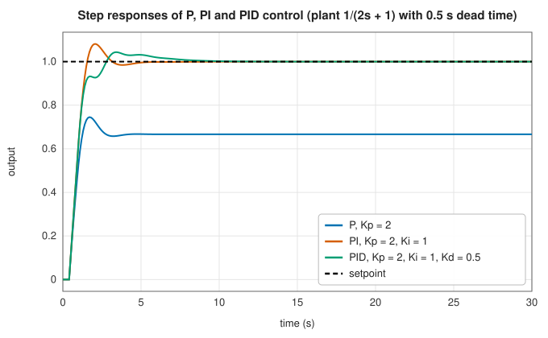
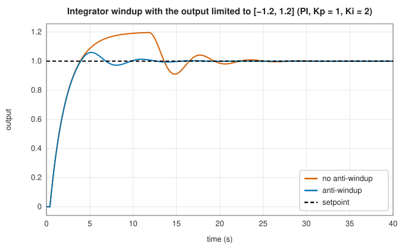
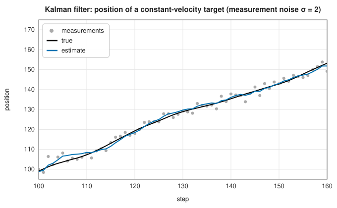

# Control: state-space models, PID controllers and the Kalman filter

<div class="entry-summary">

| | |
|---|---|
| **Problem** | Describe a linear dynamic system and test its stability, controllability and observability; drive a plant's output to a setpoint by feedback; estimate a hidden state from noisy measurements |
| **Devised by** | Rudolf Kálmán (1960), state-space controllability and observability and the Kalman filter; Nicolas Minorsky (1922), PID control; John Ziegler and Nathaniel Nichols (1942), PID tuning |
| **Accuracy** | The Kalman filter is the minimum-variance linear estimator when its model is right; on a tracking test it halves the measurement error (below) |
| **Cost** | $O(n^2)$ per step for a state-space model with $n$ states; $O(1)$ for PID; $O(n^3 + m^3)$ per step for a Kalman filter with $m$ measurements |
| **API** | [`StateSpace`](../../api/lib_jsl_dsp/discrete/controls/state_space/struct.StateSpace.html) (`step`, `get_poles`, `is_stable`, `is_controllable`, `is_observable`), [`PidController`](../../api/lib_jsl_dsp/discrete/controls/pid/struct.PidController.html), [`KalmanFilter`](../../api/lib_jsl_dsp/discrete/controls/kalman/struct.KalmanFilter.html) |

</div>

## Overview

A **state-space model** describes a linear system by a state vector $x$ that evolves under the input $u$ and determines the output $y$. Its eigenvalues decide whether it is stable;
the ranks of two matrices built from it decide whether the input can steer every state (**controllability**) and whether the output reveals every state (**observability**). A **PID controller**
computes an input from the error between a setpoint and the measured output: in proportion to it, to its integral, and to its rate of change. It is the most common feedback controller in industry. The
**Kalman filter** runs a state-space model alongside the real system, correcting its state with each noisy measurement by just enough to minimise the estimation error. It is the standard way to track,
navigate and fuse sensors. All three are stream operators in the library.

## History

Nicolas Minorsky (1922) analysed automatic ship steering and arrived at three-term (PID) control; pneumatic PID controllers spread through process industries in the 1930s, and
John Ziegler and Nathaniel Nichols (1942) gave the first tuning rules. Rudolf Kálmán (1960) recast control theory in state-space form, introducing controllability and observability, and in the
same year published the discrete-time filter that bears his name. Stanley Schmidt at NASA Ames adapted it for the Apollo navigation computer; it has since become ubiquitous, from GPS receivers to
radar trackers.

## The idea

### State-space models

A dynamic system has memory: its output depends on past inputs as well as the present one. The
**state** $x$ is a vector that summarises everything about the past that matters for the future
(for a moving object, its position and velocity, say). A linear **state-space model** says how
the state evolves under an input $u$ and what output $y$ is observed. The library's model is

$$
x[k+1] = Ax[k] + Bu[k], \qquad y[k] = Cx[k+1] + Du[k],
$$

where $A$ describes how the state evolves by itself, $B$ how the input acts on it, and $C$ and $D$
how the state and the input appear in the output. Each [`step`](../../api/lib_jsl_dsp/discrete/controls/state_space/struct.StateSpace.html#method.step) updates the state first, then reads the output from the new state. Three questions are asked of such a model.

- **Is it stable?** Without input, $x[k] = A^kx[0]$. Along an eigenvector of $A$ the state is
  multiplied by the eigenvalue at each step, so it decays to zero for every $x[0]$ exactly when
  every eigenvalue of $A$ (the **poles** of the system) lies strictly inside the unit circle:
  `is_stable`.
- **Is it controllable?** Can the input drive the state anywhere? An input applied now affects
  the state through $B$; one step later that effect has become $AB$, then $A^2B$, and so on. The
  reachable states are the combinations of these, so the system is controllable when the
  **controllability matrix** $[B \; AB \; \cdots \; A^{n-1}B]$ has rank $n$, the dimension of the
  state.
- **Is it observable?** Can the state be deduced from the outputs? The output shows the state
  through $C$ now, $CA$ a step later, and so on, so the system is observable when the stacked
  **observability matrix** of $C, CA, \ldots, CA^{n-1}$ has rank $n$. The library computes ranks from the
[singular values](../linear_algebra/svd.md).

### PID control

A **controller** adjusts the input $u$ of a system (the "plant") so that its output $y$ follows
a desired value, the **setpoint** $r$. The PID controller is by far the most widely used. It
needs no model of the plant, only the error, and combines three responses to it. With error $e(t) = r - y(t)$,

$$
u(t) = K_pe(t) + K_i\int_0^te\,d\tau - K_d\frac{d y_f}{dt}.
$$

The proportional term acts on the present error. Alone, it leaves a steady-state error: on a plant of unit DC gain, $K_p = 2$ settles at $2/3$ of the setpoint. The integral term
accumulates until the error is zero. The derivative term damps the response by anticipating it. The library differentiates the measurement, not the error, so a setpoint step does not
produce a spike (**derivative kick**), and it low-pass filters the measurement first (a Butterworth biquad at 0.1 cycles per sample) to limit the noise the derivative amplifies:



### Integrator windup

A real actuator saturates. While it does, the error persists and the integral keeps growing, so when the output finally reaches the setpoint the integral is far too large and drives
an overshoot. **Anti-windup** by conditional integration stops the integral while the output is saturated and the error pushes further into the limit:



### The Kalman filter

The Kalman filter estimates the state of a system from noisy measurements. It has two sources
of information, a model that predicts how the state evolves and measurements that observe it
imperfectly, and it combines them, trusting each in proportion to its reliability.

The filter assumes the model $x_k = Fx_{k-1} + Bu_k + w_k$, $z_k = Hx_k + v_k$. The **process noise**
$w$, with covariance $Q$, represents what the model does not capture; the **measurement noise**
$v$, with covariance $R$, the inaccuracy of the sensor. Both are assumed white and Gaussian. The
filter keeps a state estimate $\hat x$ and also the covariance $P$ of its error, a running
account of how uncertain the estimate is. Each step first **predicts**: the estimate is advanced
by the model, and its uncertainty grows, both because the old uncertainty is carried forward
and because process noise is added,

$$
\hat x^- = F\hat x + Bu, \qquad P^- = FPF^* + Q,
$$

and then **updates** with the measurement,

$$
S = HP^-H^* + R, \qquad K = P^-H^*S^{-1}, \qquad \hat x = \hat x^- + K(z - H\hat x^-), \qquad P = (I - KH)P^-.
$$

The **innovation** $z - H\hat x^-$ is the difference between the measurement and what the
prediction said it would be; $S$ is its covariance. The estimate is corrected by a fraction $K$
of the innovation, the **Kalman gain**. For a single measured quantity the gain is
$P^-/(P^- + R)$: close to 1 when the prediction is much less certain than the measurement, so
the measurement is believed, and close to 0 in the opposite case, so it is nearly ignored. The
last formula records that the measurement has reduced the uncertainty. For a linear Gaussian model, $\hat x$ is the exact conditional mean of the state given all the measurements, and for any noise it is the best linear estimate.
Estimating a constant ($F = H = 1$, $Q = 0$) gives the running average, as the example below shows. Tracking a constant-velocity target from position measurements alone recovers the velocity too:



{{#include ../generated/comms/kalman_facts.md}} The **normalised estimation error squared** $e^*P^{-1}e$ checks the filter's honesty: if the model is right, it averages the state dimension. Here the
simulation's discretised acceleration noise differs slightly from the filter's $Q$, hence the small excess.

### Checking against SciPy

Because `step` reads the output after updating the state, the library's $(A, B, C, D)$ is the system that SciPy and most textbooks write as $y[k] = C'x[k] + D'u[k]$ with $C' = CA$ and $D' = CB + D$. Simulating that system with `scipy.signal.dlsim` (SciPy 1.17.1, references from `book/generator/data/make_controls_refs.py`) reproduces the library's output:

{{#include ../generated/comms/scipy_controls.md}}

A model written in the usual convention therefore cannot always be entered directly: recovering $C$ from $C' = CA$ needs $A$ to be invertible. This is a limitation of the current interface.

## Algorithm

1. **State space**: $x \leftarrow Ax + Bu$; $y = Cx + Du$. Poles from the eigenvalues of $A$; ranks of the controllability and observability matrices by SVD.
2. **PID**: error; proportional term; integrate the error times $\Delta t$; filter the measurement and difference it; sum; clip to the limits; under anti-windup, undo the integration if clipped and pushing outwards.
3. **Kalman**: predict $\hat x$ and $P$; form the innovation and $S$; solve for $K$; update $\hat x$ and $P$.

## Implementation

```rust,ignore
{{#include ../../../crates/dsp/src/discrete/controls/pid.rs:pid}}
```

```rust,ignore
{{#include ../../../crates/dsp/src/discrete/controls/kalman.rs:kalman}}
```

- The matrices are complex (`C2D`), so the same code handles real and complex systems; the covariance uses conjugate transposes.
- The gain is found by solving with $S$, not inverting it.
- The covariance update uses the short form $(I - KH)P^-$. The longer **Joseph form** $(I - KH)P^-(I - KH)^* + KRK^*$ keeps $P$ symmetric and positive definite under rounding, and is worth using in long or ill-conditioned runs.
- The control input $u$ is set with `set_control_input` and held until changed; the observation model can also change between measurements.
- PID gains, setpoint, limits and anti-windup can all be changed at run time; `None` disables a term.

## In practice

```rust,ignore
{{#include ../../../crates/dsp/examples/dsp_controls.rs}}
```

```text
poles [0.9750+0.1392i, 0.9750-0.1392i], stable true, controllable true, observable true
PI loop output after 20 s: 0.9999 (setpoint 1)
Kalman estimate 5.0359, sample mean 5.0375, variance 0.0312 (0.25 / 8 = 0.03125)
```

With a broad prior ($P_0 = 100$), the Kalman estimate of a constant is nearly the sample mean, and its variance is $R/n$.

**Strengths**

- One state-space type for simulation and structural analysis; a PID with derivative filtering, output limits and anti-windup.
- A general complex Kalman filter with control inputs and time-varying observation models.

**Weaknesses**

- Linear models only: no extended or unscented Kalman filter, no continuous-time models or discretisation.
- No automatic PID tuning; the derivative filter's cutoff is fixed relative to the sample rate.

## Exercises

1. Show that $x[k] = A^kx[0]$ decays for every $x[0]$ if and only if all eigenvalues of $A$ lie inside the unit circle.
2. Show that a system is controllable if and only if any state can be reached from zero in $n$ steps.
3. For the plant $1/(\tau s + 1)$ under proportional control, find the closed-loop steady-state error and time constant.
4. Derive the scalar Kalman filter for a constant observed in noise, and show that with $P_0 \to \infty$ it is the running mean with $P_n = R/n$.
5. Find the steady-state Kalman gain for the constant-velocity model and compare it with the α-β filter of the [pulse tracker](radar.md#finding-and-tracking-a-pulse).

## Further reading

- K. J. Åström and R. M. Murray, *Feedback Systems: An Introduction for Scientists and Engineers*, 2nd ed., Princeton University Press, 2021.
- R. E. Kalman, "A new approach to linear filtering and prediction problems", *Journal of Basic Engineering* 82 (1960) 35–45.
- K. J. Åström and T. Hägglund, *Advanced PID Control*, ISA, 2006.
- Y. Bar-Shalom, X. R. Li and T. Kirubarajan, *Estimation with Applications to Tracking and Navigation*, Wiley, 2001.
