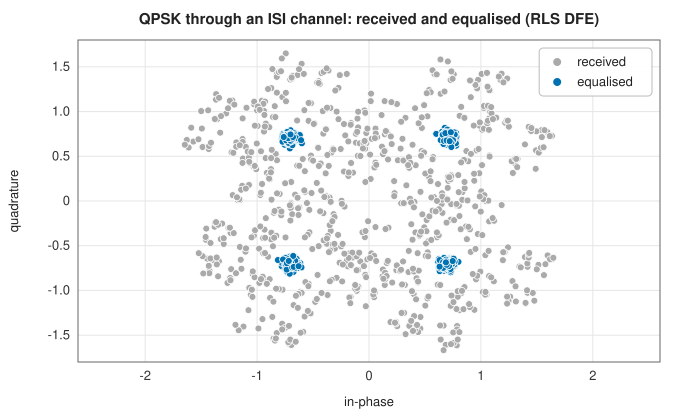
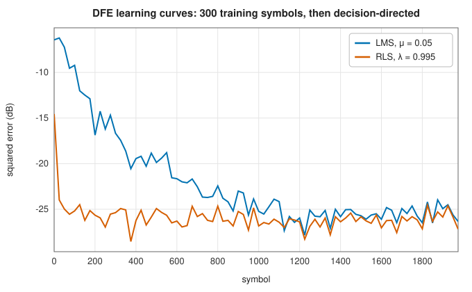

# Channels and equalisation

<div class="entry-summary">

| | |
|---|---|
| **Problem** | Model what a channel does to a signal (multipath, Doppler, non-linear amplification, noise, rate and frequency changes) and undo the intersymbol interference it causes |
| **Devised by** | Robert Lucky (1965), adaptive equalisation; Monroe Austin (1967), the decision-feedback equalizer; Bernard Widrow (1960), LMS adaptation; Dominique Godard (1974), RLS equalisation |
| **Accuracy** | A trained equalizer removes the interference down to the noise floor (table below); RLS converges in a few dozen symbols, LMS in hundreds |
| **Cost** | $O(N_f + N_b)$ per symbol for an LMS equalizer with $N_f$ forward and $N_b$ feedback taps; $O((N_f + N_b)^2)$ for RLS |
| **API** | [`ChannelImpairment`](../../api/lib_jsl_dsp/discrete/transformations/channel_impairment/struct.ChannelImpairment.html), [`ChannelTransmitter`](../../api/lib_jsl_dsp/discrete/transformations/channel_transmitter/struct.ChannelTransmitter.html), [`ChannelReceiver`](../../api/lib_jsl_dsp/discrete/transformations/channel_receiver/struct.ChannelReceiver.html), [`NonLinearityTransformer`](../../api/lib_jsl_dsp/discrete/transformations/non_linearity_transformers/struct.NonLinearityTransformer.html) (`hard_clip_real`, `hard_clip_complex`, `quantize_real`, `quantize_complex`, `sigmoid`), [`DecisionFeedbackEqualizer`](../../api/lib_jsl_dsp/discrete/digital_communications/decision_feedback_equalizer/struct.DecisionFeedbackEqualizer.html), [`decision_feedback_equalizer`](../../api/lib_jsl_dsp/discrete/digital_communications/decision_feedback_equalizer/fn.decision_feedback_equalizer.html) |

</div>

## Overview

Between transmitter and receiver, a signal is filtered by multipath propagation or band-limited wiring, shifted in frequency by motion (Doppler), distorted
by amplifiers, and corrupted by noise. To test receivers, the library models these as stream operators. A transmitter front-end resamples and
up-converts; a channel impairment applies an FIR channel, a Doppler shift, a memoryless non-linearity and white Gaussian noise; a receiver front-end
down-converts and resamples. The channel's filtering smears each symbol into its neighbours, **intersymbol interference** (ISI), which an **equalizer** must undo. The **decision-feedback equalizer**
(DFE) combines a linear filter on the received samples with a filter on its own past decisions. It cancels the interference those
decisions cause without amplifying noise as a purely linear equalizer would.

## History

Telephone-line data modems in the 1960s were limited by ISI. Robert Lucky (1965) at Bell Labs built the first automatic, adaptive equalizers,
and Monroe Austin (1967) proposed feeding back decisions to cancel the trailing interference. Bernard Widrow's LMS algorithm (1960) made adaptation cheap, and Dominique Godard (1974)
applied recursive least squares for fast start-up. Adaptive DFEs remain standard in wireline and high-speed serial links.

## The idea

### A channel in software

[`ChannelImpairment`](../../api/lib_jsl_dsp/discrete/transformations/channel_impairment/struct.ChannelImpairment.html) applies, in order: a real FIR channel (by overlap-add), a Doppler shift (a [frequency mixer](sources.md#frequency-mixing)), an optional non-linearity, and complex white Gaussian noise with a given
power spectral density, so that the noise power is $N_0f_s$. [`ChannelTransmitter`](../../api/lib_jsl_dsp/discrete/transformations/channel_transmitter/struct.ChannelTransmitter.html) and [`ChannelReceiver`](../../api/lib_jsl_dsp/discrete/transformations/channel_receiver/struct.ChannelReceiver.html) combine an [arbitrary-ratio resampler](../spectral/resampling.md#arbitrary-ratios) with a mixer, in the
order a radio front-end uses. The impairment's noise generator is seeded at random, so its noise differs between runs.

### Non-linearities

Power amplifiers saturate, and converters quantise. **Hard clipping** limits the amplitude (for complex signals, the magnitude, preserving phase); **quantisation** rounds to $L$ evenly spaced
levels on $[-1, 1]$ (each component separately for complex signals); the **sigmoid** is a smooth saturation. `NonLinearityTransformer` wraps any function as a stream operator.

### Intersymbol interference

A channel with impulse response $h$ turns symbol $s_n$ into $r_n = \sum_kh_ks_{n-k} + v_n$. With $h = (1, 0.45 + 0.3i, -0.25 + 0.1i, 0.1 - 0.05i)$, the QPSK points blur into clouds that overlap the decision boundaries:



### The decision-feedback equalizer

The DFE's output is

$$
y_n = \sum_{k=0}^{N_f-1}f_k\,r_{n-k} + \sum_{k=1}^{N_b}b_k\,\hat s_{n-k},
$$

with $\hat s$ the past decisions (or, during training, the known symbols). The forward filter removes the interference from symbols not yet decided; the feedback filter subtracts the interference
of decided ones exactly, without the noise enhancement a linear filter would add to invert a channel with deep spectral nulls. The taps adapt to reduce $|d_n - y_n|^2$
by [NLMS or RLS](../filters/adaptive.md), trained on known symbols first and then **decision-directed**:



{{#include ../generated/comms/dfe_table.md}}

RLS converges within the 300 training symbols; LMS needs about a thousand, continuing decision-directed. Without equalisation one symbol in eight is wrong.
The danger of decision feedback is **error propagation**: a wrong decision feeds wrong interference back. At sensible signal-to-noise ratios it is rare.

## Algorithm

1. **Channel**: FIR, Doppler mixer, non-linearity, noise, each as a stream stage.
2. **DFE**: shift the new sample into the forward regressor; compute $y$; decide $\hat s = $ nearest constellation point; error $e = d - y$ with $d$ the training symbol or $\hat s$; update the weights (NLMS or RLS); shift $d$ into the feedback regressor.

## Implementation

```rust,ignore
{{#include ../../../crates/dsp/src/discrete/digital_communications/decision_feedback_equalizer.rs:dfe}}
```

- `with_main_tap` places the forward filter's reference tap later, to handle pre-cursor interference, at the cost of that much delay.
- `decision_feedback_equalizer(received, training, …)` trains on the first symbols and equalizes the rest in one call.
- `quantize_real` assumes inputs on $[-1, 1]$ and does not clip values outside it.

## In practice

```rust,ignore
{{#include ../../../crates/dsp/examples/dsp_equalisation.rs}}
```

```text
hard clip of 1.7 at 1.0: 1; 8-level quantisation of 0.33: 0.4286
symbol errors: 1713 of 3000 without equalisation, 0 of 2500 after the DFE
```

The channel $(1, 0.9, 0.6)$ makes most raw decisions wrong; after 200 training symbols the DFE makes none.

**Strengths**

- Composable channel models for testing receivers; equalizers that adapt to unknown channels and track slow changes.
- Decision feedback removes post-cursor interference without noise enhancement.

**Weaknesses**

- Error propagation in the DFE; the forward filter must still handle pre-cursor interference.
- The channel noise is not reproducible between runs (its generator is randomly seeded).

## Exercises

1. Show that a zero-forcing linear equalizer for $h = (1, a)$ has impulse response $(-a)^n$, and that its noise gain grows without bound as $|a| \to 1$.
2. Show that a DFE with correct past decisions removes all post-cursor interference with a single forward tap when $h_0 \ne 0$.
3. Simulate error propagation: inject one wrong decision and count the errors that follow.
4. Add a Doppler shift to the channel and observe the equalizer's tracking; how fast must the shift be before it fails?

## Further reading

- J. G. Proakis and M. Salehi, *Digital Communications*, 5th ed., McGraw-Hill, 2008, chapters 9–10.
- S. U. H. Qureshi, "Adaptive equalization", *Proceedings of the IEEE* 73 (1985) 1349–1387.
- R. W. Lucky, "Automatic equalization for digital communication", *Bell System Technical Journal* 44 (1965) 547–588.
