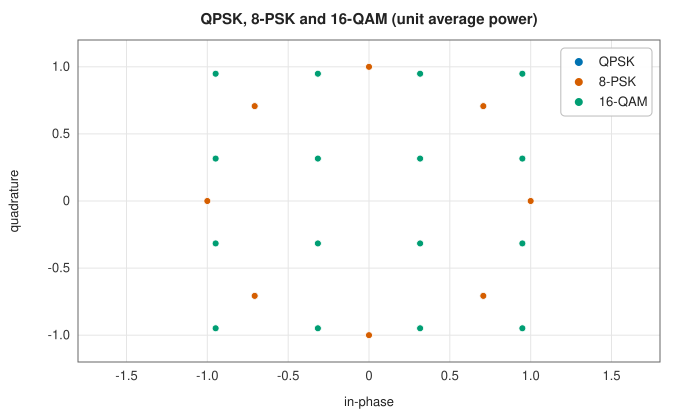
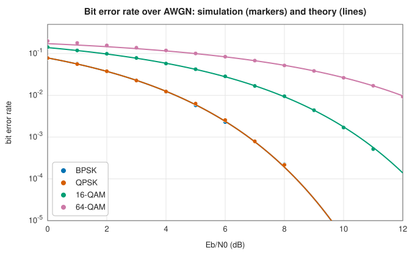
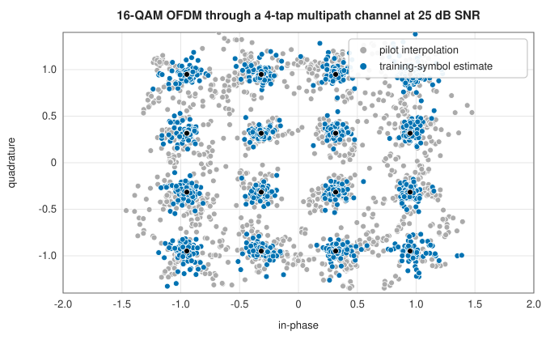
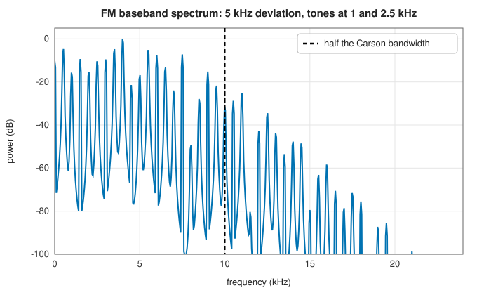

# Modulation: constellations, OFDM and FM

<div class="entry-summary">

| | |
|---|---|
| **Problem** | Map bits to complex baseband symbols and back, with hard or soft decisions; spread symbols over many orthogonal subcarriers; modulate an analogue message onto a carrier's frequency |
| **Devised by** | Frank Gray (1953), reflected binary labelling; Robert Chang (1966) and Saltzberg, then Stephen Weinstein and Paul Ebert (1971), OFDM by the DFT; Edwin Armstrong (1933), frequency modulation; John Carson (1922), FM bandwidth |
| **Accuracy** | Simulated bit error rates follow the theoretical curves; OFDM modulation and demodulation invert each other to $10^{-15}$; the FM discriminator recovers the message to $10^{-15}$ |
| **Cost** | Mapping $O(1)$ per symbol; soft demapping $O(M)$ per bit for $M$ points; OFDM one FFT per symbol |
| **Read first** | [Signal sources: oscillators, CORDIC and waveforms](sources.md), [The fast Fourier transform](../fft/fft.md) |
| **API** | [`Constellation`](../../api/lib_jsl_dsp/discrete/digital_communications/constellations/struct.Constellation.html) (`bpsk`, `qpsk`, `psk`, `qam`, `map_bits`, `slice`, `demap_hard`, `demap_soft`), [`OfdmParams`](../../api/lib_jsl_dsp/discrete/digital_communications/ofdm/struct.OfdmParams.html), [`Ofdm`](../../api/lib_jsl_dsp/discrete/digital_communications/ofdm/struct.Ofdm.html) (`modulate`, `demodulate`, `estimate_channel`, `demodulate_with_channel`), [`FmModulator`](../../api/lib_jsl_dsp/discrete/digital_communications/fm/struct.FmModulator.html), [`FmDemodulator`](../../api/lib_jsl_dsp/discrete/digital_communications/fm/struct.FmDemodulator.html), [`fm_modulate`](../../api/lib_jsl_dsp/discrete/digital_communications/fm/fn.fm_modulate.html), [`fm_demodulate`](../../api/lib_jsl_dsp/discrete/digital_communications/fm/fn.fm_demodulate.html), [`carson_bandwidth`](../../api/lib_jsl_dsp/discrete/digital_communications/fm/fn.carson_bandwidth.html) |

</div>

## Overview

A digital transmitter groups bits into symbols and maps each to a point of a **constellation** in the complex plane: two points for BPSK, four for QPSK, sixteen
for 16-QAM. The receiver decides which point was sent, either outright (**hard** decisions) or as a likelihood for each bit (**soft** decisions, which error-correcting
decoders use far better). More points carry more bits per symbol but sit closer together for the same power, so they need a higher
signal-to-noise ratio. **OFDM** sends many symbols at once on orthogonal subcarriers generated by an inverse FFT, turning a frequency-selective channel into many flat ones.
**FM** is the analogue counterpart: the message sets the carrier's instantaneous frequency.

## History

Phase and amplitude keying grew out of telegraphy and early data modems in the 1950s and 60s. Frank Gray patented the reflected binary code in
1953, and Gray labelling of constellations ensures that the likeliest error flips only one bit. Robert Chang (1966) at Bell Labs described orthogonal frequency-division
multiplexing, and Stephen Weinstein and Paul Ebert (1971) showed that a DFT could generate it; the cyclic prefix (Abraham Peled and Antonio Ruiz, 1980)
made it robust to multipath. OFDM now carries Wi-Fi, LTE, 5G and digital television. Edwin Armstrong demonstrated wideband FM in 1933, and John Carson's
bandwidth rule (1922, refined 1939) is still the engineering estimate.

## The idea

### Constellations and Gray labelling

A radio wave of a given frequency has two properties that can be varied to carry information:
its amplitude and its phase. Both are captured by one complex number, whose magnitude is the
amplitude and whose angle is the phase. Its real and imaginary parts are called the **in-phase**
($I$) and **quadrature** ($Q$) components. Digital modulation sends a sequence of such complex
numbers, called **symbols**, each chosen from a finite set, the **constellation**. With $M$
points in the set, each symbol carries $\log_2M$ bits.

- **Phase-shift keying** (PSK) places $M$ points evenly on the unit circle, so the information
  is in the phase alone. BPSK has two points ($\pm1$, one bit per symbol) and QPSK four (two
  bits).
- **Quadrature amplitude modulation** (QAM) places the points on a square grid, varying both
  amplitude and phase: 16-QAM carries four bits per symbol, 64-QAM six.

The library's constellations are normalised to unit average energy, so that different
constellations can be compared at the same transmitted power. Packing more points into the same
energy puts them closer together, and so makes them easier to confuse when noise is added.

The assignment of bit patterns to points matters too. When noise causes an error, the receiver
almost always mistakes a point for one of its nearest neighbours. Labels are therefore
**Gray-coded**, arranged so that nearest neighbours differ in exactly one bit, and the commonest
symbol errors cost only one bit error each:



<p class="caption" id="fig-16-2"><strong>Figure 16.2.</strong> Constellations.</p>

{{#include ../generated/comms/constellation_table.md}}

### Decisions and bit error rates

The standard model of a channel adds **white Gaussian noise** to each symbol: an independent
Gaussian random number of variance $N_0/2$ in each of the $I$ and $Q$ components. The received
point is the transmitted one displaced by a random amount. The best guess at what was sent is
the constellation point nearest to the received point (`slice`); this is a **hard decision**.

An error occurs when the noise carries the received point closer to a wrong point. For BPSK,
with points at $\pm1$, that means a noise component larger than the distance to the midpoint. The
probability that a standard Gaussian variable exceeds $x$ is written $Q(x)$, the upper tail of
the normal distribution, which equals $\tfrac12\operatorname{erfc}(x/\sqrt2)$. Performance is expressed
through the ratio $E_b/N_0$ of the energy spent per bit to the noise density, which allows fair
comparison of schemes with different numbers of bits per symbol. For BPSK and Gray-coded QPSK the
bit error rate is $Q(\sqrt{2E_b/N_0})$, and for square $M$-QAM approximately
$\frac{4}{\log_2M}(1 - \frac1{\sqrt M})\,Q\big(\sqrt{3\log_2M\,E_b/((M - 1)N_0)}\big)$:



<p class="caption" id="fig-16-3"><strong>Figure 16.3.</strong> Bit error rates.</p>

The simulations (markers) follow the theory (lines). Each doubling of the bits per symbol costs several decibels of $E_b/N_0$. QPSK matches BPSK per bit, because its two components are independent BPSK channels.

### Soft demapping

A hard decision throws information away: a received point that lies almost midway between two
constellation points is reported with the same assurance as one that lands squarely on a point.
An [error-correcting decoder](../coding/index.md) can do much better if it is told how reliable
each bit is. The standard measure is the **log-likelihood ratio** (LLR) of each bit,
$\log P(b = 0 \mid y)/P(b = 1 \mid y)$: positive if the bit is more probably 0, negative if more
probably 1, and large in magnitude when the evidence is strong.

Computing it exactly requires a sum over all the constellation points. The library uses the
**max-log** approximation, which keeps only the nearest point of each kind: the nearest point
whose label has the bit equal to 0, and the nearest whose label has it equal to 1.

$$
L(b) \approx \frac{1}{\sigma^2}\Big(\min_{s: b = 1}|y - s|^2 - \min_{s: b = 0}|y - s|^2\Big) .
$$

If the received point $y$ is much nearer to a "0" point than to any "1" point, the value is
large and positive. Its sign is the hard decision, and its magnitude the confidence. Soft
decisions gain about 2 dB in coded systems.

### OFDM

**The problem.** A radio channel is rarely a single path. Reflections arrive later than the
direct signal, so each symbol is smeared into the following ones (**intersymbol interference**),
and in the frequency domain the channel's gain varies across the band. Undoing this for a fast
stream of short symbols needs a long, carefully adapted [equaliser](equalisation.md).

**The idea.** **Orthogonal frequency-division multiplexing** (OFDM) avoids the problem by
sending many slow streams side by side instead of one fast one. The band is divided into $N$
narrow **subcarriers**, each carrying its own QAM symbol. A subcarrier is so narrow that the
channel's gain is practically constant across it, so each one sees the channel as a single
complex number. The transmitter does not need $N$ oscillators: placing the symbols in the bins
of an $N$-point inverse FFT produces the sum of all the modulated subcarriers at once, and the
receiver separates them again with an FFT.

**The cyclic prefix.** One detail makes this exact. The FFT's property of turning convolution
into multiplication holds for *circular* convolution, whereas a channel performs ordinary
convolution, in which the echoes of one block spill into the next. The **cyclic prefix** fixes
this: a copy of the last $N_{cp}$ samples of each block is transmitted in front of it. Provided
the channel's echoes are shorter than the prefix, they affect only the prefix, which the receiver
discards, and within the block the channel's action looks exactly circular. Each subcarrier $k$
is then simply multiplied by the channel's gain $H_k$ at its frequency, and is recovered by one
division (**one-tap equalisation**).

OFDM places $N_d$ data symbols, plus known **pilots**, on subcarriers $k$ of an $N$-point inverse FFT. `OfdmParams::wifi_like()`
uses 64 subcarriers, a 16-sample prefix, 48 data and 4 pilot subcarriers, as IEEE 802.11a does. {{#include ../generated/comms/ofdm_facts.md}}

The receiver must estimate $H_k$. The library offers linear interpolation between the pilots of each symbol (`demodulate`), and a full estimate from a known training
symbol (`estimate_channel` and `demodulate_with_channel`):



<p class="caption" id="fig-16-4"><strong>Figure 16.4.</strong> OFDM constellation.</p>

{{#include ../generated/comms/ofdm_table.md}}

Four pilots cannot follow a channel whose response changes several times across the band. That is why Wi-Fi uses training symbols for the channel estimate,
and pilots only to track phase.

### Soft demapping

A decoder needs, for each bit, the **log-likelihood ratio** $\log P(b = 0 \mid y)/P(b = 1 \mid y)$. The library uses the max-log approximation, comparing the nearest points with the bit 0 and with the bit 1:

$$
L(b) \approx \frac{1}{\sigma^2}\Big(\min_{s: b = 1}|y - s|^2 - \min_{s: b = 0}|y - s|^2\Big).
$$

Its sign is the hard decision, and its magnitude the confidence. Soft decisions gain about 2 dB in coded systems.

### OFDM

OFDM places $N_d$ data symbols, plus known **pilots**, on subcarriers $k$ of an $N$-point inverse FFT. The **cyclic prefix**, a copy of the last $N_{cp}$ samples placed in front, makes
linear convolution with any channel shorter than the prefix look circular. Each subcarrier then sees a single complex gain $H_k$, removed by one division (one-tap equalisation). `OfdmParams::wifi_like()`
uses 64 subcarriers, a 16-sample prefix, 48 data and 4 pilot subcarriers, as IEEE 802.11a does. {{#include ../generated/comms/ofdm_facts.md}}

The receiver must estimate $H_k$. The library offers linear interpolation between the pilots of each symbol (`demodulate`), and a full estimate from a known training
symbol (`estimate_channel` and `demodulate_with_channel`):


<p class="caption" id="fig-16-5"><strong>Figure 16.5.</strong> OFDM constellation.</p>

{{#include ../generated/comms/ofdm_table.md}}

Four pilots cannot follow a channel whose response changes several times across the band. That is why Wi-Fi uses training symbols for the channel estimate,
and pilots only to track phase.

### Frequency modulation

FM makes the instantaneous frequency $f_c + k_fm(t)$: in complex baseband, $s[n] = e^{i\phi[n]}$ with $\phi[n] = \phi[n-1] + 2\pi k_fm[n]/f_s$. The **discriminator** recovers the message from the phase difference between consecutive samples,
$m[n] = \arg(s[n]\overline{s[n-1]})\,f_s/(2\pi k_f)$, optionally followed by de-emphasis. **Carson's rule** estimates the bandwidth as $2(\Delta f + f_m)$:



<p class="caption" id="fig-16-6"><strong>Figure 16.6.</strong> FM spectrum.</p>

{{#include ../generated/comms/fm_facts.md}}

## Algorithm

**Mapping bits to symbols**: take the bits $\log_2M$ at a time; read each group as the label of
a constellation point; output the point.

**Hard decision** (`slice`): return the constellation point nearest to the received sample,
and its label.

**Soft demapping**, for each received sample $y$ and each of the $\log_2M$ bit positions:

1. find the smallest squared distance from $y$ to a point whose label has a 0 in that
   position, and the smallest to a point whose label has a 1;
2. the LLR is the second minus the first, divided by the noise variance.

**OFDM modulation** of one symbol:

1. place the data symbols and the known pilot values on their subcarriers, in the bins of an
   $N$-point array; leave the unused bins zero;
2. take the inverse FFT, scaled so that the time-domain signal has unit average power;
3. copy the last $N_{cp}$ samples in front of the block as the cyclic prefix.

**OFDM demodulation** of one symbol:

1. discard the first $N_{cp}$ samples and take the FFT of the remaining $N$;
2. obtain the channel gain $H_k$ of each subcarrier: by interpolating linearly between the
   gains measured at the pilots (received value divided by known value), or from a previously
   received training symbol;
3. divide each data subcarrier by its $H_k$.

**FM modulation**: for each message sample, add $2\pi k_fm[n]/f_s$ to a running phase and
output $e^{i\phi}$. **Demodulation**: multiply each sample by the conjugate of the previous
one, take the argument of the product (the phase advance), and scale by $f_s/(2\pi k_f)$.

## Implementation

```rust,ignore
{{#include ../../../crates/dsp/src/discrete/digital_communications/constellations.rs:demap_soft}}
```

```rust,ignore
{{#include ../../../crates/dsp/src/discrete/digital_communications/ofdm.rs:ofdm_modulate}}
```

```rust,ignore
{{#include ../../../crates/dsp/src/discrete/digital_communications/fm.rs:fm_discriminator}}
```

- Subcarrier indices are signed, $-N/2$ to $N/2$, with negative indices in the upper half of the FFT; DC is never used.
- `demap_soft` returns positive values for bit 0.

## In practice

```rust,ignore
{{#include ../../../crates/dsp/examples/dsp_modulation.rs}}
```

```text
16-QAM symbols 0.949+0.316i, -0.949+0.949i
hard decisions [1, 0, 1, 1, 0, 0, 1, 0]
log-likelihood ratios (positive favours 0) [-86.3, 23.2, -14.9, -25.1]
OFDM: FFT 64, prefix 16, 48 data subcarriers, 80 samples per symbol
OFDM round trip error 5.7e-16
FM: |baseband| = 1.000 everywhere; message error 2.6e-15
```

**Strengths**

- Standard, normalised constellations with Gray labels and exact soft demapping; OFDM with flexible subcarrier layouts.
- FM with constant envelope, robust to amplitude distortion.

**Weaknesses**

- No pulse shaping, synchronisation or coding inside these functions; they are building blocks (see [synchronisation](synchronisation.md), and the later chapter on error-correcting codes).
- OFDM has a high peak-to-average power ratio and needs accurate frequency synchronisation.

## Exercises

1. Show that Gray-coded QPSK has the same bit error rate per $E_b/N_0$ as BPSK.
2. Derive the max-log LLR from the exact LLR $\log\sum_{b=0}e^{-|y-s|^2/\sigma^2} - \log\sum_{b=1}e^{-|y-s|^2/\sigma^2}$.
3. Show that a cyclic prefix at least as long as the channel's delay spread makes the channel a pointwise multiplication in the DFT domain.
4. Compute the OFDM efficiency (data subcarriers and prefix overhead) of the Wi-Fi-like layout.
5. Show that FM demodulation by $\arg(s[n]\overline{s[n-1]})$ is exact for $|2\pi k_fm/f_s| < \pi$.

<details>
<summary>Hints and answers</summary>

1. Gray-coded QPSK is two independent BPSK streams on orthogonal carriers, each with energy $E_b$ per bit and noise density $N_0/2$ per dimension, so each has the same error probability $Q(\sqrt{2E_b/N_0})$ as BPSK.
2. The max-log approximation replaces each log-sum by its largest term: $\log\sum e^{-d_k} \approx -\min_kd_k$, giving $\mathrm{LLR} \approx (\min_{b=1}|y - s|^2 - \min_{b=0}|y - s|^2)/\sigma^2$.
3. With a cyclic prefix at least as long as the channel's memory, the received block is the circular convolution of the transmitted block with the channel, and the DFT turns circular convolution into pointwise multiplication.
4. Efficiency $= \dfrac{\text{data subcarriers}}{\text{FFT size}}\times\dfrac{\text{FFT size}}{\text{FFT size} + \text{CP length}}$; insert the layout's numbers (for 802.11a style: $48/64 \times 64/80 = 0.6$).
5. $s[n]\overline{s[n-1]} = e^{j(\phi_n - \phi_{n-1})}$ has argument equal to the phase increment $2\pi k_fm[n]/f_s$ (up to the principal value), which is recovered exactly if its magnitude is below $\pi$.

</details>

## Further reading

- J. G. Proakis and M. Salehi, *Digital Communications*, 5th ed., McGraw-Hill, 2008.
- S. B. Weinstein and P. M. Ebert, "Data transmission by frequency-division multiplexing using the discrete Fourier transform", *IEEE Transactions on Communication Technology* 19 (1971) 628–634.
- J. R. Carson, "Notes on the theory of modulation", *Proceedings of the IRE* 10 (1922) 57–64.
- M. Rice, *Digital Communications: A Discrete-Time Approach*, Pearson, 2009.
