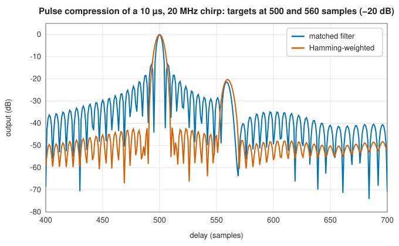
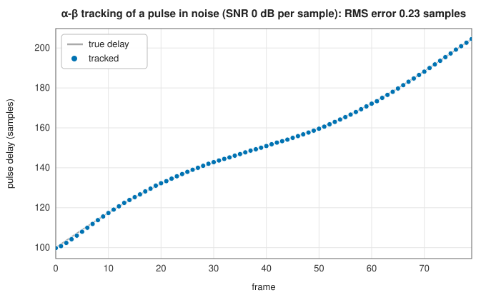

# Pulse compression, Barker codes and pulse tracking

<div class="entry-summary">

| | |
|---|---|
| **Problem** | Transmit a long pulse for energy yet resolve targets as if it were short; find a known pulse in noise to a fraction of a sample; follow it from frame to frame |
| **Devised by** | Dwight North (1943), the matched filter; Robert Dicke (1945) and Sidney Darlington (1947), chirp pulse compression; Ronald Barker (1953), binary codes; Thomas Benedict and G. W. Bordner (1962), α-β tracking |
| **Accuracy** | A linear-FM chirp compresses to a −13.3 dB sidelobe sinc, lowered to −42 dB by Hamming weighting; the tracker follows a pulse at 0 dB SNR per sample to a quarter of a sample (below) |
| **Cost** | One FFT convolution per received frame; the tracker evaluates the correlation only inside a gate |
| **API** | [`linear_chirp`](../../api/lib_jsl_dsp/discrete/radar/pulse_compression/fn.linear_chirp.html), [`matched_filter`](../../api/lib_jsl_dsp/discrete/radar/pulse_compression/fn.matched_filter.html), [`pulse_compress`](../../api/lib_jsl_dsp/discrete/radar/pulse_compression/fn.pulse_compress.html), [`peak_sidelobe_level_db`](../../api/lib_jsl_dsp/discrete/radar/pulse_compression/fn.peak_sidelobe_level_db.html), [`barker_code`](../../api/lib_jsl_dsp/discrete/digital_communications/barker_codes/fn.barker_code.html), [`barker_autocorrelation`](../../api/lib_jsl_dsp/discrete/digital_communications/barker_codes/fn.barker_autocorrelation.html), [`locate_pulse`](../../api/lib_jsl_dsp/discrete/digital_communications/pulse_correlation_tracker/fn.locate_pulse.html), [`PulseCorrelationTracker`](../../api/lib_jsl_dsp/discrete/digital_communications/pulse_correlation_tracker/struct.PulseCorrelationTracker.html) |

</div>

## Overview

A radar's ability to detect a target depends on the pulse's energy, and its ability to separate two targets on the pulse's bandwidth. A short pulse has
the bandwidth but little energy; a long pulse at limited peak power has the energy but no resolution. **Pulse compression** escapes the trade-off: transmit a long pulse with a wide
bandwidth, such as a frequency sweep (**chirp**) or a phase code, and correlate the echo with the transmitted pulse. The **matched filter** compresses it into a narrow peak whose width is the reciprocal of
the bandwidth, with the full pulse's energy. **Barker codes** are binary phase codes whose compressed sidelobes are as small as possible. Once found, a pulse can be **tracked**
from frame to frame by searching only near its predicted position.

## History

Dwight North (1943), at RCA, showed that the filter maximising the signal-to-noise ratio for a known pulse in white noise is the pulse
itself, reversed and conjugated: the **matched filter**. Robert Dicke (1945) and Sidney Darlington (1947) patented chirp pulse compression, which John Klauder and colleagues at Bell Labs
analysed in full in 1960. Ronald Barker (1953) found binary sequences whose autocorrelation sidelobes never exceed one; the longest known has 13 elements. α-β tracking filters,
the steady-state Kalman filter of a constant-velocity target, were analysed by Thomas Benedict and G. W. Bordner (1962).

## The idea

### The matched filter

A radar transmits a known pulse $p$ of $L$ samples and listens for its echo, which returns weak
and buried in noise. The receiver's task is to decide whether the pulse is present and exactly
when it arrived. The best linear filter for the purpose is the one that maximises the ratio of
the signal peak to the noise at its output.

The answer has a simple explanation. A filter forms a weighted sum of the last $L$ received
samples. To make the pulse's contribution as large as possible relative to the noise, each
sample should be weighted by how much signal it is expected to contain: heavily where the pulse
is strong, lightly where it is weak, and with the conjugate phase so that all the contributions
add in step. That is a filter whose taps are the pulse itself, conjugated and reversed in time,

$$
h[n] = \overline{p[L - 1 - n]},
$$

the **matched filter**. (The reversal is needed because a filter's first tap multiplies the most
recent sample.) Its output is the [cross-correlation](../filters/convolution.md#cross-correlation-and-delay-estimation)
of the received signal with $p$, which peaks at the moment the whole pulse has arrived.

A remarkable property follows: the peak signal-to-noise ratio is $E_p/N_0$, the pulse energy
divided by the noise density, *regardless of the pulse's shape*. A long weak pulse is detected
as well as a short strong one of the same energy. The shape determines only the width and
sidelobes of the correlation peak, its **ambiguity**, and that is the freedom the next sections
exploit: a long pulse can be designed so that its matched-filter output is a short, sharp
peak.

### Chirps

A radar wants two things that conflict for a simple pulse: high energy, which needs a long pulse
(peak power is limited), and fine range resolution, which needs a short one. **Pulse
compression** gets both, by transmitting a long pulse whose frequency changes during the pulse.

A linear-FM **chirp** $s(t) = e^{i\pi(B/T)(t - T/2)^2}$ sweeps a bandwidth $B$ in a time $T$. The width
of a matched filter's output peak is set by the pulse's bandwidth, not its duration: the chirp's
autocorrelation is close to a sinc of width $1/B$. The pulse of length $T$ is therefore
compressed to a peak of length $1/B$, and the **compression ratio** is the time-bandwidth
product $BT$. A 10 µs, 20 MHz chirp
compresses 200 to 1:



<p class="caption" id="fig-16-12"><strong>Figure 16.12.</strong> Pulse compression.</p>

The unweighted matched filter's first sidelobes are at −13.3 dB, the sinc's, and would hide the second target 20 dB down if it were closer. Weighting the
filter by a window trades a little peak SNR (about 1.3 dB for Hamming) and width for much lower sidelobes:

<p class="caption" id="tab-16-3"><strong>Table 16.3.</strong> Columns: waveform and weighting, peak sidelobe level (dB), −3 dB width (samples).</p>

{{#include ../generated/comms/sidelobes.md}}

### Barker codes

A Barker code of length $N$ is a binary sequence whose aperiodic autocorrelation sidelobes are at most 1 in magnitude, against a peak of $N$. They exist for $N = 2, 3, 4, 5, 7, 11$ and 13 only. Barker 13 gives
the −22.3 dB peak sidelobe in the table, the best a binary code of that length can do; Barker 11 spreads the 1 and 2 Mbit/s rates of 802.11b Wi-Fi.

### Finding and tracking a pulse

[`locate_pulse`](../../api/lib_jsl_dsp/discrete/digital_communications/pulse_correlation_tracker/fn.locate_pulse.html) finds the correlation peak in a frame and refines it to a fraction of a sample by fitting a parabola through the peak and its neighbours. The
[`PulseCorrelationTracker`](../../api/lib_jsl_dsp/discrete/digital_communications/pulse_correlation_tracker/struct.PulseCorrelationTracker.html) then predicts the next position from its delay and rate estimates, searches a **gate** around the prediction, and updates
both with an **α-β filter**:

$$
\hat d_k = \widetilde d_k + \alpha(m_k - \widetilde d_k), \qquad \hat r_k = \hat r_{k-1} + \beta(m_k - \widetilde d_k), \qquad \widetilde d_{k+1} = \hat d_k + \hat r_k,
$$

where $m_k$ is the measured delay. If the normalised correlation in the gate falls below a threshold, it coasts on the prediction, and after too many misses it drops the track:



<p class="caption" id="fig-16-13"><strong>Figure 16.13.</strong> Pulse tracking.</p>

## Algorithm

**Pulse compression** of a received frame.

1. Form the matched filter: the pulse, conjugated and reversed in time, and multiplied by the
   weighting window if side lobes are to be reduced.
2. Convolve the frame with it, by [FFT convolution](../filters/convolution.md#algorithm).
3. Align the output so that index $k$ holds the response to an echo that *starts* at sample
   $k$.

**Locating a pulse** (`locate_pulse`).

1. Find the index of the largest magnitude of the compressed output.
2. Fit a parabola through that magnitude and its two neighbours, and take the position of the
   parabola's vertex as the delay, to a fraction of a sample.
3. Report also the normalised correlation at the peak, a number between 0 and 1 that measures
   how well the frame matches the pulse there.

**Tracking** (`PulseCorrelationTracker`), for each new frame:

1. **predict** the delay from the previous estimates: $\widetilde d = \hat d + \hat r$;
2. **search** only the gate, a window of delays around the prediction, for the correlation
   peak;
3. **test**: if the normalised correlation at the peak is above the threshold, the pulse was
   found. Update the delay by the fraction $\alpha$ of the difference between the measurement
   and the prediction, and the rate by the fraction $\beta$ of it;
4. otherwise **coast**: keep the prediction as the estimate, and count a miss. After too many
   consecutive misses, drop the track.

## Implementation

```rust,ignore
{{#include ../../../crates/dsp/src/discrete/radar/pulse_compression.rs:pulse_compress}}
```

```rust,ignore
{{#include ../../../crates/dsp/src/discrete/digital_communications/pulse_correlation_tracker.rs:alpha_beta}}
```

- `peak_sidelobe_level_db` measures the largest response outside the main lobe, bounded by the first minima on either side of the peak.
- The gate half-width, α and β are set by `new`; the detection threshold (normalised correlation 0.4) and the miss limit (10 frames) by `with_detection_threshold` and `with_max_misses`.
- Inside the gate the tracker correlates directly, $O(GL)$ for a gate of $G$ delays and a pulse of $L$ samples, against the full frame's FFT correlation on acquisition.

## In practice

```rust,ignore
{{#include ../../../crates/dsp/examples/dsp_radar.rs}}
```

```text
chirp: 400 samples, time-bandwidth product 100.00000000000001
compressed peak at sample 700, gain 400 (pulse energy), sidelobes -13.5 dB
Barker 13 [1, 1, 1, 1, 1, -1, -1, 1, 1, -1, 1, -1, 1]
autocorrelation [1, 0, 1, 0, 1, 0, 1, 0, 1, 0, 1, 0, 13, 0, 1, 0, 1, 0, 1, 0, 1, 0, 1, 0, 1]
locate_pulse: delay 300.00, normalised correlation 1.000
```

**Strengths**

- The matched filter is SNR-optimal for any pulse; chirps give large compression ratios and tolerate Doppler.
- Sub-sample delay estimates and a cheap gated tracker.

**Weaknesses**

- Range sidelobes (reduced by weighting at a cost in SNR and resolution); chirps couple range and Doppler.
- The α-β tracker assumes constant rate between frames and needs tuning of α, β and the gate.

## Exercises

1. Show by the Cauchy-Schwarz inequality that the matched filter maximises the output SNR, and that the maximum is $E_p/N_0$.
2. Show that the autocorrelation of a linear-FM chirp with large $BT$ is approximately $T\,\mathrm{sinc}(B\tau)$.
3. Verify that Barker 13's aperiodic autocorrelation sidelobes are 0 or 1.
4. Compute the SNR loss of Hamming weighting, $(\sum w)^2/(N\sum w^2)$, for a long pulse.
5. Derive the α-β filter as the steady-state Kalman filter for a constant-velocity target with white acceleration noise, and relate $\alpha$ and $\beta$.

<details>
<summary>Hints and answers</summary>

1. Output SNR is $|\int h(t)s(T - t)\,dt|^2/(N_0/2\int|h|^2)$; by Cauchy-Schwarz it is at most $\int|s|^2/(N_0/2)$, with equality for $h(t) = s^*(T - t)$. The maximum is $E_p/N_0$ in the entry's noise convention (with the other common convention for the noise density it is $2E_p/N_0$).
2. The chirp $e^{j\pi(B/T)t^2}$ has an autocorrelation that is the Fourier transform of its (nearly flat, width $B$) spectrum magnitude squared, so it is approximately $T\operatorname{sinc}(B\tau)$.
3. Barker 13 is $+++++--++-+-+$. The aperiodic autocorrelation at shift $k$ is the sum of $13 - k$ products; for this sequence each equals $0$ or $\pm1$ (the sequence is chosen for that), peak 13.
4. For Hamming, $\sum w/N = 0.54$ and $\sum w^2/N = 0.54^2 + 0.46^2/2 = 0.3974$, so the loss is $0.54^2/0.3974 = 0.734$, i.e. $-1.34$ dB.
5. The constant-velocity model with white acceleration noise has a steady-state Kalman gain that depends on $\lambda = \sigma_a T^2/\sigma_v$ ($\sigma_a$ the acceleration noise, $\sigma_v$ the measurement noise); the gains satisfy $\beta = 2(2 - \alpha) - 4\sqrt{1 - \alpha}$, the Kalata relation.

</details>

## Further reading

- M. A. Richards, *Fundamentals of Radar Signal Processing*, 2nd ed., McGraw-Hill, 2014, chapters 4 and 9.
- D. O. North, "An analysis of the factors which determine signal/noise discrimination in pulsed carrier systems", RCA report PTR-6C, 1943; reprinted in *Proceedings of the IEEE* 51 (1963) 1016–1027.
- J. R. Klauder, A. C. Price, S. Darlington and W. J. Albersheim, "The theory and design of chirp radars", *Bell System Technical Journal* 39 (1960) 745–808.
- R. H. Barker, "Group synchronizing of binary digital systems", in *Communication Theory*, Butterworths, 1953, 273–287.
- T. R. Benedict and G. W. Bordner, "Synthesis of an optimal set of radar track-while-scan smoothing equations", *IRE Transactions on Automatic Control* 7 (1962) 27–32.
