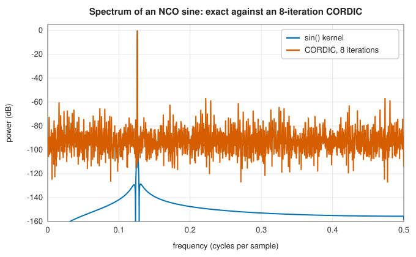

# Signal sources: oscillators, CORDIC and waveforms

<div class="entry-summary">

| | |
|---|---|
| **Problem** | Generate sinusoids, quadrature carriers, periodic waveforms and noise at exact frequencies, cheaply and reproducibly, and shift signals in frequency |
| **Devised by** | Jack Volder (1959), CORDIC; John Walther (1971), the unified CORDIC; Joseph Tierney, Charles Rader and Bernard Gold (1971), the direct digital synthesiser |
| **Accuracy** | The 64-bit phase accumulator has a frequency resolution of $f_s/2^{64}$; a 32-bit CORDIC gains about one bit per iteration (table below) |
| **Cost** | One addition per sample for the phase; one `sin_cos` or $k$ shift-and-add steps for the waveform |
| **API** | [`Nco`](../../api/lib_jsl_dsp/discrete/sources/nco/struct.Nco.html), [`NcoSource`](../../api/lib_jsl_dsp/discrete/sources/nco/struct.NcoSource.html) (with [`SineWave`](../../api/lib_jsl_dsp/discrete/sources/sinusoid/struct.SineWave.html), [`QuadratureWave`](../../api/lib_jsl_dsp/discrete/sources/quadrature/struct.QuadratureWave.html), [`SquareWave`](../../api/lib_jsl_dsp/discrete/sources/square/struct.SquareWave.html), [`TriangleWave`](../../api/lib_jsl_dsp/discrete/sources/triangle/struct.TriangleWave.html), [`RampWave`](../../api/lib_jsl_dsp/discrete/sources/ramp/struct.RampWave.html), [`PulseTrainWave`](../../api/lib_jsl_dsp/discrete/sources/pulse_train/struct.PulseTrainWave.html), [`NoiseWave`](../../api/lib_jsl_dsp/discrete/sources/noise/struct.NoiseWave.html)), [`Cordic32`](../../api/lib_jsl_dsp/discrete/sources/cordic/struct.Cordic32.html), [`Cordic64`](../../api/lib_jsl_dsp/discrete/sources/cordic/struct.Cordic64.html), [`cordic_sin_cos`](../../api/lib_jsl_dsp/discrete/sources/cordic/fn.cordic_sin_cos.html), [`FrequencyMixer`](../../api/lib_jsl_dsp/discrete/transformations/frequency_mixer/struct.FrequencyMixer.html) |

</div>

## Overview

Test signals, carriers and local oscillators all start from a **numerically controlled oscillator** (NCO): an integer phase accumulator that wraps around
once per cycle, advanced by a fixed **tuning word** each sample. A waveform function turns the phase into a sample: a sine, a quadrature pair $\cos + i\sin$, a ramp, triangle,
square or pulse train, or held noise. Integer phase makes the frequency exact and the phase free of drift. The sine itself can come from the floating-point `sin`
or from **CORDIC**, which rotates a vector by shifts and additions only, as hardware does. A **frequency mixer** multiplies a signal by a complex exponential to move its spectrum.

## History

Jack Volder (1959) devised CORDIC (coordinate rotation digital computer) at Convair for the navigation computer of the B-58 bomber, which
had to compute trigonometric functions without a multiplier. John Walther (1971) at Hewlett-Packard unified it to cover hyperbolic and linear functions, and it
became the algorithm of the HP-35 calculator. Joseph Tierney, Charles Rader and Bernard Gold (1971) described the direct digital frequency
synthesiser: a phase accumulator addressing a sine table. NCOs of this kind are in every software radio.

## The idea

### Phase accumulation

A **numerically controlled oscillator** (NCO) generates the samples of a sinusoid,
$\cos(2\pi fn/f_s)$, one after another. It does so in two stages: keep track of the phase, then
convert the phase to an amplitude.

The phase advances by the same amount, $f/f_s$ of a full turn, at every sample. The obvious
implementation adds that amount to a floating-point variable, and has two flaws: each addition
rounds, so the phase slowly drifts, and the phase must be wrapped back into one turn from time
to time. Both disappear if the phase is kept as an unsigned *integer* that represents a fraction
of a turn. With a $B$-bit **phase accumulator**, the value $2^B$ stands for one full turn. The
**tuning word** for frequency $f$ at rate $f_s$ is

$$
\Delta = \mathrm{round}(2^Bf/f_s),
$$

and the phase after $n$ samples is $n\Delta \bmod 2^B$. Integer addition is exact, so no error
accumulates however long the oscillator runs, and the overflow of the integer *is* the
wrap-around of the phase, at no cost. The only error is the rounding of $\Delta$ itself, which
makes the frequency inexact by at most $f_s/2^{B+1}$. The library uses $B = 64$, so the frequency
is exact to $f_s/2^{64}$ (about $10^{-14}$ Hz at 1 MHz). `next_phase_modulated` adds a per-sample
offset to the phase, giving frequency modulation.

### CORDIC

The second stage converts the phase to $\cos$ and $\sin$. A table lookup or a library call would
do, but hardware and fixed-point processors often have no multiplier to spare. **CORDIC**
(coordinate rotation digital computer) computes sines and cosines using only shifts and
additions.

**The idea.** The point $(\cos\theta, \sin\theta)$ is the vector $(1, 0)$ rotated by the angle
$\theta$. A rotation by an angle $\alpha$ can be written

$$
x' = \cos\alpha\,(x - y\tan\alpha), \qquad y' = \cos\alpha\,(y + x\tan\alpha) .
$$

If $\tan\alpha$ is a power of two, $\tan\alpha = 2^{-i}$, the multiplications inside the brackets
are just shifts of a binary number. So CORDIC builds the rotation by $\theta$ out of
**micro-rotations** by the fixed angles $\alpha_i = \arctan2^{-i}$ ($45°$, $26.6°$, $14.0°$,
$7.1°$, ...), each applied either forwards or backwards. Any angle in the first quadrant can be
approximated by such a sum of signed angles, much as a number is approximated by binary digits.
A third variable $z$ holds the angle still to be rotated, and the sign $d_i = \pm1$ of each
micro-rotation is chosen to drive $z$ towards zero:

$$
x_{i+1} = x_i - d_iy_i2^{-i}, \qquad y_{i+1} = y_i + d_ix_i2^{-i}, \qquad z_{i+1} = z_i - d_i\arctan2^{-i} .
$$

Each step is two shifts and three additions; the angles $\arctan2^{-i}$ come from a small table.

**The gain.** The formulas above omit the factor $\cos\alpha_i$ of each micro-rotation, so every
step also stretches the vector slightly, by $1/\cos\alpha_i = \sqrt{1 + 2^{-2i}}$. Because every
micro-rotation is performed, in one direction or the other, the total stretch is the same for
every angle: $K = \prod\sqrt{1 + 2^{-2i}} \approx 1.6468$. It is compensated in advance by starting
from the vector $(1/K, 0)$.

The quadrant is taken from the top two bits of the phase first, so the iterations only have to
cover $[0, \pi/2)$. Each iteration adds about one bit of accuracy:

<p class="caption" id="tab-16-1"><strong>Table 16.1.</strong> Columns: CORDIC iterations (32-bit), largest error in sin and cos, equivalent bits.</p>

{{#include ../generated/comms/cordic_accuracy.md}}

A short CORDIC's errors are periodic in the phase, so they appear in the spectrum as **spurs**, not noise:



<p class="caption" id="fig-16-1"><strong>Figure 16.1.</strong> NCO spurs.</p>

`Cordic32` uses 32-bit integers and reaches about $10^{-8}$; `Cordic64` takes the oscillator's full 64-bit phase and reaches double precision with 52 or more iterations.

### Waveforms and noise

The other waveforms read the phase directly. A **ramp** is the phase itself, scaled to $[-1, 1)$. A **triangle** folds it. A **square** wave or **pulse train** compares it with a duty cycle.
**Noise** sources draw a new uniform or Gaussian value every sample (white), or each time the phase wraps (sample-and-hold, a crude
band-limited noise). All are seeded, so a test signal is reproducible.

### Frequency mixing

Multiplying a complex signal by $e^{2\pi if_0n/f_s}$ shifts its spectrum by $f_0$: down-conversion to baseband in a receiver, or up-conversion in a transmitter. Multiplying a real signal
by a real cosine instead produces both the sum and the difference frequencies, which is why receivers mix with a quadrature (complex) oscillator. [`FrequencyMixer`](../../api/lib_jsl_dsp/discrete/transformations/frequency_mixer/struct.FrequencyMixer.html)
keeps a floating-point phase, wrapped every cycle.

## Algorithm

**Oscillator** (`next_phase`): return the current value of the 64-bit phase accumulator, then
add the tuning word to it, letting the addition wrap round.

**CORDIC**, converting a phase to a cosine and sine, in integer arithmetic.

1. **Quadrant.** The top two bits of the phase say which quarter turn it lies in. Remove
   them; what remains is an angle in $[0, \pi/2)$.
2. **Start** from the vector $(1/K, 0)$, already rotated by that number of quarter turns (a
   quarter turn only exchanges the two components and changes signs), with $z$ set to the
   remaining angle.
3. **Iterate** for $i = 0, 1, \ldots$ up to the chosen number of iterations: let $d = +1$ if
   $z \ge 0$ and $-1$ otherwise; replace $(x, y)$ by $(x - d\,(y \gg i),\ y + d\,(x \gg i))$,
   where $\gg i$ is a right shift by $i$ bits, with rounding; subtract $d\arctan2^{-i}$, read
   from a table, from $z$.
4. **Return** $x$ as the cosine and $y$ as the sine.

The cost is three additions and two shifts per iteration.

**A waveform sample**: take the next phase; map it to a value by the waveform's rule (the
CORDIC for a sinusoid, the phase itself for a ramp, a fold for a triangle, a comparison with
the duty cycle for a square wave); multiply by the amplitude and add the offset.

**Frequency mixer**: multiply each input sample by $e^{i\phi}$, then advance $\phi$ by
$2\pi f_0/f_s$ and wrap it into one cycle.

## Implementation

```rust,ignore
{{#include ../../../crates/dsp/src/discrete/sources/nco.rs:nco}}
```

```rust,ignore
{{#include ../../../crates/dsp/src/discrete/sources/cordic.rs:cordic}}
```

- The CORDIC types are generated by one macro for 32-bit and 64-bit arithmetic. The arctangent table and the gain compensations
  for every iteration count are constants.
- `NcoSource::generate(n)` returns `n` samples; every source also implements [`Waveform`](../../api/lib_jsl_dsp/discrete/sources/nco/trait.Waveform.html), so new shapes plug into the same oscillator.

## In practice

```rust,ignore
{{#include ../../../crates/dsp/examples/dsp_sources.rs}}
```

```text
phase after 12 samples: 0.250000 turns (exact 0.25)
sine: [0.0000, 0.1305, 0.2588, 0.3827]
quadrature: 1.0000+0.0000i, 0.9914+0.1305i
square, duty 0.25: [1.0, -1.0, -1.0, -1.0, 1.0, -1.0, -1.0, -1.0]
CORDIC sin/cos(0.5) = 0.479425540, 0.877582562 (exact 0.479425539, 0.877582562)
10-iteration CORDIC: sin(0.5) = 0.47850, gain constant 1.646759
```

**Strengths**

- Exact frequencies and drift-free phase; multiplier-free sines and cosines with CORDIC.
- Reproducible, composable sources for testing every other algorithm.

**Weaknesses**

- Square, ramp and pulse waveforms are not band-limited: their harmonics alias.
- Short CORDICs and truncated phases produce spurs, not white noise.

## Exercises

1. Find the tuning word and the actual frequency for 1 kHz at 48 kHz with a 32-bit accumulator, and the frequency error.
2. Show that the CORDIC gain $K$ converges to about 1.64676 as the number of iterations grows.
3. Show that $\sum_{i \ge 0}\arctan2^{-i} > \pi/2$, so CORDIC covers a quarter turn.
4. Mix a real 1 kHz tone with a real 1.1 kHz cosine and identify the two products; repeat with a complex exponential.
5. Generate a band-limited square wave by summing odd harmonics below Nyquist, and compare its spectrum with `SquareWave`'s.

## Further reading

- J. E. Volder, "The CORDIC trigonometric computing technique", *IRE Transactions on Electronic Computers* 8 (1959) 330–334.
- J. S. Walther, "A unified algorithm for elementary functions", *Proceedings of the Spring Joint Computer Conference* (1971) 379–385.
- J. Tierney, C. M. Rader and B. Gold, "A digital frequency synthesizer", *IEEE Transactions on Audio and Electroacoustics* 19 (1971) 48–57.
- R. Andraka, "A survey of CORDIC algorithms for FPGA based computers", *Proceedings of the ACM/SIGDA FPGA Symposium* (1998) 191–200.
