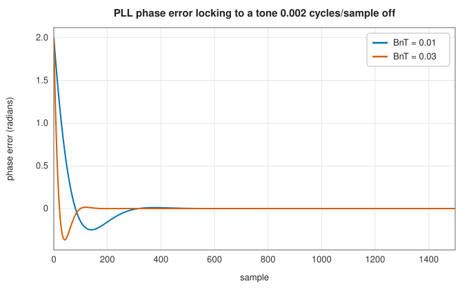
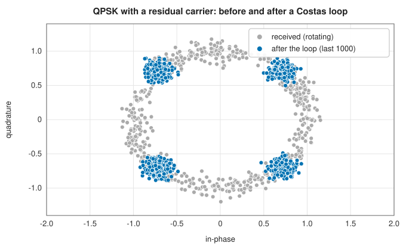
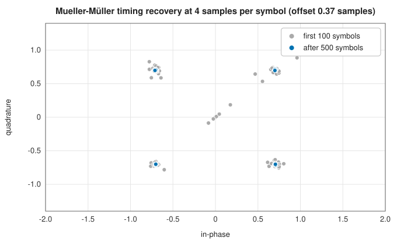

# Synchronisation: phase-locked loops, Costas loops and timing recovery

<div class="entry-summary">

| | |
|---|---|
| **Problem** | Lock a local oscillator to a received carrier, recover the carrier of suppressed-carrier modulation, and find the right instants to sample each symbol |
| **Devised by** | Henri de Bellescize (1932), the phase-locked loop; John Costas (1956), the Costas loop; Kurt Mueller and Markus Müller (1976), timing recovery; C. W. Farrow (1988), the variable fractional-delay filter |
| **Accuracy** | A type-2 loop tracks a phase and a constant frequency offset with zero steady-state error; the Lagrange interpolator's error falls with its order (table below) |
| **Cost** | A few operations per sample for the loops; $(N + 1)^2$ multiply-adds per output for an order-$N$ Farrow interpolator |
| **API** | [`PhaseLockedLoop`](../../api/lib_jsl_dsp/discrete/synchronization/phase_locked_loop/struct.PhaseLockedLoop.html), [`LoopFilter`](../../api/lib_jsl_dsp/discrete/synchronization/phase_locked_loop/struct.LoopFilter.html), [`CostasLoop`](../../api/lib_jsl_dsp/discrete/synchronization/costas_loop/struct.CostasLoop.html) ([`CostasModulation`](../../api/lib_jsl_dsp/discrete/synchronization/costas_loop/enum.CostasModulation.html)), [`MuellerTimingRecovery`](../../api/lib_jsl_dsp/discrete/digital_communications/mueller_timing_detector/struct.MuellerTimingRecovery.html), [`mueller_timing_detector`](../../api/lib_jsl_dsp/discrete/digital_communications/mueller_timing_detector/fn.mueller_timing_detector.html), [`FarrowFilter`](../../api/lib_jsl_dsp/discrete/digital_communications/farrow_filter/struct.FarrowFilter.html), [`farrow_filter`](../../api/lib_jsl_dsp/discrete/digital_communications/farrow_filter/fn.farrow_filter.html) |

</div>

## Overview

A receiver's oscillator never runs at exactly the transmitter's frequency, and its sampling clock never matches the transmitter's symbol clock. Both
must be recovered from the signal itself. A **phase-locked loop** (PLL) compares the incoming phase with its own oscillator and steers it with the filtered
error until they agree. A **Costas loop** does the same for modulated signals whose carrier is suppressed, using a phase detector that ignores the data. **Timing recovery** steers
the sampling instant: a timing-error detector such as **Mueller and Müller's** measures how early or late the samples are, and an interpolator, here a **Farrow filter**, computes the signal between the
samples actually taken.

## History

Henri de Bellescize (1932) patented the phase-locked loop for synchronous radio reception. PLLs spread through television (to lock horizontal
sweep), space communications (Jet Propulsion Laboratory, 1950s), and every modern clock and frequency synthesiser. John Costas (1956), at General Electric,
invented the loop that bears his name for suppressed-carrier communication. Kurt Mueller and Markus Müller (1976) derived a timing-error detector needing only one sample per symbol,
and C. W. Farrow (1988) introduced the filter structure that interpolates at a continuously variable fractional delay. Floyd Gardner's *Phaselock Techniques* and Michael Rice's
*Digital Communications* are the standard engineering references.

## The idea

### The loop

A receiver's oscillator never matches the transmitter's exactly. A small frequency difference
makes the received constellation rotate steadily, and an unknown phase leaves it at an arbitrary
angle. Before symbols can be decided, the receiver must estimate the phase of the incoming
carrier and follow it as it drifts. A **phase-locked loop** (PLL) does this by feedback: it
generates its own copy of the carrier, measures how far the copy is from the input, and corrects
the copy.

Every loop here has three parts.

- A **phase detector** compares the input with the local copy and produces an error $e[n]$,
  ideally the phase difference between them.
- A **loop filter** smooths the error and decides how to respond.
- A **[numerically controlled oscillator](sources.md#phase-accumulation)** generates the local
  copy at the phase $\hat\phi$ the filter commands.

The loop filter is **proportional-integral**. It keeps an estimate $\hat\omega$ of the frequency
(the phase advance per sample) as well as the phase:

$$
\hat\omega \leftarrow \hat\omega + K_ie, \qquad \hat\phi \leftarrow \hat\phi + K_pe + \hat\omega .
$$

The proportional term $K_pe$ corrects the phase directly. The integral term accumulates the
error into the frequency estimate. The second is what allows the loop to follow a frequency
offset: with a proportional term alone, a constant frequency difference would need a constant
error to keep driving the correction, so the loop would always lag. With the integrator, the
frequency estimate settles at the true offset and the phase error falls to zero. This is called
a **type-2** loop.

The two gains are not chosen directly. They follow from two more meaningful quantities: the
normalised **noise bandwidth** $B_nT$, which sets how fast the loop reacts, and the **damping**
$\zeta$, which sets how much it overshoots (0.707 is the usual choice). With
$\theta = B_nT/(\zeta + 1/4\zeta)$, $K_p = 4\zeta\theta/(1 + 2\zeta\theta + \theta^2)$ and
$K_i = 4\theta^2/(1 + 2\zeta\theta + \theta^2)$. A wider bandwidth acquires faster and tracks
changes better, but it also follows more of the noise:



<p class="caption" id="fig-16-7"><strong>Figure 16.7.</strong> PLL acquisition.</p>

The PLL's detector is $\arg(xe^{-i\hat\phi})$: multiplying the input $x$ by $e^{-i\hat\phi}$ removes
the estimated phase, and the angle of what remains is the error. It is exact for any phase
error, so the loop pulls in from any initial phase.

### Costas loops

A plain PLL needs an unmodulated carrier. A data signal has none: in BPSK the received phase is
$\phi + \pi d$, where the data bit $d$ flips it by 180° at random. A phase detector for such a
signal must not care which way the symbol points.

The **Costas loop** achieves this by using the receiver's own decisions. After the estimated
phase has been removed, a BPSK symbol should lie on the real axis, at $+1$ or $-1$, so its
imaginary part $Q$ should be zero. A residual phase error $\theta$ tilts the symbol and makes
$Q$ proportional to $\pm\sin\theta$, the sign depending on the data. Multiplying by the sign of
the real part $I$, which is the decision about the data, cancels that sign: the detector
$\mathrm{sgn}(I)\,Q$ gives $\sin\theta$ whichever bit was sent. Since it cannot tell a symbol from
its negative, the loop can lock with the constellation upside down, a 180° ambiguity. For QPSK
the detector $\mathrm{sgn}(I)Q - \mathrm{sgn}(Q)I$ removes the four symbols in the same way and
locks with a 90° ambiguity. The ambiguity is resolved by differential coding, which puts the
information in the *changes* of phase, or by a known preamble:



<p class="caption" id="fig-16-8"><strong>Figure 16.8.</strong> Costas loop on QPSK.</p>

{{#include ../generated/comms/costas_facts.md}} The estimate fluctuates with the noise in proportion to the loop bandwidth.

### Timing recovery

The receiver samples the signal several times per symbol, $L$ samples per symbol, with a clock
that is not synchronised to the transmitter's. Each symbol is a pulse, and it should be read at
the peak of the pulse, where it is strongest and the neighbouring pulses pass through zero. The
receiver must find that instant and track it, which is a second feedback loop of the same
three-part form, with a **timing error detector** in place of the phase detector.

The **Mueller-Müller** detector works at one sample per symbol. It compares consecutive
symbol-rate samples $y$ with the decisions $d$ made from them:

$$
e = \mathrm{Re}\big(\bar d_{k-1}y_k - \bar d_ky_{k-1}\big) .
$$

If the samples are taken at the pulse peaks, each sample contains only its own symbol and the
two terms cancel on average. If the sampling is early or late, each sample also contains a
little of its neighbour, and the two terms no longer balance: the detector's average output is
positive for one sign of the timing error and negative for the other. A loop filter turns it
into the next sampling position. That position generally falls between two of the available
samples, so an interpolator evaluates the signal there:



<p class="caption" id="fig-16-9"><strong>Figure 16.9.</strong> Timing recovery.</p>

{{#include ../generated/comms/timing_facts.md}}

### Fractional delay: the Farrow filter

Evaluating a signal at $n + \mu$ with $0 \le \mu < 1$ means fitting a polynomial through neighbouring samples. Lagrange interpolation of order $N$ through $N + 1$ samples is a set of $N + 1$ fixed FIR filters whose outputs
$v_m$ combine as $y(\mu) = v_0 + \mu(v_1 + \mu(v_2 + \cdots))$. That is the **Farrow structure**: only the cheap Horner step depends on $\mu$, so the delay can change every sample. Higher orders are exact for polynomials of higher degree and
accurate to higher frequencies:

<p class="caption" id="tab-16-2"><strong>Table 16.2.</strong> Columns: Lagrange order, error at 0.05 cycles/sample, at 0.15, at 0.30.</p>

{{#include ../generated/comms/farrow.md}}

Cubic interpolation (order 3), the usual choice for timing recovery, has an error of $2 \times 10^{-4}$ (−74 dB) at 0.05 cycles per sample, one reason receivers oversample by four or more.

## Algorithm

Each loop processes one input sample (or one symbol) at a time.

**PLL.**

1. Remove the estimated phase: multiply the input by $e^{-i\hat\phi}$.
2. Detect: the error $e$ is the argument of the result.
3. Filter and advance: $\hat\omega \leftarrow \hat\omega + K_ie$, then
   $\hat\phi \leftarrow \hat\phi + K_pe + \hat\omega$.

**Costas loop.**

1. Multiply the input by $e^{-i\hat\phi}$, and normalise the result to unit magnitude, so that
   the detector's gain does not depend on the signal level.
2. Detect with the data-stripping rule: $\operatorname{sgn}(I)\,Q$ for BPSK, or
   $\operatorname{sgn}(I)Q - \operatorname{sgn}(Q)I$ for QPSK.
3. Filter and advance, as for the PLL.
4. The derotated sample from step 1 is the output, ready for the decision device.

**Mueller-Müller timing recovery**, with $\mu$ the position of the next symbol within the
sample stream and $\omega$ the current estimate of the samples per symbol. For each symbol:

1. interpolate the signal at position $\mu$ with the [Farrow filter](#fractional-delay-the-farrow-filter)
   to get the symbol-rate sample $y_k$;
2. decide the symbol $d_k$ (the nearest constellation point);
3. compute the timing error from this and the previous symbol,
   $e = \operatorname{Re}(\bar d_{k-1}y_k - \bar d_ky_{k-1})$, limited to $\pm1$;
4. update the period estimate $\omega$ by a small multiple of $e$, keeping it within
   $\pm0.5\%$ of its nominal value;
5. advance the position: $\mu \leftarrow \mu + \omega + g_\mu e$.

**Farrow interpolation** of order $N$ at fractional delay $\mu$: compute the $N + 1$ fixed FIR
filter outputs $v_0, \ldots, v_N$ from the neighbouring samples, and combine them by Horner's
rule in $\mu$.

## Implementation

```rust,ignore
{{#include ../../../crates/dsp/src/discrete/synchronization/phase_locked_loop.rs:loop_filter}}
```

```rust,ignore
{{#include ../../../crates/dsp/src/discrete/digital_communications/mueller_timing_detector.rs:mueller}}
```

```rust,ignore
{{#include ../../../crates/dsp/src/discrete/digital_communications/farrow_filter.rs:farrow}}
```

- The Costas loops take one sample per symbol (after timing recovery); the PLL takes any complex tone.
- `MuellerTimingRecovery` interpolates with a cubic Farrow filter and implements [`StreamOperator`](../../api/lib_jsl_dsp/discrete/stream_operator/trait.StreamOperator.html), emitting one sample per recovered symbol.
- `farrow_filter(x, delay, order)` delays a whole signal by a fraction of a sample.

## In practice

```rust,ignore
{{#include ../../../crates/dsp/examples/dsp_synchronisation.rs}}
```

```text
PLL frequency 0.01000 cycles/sample (true 0.01000)
Costas: residual imaginary part 2.2e-16, phase ambiguity ±1 on the real axis: -1.000
Farrow delay 0.25: y[20] = -0.72317, sin(0.2 × 19.75) = -0.72319
Mueller-Müller: 800 symbols out, worst error after settling 0.123
```

The BPSK Costas loop locked with the 180° ambiguity: the recovered symbols are the transmitted ones negated. The Mueller-Müller example's
residual error comes from the crude linear pulse, not from the loop.

**Strengths**

- Standard, well-understood loops with gains set from bandwidth and damping; detectors that work through the data.
- Farrow interpolation makes timing recovery possible at any oversampling ratio.

**Weaknesses**

- Phase ambiguities in Costas loops; frequency offsets beyond the pull-in range need a coarse estimator first.
- The Mueller-Müller detector relies on correct decisions, so it needs a reasonable signal-to-noise ratio and carrier lock.

## Exercises

1. Linearise the type-2 loop and find its closed-loop transfer function and natural frequency in terms of $K_p$ and $K_i$.
2. Show that the BPSK Costas detector's output is $\mathrm{sgn}(\cos\theta)\sin\theta$ whatever the data, and explain the 180° ambiguity.
3. Show that the Mueller-Müller error is zero on average for a Nyquist pulse sampled at its peaks.
4. Derive the cubic Lagrange interpolation coefficients as polynomials in $\mu$.
5. Measure how long the PLL takes to lock as a function of $B_nT$ for a fixed frequency offset, and compare with the loop's theoretical acquisition time.

<details>
<summary>Hints and answers</summary>

1. Linearising, the loop with PI filter $K_p + K_i/s$ and an NCO integrator is $H(s) = (K_ps + K_i)/(s^2 + K_ps + K_i)$ (with unit detector gain), so $\omega_n = \sqrt{K_i}$ and $2\zeta\omega_n = K_p$.
2. $\mathrm{sgn}(I)\cdot Q$ with $I = d\cos\theta$ and $Q = d\sin\theta$, where $d = \pm1$: $\operatorname{sgn}(d\cos\theta)\,d\sin\theta = \operatorname{sgn}(\cos\theta)\sin\theta$ because $d^2 = 1$. The error is unchanged under $\theta \to \theta + \pi$, which is why the loop locks to either phase.
3. For a Nyquist pulse the intersymbol interference at the sampling instants is zero, so the expected product of the sample difference and the symbol decision vanishes at the correct sampling phase.
4. Cubic Lagrange through samples at $-1, 0, 1, 2$ at fractional offset $\mu$: $c_{-1} = -\mu(\mu - 1)(\mu - 2)/6$, $c_0 = (\mu + 1)(\mu - 1)(\mu - 2)/2$, $c_1 = -(\mu + 1)\mu(\mu - 2)/2$, $c_2 = (\mu + 1)\mu(\mu - 1)/6$.
5. Lock time falls as the loop bandwidth $B_nT$ rises (acquisition time of the order of $1/B_n$ or longer for a frequency offset); plot the measured time against $B_nT$ on a log-log scale.

</details>

## Further reading

- F. M. Gardner, *Phaselock Techniques*, 3rd ed., Wiley, 2005.
- M. Rice, *Digital Communications: A Discrete-Time Approach*, Pearson, 2009, chapters 7–8 and appendix C.
- K. H. Mueller and M. Müller, "Timing recovery in digital synchronous data receivers", *IEEE Transactions on Communications* 24 (1976) 516–531.
- C. W. Farrow, "A continuously variable digital delay element", *Proceedings of the IEEE International Symposium on Circuits and Systems* (1988) 2641–2645.
