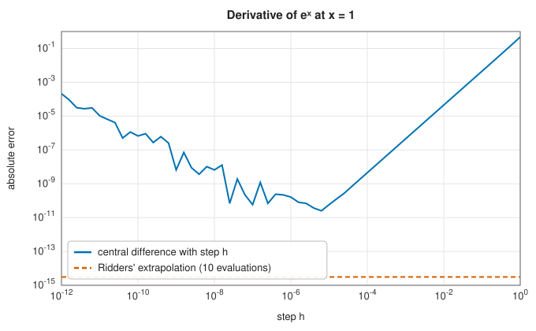

# Adaptive derivatives

<div class="entry-summary">

| | |
|---|---|
| **Problem** | Differentiate a function accurately from its values alone, without choosing a step, and with an estimate of the error; also its Jacobian and Hessian |
| **Devised by** | Lewis Fry Richardson (1911, 1927), extrapolation to zero step; C. J. F. Ridders (1982), the adaptive tableau for derivatives |
| **Accuracy** | 12–15 correct digits for smooth functions; agrees with or improves on `scipy.differentiate.derivative`, with comparable error estimates |
| **Cost** | 10–20 function evaluations per derivative |
| **Read first** | [Finite difference derivatives](finite-differences.md) |
| **API** | [`derivative`](../../api/lib_jsl_derivatives/adaptive/fn.derivative.html), [`jacobian`](../../api/lib_jsl_derivatives/adaptive/fn.jacobian.html), [`hessian`](../../api/lib_jsl_derivatives/adaptive/fn.hessian.html), [`DerivativeOptions`](../../api/lib_jsl_derivatives/adaptive/struct.DerivativeOptions.html) |

</div>

## Overview

A [finite difference](finite-differences.md) with a fixed step balances truncation error, which falls as the step shrinks, against rounding
error, which grows. At best it reaches about two thirds of the available digits, and only if the step suits the function's scale.
**Richardson extrapolation** escapes the trade-off. It combines several differences with large, accurately computed steps so as to cancel
their truncation errors, and it reports how well the combinations agree, which is an error estimate. This entry implements Ridders'
version, the counterpart of SciPy's `differentiate.derivative`, `jacobian` and `hessian`.

## History

Lewis Fry Richardson (1911) noticed that an approximation whose error is a known power series in the step can be extrapolated to zero
step, and called it "the deferred approach to the limit" (1927). Werner Romberg's integration (1955) applied it to quadrature. C. J. F.
Ridders (1982) organised it for derivatives as a Neville tableau with a built-in error estimate and stopping rule, the version popularised
by *Numerical Recipes*. SciPy 1.15 (2024) added `scipy.differentiate`, which takes the same approach with higher-order stencils.

## The idea

The central difference $D(h) = \frac{f(x + h) - f(x - h)}{2h}$ has an error expansion in even powers, $D(h) = f'(x) + a_1h^2 + a_2h^4 + \cdots$. With $D$ at steps $h$ and $h/c$, the combination
$\frac{c^2D(h/c) - D(h)}{c^2 - 1}$ cancels the $h^2$ term. Repeating on the results cancels $h^4$, and so on. Ridders' tableau computes this for a decreasing sequence of steps:

$$
T_{i,0} = D(h/c^i), \qquad T_{i,j} = \frac{c^{2j}T_{i,j-1} - T_{i-1,j-1}}{c^{2j} - 1}.
$$

Each entry has two parents. Its difference from them estimates its error, and the entry with the smallest such difference is the answer.
The tableau starts from a large step (0.5 by default), where rounding error is negligible, and extrapolates towards zero without ever
evaluating at a tiny step. When the diagonal stops improving, rounding has caught up and the iteration stops.



<p class="caption" id="fig-1-2"><strong>Figure 1.2.</strong> Error against the step.</p>

The best fixed step gives an error of about $10^{-11}$. Ridders' tableau reaches $10^{-15}$ with ten evaluations, using only five steps, from 0.5 down to 0.03.

The **Jacobian** applies the method to each coordinate direction of each component. The **Hessian** is the Jacobian of the gradient, each gradient
component itself computed by the method, and is then symmetrised.

## Algorithm

**`derivative(f, x, options)`**: $h = $ `initial_step`; row 0 is $[D(h)]$. For each further row: $h \leftarrow h/c$; new row $[D(h)]$ extended by the extrapolation formula; keep
the entry with the smallest difference from its parents and that difference as the error. Stop when the error is within tolerance, or
when the diagonal grows by more than twice the error after the error has become small, or after `max_iterations` rows.

## Implementation

```rust,ignore
{{#include ../../../crates/derivatives/src/adaptive.rs:ridders}}
```

- `initial_step` is absolute, as in SciPy. For functions that vary on a scale far from 1, scale it accordingly.
- The divergence test applies only after the estimate is within $\sqrt\varepsilon$ in relative terms. Before that, large changes in the diagonal mean the step is still too
  large, not that rounding dominates.

## In practice

Each function is differentiated at $x = 0.3$, 1 and 2.7, and the largest errors are compared with SciPy 1.17.1's `differentiate.derivative`
(references from `book/generator/data/make_sampled_refs.py`):

<p class="caption" id="tab-1-4"><strong>Table 1.4.</strong> Adaptive derivatives against SciPy.</p>

{{#include ../generated/derivatives/adaptive_scipy.md}}

Both methods reach 11–15 digits, with comparable error estimates and evaluation counts. SciPy's higher-order stencils converge
differently, so the two are not expected to agree to rounding. Both are compared with the exact derivative instead.

**Strengths**

- No step to choose, and near machine precision for smooth functions.
- An error estimate with every result.

**Weaknesses**

- Needs the function on both sides of $x$ at distances up to `initial_step`. Use one-sided differences near a domain boundary.
- Noisy functions defeat extrapolation. Their derivative should come from a fitted model instead.
- The Hessian costs $O(n^2)$ derivatives, each about 10–20 evaluations.

## Exercises

1. Show that the central difference has an error expansion in even powers of $h$ for a smooth $f$.
2. With $c = 2$, show that $\tfrac13(4D(h/2) - D(h))$ is the five-point stencil of [finite differences](finite-differences.md#higher-order-stencils).
3. Why does starting from a large step not spoil the accuracy, while evaluating at a tiny step would?

<details>
<summary>Hints and answers</summary>

1. The Taylor series of $f(x \pm h)$ give $f(x + h) - f(x - h) = 2hf' + \tfrac{h^3}{3}f''' + \cdots$, with odd powers only, so dividing by $2h$ leaves even powers.
2. Expand: $\tfrac13\big(4\tfrac{f(x + h/2) - f(x - h/2)}{h} - \tfrac{f(x + h) - f(x - h)}{2h}\big)$, which is the stencil $\tfrac{-f(x + h) + 8f(x + h/2) - 8f(x - h/2) + f(x - h)}{6h}$ with spacing $h/2$.
3. The truncation error is removed exactly by the extrapolation, up to higher orders. The rounding error of a difference is about $\varepsilon|f|/h$, which is small for large $h$ and is amplified only by the modest extrapolation weights.

</details>

## Further reading

- C. J. F. Ridders, "Accurate computation of F′(x) and F′(x)F″(x)", *Advances in Engineering Software* 4 (1982) 75–76.
- W. H. Press, S. A. Teukolsky, W. T. Vetterling and B. P. Flannery, *Numerical Recipes*, 3rd ed., Cambridge University Press, 2007, section 5.7.
- L. F. Richardson and J. A. Gaunt, "The deferred approach to the limit", *Philosophical Transactions of the Royal Society A* 226 (1927) 299–361.
