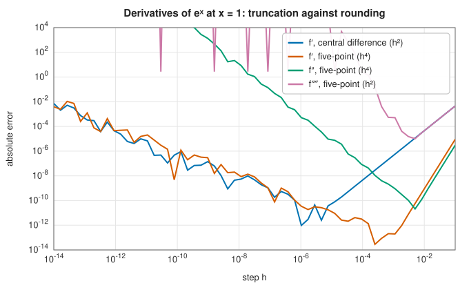

# Finite difference derivatives

<div class="entry-summary">

| | |
|---|---|
| **Problem** | Approximate $f'(x)$, higher derivatives, gradients, Hessians and Jacobians from values of $f$ |
| **Devised by** | Difference quotients: Newton and Leibniz (1670s), Brook Taylor (1715); difference formulas of higher order from interpolation: Newton, Stirling and Bessel (18th century); step-size analysis in floating point: the early numerical analysts, systematised in texts such as Gill, Murray and Wright (1981) |
| **Accuracy** | Central difference: about $\varepsilon^{2/3}$ (10 digits); five-point first derivative: about $\varepsilon^{4/5}$ (13 digits); each higher derivative loses more |
| **Cost** | Two evaluations (central), four or five (five-point); a gradient costs $2n$, a Hessian about $2n^2$ |
| **API** | [`derivative_2_point`](../../api/lib_jsl_derivatives/derivatives_1d_scalar/fn.derivative_2_point.html), [`derivative_stencil`](../../api/lib_jsl_derivatives/derivatives_1d_scalar/fn.derivative_stencil.html), [`gradient_2_point`](../../api/lib_jsl_derivatives/derivatives_vectors/fn.gradient_2_point.html), [`hessian_2_point`](../../api/lib_jsl_derivatives/derivatives_vectors/fn.hessian_2_point.html), [`jacobian_2_point`](../../api/lib_jsl_derivatives/derivatives_vectors/fn.jacobian_2_point.html) |

</div>

## Overview

The derivative is defined as the limit of a difference quotient,

$$
f'(x) = \lim_{h \to 0} \frac{f(x+h) - f(x)}{h}.
$$

A computer cannot take a limit, but it can evaluate the quotient for one small value of $h$. That
is a **finite difference**: stop short of the limit and use a small but finite step $h$.

The idea could not be simpler. The difficulty is in choosing $h$, because two errors pull in
opposite directions:

- If $h$ is **too large**, the quotient is the slope of a chord that is still some way from the
  tangent. This is the **truncation error**, and it shrinks as $h$ shrinks.
- If $h$ is **too small**, the two function values $f(x+h)$ and $f(x)$ agree in nearly all their
  digits. Subtracting them cancels those digits and leaves mostly rounding error, which is then
  divided by the small number $h$. This is the **rounding error**, and it grows as $h$ shrinks.

A quick experiment shows both. Take $f(x) = e^x$ at $x = 0$, where the exact derivative is 1. With
$h = 0.1$ the quotient is 1.0517, wrong in the second digit because the step is too coarse. With
$h = 10^{-15}$ the computed quotient is 1.1102, which is worse: $e^{h}$ and 1 differ only in their
last binary digit or two, so their difference is almost entirely rounding error. The best
answer lies somewhere in between. Understanding this trade-off, and choosing $h$ to balance it, is the
heart of numerical differentiation, and the rest of this entry works it out step by step.

## History

Difference quotients are the starting point of the calculus: both Newton and Leibniz reasoned with
the ratios of small increments before passing to the limit. Brook Taylor's *Methodus
incrementorum* (1715) developed the calculus of finite differences systematically, and the
interpolation formulas of Newton, James Stirling and Friedrich Bessel gave difference formulas of
any order, used for centuries to differentiate tables of values by hand.

The modern question, how to choose the step in floating-point arithmetic, came with the computer.
Its answer, that the best step balances the truncation and rounding errors and scales with a power
of the machine precision, became standard in the optimisation literature of the 1970s, where finite
difference gradients and Jacobians are essential; Philip Gill, Walter Murray and Margaret Wright's
*Practical Optimization* (1981) gives a careful treatment.

## The idea

The argument has four parts. First we measure the truncation error of a difference quotient with
Taylor's theorem. Then we measure the rounding error, and balance the two to find the best step.
After that we see how using more points gives more accurate formulas, and finally how the same
ideas carry over to functions of several variables.

### Truncation error

Taylor's theorem expresses the values of $f$ near $x$ through its derivatives at $x$. For a step
of $+h$ and a step of $-h$ it gives

$$
\begin{aligned}
f(x + h) &= f(x) + h f'(x) + \tfrac{h^2}{2} f''(x) + \tfrac{h^3}{6} f'''(x) + \cdots, \\
f(x - h) &= f(x) - h f'(x) + \tfrac{h^2}{2} f''(x) - \tfrac{h^3}{6} f'''(x) + \cdots.
\end{aligned}
$$

The two expansions differ only in the signs of the odd powers of $h$.

**The forward difference.** Take the first expansion, subtract $f(x)$ from both sides and divide
by $h$:

$$
\frac{f(x+h) - f(x)}{h} = f'(x) + \frac h2 f''(x) + \cdots.
$$

The left side is the quantity we compute and the first term on the right is the quantity we want.
Everything else is the truncation error, and for small $h$ its largest part is $\tfrac h2 f''(x)$.
The error is proportional to $h$, so we say the forward difference is **first-order accurate**:
halving the step halves the error.

**The central difference.** Now subtract the second expansion from the first. The terms $f(x)$
and $\tfrac{h^2}{2}f''(x)$ appear in both with the same sign, so they cancel, while the odd terms
double:

$$
f(x+h) - f(x-h) = 2h f'(x) + \tfrac{h^3}{3} f'''(x) + \cdots.
$$

Dividing by $2h$ gives the **central difference**

$$
\frac{f(x+h) - f(x-h)}{2h} = f'(x) + \frac{h^2}{6} f'''(x) + O(h^4).
$$

Its error is proportional to $h^2$: it is **second-order accurate**, so halving the step divides
the error by four. It costs two evaluations of $f$, the same as the forward difference, and the
improvement comes entirely from the symmetry of the two points about $x$.

The $e^x$ example from the overview shows the difference. At $x = 0$ with $h = 0.1$, every
derivative of $e^x$ equals 1, so the predicted errors are $h/2 = 0.05$ and $h^2/6 \approx 0.0017$.
The computed quotients are

$$
\frac{e^{0.1} - 1}{0.1} = 1.0517, \qquad \frac{e^{0.1} - e^{-0.1}}{0.2} = 1.0017,
$$

just as predicted. This symmetric cancellation is the same phenomenon that makes the
[midpoint rule](../integration/newton-cotes.md#the-midpoint-rule) better than it looks.

### Rounding error and the optimal step

If truncation were the only error we would make $h$ as small as possible. Rounding prevents that.

A double-precision number holds about 16 significant digits, so a computed function value carries
a relative error of about $\varepsilon \approx 2.2 \times 10^{-16}$ at best. In absolute terms each of
$f(x+h)$ and $f(x-h)$ is wrong by about $\varepsilon|f|$. Their difference is therefore also wrong by
about $\varepsilon|f|$, however small the difference itself is. The central difference then divides by
$2h$, so the rounding error in the result is about $\varepsilon|f|/h$ (we ignore factors of 2, which do
not change the conclusion). Adding the two errors,

$$
E(h) \approx \underbrace{\frac{h^2}{6}|f'''|}_{\text{truncation}} + \underbrace{\frac{\varepsilon |f|}{h}}_{\text{rounding}}.
$$

The first term falls as $h$ decreases and the second rises, so $E$ has a minimum. To find it, set
the derivative with respect to $h$ to zero:

$$
\frac{dE}{dh} = \frac{h}{3}|f'''| - \frac{\varepsilon|f|}{h^2} = 0
\quad\Longrightarrow\quad
h^3 = \frac{3\,\varepsilon\,|f|}{|f'''|}.
$$

For a function whose values and derivatives are of ordinary size ($|f|$ and $|f'''|$ near 1) this
says $h \sim \varepsilon^{1/3} \approx 6 \times 10^{-6}$. Substituting back, both terms of $E$ are then
of size $\varepsilon^{2/3} \approx 4 \times 10^{-11}$: about ten correct digits. That is the best a
central difference can do in double precision, and it is why a derivative computed this way never
has the full 16 digits of the function values.

**The general rule.** The same calculation works for any difference formula. Suppose the formula
approximates the $m$-th derivative with a truncation error proportional to $h^p$. Its denominator
contains $h^m$, so the rounding error is proportional to $\varepsilon/h^m$, and

$$
E(h) \approx A h^p + \frac{B\varepsilon}{h^m}
$$

for some constants $A$ and $B$. Setting $dE/dh = 0$ gives $pAh^{p-1} = mB\varepsilon h^{-m-1}$, that
is $h^{p+m} = (mB/pA)\,\varepsilon$. Dropping the constants,

$$
h_{\text{opt}} \sim \varepsilon^{1/(p+m)}, \qquad E(h_{\text{opt}}) \sim \varepsilon^{p/(p+m)}.
$$

For the forward difference ($p = 1$, $m = 1$) this gives a step of $\varepsilon^{1/2}$ and only eight
digits; for the central difference ($p = 2$, $m = 1$) it reproduces the result above.

The figure shows the trade-off for derivatives of $e^x$. Both axes are logarithmic, so an error
proportional to $h^p$ appears as a straight line of slope $p$. Each curve is a V. On the right arm
the truncation error dominates, and the slopes are 2 and 4, the orders of the formulas. On the
left arm the rounding error dominates, and the slopes are $-1$, $-2$ and $-4$, one for each order
of derivative $m$.



The library's default steps sit at the bottom of each V:

{{#include ../generated/derivatives/default_steps.md}}

Two practical details complete the picture.

- The steps are **relative**: the step actually used at $x$ is $h \cdot \max(|x|, 1)$. This suits
  functions that vary on the scale of $x$. An absolute step of $10^{-5}$ would be meaningless at
  $x = 10^{10}$, where neighbouring floating-point numbers are about $10^{-6}$ apart. The
  exception is a function that oscillates on a scale of one at large $x$, such as $\sin x$ at
  $x = 10^8$; it needs a smaller step, passed explicitly.
- The sum $x + h$ is rounded to the nearest floating-point number, so the step actually taken is
  not quite $h$. The library replaces $h$ by $(x + h) - x$, a subtraction that floating-point
  arithmetic performs exactly, so the denominator matches the points at which $f$ is evaluated.

### Higher-order stencils

A **stencil** is the set of points a difference formula uses, together with their weights. The
central difference cancelled one term of the Taylor series by combining two points. Combining more
points cancels more terms. With the five points $x$, $x \pm h$ and $x \pm 2h$:

$$
f'(x) \approx \frac{-f(x+2h) + 8f(x+h) - 8f(x-h) + f(x-2h)}{12h},
\qquad
f''(x) \approx \frac{-f(x+2h) + 16f(x+h) - 30f(x) + 16f(x-h) - f(x-2h)}{12h^2}.
$$

Both are fourth-order accurate ($p = 4$). The same five points also give second-order formulas for
$f'''$ and $f''''$.

Where do the weights come from? One systematic route is **Richardson extrapolation**: combine two
estimates made with different steps so that their leading errors cancel. Write $D(h)$ for the
central difference with step $h$. From the previous section, its error contains only even powers
of $h$:

$$
D(h) = f'(x) + c_2h^2 + c_4h^4 + \cdots,
$$

where $c_2 = f'''(x)/6$ and $c_4$ does not depend on $h$. Doubling the step replaces $h$ by $2h$:

$$
D(2h) = f'(x) + 4c_2h^2 + 16c_4h^4 + \cdots.
$$

Multiplying the first line by 4 and subtracting the second removes the $h^2$ term:

$$
4D(h) - D(2h) = 3f'(x) - 12c_4h^4 + \cdots
\quad\Longrightarrow\quad
\frac{4D(h) - D(2h)}{3} = f'(x) - 4c_4h^4 + \cdots.
$$

The combination on the left is fourth-order accurate. Writing out $D(h)$ and $D(2h)$ in terms of
function values turns it into the five-point formula for $f'$ above
([exercise 2](#exercises)). [Romberg integration](../integration/romberg.md#richardson-extrapolation)
applies exactly the same trick to the trapezoid rule.

What does higher order buy? Put $p = 4$, $m = 1$ into the general rule: the optimal step grows to
$\varepsilon^{1/5} \approx 7 \times 10^{-4}$ and the error falls to $\varepsilon^{4/5} \approx 3 \times
10^{-13}$, about thirteen digits. A higher-order formula tolerates a larger step, and a larger
step means less cancellation.

Higher derivatives are inherently harder, because the rounding error is divided by $h^m$. For the
fourth derivative from five points ($p = 2$, $m = 4$) the rule gives an error of
$\varepsilon^{2/6} \approx 6 \times 10^{-6}$: only about five digits.

### Gradients, Hessians and Jacobians

For a function of several variables, a partial derivative is an ordinary derivative along one
coordinate with the others held fixed, so it can be computed by a central difference along that
coordinate. Write $\mathbf e_i$ for the unit vector along coordinate $i$.

- The **gradient** of $f: \mathbb R^n \to \mathbb R$ is the vector of its $n$ partial derivatives.
  Component $i$ is $\big(f(\mathbf x + h_i\mathbf e_i) - f(\mathbf x - h_i\mathbf e_i)\big)/2h_i$, so the
  whole gradient costs $2n$ evaluations.
- The **Jacobian** of a vector function $\mathbf f: \mathbb R^n \to \mathbb R^m$ is the $m \times n$
  matrix of partial derivatives $\partial f_k/\partial x_j$. One pair of evaluations of $\mathbf f$,
  at $\mathbf x \pm h_j\mathbf e_j$, gives a whole column, so the cost is again $2n$ evaluations of
  the vector function.
- The **Hessian** is the $n \times n$ matrix of second partial derivatives. Its diagonal entries
  use the three-point second difference
  $\big(f(\mathbf x + h_i\mathbf e_i) - 2f(\mathbf x) + f(\mathbf x - h_i\mathbf e_i)\big)/h_i^2$. Its
  off-diagonal entries apply a central difference in direction $j$ to a central difference in
  direction $i$, which uses the four corners of a small rectangle around $\mathbf x$:

$$
\frac{\partial^2 f}{\partial x_i \partial x_j} \approx
\frac{f(\mathbf x + h_i\mathbf e_i + h_j\mathbf e_j) - f(\mathbf x + h_i\mathbf e_i - h_j\mathbf e_j) - f(\mathbf x - h_i\mathbf e_i + h_j\mathbf e_j) + f(\mathbf x - h_i\mathbf e_i - h_j\mathbf e_j)}{4h_ih_j}.
$$

Both Hessian formulas are second-order approximations of a second derivative ($p = 2$, $m = 2$),
so the general rule gives the step $\varepsilon^{1/4}$. The number of entries, and so the cost, grows
like $n^2$, which is why optimisation methods such as
[BFGS](../../api/lib_jsl_optimization/index.html) build up Hessian approximations from gradients
instead.

### Better than finite differences

Two techniques avoid the cancellation entirely, when they apply.

**The complex step.** Suppose $f$ is analytic and the program that computes it accepts complex
arguments. Take a step of $ih$ in the imaginary direction. Taylor's theorem holds for complex steps
too:

$$
f(x + ih) = f(x) + ih f'(x) - \tfrac{h^2}{2} f''(x) - \tfrac{ih^3}{6} f'''(x) + \cdots.
$$

If $f$ is real for real arguments, the derivative $f'(x)$ sits alone in the imaginary part, with a
correction of order $h^3$. Hence

$$
f'(x) \approx \frac{\operatorname{Im} f(x + ih)}{h},
$$

with an error of order $h^2$. No subtraction of nearly equal numbers takes place, so there is
no rounding penalty for a small step: $h$ can be as small as $10^{-100}$, and the result is accurate
to machine precision. More generally,
[Cauchy's integral formula](../integration/contour-integration.md#cauchys-integral-formula-and-derivatives)
gives derivatives of any order.

**Automatic differentiation** applies the chain rule to each elementary operation of the program
that computes $f$, producing derivatives that are exact up to rounding.

Both techniques require access to more than function values: the first needs complex arithmetic
inside $f$ and the second needs its source code. That is why finite differences remain the
universal fallback.

## Algorithm

1. Choose the relative step $h = \varepsilon^{1/(p+m)}$ (or the user's), scale it by $\max(|x|, 1)$, and
   make it exact with $h \leftarrow (x + h) - x$.
2. Evaluate $f$ at the stencil points and combine them with the formula's weights.
3. For several variables, repeat for each coordinate (and each pair, for the Hessian), restoring the
   point after each perturbation.

## Implementation

The central difference and the five-point formulas:

```rust,ignore
{{#include ../../../crates/derivatives/src/derivatives_1d_scalar.rs:central_difference}}
```

```rust,ignore
{{#include ../../../crates/derivatives/src/derivatives_1d_scalar.rs:five_point}}
```

- An earlier version of the library used a fixed absolute step of $10^{-6}$ for every formula. That
  is near-optimal for the central difference at $x \approx 1$, but for the five-point fourth derivative
  the rounding error $\varepsilon/h^4$ is then about $10^8$: the formula returned noise. The default steps
  now depend on the formula, as in the table above.
- The step for each coordinate is chosen separately, scaled by that coordinate's magnitude.

## In practice

```rust,ignore
{{#include ../../../crates/derivatives/examples/finite_difference_derivatives.rs}}
```

**Strengths**

- Needs nothing but function values: works for any function, including black-box procedures.
- Simple, cheap for low dimensions, and accurate to about ten digits with a balanced step.

**Weaknesses**

- Accuracy is fundamentally limited by cancellation, more severely for higher derivatives.
- Noisy functions (simulations, measured data) can make finite differences useless, since the noise
  plays the role of $\varepsilon$ and is far larger.
- The cost of gradients grows with the dimension, and that of Hessians with its square.

## Exercises

1. Show that the forward difference has optimal step $\sim\varepsilon^{1/2}$ and error $\sim\varepsilon^{1/2}$ (eight
   digits). Why is the central difference worth its extra evaluation?
2. Derive the five-point first-derivative formula by Richardson extrapolation of the central
   difference.
3. Suppose $f$ is computed with a relative error of $10^{-8}$ (for example, by an iterative solver).
   What step and accuracy should you expect for the central difference?
4. Implement the complex-step derivative for $f(x) = e^x/\sqrt{\sin^3 x + \cos^3 x}$ at $x = 1.5$ and
   compare it with the central difference at a range of steps.
5. Use [`hessian_2_point`](../../api/lib_jsl_derivatives/derivatives_vectors/fn.hessian_2_point.html)
   on $f(x, y) = \sin(xy)$ near $(10^3, 10^{-3})$. Why does the default relative step work poorly here,
   and what would you do?

## Further reading

- B. Taylor, *Methodus incrementorum directa et inversa*, London, 1715.
- P. E. Gill, W. Murray and M. H. Wright, *Practical Optimization*, Academic Press, 1981, section 8.6.
  Step-size selection for finite difference gradients.
- J. N. Lyness and C. B. Moler, "Numerical differentiation of analytic functions", *SIAM Journal on
  Numerical Analysis* 4 (1967) 202–210, and W. Squire and G. Trapp, "Using complex variables to
  estimate derivatives of real functions", *SIAM Review* 40 (1998) 110–112. The complex step.
- A. Griewank and A. Walther, *Evaluating Derivatives: Principles and Techniques of Algorithmic
  Differentiation*, 2nd ed., SIAM, 2008.
- N. J. Higham, *Accuracy and Stability of Numerical Algorithms*, 2nd ed., SIAM, 2002. Rounding errors
  in general.
