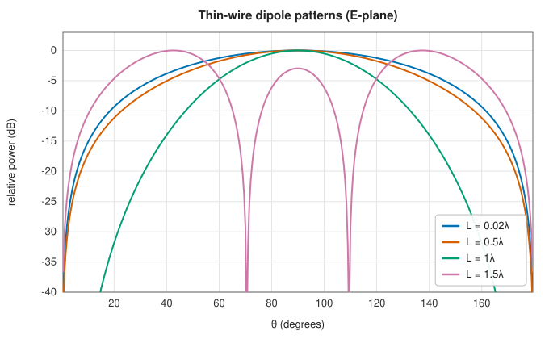
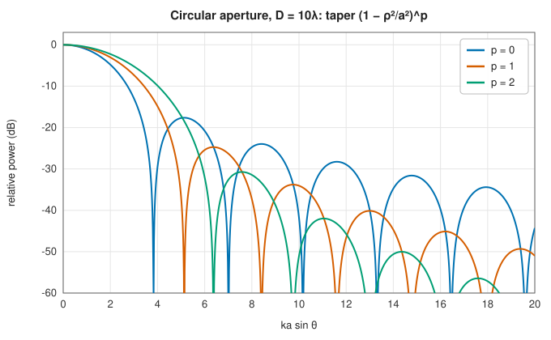
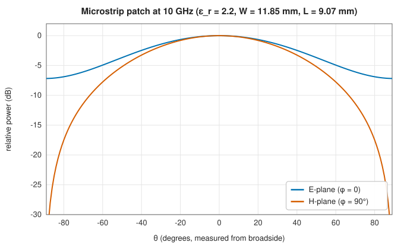

# Antenna models: dipoles, loops, dishes and patches

<div class="entry-summary">

| | |
|---|---|
| **Problem** | Give the far-field pattern, radiated power, directivity and radiation resistance of the classic antennas, from closed-form current or aperture models |
| **Devised by** | Heinrich Hertz (1887), the dipole; Samuel Silver and the MIT Radiation Laboratory (1940s), aperture theory of reflectors; Robert Munson and John Howell (1972–74), microstrip patches; formulas collected by Constantine Balanis (1982) |
| **Accuracy** | Directivities and radiation resistances agree with the closed forms to four digits (table below); the patch model is the standard approximate transmission-line/cavity model |
| **Cost** | A few function evaluations per direction; radiated power by Gauss-Legendre quadrature over the sphere |
| **API** | [`Antenna`](../../api/lib_jsl_electromagnetics/antenna_models/trait.Antenna.html) (`far_field`, `radiated_power`, `directivity`, `peak_directivity`, `radiation_resistance`, `far_field_pattern`, `gain_pattern`), [`HertzianDipole`](../../api/lib_jsl_electromagnetics/antenna_models/hertzian_dipole/struct.HertzianDipole.html), [`MagneticLoop`](../../api/lib_jsl_electromagnetics/antenna_models/magnetic_loop/struct.MagneticLoop.html), [`Dipole`](../../api/lib_jsl_electromagnetics/antenna_models/half_wave_dipole/struct.Dipole.html), [`HalfWaveDipole`](../../api/lib_jsl_electromagnetics/antenna_models/half_wave_dipole/struct.HalfWaveDipole.html), [`Dish`](../../api/lib_jsl_electromagnetics/antenna_models/dish/struct.Dish.html), [`PatchAntenna`](../../api/lib_jsl_electromagnetics/antenna_models/patch_antenna/struct.PatchAntenna.html), [`Isotropic`](../../api/lib_jsl_electromagnetics/antenna_models/struct.Isotropic.html) |

</div>

## Overview

An antenna converts a guided current into a radiated wave. Far from it, the field falls as $1/r$ and depends on direction through the **pattern** $(E_\theta, E_\varphi)$. The pattern determines the **radiation intensity** $U = |\mathbf E|^2/2\eta$ (W/sr), the radiated power $P = \oint U\,d\Omega$, and the **directivity** $D = 4\pi U/P$, which compares the antenna with an isotropic radiator.
For a current-fed antenna, the **radiation resistance** $R = 2P/|I|^2$ is the resistance that would dissipate the radiated power. Each model here gives its pattern in closed form, from an assumed current or aperture field, and implements the [`Antenna`](../../api/lib_jsl_electromagnetics/antenna_models/trait.Antenna.html) trait, from which the rest is computed numerically.

## History

Heinrich Hertz (1887) produced and detected electromagnetic waves with a spark-gap dipole and a loop, confirming Maxwell's theory. Guglielmo Marconi made them practical for telegraphy. The thin-wire dipole with a sinusoidal current, analysed in the 1920s and 30s, gives the half-wave dipole's 73 Ω and 1.64 directivity. Microwave radar in the Second World War brought reflector dishes and
horns, analysed as radiating apertures by Samuel Silver and colleagues (*Microwave Antenna Theory and Design*, 1949). Microstrip patch antennas, proposed by Georges Deschamps (1953), became practical with printed circuits: Robert Munson (1974) and John Howell (1975) built them for missiles. They are now in every phone and GPS receiver.

## The idea

### Electric and magnetic dipoles

A **Hertzian dipole**, a uniform current $I$ on a length $l \ll \lambda$ along $z$, radiates $E_\theta = j\eta kIl\sin\theta/(4\pi)$. Its directivity is 1.5, and $R = 80\pi^2(l/\lambda)^2$, tiny for short antennas. The model also gives its exact near field, with the $1/r^2$ and $1/r^3$ terms. A **small loop** of radius $a$ is a magnetic dipole: the same pattern with $\mathbf E$ along $\hat\varphi$, and $R = 20\pi^2(ka)^4$ per turn squared.

### Thin-wire dipoles

A centre-fed wire of length $L$ with the standard sinusoidal current $I(z) = I_m\sin\big(k(L/2 - |z|)\big)$ radiates

$$
E_\theta = \frac{j\eta I_m}{2\pi}\,\frac{\cos\big(\tfrac{kL}{2}\cos\theta\big) - \cos\tfrac{kL}{2}}{\sin\theta}.
$$

At $L = \lambda/2$ this gives $D = 1.64$ and $R = 30\,\mathrm{Cin}(2\pi) = 73.1\ \Omega$. Longer dipoles sharpen the broadside beam until, past $1.25\lambda$, lobes split off toward the ends:



The radiation resistance is referred to the current maximum $I_m$, which is the feed current only for odd multiples of a half wavelength.

### Apertures: the dish

A reflector dish is modelled as a circular aperture of diameter $D$ with a $\hat y$-polarized field $E_0(1 - \rho^2/a^2)^p$, radiating as a Huygens source. Its far field is a Fourier-Bessel transform:

$$
[E_\theta, E_\varphi] \propto 2^pp!\,\frac{J_{p+1}(u)}{u^{p+1}}\,\frac{1 + \cos\theta}{2}\,[\sin\varphi, \cos\varphi], \qquad u = ka\sin\theta.
$$

Uniform illumination ($p = 0$) gives the maximum directivity $(\pi D/\lambda)^2$, the Airy pattern with −17.6 dB sidelobes, and a half-power beamwidth of $1.029\lambda/D$. Tapering the edge lowers the sidelobes at the cost of directivity:



{{#include ../generated/em-arrays/dish_table.md}}

### Microstrip patches

A rectangular patch of length $L$ on a grounded substrate of permittivity $\varepsilon_r$ and height $h$ resonates when $L$ is about half a wavelength in the dielectric. Fringing fields lengthen it electrically by $\Delta L$ and lower the effective permittivity to $\varepsilon_{\text{eff}}$. The **transmission-line model** treats the two radiating edges as slots of width $W$, separated by $L + 2\Delta L$.
[`PatchAntenna::design`](../../api/lib_jsl_electromagnetics/antenna_models/patch_antenna/struct.PatchAntenna.html#method.design) chooses $W$ and $L$ for a frequency. The model gives the edge resistance from the slot conductances and the inset depth that matches it to 50 Ω. The pattern is broad, wider in the E-plane than in the H-plane:



### Checks against closed forms

{{#include ../generated/em-arrays/antenna_table.md}}

## Algorithm

1. **Pattern**: the model's closed-form $(E_\theta, E_\varphi)$ per unit excitation (current, aperture field or edge voltage).
2. **Power**: $P = \oint |\mathbf E|^2/2\eta\,d\Omega$ by Gauss-Legendre quadrature over the sphere (more nodes for electrically large antennas).
3. **Directivity**: $4\pi U/P$; the peak by searching the sphere (finely in $\theta$ for rotationally symmetric patterns).
4. **Gain patterns**: scale the pattern so that $|\mathbf E|^2$ equals the directivity times the efficiency, the normalisation the array models use.

## Implementation

```rust,ignore
{{#include ../../../crates/electromagnetics/src/antenna_models/half_wave_dipole.rs:dipole_far_field}}
```

- Every model gives its far field in either time convention (they differ by conjugation).
- `far_field_pattern` fills a container on a far-field sphere; `HarmonicField::transformed` rotates or moves it.
- These are analytic models, not full-wave solutions; for a wire antenna's actual current, see the method of moments in the next chapter.

## In practice

```rust,ignore
{{#include ../../../crates/electromagnetics/examples/antenna_patterns.rs}}
```

```text
== antenna models at 10 GHz (λ = 30.0 mm) ==
  model                             D (lin)  D (dBi)        R_rad (Ω)
  Hertzian dipole (λ/50)               1.50     1.76           0.3156
  small loop (a = λ/30)                1.50     1.76           0.3795
  half-wave dipole                     1.64     2.15          73.0790
  full-wave dipole                     2.41     3.82         198.9500
  microstrip patch (ε_r 2.2)           5.44     7.35                -
  dish, D = 10λ, uniform             986.96    29.94                -
  dish, D = 10λ, tapered (p=2)       548.31    27.39                -

  patch: W = 11.85 mm, L = 9.05 mm, edge resistance 228 Ω, 50 Ω inset 3.12 mm
  dish: half-power beamwidth 5.89° (uniform circular aperture: 1.029 λ/D = 5.90°)
```

The example then draws four polar pattern cuts in the terminal.

**Strengths**

- Exact closed forms for the idealised currents and apertures; consistent power, directivity and resistance from one trait.
- Patterns in either time convention, as containers ready for arrays and overlap integrals.

**Weaknesses**

- Assumed currents: no input reactance, no feed or mutual-coupling effects, and the sinusoidal current is only approximate for thick or long wires.
- The patch model ignores substrate surface waves and finite ground planes.

## Exercises

1. Integrate $\sin^2\theta$ over the sphere to obtain the Hertzian dipole's directivity of 1.5.
2. Show that the dipole formula reduces to the Hertzian dipole's for $kL \ll 1$ when $I_m$ is replaced by the average current.
3. Show that a uniform circular aperture's directivity is $(\pi D/\lambda)^2$, and find the efficiency of the taper $(1 - \rho^2/a^2)^p$.
4. Find the length at which a dipole's broadside lobe vanishes, and explain why the radiation resistance referred to the feed diverges for a full-wave dipole.
5. Design a patch for 2.45 GHz on FR-4 ($\varepsilon_r = 4.4$, $h = 1.6$ mm) and find its 50 Ω inset.

## Further reading

- C. A. Balanis, *Antenna Theory: Analysis and Design*, 4th ed., Wiley, 2016, chapters 4, 5, 12 and 14.
- J. D. Kraus and R. J. Marhefka, *Antennas for All Applications*, 3rd ed., McGraw-Hill, 2002.
- S. Silver (ed.), *Microwave Antenna Theory and Design*, MIT Radiation Laboratory Series 12, McGraw-Hill, 1949.
- R. E. Munson, "Conformal microstrip antennas and microstrip phased arrays", *IEEE Transactions on Antennas and Propagation* 22 (1974) 74–78.
