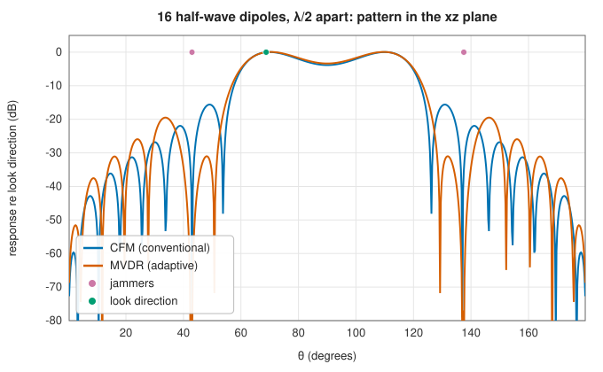
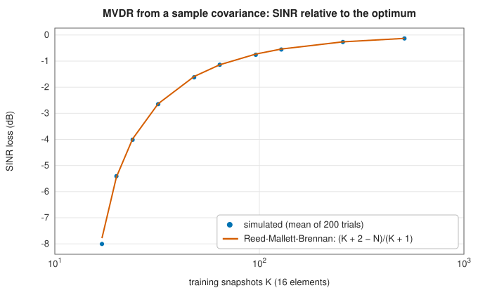

# Arrays, scenes and beamformers

<div class="entry-summary">

| | |
|---|---|
| **Problem** | Model what an array of antennas receives from point sources, a noisy sky and its own receivers, and combine the elements to favour a desired signal and suppress the rest |
| **Devised by** | Karl Ferdinand Braun (1905), the phased array; Sidney Applebaum (1966) and Bernard Widrow (1967), adaptive arrays; Jack Capon (1969), minimum variance; Otis Frost (1972), linearly constrained beamforming; Irving Reed, John Mallett and Lawrence Brennan (1974), sample-matrix inversion |
| **Accuracy** | Exact for the modelled covariance: max-SNR and MVDR reach the optimum SINR, LCMV meets its constraints to rounding (table below); with estimated covariances, the SINR loss follows the Reed-Mallett-Brennan law |
| **Cost** | Covariance $O(N^2)$ per source, $O(N^2 Q)$ for a scene on $Q$ sky samples; MVDR and LCMV $O(N^3)$; max-SNR an $N \times N$ eigenproblem |
| **API** | [`SensorArray`](../../api/lib_jsl_electromagnetics/arrays/sensor_array/struct.SensorArray.html) (`from_antenna`, `linear_positions`, `planar_positions`, `steering_vector`, `response_matrix`, `pattern_at`, `array_pattern`), [`PointSource`](../../api/lib_jsl_electromagnetics/signal_models/point_source/struct.PointSource.html), [`BrightnessScene`](../../api/lib_jsl_electromagnetics/signal_models/distributed/struct.BrightnessScene.html), [`Scene`](../../api/lib_jsl_electromagnetics/signal_models/covariance/struct.Scene.html), [`synthesize_snapshots`](../../api/lib_jsl_electromagnetics/signal_models/covariance/fn.synthesize_snapshots.html), [`sample_covariance`](../../api/lib_jsl_electromagnetics/signal_models/covariance/fn.sample_covariance.html), [`cfm_for_direction`](../../api/lib_jsl_electromagnetics/algorithms/cfm_beamformer/fn.cfm_for_direction.html), [`cfm_beamformer`](../../api/lib_jsl_electromagnetics/algorithms/cfm_beamformer/fn.cfm_beamformer.html), [`max_snr_beamformer`](../../api/lib_jsl_electromagnetics/algorithms/max_snr_beamformer/fn.max_snr_beamformer.html), [`mvdr_beamformer`](../../api/lib_jsl_electromagnetics/algorithms/lcmv_beamformer/fn.mvdr_beamformer.html), [`lcmv_beamformer`](../../api/lib_jsl_electromagnetics/algorithms/lcmv_beamformer/fn.lcmv_beamformer.html), [`sinr`](../../api/lib_jsl_electromagnetics/algorithms/beamforming/fn.sinr.html) |

</div>

## Overview

An array of $N$ antennas samples an incoming wave at $N$ places. A plane wave from direction $\Omega$ reaches each element with that element's pattern and a phase set by its position: together, the **steering vector** $\mathbf a(\Omega)$. The array output $y = \mathbf w^{\mathsf H}\mathbf x$ is a weighted sum. The weights $\mathbf w$ shape a beam, steering it electronically without moving anything. A **beamformer** chooses them.
The **conventional** or **conjugate field match** (CFM) beamformer matches the weights to the desired steering vector. The **adaptive** beamformers use the received covariance to place nulls on interference: **max-SNR**, **MVDR** (minimum variance distortionless response), and **LCMV** (linearly constrained minimum variance). This entry also covers the **signal models** that produce the covariance: point sources, distributed sky and ground emission, and receiver noise.

## History

Karl Ferdinand Braun (1905) steered a radio beam with three phased antennas. Phased arrays grew with radar in the Second World War and in radio astronomy afterwards. Adaptive arrays that cancel jamming appeared in the 1960s: Sidney Applebaum's sidelobe canceller (1966, published 1976) and Bernard Widrow's LMS array (1967). Jack Capon (1969) introduced the minimum-variance distortionless
beamformer for seismic arrays, and Otis Frost (1972) generalised it to linear constraints. Irving Reed, John Mallett and Lawrence Brennan (1974) showed how many snapshots an adaptive array needs when it estimates its covariance. Today the same mathematics serves radar, 5G massive MIMO, sonar and radio telescopes.

## The idea

### Arrays and steering vectors

An **array** is a set of antennas whose outputs are combined. A plane wave arriving from a given
direction reaches the elements at slightly different times, because some are closer to the
source than others. For a narrow-band signal a time difference is a phase difference: an element
at position $\mathbf p_n$ receives the wave from the direction of the unit vector $\hat r$ with
the phase factor $e^{jk\hat r \cdot \mathbf p_n}$, where $k = 2\pi/\lambda$. The list of these
factors for all the elements, each multiplied by the element's own response, is the
**steering vector** $\mathbf a(\Omega)$ of the direction $\Omega$. It is the array's signature of
that direction.

A **beamformer** multiplies each element's output by a complex weight and adds them, forming
$y = \mathbf w^{\mathsf H}\mathbf x$. If the weights undo the phase differences of one direction, the
contributions from that direction add in step, while those from other directions partly cancel.
The array then has a beam pointing in the chosen direction, with no moving parts. The rest of
this entry is about choosing the weights.

[`SensorArray`](../../api/lib_jsl_electromagnetics/arrays/sensor_array/struct.SensorArray.html) holds elements with positions $\mathbf p_n$ and far-field patterns $\mathbf g_n(\Omega) = (g_\theta, g_\varphi)$. The patterns are either analytic (an [antenna model](antennas.md) with an orientation) or sampled (a pattern container, which can include mutual coupling as embedded element patterns). Element $n$'s response to a wave of Jones polarisation $\mathbf p$ is
$\mathbf g_n(\Omega) \cdot \mathbf p\,e^{jk\hat r \cdot \mathbf p_n}$. These responses form the steering vector, and the array pattern for weights $\mathbf w$ is $\sum_n w_n^*\mathbf g_n(\Omega)e^{jk\hat r \cdot \mathbf p_n}$. Spacing matters for a reason that is the sampling theorem in space (see [sampling and aliasing](../filters/index.md#sampling-and-aliasing)): elements $d$ apart sample the wavefront at rate $1/d$, so directions are distinguishable without ambiguity only if $d \le \lambda/2$, and wider spacing produces **grating lobes**, extra main beams at angles that alias onto the intended one. A uniform line of elements $\lambda/2$ apart sees only the angle to its axis: a source at $\theta$ and one at $\pi - \theta$ in the plane of the axis are indistinguishable.

### Scenes and covariance

A **point source** of flux density $S$ and polarisation coherency $\mathbf C$ contributes $S\,\mathbf A\mathbf C\mathbf A^{\mathsf H}$, with $\mathbf A$ the $N \times 2$ response matrix. A **brightness scene**, a map of noise temperature $T(\Omega)$ over the far-field sphere such as warm ground and cold sky, contributes
$\frac{k_BB}{4\pi}\oint T(\Omega)\,\mathbf A\mathbf A^{\mathsf H}\,d\Omega$ for unpolarised emission. A lossless antenna in a uniform sky then sees exactly $k_BTB$. **Receiver noise** adds $k_BT_rB\,\mathbf I$. The [`Scene`](../../api/lib_jsl_electromagnetics/signal_models/covariance/struct.Scene.html) sums these into
$\mathbf R$, and [`synthesize_snapshots`](../../api/lib_jsl_electromagnetics/signal_models/covariance/fn.synthesize_snapshots.html) draws complex Gaussian samples with that covariance.

### Beamformers

The output $y = \mathbf w^{\mathsf H}\mathbf x$ has power $\mathbf w^{\mathsf H}\mathbf R\mathbf w$, where
$\mathbf R = E[\mathbf x\mathbf x^{\mathsf H}]$ is the covariance of the element outputs. Splitting $\mathbf R$
into the part $\mathbf R_s$ due to the desired signal and the part $\mathbf R_n$ due to interference
and noise, the figure of merit is the **SINR**,
$\mathbf w^{\mathsf H}\mathbf R_s\mathbf w/\mathbf w^{\mathsf H}\mathbf R_n\mathbf w$, the ratio of desired signal to
interference plus noise at the output. Four classical choices of weights follow, from the
simplest to the most flexible; $\mathbf a$ is the steering vector of the direction of interest.

- **CFM**: $\mathbf w = \mathbf a/\|\mathbf a\|$, the matched filter, optimal in spatially white noise. For a distributed desired field it is the dominant eigenvector of $\mathbf R_s$.
- **Max-SNR**: maximise the SINR directly. This is the generalised eigenproblem $\mathbf R_s\mathbf w = \lambda\mathbf R_n\mathbf w$, solved by whitening with the Cholesky factor of $\mathbf R_n$. Its largest eigenvalue is the optimum SINR.
- **MVDR** (minimum variance distortionless response): minimise the output power $\mathbf w^{\mathsf H}\mathbf R\mathbf w$ subject to unit gain toward the look direction, $\mathbf w^{\mathsf H}\mathbf a = 1$. The constraint protects the wanted signal, so the only way to reduce the output power is to reject everything else. A [Lagrange multiplier](../optimization/constrained.md#optimality-conditions) gives $\mathbf R\mathbf w = \mu\mathbf a$, and the constraint fixes $\mu$: $\mathbf w = \mathbf R^{-1}\mathbf a/(\mathbf a^{\mathsf H}\mathbf R^{-1}\mathbf a)$. For a point-source signal it equals max-SNR, and it needs only the total covariance.
- **LCMV**: minimise the output power subject to several responses $\mathbf C^{\mathsf H}\mathbf w = \mathbf f^*$. The solution is $\mathbf w = \mathbf R^{-1}\mathbf C(\mathbf C^{\mathsf H}\mathbf R^{-1}\mathbf C)^{-1}\mathbf f^*$, for example unit gain on the target and exact nulls on known jammers.

A 16-element array of half-wave dipoles at 1.5 GHz looks for a weak signal at $\theta = 69°$ amid two jammers 43 dB above the noise, a 290 K ground, a 10 K sky and 75 K receivers:



<p class="caption" id="fig-20-5"><strong>Figure 20.5.</strong> Beam patterns.</p>

{{#include ../generated/em-arrays/beamformer_table.md}}

The CFM beam leaves the jammers in its sidelobes. The adaptive beamformers null them by 100 dB or more and recover the full SINR, and LCMV's explicit nulls are exact to rounding.

### Learning from snapshots

In practice $\mathbf R$ is estimated from $K$ snapshots, $\hat{\mathbf R} = \frac1K\sum_k\mathbf x_k\mathbf x_k^{\mathsf H}$. With interference-plus-noise training data, Reed, Mallett and Brennan showed that the expected SINR of $\hat{\mathbf R}^{-1}\mathbf a$, relative to the optimum, is $(K + 2 - N)/(K + 1)$. So $K = 2N$ snapshots lose 3 dB:



<p class="caption" id="fig-20-6"><strong>Figure 20.6.</strong> SMI loss.</p>

If the training data contains the desired signal, the loss is larger and the signal partly cancels itself. Diagonal loading and constraints guard against that.

## Algorithm

**Steering vector** for a direction $\Omega$ and a polarisation: for each element, evaluate
its pattern in that direction, take its component along the polarisation, and multiply by the
phase factor $e^{jk\hat r\cdot\mathbf p_n}$ of the element's position.

**Covariance of a scene**: start from zero and add the contribution of each part. A point
source adds $S\,\mathbf A\mathbf C\mathbf A^{\mathsf H}$. A brightness map adds its integral over the sphere,
computed by quadrature: the weighted sum of $T(\Omega)\,\mathbf A\mathbf A^{\mathsf H}$ over the quadrature
directions. The receivers add a multiple of the identity.

**Beamformer weights.**

- *CFM*: normalise the steering vector, or take the dominant eigenvector of $\mathbf R_s$.
- *MVDR and LCMV*: factor $\mathbf R$ by LU; solve $\mathbf R\mathbf X = \mathbf C$ for $\mathbf X = \mathbf R^{-1}\mathbf C$,
  where the columns of $\mathbf C$ are the constraint vectors (the single steering vector, for
  MVDR); form the small matrix $\mathbf C^{\mathsf H}\mathbf X$ and solve it against $\mathbf f^*$; multiply the
  solution by $\mathbf X$.
- *Max-SNR*: factor $\mathbf R_n = \mathbf L\mathbf L^{\mathsf H}$ by Cholesky; form $\mathbf L^{-1}\mathbf R_s\mathbf L^{-\mathsf H}$
  by triangular solves; find its dominant eigenvector $\mathbf v$; return
  $\mathbf w = \mathbf L^{-\mathsf H}\mathbf v$.

**Evaluating a beamformer**: the output SINR is
$\mathbf w^{\mathsf H}\mathbf R_s\mathbf w/\mathbf w^{\mathsf H}\mathbf R_n\mathbf w$, and the beam pattern is
$|\mathbf w^{\mathsf H}\mathbf a(\Omega)|^2$ over a grid of directions.

With $N$ elements, each set of adaptive weights costs $O(N^3)$.

## Implementation

```rust,ignore
{{#include ../../../crates/electromagnetics/src/arrays/sensor_array.rs:geometric_phase}}
```

```rust,ignore
{{#include ../../../crates/electromagnetics/src/algorithms/lcmv_beamformer.rs:lcmv}}
```

- Weights act as $y = \mathbf w^{\mathsf H}\mathbf x$, so a beamformer's gain toward $\mathbf a$ is $\mathbf w^{\mathsf H}\mathbf a$ ([`response`](../../api/lib_jsl_electromagnetics/algorithms/beamforming/fn.response.html)).
- Covariances are in watts over the scene bandwidth; `array_pattern` returns the beam as a far-field container for directivity and overlap calculations.

## In practice

```rust,ignore
{{#include ../../../crates/electromagnetics/examples/beamforming_demo.rs}}
```

```text
== 16-element half-wave dipole array at 1.5 GHz ==
  desired at θ = 69°, jammers at 43° and 138°;
  290 K ground below the horizon, 10 K sky above, 75 K receivers (system noise 225 K per element).
  per element: desired SNR -3.9 dB, each jammer 42.6 dB above the noise.

  beamformer    SINR (dB) jammer 1 response (dB) jammer 2 response (dB)
  CFM              -14.77                  -59.3                  -35.3
  max-SNR            6.72                 -101.3                 -101.1
  MVDR               6.72                 -101.3                 -101.1
  LCMV               6.72                 -240.0                 -240.0
```

The example also draws the CFM and MVDR patterns in the terminal. The system noise of 225 K is the receivers' 75 K plus about 150 K from the half of each dipole's pattern that sees the warm ground.

**Strengths**

- Physically grounded covariances (element patterns, polarisation, sky and ground temperatures) for any array geometry.
- Optimal and constrained beamformers with exact figures of merit.

**Weaknesses**

- Narrowband: one frequency per array; wideband arrays need a filter per element.
- Adaptive beamformers are sensitive to steering-vector errors and to the desired signal in the training data.

## Exercises

1. Show that the CFM weights maximise the SINR when $\mathbf R_n = \sigma^2\mathbf I$.
2. Derive the MVDR weights by Lagrange multipliers, and show that its output power is $1/(\mathbf a^{\mathsf H}\mathbf R^{-1}\mathbf a)$.
3. Show that MVDR with the total covariance $\mathbf R_s + \mathbf R_n$ gives the same weights (up to scale) as with $\mathbf R_n$ alone, for a point-source signal.
4. Find the array factor of $N$ isotropic elements spaced $d$ apart, and the spacing at which grating lobes appear.
5. Simulate sample-matrix inversion with the desired signal included in the training data, and compare the loss with the figure above.

## Further reading

- H. L. Van Trees, *Optimum Array Processing*, Wiley, 2002.
- J. Capon, "High-resolution frequency-wavenumber spectrum analysis", *Proceedings of the IEEE* 57 (1969) 1408–1418.
- O. L. Frost, "An algorithm for linearly constrained adaptive array processing", *Proceedings of the IEEE* 60 (1972) 926–935.
- I. S. Reed, J. D. Mallett and L. E. Brennan, "Rapid convergence rate in adaptive arrays", *IEEE Transactions on Aerospace and Electronic Systems* 10 (1974) 853–863.
