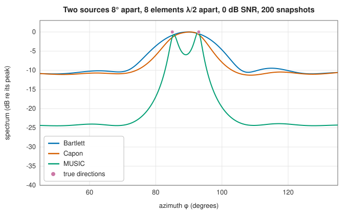

# Direction finding: Bartlett, Capon, MUSIC and ESPRIT

<div class="entry-summary">

| | |
|---|---|
| **Problem** | Estimate the directions of several signals arriving at an array from its covariance matrix, beyond the resolution of the array's beam when possible |
| **Devised by** | M. S. Bartlett (1948), the averaged periodogram behind the conventional scan; Jack Capon (1969), minimum variance; Ralph Schmidt (1979), MUSIC; Richard Roy, Arogyaswami Paulraj and Thomas Kailath (1986), ESPRIT |
| **Accuracy** | MUSIC and ESPRIT resolve sources a fraction of a beamwidth apart at moderate SNR; single-source errors fall as $1/\sqrt{K\cdot\mathrm{SNR}}$ (table below) |
| **Cost** | Spectra: one $N$-vector product per scanned direction after an $O(N^3)$ inverse or eigendecomposition; ESPRIT: two small eigenproblems, no scan |
| **Read first** | [Arrays, scenes and beamformers](beamforming.md), [Parametric spectra: linear prediction, Burg and MUSIC](../spectral/parametric.md) |
| **API** | [`bartlett_spectrum`](../../api/lib_jsl_electromagnetics/algorithms/direction_of_arrival/fn.bartlett_spectrum.html), [`capon_spectrum`](../../api/lib_jsl_electromagnetics/algorithms/direction_of_arrival/fn.capon_spectrum.html), [`music_spectrum`](../../api/lib_jsl_electromagnetics/algorithms/direction_of_arrival/fn.music_spectrum.html), [`spectrum_peaks`](../../api/lib_jsl_electromagnetics/algorithms/direction_of_arrival/fn.spectrum_peaks.html), [`esprit_ula`](../../api/lib_jsl_electromagnetics/algorithms/direction_of_arrival/fn.esprit_ula.html) |

</div>

## Overview

**Direction finding** turns the beamforming question around: instead of passing a signal from a known direction, find the directions the signals come from. A **spatial spectrum** scans candidate directions $\Omega$ and evaluates a function of the array covariance $\mathbf R$ and the steering vector $\mathbf a(\Omega)$ that peaks at the sources. The **Bartlett** spectrum steers a conventional beam, so its resolution is one beamwidth, about $2/N$ radians for $N$
elements $\lambda/2$ apart. The **Capon** spectrum steers an adaptive MVDR beam, which nulls the other sources and sharpens the peaks. **MUSIC** splits the eigenvectors of $\mathbf R$ into a signal subspace and a noise subspace and looks for steering vectors orthogonal to the noise subspace, which gives **super-resolution** when the number of sources is known. **ESPRIT** skips the scan: for a uniform line it reads the directions off the rotation between two shifted subarrays.

## History

Direction finding began with rotating loop antennas in the First World War. With arrays and digital processing it became spectral estimation in space. Bartlett's averaged periodogram (1948) is the conventional beam scan, and Jack Capon's minimum-variance estimator (1969) came from seismic arrays. Ralph Schmidt's MUSIC (multiple signal classification), presented in 1979 and published in 1986, introduced the subspace methods. Richard Roy, Arogyaswami Paulraj and Thomas Kailath's ESPRIT (estimation of signal
parameters via rotational invariance techniques, 1986–89) needed no search. Petre Stoica and Arye Nehorai (1989) compared these estimators with the Cramér-Rao bound. They now locate emitters in electronic warfare, sources in radio astronomy, and users in cellular systems.

## The idea

### Beam-scanning spectra

The simplest way to find where signals come from is to steer a
[beam](beamforming.md#beamformers) across all directions and plot the output power against the
steering direction; sources appear as peaks. With $\mathbf R = \sum_i P_i\mathbf a_i\mathbf a_i^{\mathsf H} + \sigma^2\mathbf I$ for uncorrelated sources:

$$
P_{\text{Bartlett}}(\Omega) = \frac{\mathbf a^{\mathsf H}\mathbf R\mathbf a}{\mathbf a^{\mathsf H}\mathbf a}, \qquad P_{\text{Capon}}(\Omega) = \frac{1}{\mathbf a^{\mathsf H}\mathbf R^{-1}\mathbf a}\ \ (\|\mathbf a\| = 1).
$$

Bartlett's is the power out of a conventional beam steered to $\Omega$, and Capon's the power out of an MVDR beam, which suppresses everything not from $\Omega$.

### MUSIC

MUSIC applies the subspace idea of
[spectral estimation](../spectral/parametric.md#music) to directions instead of frequencies; the
array's steering vectors play the role of the sampled complex exponentials there.

The $M$ largest eigenvalues of $\mathbf R$ belong to the signal subspace, spanned by the steering vectors of the $M$ sources. The other $N - M$ eigenvectors $\mathbf E_n$ span the noise subspace, which is orthogonal to every source's steering vector. So

$$
P_{\text{MUSIC}}(\Omega) = \frac{\mathbf a^{\mathsf H}\mathbf a}{\mathbf a^{\mathsf H}\mathbf E_n\mathbf E_n^{\mathsf H}\mathbf a}
$$

is infinite at the sources for the exact covariance, and sharply peaked for an estimated one. MUSIC needs the number of sources, and it fails for fully correlated sources (multipath), which collapse the signal subspace.

### ESPRIT

For a uniform linear array, the first $N - 1$ elements and the last $N - 1$ form two identical subarrays displaced by $d$. Their steering vectors differ by the phase $e^{jkdu}$, where $u$ is the direction cosine along the axis. The signal-subspace eigenvectors $\mathbf E_s$, restricted to the two subarrays, are related by $\mathbf E_2 = \mathbf E_1\boldsymbol\Psi$. The least-squares solution
$\boldsymbol\Psi = (\mathbf E_1^{\mathsf H}\mathbf E_1)^{-1}\mathbf E_1^{\mathsf H}\mathbf E_2$ has eigenvalues $e^{jkdu_i}$, so $u_i = \arg\lambda_i/(kd)$ (sign per the time convention). No scan or peak search is needed.



<p class="caption" id="fig-20-7"><strong>Figure 20.7.</strong> DOA spectra.</p>

{{#include ../generated/em-arrays/doa_facts.md}}

For a single source, all three estimators are nearly unbiased, and their errors shrink with SNR:

<p class="caption" id="tab-20-3"><strong>Table 20.3.</strong> Direction-finding error of Capon, MUSIC and ESPRIT against SNR.</p>

{{#include ../generated/em-arrays/doa_rmse.md}}

The errors are for 100 snapshots on 8 elements, from 40 trials each. Capon and MUSIC are nearly identical for one source. Least-squares ESPRIT uses only the shift invariance, and is somewhat noisier.

## Algorithm

All the estimators start from the same matrix.

1. **Covariance.** Estimate $\hat{\mathbf R} = \tfrac1K\sum_k\mathbf x_k\mathbf x_k^{\mathsf H}$ from $K$
   snapshots, with
   [`sample_covariance`](../../api/lib_jsl_electromagnetics/signal_models/covariance/fn.sample_covariance.html).

**Scanning estimators** (Bartlett, Capon, MUSIC).

2. Prepare what the formula needs: nothing for Bartlett; a factorisation of $\hat{\mathbf R}$
   for Capon; for MUSIC, the eigendecomposition and the eigenvectors of the $N - M$ smallest
   eigenvalues.
3. For each direction of a grid, compute the array's steering vector (for its actual
   geometry, element patterns and polarisation) and evaluate the formula.
4. Find the $M$ highest peaks of the resulting spectrum with
   [`spectrum_peaks`](../../api/lib_jsl_electromagnetics/algorithms/direction_of_arrival/fn.spectrum_peaks.html).

The accuracy is limited by the spacing of the grid unless the peaks are refined.

**ESPRIT**, for a uniform linear array.

2. Compute the eigendecomposition of $\hat{\mathbf R}$ and take the eigenvectors of the $M$
   largest eigenvalues as the columns of $\mathbf E_s$.
3. Let $\mathbf E_1$ be $\mathbf E_s$ without its last row and $\mathbf E_2$ without its first row.
4. Solve $\mathbf E_1\boldsymbol\Psi = \mathbf E_2$ for the $M \times M$ matrix $\boldsymbol\Psi$ by least squares.
5. Compute the eigenvalues $\lambda_i$ of $\boldsymbol\Psi$; the direction cosines are
   $u_i = \arg\lambda_i/(kd)$.

## Implementation

```rust,ignore
{{#include ../../../crates/electromagnetics/src/algorithms/direction_of_arrival.rs:music}}
```

```rust,ignore
{{#include ../../../crates/electromagnetics/src/algorithms/direction_of_arrival.rs:esprit}}
```

- The spectra take any [`SensorArray`](../../api/lib_jsl_electromagnetics/arrays/sensor_array/struct.SensorArray.html) and polarisation; ESPRIT assumes a uniform linear array of identical elements.
- `spectrum_peaks` returns local maxima of a 1D scan, strongest first.

## In practice

```rust,ignore
{{#include ../../../crates/electromagnetics/examples/direction_finding.rs}}
```

```text
Bartlett: peaks at 74.2° and 95.3°
   Capon: peaks at 70.3° and 77.7°
   MUSIC: peaks at 70.0° and 77.9°
  ESPRIT: 70.04° and 77.93°
```

With ten elements and sources 8° apart at 5 dB SNR, the conventional beam merges the two into one peak between them. Its second "peak" is a sidelobe. The other three methods resolve both sources.

**Strengths**

- Works on any array geometry with real element patterns; super-resolution with MUSIC and ESPRIT.
- ESPRIT gives directions in closed form, without a grid.

**Weaknesses**

- MUSIC and ESPRIT need the number of sources and uncorrelated signals (spatial smoothing helps for coherent ones).
- All degrade at low SNR or few snapshots, where the subspaces swap (the threshold effect).

## Exercises

1. Show that for one source and white noise, all three spectra peak exactly at the source.
2. Show that the noise eigenvectors of $\mathbf R = \mathbf A\mathbf P\mathbf A^{\mathsf H} + \sigma^2\mathbf I$ are orthogonal to the columns of $\mathbf A$.
3. Derive ESPRIT's relation $\mathbf E_2 = \mathbf E_1\boldsymbol\Psi$ from the shift structure of a uniform line.
4. Simulate two fully correlated sources and show that MUSIC fails; restore it with forward spatial smoothing.
5. Compute the Cramér-Rao bound for one source on a uniform line, and compare it with the table above.

<details>
<summary>Hints and answers</summary>

1. For one source with white noise, $R = \sigma_s^2\mathbf a\mathbf a^{\mathsf H} + \sigma^2I$. The Bartlett power $\mathbf a^{\mathsf H}R\mathbf a$ is maximised at the true steering vector (Cauchy-Schwarz); Capon's $1/\mathbf a^{\mathsf H}R^{-1}\mathbf a$ and MUSIC's $1/\lVert E_n^{\mathsf H}\mathbf a\rVert^2$ also peak there.
2. $R\mathbf e = \lambda\mathbf e$; for $\mathbf e \perp$ the signal subspace span of the columns of $A$, $R\mathbf e = \sigma^2\mathbf e$, so these are the noise eigenvectors and $A^{\mathsf H}\mathbf e = 0$.
3. Two subarrays offset by one element satisfy $A_2 = A_1\Phi$ with $\Phi = \operatorname{diag}(e^{jkd\sin\theta_i})$; as the signal subspace is $E_s = AT$, $E_2 = A_2T = A_1\Phi T = E_1T^{-1}\Phi T$, i.e. $E_2 = E_1\Psi$ with $\Psi = T^{-1}\Phi T$.
4. With fully correlated sources the signal covariance $P$ is rank 1, so the signal subspace has dimension 1 and MUSIC sees one source; forward spatial smoothing averages the covariances of overlapping subarrays and restores the rank.
5. The CRB for one source on an $N$-element uniform line is $\sigma_\theta^2 \ge \dfrac{6}{\mathrm{SNR}\cdot K\cdot N(N^2 - 1)\,(\pi\cos\theta)^2}$ for half-wavelength spacing, in radians$^2$ for $K$ snapshots.

</details>

## Further reading

- H. Krim and M. Viberg, "Two decades of array signal processing research", *IEEE Signal Processing Magazine* 13:4 (1996) 67–94.
- R. O. Schmidt, "Multiple emitter location and signal parameter estimation", *IEEE Transactions on Antennas and Propagation* 34 (1986) 276–280.
- R. Roy and T. Kailath, "ESPRIT—estimation of signal parameters via rotational invariance techniques", *IEEE Transactions on Acoustics, Speech, and Signal Processing* 37 (1989) 984–995.
- P. Stoica and A. Nehorai, "MUSIC, maximum likelihood, and Cramér-Rao bound", *IEEE Transactions on Acoustics, Speech, and Signal Processing* 37 (1989) 720–741.
