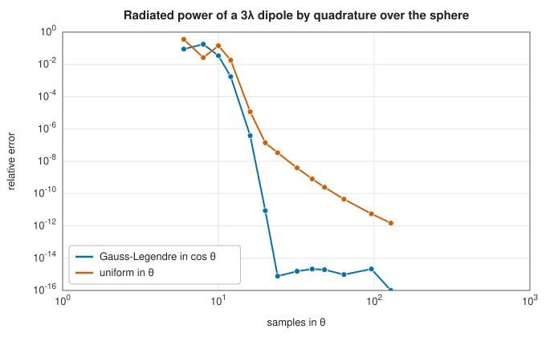

# Fields on grids: conventions, domains, quadrature and vector calculus

<div class="entry-summary">

| | |
|---|---|
| **Problem** | Represent electromagnetic fields sampled on surfaces and volumes, in any coordinate system and polarisation basis, and integrate, interpolate, transform and differentiate them consistently |
| **Devised by** | Standard electromagnetic theory (Maxwell, 1865; Poynting, 1884); Carl Friedrich Gauss (1814), Gaussian quadrature; finite differences on curvilinear grids |
| **Accuracy** | Sphere quadrature exact to rounding for band-limited patterns (Gauss-Legendre in $\cos\theta$); fourth-order derivatives (tables below); Poynting flux conserved to all digits printed |
| **Cost** | $O(N)$ storage and per-sample operations for $N$ samples; interpolation $O(4^d)$ per query for cubic stencils in $d$ dimensions |
| **Read first** | [Preliminaries: complex numbers](../preliminaries.md#complex-numbers) |
| **API** | [`TimeConvention`](../../api/lib_jsl_electromagnetics/conventions/enum.TimeConvention.html), [`Medium`](../../api/lib_jsl_electromagnetics/conventions/struct.Medium.html), [`Position`](../../api/lib_jsl_electromagnetics/coordinates/systems/struct.Position.html), [`PolarizationBasis`](../../api/lib_jsl_electromagnetics/coordinates/polarization/enum.PolarizationBasis.html), [`RigidTransform`](../../api/lib_jsl_electromagnetics/coordinates/transforms/struct.RigidTransform.html), [`Axis`](../../api/lib_jsl_electromagnetics/fields/domain/axis/struct.Axis.html), [`Domain`](../../api/lib_jsl_electromagnetics/fields/domain/structured/struct.Domain.html), [`HarmonicField`](../../api/lib_jsl_electromagnetics/fields/field_container/struct.HarmonicField.html), [`TimeField`](../../api/lib_jsl_electromagnetics/fields/field_container/struct.TimeField.html), [`physics`](../../api/lib_jsl_electromagnetics/fields/physics/index.html) (`plane_wave`, `poynting`, `power_through_surface`, `directivity`), [`overlap_integral`](../../api/lib_jsl_electromagnetics/algorithms/overlap_integral/fn.overlap_integral.html) |

</div>

## Overview

Antennas, arrays and solvers all produce or consume **fields**: vectors attached to points of space, at one frequency (complex **phasors**) or over time. This entry describes how the library holds them. A field is a container of samples on a structured **domain**: a plane, sphere or cylinder for surfaces, or a box, spherical shell or cylinder for volumes. It carries its quantity (E, H, J, …),
its polarisation basis (Cartesian, spherical, cylindrical, or circular), and for phasors the frequency and **time convention**. Each domain carries **quadrature weights** with the Jacobian included, so every integral, from radiated power to overlap integrals, is a weighted sum. Fields can be
converted between bases, interpolated onto other grids, rotated and translated, and differentiated (gradient, divergence, curl, Laplacians) in their native curvilinear coordinates.

## History

James Clerk Maxwell's equations (1865), in Oliver Heaviside's vector form (1880s), and John Henry Poynting's theorem on energy flow (1884) are the physics. Two conventions for phasors have coexisted since the start of AC circuit theory. Engineers write $e^{+j\omega t}$, following Charles Steinmetz (1893), and physicists write $e^{-i\omega t}$. Every formula's signs depend on the choice, and
mixing them is a classic source of errors. Carl Friedrich Gauss (1814) devised the quadrature that integrates polynomials of twice the degree of equally many uniformly spaced points. On the sphere, Gauss-Legendre nodes in $\cos\theta$ with uniform azimuth integrate band-limited patterns exactly.

## The idea

### Conventions

Units are SI, and phasors are **peak** amplitudes, so time averages carry a factor ½, as in $\mathbf S = \tfrac12\mathbf E \times \mathbf H^*$. [`TimeConvention`](../../api/lib_jsl_electromagnetics/conventions/enum.TimeConvention.html) is either `PlusJ`, meaning $e^{+j\omega t}$ (the default, with outgoing waves $e^{-jkr}$), or `MinusI`, meaning $e^{-i\omega t}$. Converting between them is complex conjugation, and operations on two fields check that they agree.
Spherical angles follow the physics convention: $\theta$ from $+z$, $\varphi$ from $+x$. Far fields are stored with the factor $e^{-jkr}/r$ removed, as $(E_\theta, E_\varphi)$.

### Domains and quadrature

A domain is a product of one-dimensional [`Axis`](../../api/lib_jsl_electromagnetics/fields/domain/axis/struct.Axis.html) objects, each with nodes and weights: uniform (trapezoidal), periodic (for azimuth), or Gauss-Legendre. The domain multiplies in the Jacobian, $\sin\theta$ on spheres or $\rho$ in cylinders, so $\int f\,dA \approx \sum_i w_if_i$ on any of them. For the far-field sphere, Gauss-Legendre nodes in $\cos\theta$ integrate a pattern that is a polynomial in $\cos\theta$
of degree up to $2n - 1$ exactly, and uniform azimuth samples integrate trigonometric polynomials exactly. A uniform grid in $\theta$ converges only algebraically:



<p class="caption" id="fig-20-1"><strong>Figure 20.1.</strong> Sphere quadrature.</p>

### Bases, interpolation and rigid transforms

Every polarisation basis is a position-dependent map to Cartesian components, so a change of basis goes through Cartesian at each sample's position. The **circular** basis uses the right- and left-hand components transverse to the system's reference direction (IEEE handedness). Interpolation by nearest, linear or cubic (four-point Lagrange) stencils is separable over the axes. It wraps
periodic axes and continues across the poles of a sphere onto the reflected samples $(\theta', \varphi + \pi)$. Vector fields are interpolated in Cartesian components, since $\hat\theta$ and $\hat\varphi$ components change sign across a pole. A **rotation** moves both the sample positions and the vectors. A **translation** of a far field multiplies it by the phase ramp $e^{jk\hat r \cdot \mathbf d}$.

### Vector calculus on curvilinear grids

Derivatives along each native axis use five-point Lagrange stencils (fourth order, any spacing; three points on short axes). They combine into Cartesian derivatives through the local frame $\hat u_a$ and scale factors $h_a$:

$$
\frac{\partial}{\partial x_j} = \sum_a \frac{(\hat u_a)_j}{h_a}\,\frac{\partial}{\partial u_a},
$$

applied to the smooth Cartesian components. Gradient, divergence, curl and Laplacians follow. Samples where a scale factor vanishes (the axis of a cylinder, the centre or poles of a sphere) are returned as NaN. Checking Faraday's law $\nabla \times \mathbf E = -j\omega\mu_0\mathbf H$ for a plane wave shows the fourth order:

<p class="caption" id="tab-20-1"><strong>Table 20.1.</strong> Convergence of the sampled-field curl check with sampling density.</p>

{{#include ../generated/em-arrays/faraday_table.md}}

The divergence vanishes to rounding because the plane wave's field is transverse. Surface operators (surface gradient, divergence, curl and the Laplace-Beltrami operator) are provided for plane, sphere and cylinder domains.

### Physics on fields

The [`physics`](../../api/lib_jsl_electromagnetics/fields/physics/index.html) module computes the Poynting vector $\tfrac12\mathbf E \times \mathbf H^*$ (or $\mathbf E \times \mathbf H$ for time-domain fields), the power through a surface, radiation intensity, directivity and wave impedance, and fields from potentials, $\mathbf E = -\nabla\Phi - j\omega\mathbf A$, $\mathbf B = \nabla \times \mathbf A$ (signs per the convention). The **overlap integral**

$$
\eta = \frac{\big|\int \mathbf E_1 \cdot \mathbf E_2^*\,dA\big|^2}{\int |\mathbf E_1|^2\,dA\int |\mathbf E_2|^2\,dA}
$$

measures how well two fields match, as in the coupling of a beam into a mode or of a feed to a reflector. [`overlap_integral`](../../api/lib_jsl_electromagnetics/algorithms/overlap_integral/fn.overlap_integral.html) resamples the second field onto the first's domain and compares them in Cartesian components, so the fields may live on different grids and in different bases.

## Algorithm

**Integrating a field** over its domain: multiply each sample by its weight, the product of
the one-dimensional quadrature weights of the axes and the Jacobian at that sample
($\sin\theta$ on a sphere, $\rho$ in a cylinder), and add them up.

**Changing the polarisation basis** of a vector field: at each sample, convert the components
to Cartesian using the unit vectors of the old basis *at that sample's position*; then take
the components of the Cartesian vector along the unit vectors of the new basis there.

**Interpolating at a point.**

1. Convert the field to Cartesian components, which vary smoothly even where the coordinate
   unit vectors do not (at the poles).
2. For each axis, find the stencil of neighbouring grid points (one, two or four) and the
   Lagrange weights of the point within it. On a periodic axis the stencil wraps round. On a
   sphere, a stencil that would run past a pole continues on the far side, at
   $(\theta', \varphi + \pi)$.
3. Sum the products of the weights with the samples over the stencil.
4. Convert the result back to the requested basis at the point.

**Differentiating.**

1. For each native axis, apply the five-point Lagrange derivative stencil along that axis to
   each Cartesian component.
2. Combine the per-axis derivatives into Cartesian derivatives through the local frame and the
   scale factors, by the formula above.
3. Assemble the gradient, divergence, curl or Laplacian from the Cartesian derivatives.

## Implementation

```rust,ignore
{{#include ../../../crates/electromagnetics/src/fields/vector_calculus.rs:cartesian_jacobians}}
```

- Fields are shared through `Arc<Domain>`, so many fields on one grid cost one grid.
- `HarmonicField` holds complex phasors; `TimeField` holds real samples on a uniform time axis, with `∂/∂t` and instantaneous Poynting vectors.
- Quantities carry units, and the physics functions check them (for example that the first argument is an electric field).

## In practice

```rust,ignore
{{#include ../../../crates/electromagnetics/examples/fields_demo.rs}}
```

```text
== Hertzian dipole (l = λ/20): power through spheres vs far-field power ==
  far-field radiated power  9.876437e-1 W per A²
  r =  0.02 λ: Poynting flux 9.876437e-1 W
  r =   0.1 λ: Poynting flux 9.876437e-1 W
  r =   0.5 λ: Poynting flux 9.876437e-1 W
  r =     2 λ: Poynting flux 9.876437e-1 W
  r =    10 λ: Poynting flux 9.876437e-1 W
== plane wave in a 0.5 λ cube (21³ samples) ==
  max |∇·E| = 5.78e-14 V/m²   max |∇×E + jωμ₀H| = 2.71e-4 V/m² (|∇×E| ≈ 6.3)
== Gaussian beam coupling (waist 1) against offset copies on a different grid and basis ==
  offset 0.0: efficiency 1.00000 (closed form 1.00000)
  offset 0.5: efficiency 0.77883 (closed form 0.77880)
  offset 1.0: efficiency 0.36794 (closed form 0.36788)
  offset 1.5: efficiency 0.10542 (closed form 0.10540)
== rigid transforms of the dipole pattern ==
  peak directivity: original 1.5000, rotated 40° 1.5001
  translated λ/4 along x: phase change towards +x 90.1° (expected 90°)
```

The exact near field of a Hertzian dipole carries the same power through a sphere of radius $0.02\lambda$, deep in the reactive near field, as through one of $10\lambda$. The Gaussian beams' coupling $e^{-d^2/w^2}$ is reproduced across different grids and bases to the interpolation's accuracy.

**Strengths**

- One container for every field, with the convention, quantity and basis attached; integrals and derivatives in native coordinates.
- Exact quadrature on the far-field sphere; consistent interpolation across poles and periodic axes.

**Weaknesses**

- Structured grids only; no unstructured meshes or adaptive refinement.
- Finite differences need several samples per wavelength (20 for $5 \times 10^{-4}$ accuracy above).

## Exercises

1. Show that converting a phasor field between $e^{+j\omega t}$ and $e^{-i\omega t}$ is complex conjugation, and find how the curl equation changes.
2. Show that $n$ Gauss-Legendre nodes in $\cos\theta$ with $2n$ uniform azimuths integrate every spherical harmonic of degree below $2n$ exactly.
3. Derive the divergence in spherical coordinates from the formula for $\partial/\partial x_j$ above.
4. Show that the Poynting flux of the dipole's exact near field through a sphere is independent of the radius.
5. Compute the overlap of two Gaussian beams of different waists, and check it against `overlap_integral`.

<details>
<summary>Hints and answers</summary>

1. If $E(t) = \operatorname{Re}[\mathbf Ee^{j\omega t}] = \operatorname{Re}[\mathbf E^*e^{-j\omega t}]$, the phasor in the other convention is the complex conjugate. $\nabla\times\mathbf E = -j\omega\mu\mathbf H$ becomes $\nabla\times\mathbf E = +i\omega\mu\mathbf H$.
2. A degree-$l$ spherical harmonic is $e^{im\varphi}P_l^m(\cos\theta)$: the uniform azimuth rule integrates $e^{im\varphi}$ exactly for $|m| < 2n$, and the product of $P_l^m$ factors in $\cos\theta$ is a polynomial of degree at most $2l$; with $n$ Gauss-Legendre nodes that is exact up to degree $2n - 1$.
3. In spherical coordinates, $\nabla\cdot\mathbf F = \dfrac1{r^2}\partial_r(r^2F_r) + \dfrac1{r\sin\theta}\partial_\theta(\sin\theta F_\theta) + \dfrac1{r\sin\theta}\partial_\varphi F_\varphi$, which follows from the scale factors $(1, r, r\sin\theta)$ in the general divergence formula.
4. The time-averaged Poynting flux through a closed surface equals the power radiated by the source (lossless medium), independent of the surface; the exact near field includes reactive terms that average to zero over a period.
5. The overlap of two Gaussian beams of waists $w_1, w_2$ at a common plane is $\eta = \big(2w_1w_2/(w_1^2 + w_2^2)\big)^2$ for aligned beams with matched curvature.

</details>

## Further reading

- C. A. Balanis, *Advanced Engineering Electromagnetics*, 2nd ed., Wiley, 2012, chapters 1–6.
- J. D. Jackson, *Classical Electrodynamics*, 3rd ed., Wiley, 1999, chapters 6–7.
- P. J. Davis and P. Rabinowitz, *Methods of Numerical Integration*, 2nd ed., Academic Press, 1984.
- B. Fornberg, "Generation of finite difference formulas on arbitrarily spaced grids", *Mathematics of Computation* 51 (1988) 699–706.
