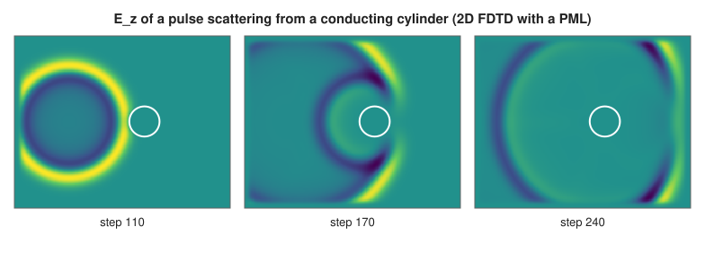
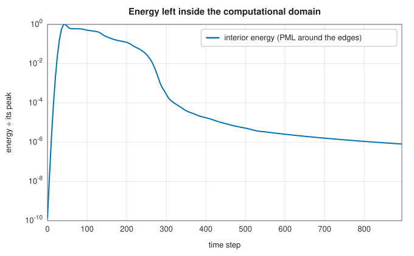

# The finite-difference time-domain method

<div class="entry-summary">

| | |
|---|---|
| **Problem** | Solve Maxwell's equations directly in time on a grid, for pulses travelling through materials and scattering from objects, with open boundaries that absorb outgoing waves |
| **Devised by** | Kane Yee (1966), the staggered grid; Allen Taflove (1975–80), the method's development and name; Gerrit Mur (1981), absorbing boundaries; Jean-Pierre Berenger (1994), the perfectly matched layer |
| **Accuracy** | Second order in space and time; exact (dispersionless) in 1D at the magic time step; reflection coefficients within 0.4% of Fresnel's (tables below) |
| **Cost** | $O(N)$ per time step for $N$ cells, with steps limited by the Courant condition |
| **API** | [`Fdtd1D`](../../api/lib_jsl_electromagnetics/algorithms/fdtd/struct.Fdtd1D.html) (`new`, `set_material`, `step`, `ez`, `hy`), [`FdtdTmz`](../../api/lib_jsl_electromagnetics/algorithms/fdtd/struct.FdtdTmz.html) (`new`, `set_permittivity`, `set_pec`, `step`, `ez`, `interior_energy`), [`gaussian_pulse`](../../api/lib_jsl_electromagnetics/algorithms/fdtd/fn.gaussian_pulse.html) |

</div>

## Overview

The **finite-difference time-domain** (FDTD) method replaces the curl equations by centred differences on a staggered grid and steps the fields forward in time. Electric and magnetic field components sit half a cell apart in space and half a step apart in time (the **Yee cell**), so each update uses the curl of its neighbours. The method needs no matrix and no frequency-domain formulation, and handles any arrangement of materials. A single pulse gives the response at all frequencies at once.
Its open problems are the grid's edges, which must absorb outgoing waves (**absorbing boundary conditions** or a **perfectly matched layer**), and numerical **dispersion**: waves on a grid travel slightly slower than in reality, depending on frequency and direction.

## History

Kane Yee (1966) published the staggered-grid scheme in a short paper on scattering by isotropic media. It attracted little notice until Allen Taflove and colleagues developed it through the 1970s and 80s, named it FDTD (1980), and applied it to scattering and microwave penetration. Gerrit Mur's absorbing boundary conditions (1981) let open problems run in finite grids. Jean-Pierre Berenger's perfectly matched layer (1994) absorbs waves of every angle and frequency with tiny reflection. FDTD is now a standard tool for antenna, microwave, photonic and
bioelectromagnetic simulation.

## The idea

### The Yee scheme in one dimension

**The equations.** Maxwell's two curl equations say that a changing magnetic field produces a
circulating electric field, and a changing electric field a circulating magnetic one. For a
wave travelling along $x$ with field components $E_z$ and $H_y$, they reduce to

$$
\mu\frac{\partial H_y}{\partial t} = \frac{\partial E_z}{\partial x}, \qquad
\varepsilon\frac{\partial E_z}{\partial t} = \frac{\partial H_y}{\partial x} .
$$

The time derivative of each field is the space derivative of the other.

**Yee's staggering.** The finite-difference time-domain (FDTD) method replaces all four
derivatives by [central differences](../derivatives/finite-differences.md#truncation-error),
which are second-order accurate. A central difference of $E$ between two neighbouring grid
points gives the derivative at the point *halfway between* them, so that is where $H$ should
be stored. Yee therefore placed the two fields on interleaved grids: $E_z$ at the points $i$,
$H_y$ at the half-points $i + \tfrac12$. The same argument applies in time: $E$ is stored at the
whole time steps $n$ and $H$ at the half steps $n + \tfrac12$. Each field is then advanced using
the other field at the time halfway through its step, a **leapfrog** scheme. No linear system is
solved; every update is explicit and uses only the two nearest neighbours.

With the normalised field $\widetilde H = \eta_0H$ (which gives $E$ and $H$ the same units) and the time step $\Delta t = S\Delta x/c$, the two updates are

$$
\widetilde H_y^{n+1/2}(i + \tfrac12) = \widetilde H_y^{n-1/2}(i + \tfrac12) + \frac{S}{\mu_r}\big[E_z^n(i + 1) - E_z^n(i)\big],
$$

$$
E_z^{n+1}(i) = E_z^n(i) + \frac{S}{\varepsilon_r}\big[\widetilde H_y^{n+1/2}(i + \tfrac12) - \widetilde H_y^{n+1/2}(i - \tfrac12)\big],
$$

with a conductivity term for lossy cells.

**Stability.** The number $S = c\Delta t/\Delta x$ is the **Courant number**: the fraction of a
cell that light crosses in one time step. An update uses only neighbouring cells, so information
in the computation travels at most one cell per step. If the physical wave travelled further
than that in a step ($S > 1$), the scheme could not possibly follow it, and in fact it becomes
unstable: errors grow without bound. The scheme is stable for $S \le 1$. At $S = 1$, the "magic
time step", a wave moves exactly one cell per step in vacuum, and the scheme has no dispersion at
all.

**Boundaries.** The grid must end somewhere, and a wave reaching the last cell would reflect
back as from a mirror. An **absorbing boundary condition** sets the edge value so as to mimic a
wave leaving the grid. First-order **Mur** boundaries, $E(0)^{n+1} = E(1)^n + \frac{S - 1}{S + 1}\big(E(1)^{n+1} - E(0)^n\big)$, absorb exactly at the magic step.

{{#include ../generated/em-waves/fdtd_reflection.md}}

A Gaussian pulse meeting a dielectric half-space reflects with the Fresnel coefficient, to within 0.4% at $\varepsilon_r = 9$, where the medium's wavelength is shortest.

### Numerical dispersion

On the grid, waves of different wavelengths travel at slightly different speeds, although in
vacuum they should all travel at $c$. This artefact is **numerical dispersion**, and it distorts
pulses over long distances. For $S < 1$ the Yee scheme's dispersion relation is $\sin(\omega\Delta t/2) = S\sin(k\Delta x/2)$. Waves travel slower than $c$, by an error proportional to $(\Delta x/\lambda)^2$, so ten cells per wavelength is a common minimum and twenty is safer. Measuring the phase velocity of a sinusoid in the library's solver reproduces the formula:

{{#include ../generated/em-waves/fdtd_dispersion.md}}

### Two dimensions and the perfectly matched layer

The transverse-magnetic mode ($E_z$, $H_x$, $H_y$) needs $S \le 1/\sqrt2$. Around the domain, Berenger's **split-field PML** splits $E_z$ into two parts, each with a conductivity along one axis, and the matching magnetic conductivity makes the layer's impedance equal free space's at every angle. Waves enter without reflection and decay inside it. The conductivity is graded smoothly from zero to limit the discretisation's reflection. Here, a pulse scatters from a perfectly conducting cylinder:





Once the pulse and its scattered waves have left the interior, the energy remaining there falls by six orders of magnitude.

## Algorithm

1. **H update**: add the Courant number times the discrete curl of $E$ (with PML magnetic loss in 2D).
2. **E update**: the same for $E$ from $H$, with material and conductivity factors; the split parts in the PML.
3. **Source**: add the source's value to $E$ at its cell (a soft source, transparent to passing waves).
4. **Boundaries**: Mur updates at the ends (1D); the PML backed by zero field (2D).

## Implementation

```rust,ignore
{{#include ../../../crates/electromagnetics/src/algorithms/fdtd.rs:fdtd1d}}
```

- Fields are stored as public vectors (1D) or read through `ez(i, j)` (2D), so they can be recorded at probes or as snapshots.
- `set_pec` makes cells perfect conductors; `set_permittivity` and `set_material` set dielectrics and losses.

## In practice

```rust,ignore
{{#include ../../../crates/electromagnetics/examples/fdtd.rs}}
```

```text
1D: reflection -0.2007 (Fresnel (1 − 1.5)/(1 + 1.5) = -0.2000)
2D: step 150, energy left inside the PML boundary 4.84e-3 of its peak
2D: step 300, energy left inside the PML boundary 5.44e-5 of its peak
2D: step 450, energy left inside the PML boundary 7.58e-6 of its peak
2D: step 600, energy left inside the PML boundary 2.14e-6 of its peak
```

**Strengths**

- Simple, explicit, matrix-free; arbitrary materials and geometries; broadband results from one run.
- Exact in 1D at the magic step; effective absorbing boundaries.

**Weaknesses**

- Staircased geometry on a Cartesian grid; numerical dispersion needs many cells per wavelength.
- 1D and 2D TMz only here; no 3D solver, dispersive materials or near-to-far transformation built in.

## Exercises

1. Derive the 1D update equations from Faraday's and Ampère's laws with centred differences.
2. Derive the dispersion relation $\sin(\omega\Delta t/2) = S\sin(k\Delta x/2)$, and show that $S = 1$ removes dispersion.
3. Show that the scheme is unstable for $S > 1$ by finding a growing mode.
4. Measure the transmission through a dielectric slab with an FDTD pulse and compare it with the Fabry-Pérot formula.
5. Reduce the PML to four cells and measure how the reflected energy grows.

## Further reading

- A. Taflove and S. C. Hagness, *Computational Electrodynamics: The Finite-Difference Time-Domain Method*, 3rd ed., Artech House, 2005.
- K. S. Yee, "Numerical solution of initial boundary value problems involving Maxwell's equations in isotropic media", *IEEE Transactions on Antennas and Propagation* 14 (1966) 302–307.
- J.-P. Berenger, "A perfectly matched layer for the absorption of electromagnetic waves", *Journal of Computational Physics* 114 (1994) 185–200.
- J. B. Schneider, *Understanding the Finite-Difference Time-Domain Method*, 2010, www.eecs.wsu.edu/~schneidj/ufdtd.
