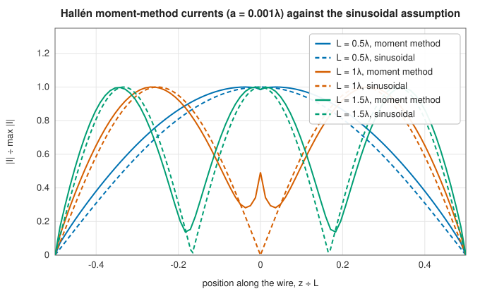
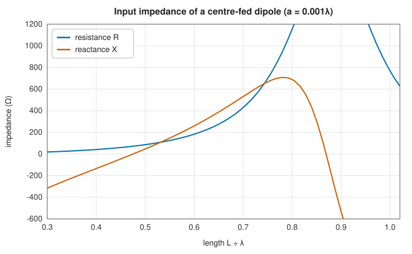

# The method of moments for wire antennas

<div class="entry-summary">

| | |
|---|---|
| **Problem** | Compute the actual current on a thin-wire dipole, and from it the input impedance and pattern, instead of assuming a sinusoidal current |
| **Devised by** | Erik Hallén (1938), the integral equation; Roger Harrington (1967–68), the method of moments; Gerald Burke and Andrew Poggio (1981), NEC |
| **Accuracy** | Conserves power to five digits; impedances converge as long as segments stay several radii long (table below); resonance at $L \approx 0.475\lambda$ for $a = 10^{-3}\lambda$ |
| **Cost** | $O(N^2)$ to fill the matrix with $8$-point quadrature per element, $O(N^3)$ to solve, for $N$ unknowns |
| **Read first** | [Antenna models: dipoles, loops, dishes and patches](../em-arrays/antennas.md), [Gaussian elimination and LU factorisation](../linear_algebra/lu.md) |
| **API** | [`WireDipole`](../../api/lib_jsl_electromagnetics/algorithms/method_of_moments/struct.WireDipole.html) (`new`, `solve`), [`WireSolution`](../../api/lib_jsl_electromagnetics/algorithms/method_of_moments/struct.WireSolution.html) (`nodes`, `currents`, `input_impedance`, `far_field_theta`, `radiated_power`) |

</div>

## Overview

The [antenna models](../em-arrays/antennas.md) assumed a current and computed its field. The **method of moments** reverses this: it finds the current that makes the field satisfy the boundary condition on the conductor, zero tangential electric field except at the feed. For a straight thin wire this is **Hallén's integral equation** for the current $I(z)$. The method expands the unknown current in simple basis functions, here triangles, and enforces the equation at matching points.
The result is a dense linear system. Its solution gives the current, and from it the input impedance, the radiated power and the pattern, including the effects that the sinusoidal assumption misses: finite radius, the feed region, and the shift of resonance below half a wavelength.

## History

Erik Hallén (1938) at the Royal Institute of Technology in Stockholm formulated the integral equation for the current on a cylindrical antenna and solved it iteratively. Ronold King and others developed approximate solutions in the 1940s and 50s. With digital computers, Roger Harrington's *Field Computation by Moment Methods* (1968) unified the approach as a projection of operator equations onto finite bases, and Jack Richmond and others applied it to wires. The
Numerical Electromagnetics Code (NEC, Gerald Burke and Andrew Poggio, Lawrence Livermore, 1981) made moment-method wire modelling the standard antenna design tool.

## The idea

### Hallén's equation

FDTD fills space with a grid and follows the fields in time. The **method of moments** takes the
opposite approach for a metal structure at a single frequency. The only unknown is the current
on the metal; once it is found, the fields everywhere follow by integration. The current is
determined by an **integral equation**, which states that the field radiated by the current,
together with the applied voltage, satisfies the boundary condition on the conductor. The
unknowns then live only on the wire, not in the surrounding space.

A centre-fed straight wire of length $L$ and radius $a \ll \lambda$ along $z$, driven by a voltage $V$ across a narrow gap at its centre, carries a current $I(z)$ with $I(\pm L/2) = 0$. The vector potential of the current must satisfy a one-dimensional Helmholtz equation driven by the gap. Its solution gives

$$
\int_{-L/2}^{L/2} I(z')\,G(z - z')\,dz' = C\cos kz - \frac{jV}{2\eta}\sin k|z|, \qquad G = \frac{e^{-jkR}}{4\pi R}, \quad R = \sqrt{(z - z')^2 + a^2},
$$

with an unknown constant $C$ fixed by the end condition. The **reduced kernel** puts the current on the axis and evaluates the field on the surface, which is smooth and simple. The price is that the equation becomes ill-posed when the discretisation is finer than about the radius.

### Discretisation

An integral equation has an unknown *function*. To solve it numerically, the function is
approximated by a combination of a finite number of simple **basis functions** with unknown
coefficients, and the equation is enforced at a finite number of points (or, more generally, in a
finite number of weighted averages, the "moments" that give the method its name). The result is
an ordinary system of linear equations, with a dense matrix whose entry $(i, j)$ is the effect
of basis function $j$ at test point $i$.

Here the current is expanded in $N$ triangle functions on equally spaced interior nodes, so it is piecewise linear and zero at the ends. Matching at the $N$ nodes and at one wire end gives $N + 1$ equations for the $N$ node currents and $C$. Each matrix entry integrates a triangle against the kernel. The near-singular part $1/4\pi R$ is integrated analytically, and the smooth remainder $(e^{-jkR} - 1)/4\pi R$ by 8-point Gauss-Legendre quadrature. The input impedance is $V/I(0)$.



<p class="caption" id="fig-21-10"><strong>Figure 21.10.</strong> MoM currents.</p>

At half a wavelength the computed current is close to the assumed sinusoid. At one wavelength the sinusoid predicts zero current at the feed and an infinite impedance, but the actual current there is small and finite, so the impedance is large and finite.

### Impedance and resonance



<p class="caption" id="fig-21-11"><strong>Figure 21.11.</strong> MoM impedance.</p>

{{#include ../generated/em-waves/mom_facts.md}} The resistance there is close to the 73 Ω of the induced-EMF method, and the reactance near half a wavelength is about the textbook $+42.5$ Ω plus a correction for the radius. Near a full wavelength the impedance rises to the anti-resonance.

<p class="caption" id="tab-21-3"><strong>Table 21.3.</strong> Method-of-moments input impedance of a dipole as the mesh is refined.</p>

{{#include ../generated/em-waves/mom_convergence.md}}

For the thinner wire every mesh has segments much longer than the radius, and the impedance converges to $80.6 + 46.6j$ Ω. For the thicker one, refining until segments are only one or two radii long makes the impedance drift instead of converge. That is the reduced kernel's ill-posedness, and the reason the documentation asks for segments several radii long. In every case the radiated power equals the power delivered at the gap to five digits.

## Algorithm

Input: the length $L$ and radius $a$ of the wire, the frequency and the number of nodes.

1. **Mesh.** Place $N$ equally spaced interior nodes along the wire, with $N$ odd so that one
   node falls exactly at the feed. The current is zero at the two ends, so the unknowns are
   the $N$ node currents and the constant $C$.
2. **Fill the matrix**, of size $(N + 1) \times (N + 1)$. Row $i$ enforces Hallén's equation at a
   match point $z_i$ (the $N$ nodes and one end of the wire). Its entry in column $j$ is the
   integral of the kernel against the triangle function of node $j$, computed as the sum of
   an analytic integral of the $1/4\pi R$ part and an 8-point Gauss-Legendre quadrature of the
   smooth remainder. Its entry in the last column is $-\cos kz_i$, the coefficient of $C$.
   The right-hand side is $-(jV/2\eta)\sin k|z_i|$.
3. **Solve** the dense complex linear system.
4. **Input impedance**: $Z_{\text{in}} = V/I(0)$, with $I(0)$ the current at the feed node.
5. **Far field**: integrate the piecewise-linear current against $e^{jkz'\cos\theta}$, segment
   by segment, in closed form.

Filling the matrix costs $O(N^2)$ kernel integrals and solving it $O(N^3)$.

## Implementation

```rust,ignore
{{#include ../../../crates/electromagnetics/src/algorithms/method_of_moments.rs:hallen_fill}}
```

- Matching at the nodes and at one end, rather than at segment midpoints, avoids an oscillating current: with triangle bases, midpoint matching decouples alternate nodes.
- A wire must be thin (radius at most a twentieth of its length) for the thin-wire kernel to apply.

## In practice

```rust,ignore
{{#include ../../../crates/electromagnetics/examples/wire_antenna.rs}}
```

```text
L = 0.47λ: Z_in = 65.92 -36.41j Ω, |I(feed)| = 13.28 mA, radiated 5.811 mW for 1 V
L = 0.5λ: Z_in = 80.47 +46.16j Ω, |I(feed)| = 10.78 mA, radiated 4.675 mW for 1 V
L = 1λ: Z_in = 2005.55 -2191.41j Ω, |I(feed)| = 0.34 mA, radiated 0.114 mW for 1 V
```

**Strengths**

- Full-wave: the current, impedance and pattern follow from Maxwell's equations, not an assumed current.
- Small dense systems for wire antennas; energy conserved to the discretisation's accuracy.

**Weaknesses**

- Straight, centre-fed single wires only; no junctions, ground planes or arrays of wires.
- The delta-gap feed and the reduced kernel limit how fine the mesh can usefully be.

## Exercises

1. Derive Hallén's equation from $E_z = 0$ on the wire and the potential's Helmholtz equation.
2. Integrate $1/\sqrt{(z - z')^2 + a^2}$ times a linear function analytically.
3. Show that the delivered power $\tfrac12\mathrm{Re}(VI^*)$ must equal the radiated power, and use it to check a solution.
4. Explain why the resonant length falls below $\lambda/2$ as the wire gets thicker.
5. Extend the solver to two parallel dipoles and compute their mutual impedance.

<details>
<summary>Hints and answers</summary>

1. With $\mathbf E^{\mathrm{tot}}_z = 0$ on the wire, $E_z^s = -E_z^i$. Expressing $E_z^s$ through the vector potential $A_z$ and the scalar potential and eliminating the latter with the Lorenz gauge gives $\int I(z')G(z - z')\,\mathrm dz' = C\cos kz - \tfrac{j}{2\eta}V\sin k|z|$ (Hallén's equation) with $C$ fixed by the end condition $I(\pm L/2) = 0$.
2. $\int\dfrac{\mathrm dz'}{\sqrt{(z - z')^2 + a^2}} = -\operatorname{arsinh}\dfrac{z - z'}a$, and $\int\dfrac{z'\mathrm dz'}{\sqrt{(z - z')^2 + a^2}}$ can be obtained by writing $z' = z - (z - z')$.
3. The complex power delivered by the source is $\tfrac12VI^*$; its real part equals the power radiated through a large sphere, which can be computed from the far field. A mismatch indicates an error in the solution.
4. A thicker wire has a larger end capacitance and fringing, which effectively lengthens the wire electrically, so the resonant length is shorter.
5. Add a second wire with its own unknowns; the off-diagonal blocks of the impedance matrix give the mutual coupling, and $Z_{12}$ follows from the voltage induced on wire 2 by unit current on wire 1.

</details>

## Further reading

- R. F. Harrington, *Field Computation by Moment Methods*, Macmillan, 1968.
- E. Hallén, "Theoretical investigations into the transmitting and receiving qualities of antennae", *Nova Acta Regiae Societatis Scientiarum Upsaliensis* 11 (1938) 1–44.
- W. C. Gibson, *The Method of Moments in Electromagnetics*, 2nd ed., CRC Press, 2014, chapters 3–4.
- G. J. Burke and A. J. Poggio, *Numerical Electromagnetics Code (NEC)*, Lawrence Livermore National Laboratory, 1981.
