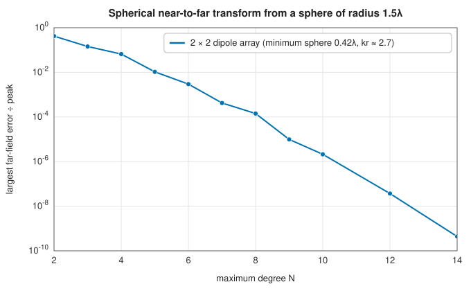
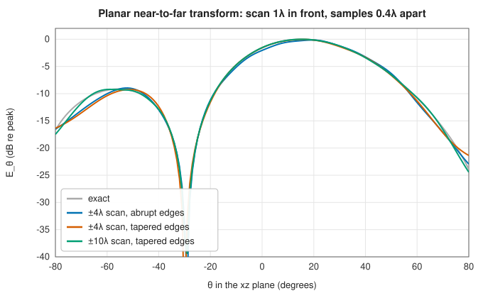

# Spherical waves and near-field to far-field transformation

<div class="entry-summary">

| | |
|---|---|
| **Problem** | Represent the field radiated by any antenna as a sum of spherical waves, and recover its far-field pattern from fields measured close to it, on a sphere or a plane |
| **Devised by** | Julius Stratton (1941) and Peter Debye, vector spherical wave functions; David Kerns (1963–76), planar near-field scanning; Frank Jensen (1970) and Jesper Hansen and colleagues (1988), spherical near-field measurement |
| **Accuracy** | Spectral: the error falls exponentially with the expansion degree beyond $kr_{\min}$; planar scans are limited by truncation (tables and figures below) |
| **Cost** | $O(N^4)$ for a degree-$N$ spherical expansion by direct projection; $O(N_xN_y)$ per direction for a planar scan |
| **API** | [`SphericalWaveExpansion`](../../api/lib_jsl_electromagnetics/fields/spherical_waves/struct.SphericalWaveExpansion.html) (`from_far_field`, `far_field`, `field_at`, `radiated_power`, `power_by_degree`), [`vector_spherical_harmonics`](../../api/lib_jsl_electromagnetics/fields/spherical_waves/fn.vector_spherical_harmonics.html), [`spherical_near_to_far`](../../api/lib_jsl_electromagnetics/algorithms/near_field_far_field/fn.spherical_near_to_far.html), [`planar_near_to_far`](../../api/lib_jsl_electromagnetics/algorithms/near_field_far_field/fn.planar_near_to_far.html), [`scan_taper`](../../api/lib_jsl_electromagnetics/algorithms/near_field_far_field/fn.scan_taper.html) |

</div>

## Overview

Outside a sphere enclosing all its sources, the field of an antenna is a sum of **vector spherical waves**: outgoing solutions of Maxwell's equations, each a spherical Hankel function of $kr$ times a vector spherical harmonic. The expansion's coefficients describe the antenna completely. They give its far-field pattern, its radiated power, and its field at any radius outside that sphere. A source of radius $r_{\min}$ needs degrees up to about $kr_{\min}$: higher modes are evanescent and
carry almost no power. This makes **near-field measurement** possible. Large antennas have far fields too distant for any test range, so their field is measured on a sphere or plane close by, expanded in spherical or plane waves, and propagated to infinity.

## History

Vector spherical wave functions were developed by Peter Debye (1909) and in Julius Stratton's *Electromagnetic Theory* (1941). David Kerns at the US National Bureau of Standards developed the plane-wave theory of planar near-field scanning (1963–76), which became the standard for large antennas and phased arrays. Frank Jensen (1970) at the Technical University of Denmark introduced spherical near-field measurement, made practical with probe correction by Jesper Hansen
and colleagues (*Spherical Near-Field Antenna Measurements*, 1988). Near-field ranges now measure everything from mobile phones to satellite antennas.

## The idea

### Spherical wave expansions

In the $e^{+j\omega t}$ convention, with orthonormal tangential vector spherical harmonics $\boldsymbol\Psi_{nm}$ (the gradient of $Y_{nm}$) and $\boldsymbol\Phi_{nm} = \hat r \times \boldsymbol\Psi_{nm}$,

$$
\mathbf E = \sum_{n=1}^{N}\sum_{m=-n}^{n}\alpha_{nm}\mathbf M_{nm} + \beta_{nm}\mathbf N_{nm}, \qquad \mathbf M_{nm} = h_n^{(2)}(kr)\,\boldsymbol\Phi_{nm}, \quad \mathbf N_{nm} = \tfrac1k\nabla \times \mathbf M_{nm}.
$$

As $r \to \infty$, $h_n^{(2)}(kr) \to j^{n+1}e^{-jkr}/kr$. So the far-field pattern is $\mathbf F = \sum(j^{n+1}/k)\alpha_{nm}\boldsymbol\Phi_{nm} + (j^{n+2}/k)\beta_{nm}\boldsymbol\Psi_{nm}$, and projecting a pattern onto $\boldsymbol\Phi_{nm}$ and $\boldsymbol\Psi_{nm}$ gives the coefficients. [`from_far_field`](../../api/lib_jsl_electromagnetics/fields/spherical_waves/struct.SphericalWaveExpansion.html#method.from_far_field) does this with Gauss-Legendre quadrature in $\theta$ and the trapezoid rule in $\varphi$. Both are exact for patterns band-limited to the degree.
Since the harmonics are orthonormal, the radiated power is a sum of $|\alpha|^2 + |\beta|^2$, and `power_by_degree` shows where it lives.

### Spherical near-field to far-field

On a sphere of radius $r_0$ enclosing the antenna, the tangential field's projection onto $\boldsymbol\Phi_{nm}$ is $\alpha_{nm}h_n^{(2)}(kr_0)$, and onto $\boldsymbol\Psi_{nm}$ it is $-\beta_{nm}(kr_0h_n^{(2)})'/kr_0$. Dividing by these radial functions recovers the coefficients, hence the far field everywhere. Testing with the exact near field of a 2 × 2 array of short dipoles, measured on a sphere of radius $1.5\lambda$ around it:



<p class="caption" id="fig-21-8"><strong>Figure 21.8.</strong> Spherical near-to-far.</p>

The error falls exponentially once the degree exceeds the source's electrical size, $kr_{\min} \approx 2.7$, and reaches $10^{-9}$ at $N = 14$.

### Planar near-field to far-field

In front of an antenna, the field on a plane $z = z_0$ is a superposition of plane waves $e^{-j(k_xx + k_yy + k_zz)}$. Its two-dimensional Fourier transform is the **plane-wave spectrum** $\mathbf A(k_x, k_y)$, and by stationary phase the far field in direction $(\theta, \varphi)$ is the spectrum at $(k_x, k_y) = k\sin\theta(\cos\varphi, \sin\varphi)$:

$$
F_\theta = \frac{jk}{2\pi}(A_x\cos\varphi + A_y\sin\varphi), \qquad F_\varphi = \frac{jk\cos\theta}{2\pi}(A_y\cos\varphi - A_x\sin\varphi).
$$

Only the forward half-space is covered, and samples must be at most $\lambda/2$ apart. A finite scan truncates the field, which rings like a rectangular window. Tapering the scan's edges with [`scan_taper`](../../api/lib_jsl_electromagnetics/algorithms/near_field_far_field/fn.scan_taper.html) helps, and a larger scan helps more:



<p class="caption" id="fig-21-9"><strong>Figure 21.9.</strong> Planar near-to-far.</p>

{{#include ../generated/em-waves/planar_table.md}}

The valid angle of a planar scan is limited by the scan's size: rays from the antenna through the scan's edge bound the directions it sees.

## Algorithm

**Spherical wave coefficients from a far-field pattern**, up to degree $N$.

1. Sample the pattern at the Gauss-Legendre nodes in $\cos\theta$ and at equally spaced
   azimuths.
2. For each degree $n$ and order $m$, compute the inner products of the pattern with
   $\boldsymbol\Phi_{nm}$ and $\boldsymbol\Psi_{nm}$ over the sphere, by quadrature.
3. Divide by the far-field factors $j^{n+1}/k$ and $j^{n+2}/k$ to obtain $\alpha_{nm}$ and
   $\beta_{nm}$.

**Spherical near-field to far-field transformation**, from the tangential field on a sphere of
radius $r_0$.

1. Project the measured field onto $\boldsymbol\Phi_{nm}$ and $\boldsymbol\Psi_{nm}$, as in steps 1 and 2 above.
2. Divide the projections by the radial functions at $kr_0$: $h_n^{(2)}(kr_0)$ for
   $\alpha_{nm}$, and $-(kr_0h_n^{(2)})'/kr_0$ for $\beta_{nm}$.
3. Evaluate the far field in any direction from the coefficients.

**Planar near-field to far-field transformation**, from $E_x$ and $E_y$ sampled on a plane
$z = z_0$. For each requested direction $(\theta, \varphi)$:

1. compute the wavenumbers $k_x = k\sin\theta\cos\varphi$, $k_y = k\sin\theta\sin\varphi$ and
   $k_z = k\cos\theta$;
2. compute the spectrum components $A_x$ and $A_y$ as the sums of the samples times
   $e^{j(k_xx + k_yy)}$ and the sample area. The exponential factors into a part for each
   axis, so the double sum is done as a sum along $x$ followed by a sum along $y$;
3. multiply by $e^{jk_zz_0}$, which refers the spectrum to the plane $z = 0$;
4. form $F_\theta$ and $F_\varphi$ from the formulas above.

## Implementation

```rust,ignore
{{#include ../../../crates/electromagnetics/src/fields/spherical_waves.rs:swe_projection}}
```

```rust,ignore
{{#include ../../../crates/electromagnetics/src/algorithms/near_field_far_field.rs:planar_spectrum}}
```

- `field_at` evaluates the expansion at any point outside the minimum sphere, including the reactive near field.
- The transforms assume an ideal (point) probe; real measurements need probe correction.

## In practice

```rust,ignore
{{#include ../../../crates/electromagnetics/examples/near_field_far_field.rs}}
```

```text
2λ dipole: radiated power 129.5364 W (direct integration 129.5364 W); share above degree 10: 2.3e-6
Hertzian dipole from a 0.3λ sphere: far field at θ = 1 rad 0.000000 +1.586135j V (exact 0.000000 +1.586135j V)
```

A $2\lambda$ dipole has $kr_{\min} = 2\pi$, and degrees above 10 carry two millionths of its power.

**Strengths**

- A compact, exact description of radiated fields; far fields from near-field data on spheres or planes.

**Weaknesses**

- Direct projection costs $O(N^4)$ (FFT-based methods are faster for large antennas).
- No probe correction; planar scans cover only the forward half-space.

## Exercises

1. Show that a Hertzian dipole along $z$ is a single TM mode, $n = 1$, $m = 0$.
2. Use the large-argument form of $h_n^{(2)}$ to derive the far-field factors $j^{n+1}/k$ and $j^{n+2}/k$.
3. Explain why degrees above $kr_{\min}$ carry little power, using the behaviour of $h_n^{(2)}(x)$ for $n > x$.
4. Derive the planar far-field formula from the plane-wave spectrum by stationary phase.
5. Find the largest valid angle of a $\pm 4\lambda$ planar scan $1\lambda$ in front of an antenna $1\lambda$ across.

<details>
<summary>Hints and answers</summary>

1. The field of a $z$-directed Hertzian dipole has $E_\theta \ne 0$, $H_\varphi \ne 0$ and no $E_\varphi$: a TM mode. Its pattern $\sin\theta$ is the $n = 1$, $m = 0$ vector spherical harmonic.
2. For large argument $h_n^{(2)}(x) \approx j^{n+1}e^{-jx}/x$; inserting it in the field expansion gives the far-field factors $j^{n+1}/k$ and $j^{n+2}/k$ for the two mode types.
3. For $n > x$ the spherical Hankel function grows rapidly ($h_n \sim -j(2n - 1)!!/x^{n+1}$) so these modes do not radiate: modes beyond $n \approx kr_{\min}$ carry exponentially little power to a sphere of radius $r_{\min}$.
4. Writing the field as a plane-wave spectrum $\int\tilde E(k_x, k_y)e^{-j\mathbf k\cdot\mathbf r}\mathrm dk_x\mathrm dk_y$, the large-$r$ stationary-phase point is at $\mathbf k = k\hat r$, giving $E_{\mathrm{far}} \propto jk\cos\theta\,\tilde E(k\sin\theta\cos\varphi, k\sin\theta\sin\varphi)\,e^{-jkr}/r$.
5. Draw the geometry: the far field at angle $\theta$ is reliable only if the scan plane, at distance $z_0$ and extent $\pm L_s$, captures the part of the antenna's field that radiates towards $\theta$. Use the validity criterion in the entry with the antenna's extent $D$ and the scan edge as seen from the antenna's edge, and expect a result well short of $90°$ for this short scan distance.

</details>

## Further reading

- J. E. Hansen (ed.), *Spherical Near-Field Antenna Measurements*, Peter Peregrinus, 1988.
- A. D. Yaghjian, "An overview of near-field antenna measurements", *IEEE Transactions on Antennas and Propagation* 34 (1986) 30–45.
- D. M. Kerns, *Plane-Wave Scattering-Matrix Theory of Antennas and Antenna-Antenna Interactions*, NBS Monograph 162, 1981.
- J. A. Stratton, *Electromagnetic Theory*, McGraw-Hill, 1941, chapter 7.
