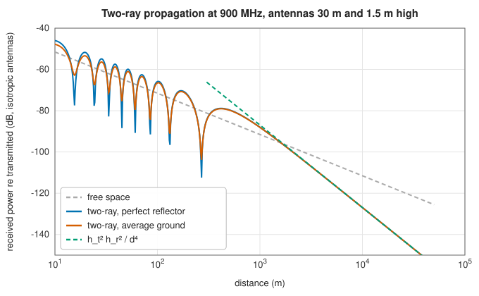
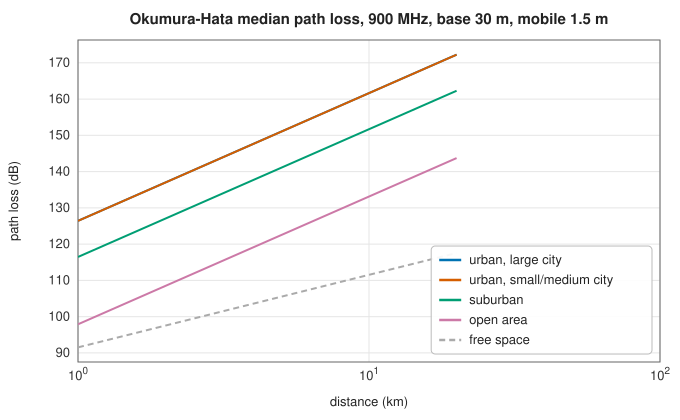
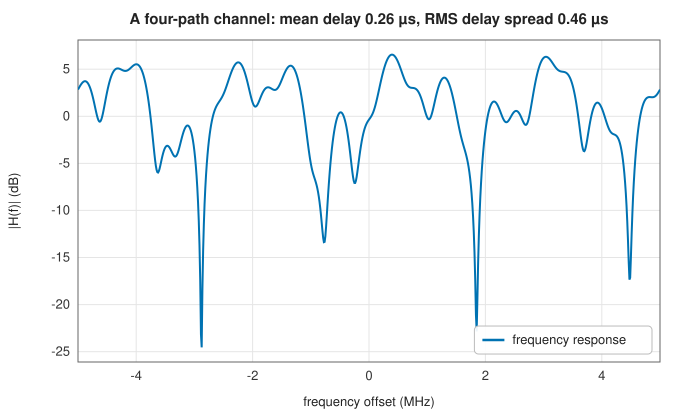
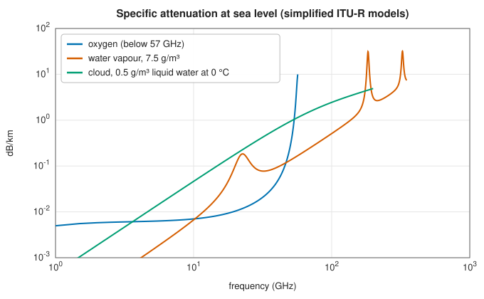

# Propagation: link budgets, path loss, multipath, the atmosphere and radar

<div class="entry-summary">

| | |
|---|---|
| **Problem** | Predict how much power reaches a receiver over a radio path: through free space, over the ground, in a city, through the atmosphere, or back from a radar target |
| **Devised by** | Harald Friis (1946), the transmission formula; Yoshihisa Okumura (1968) and Masaharu Hata (1980), urban path loss; the ITU-R, atmospheric attenuation (Recommendations P.676, P.838, P.840); the radar equation (1940s) |
| **Accuracy** | Free-space and two-ray formulas are exact for their geometry; Hata reproduces the textbook 126.4 dB; the empirical and atmospheric models are approximations, accurate to a few dB within their stated ranges |
| **Cost** | Closed-form formulas |
| **API** | [`path_loss`](../../api/lib_jsl_electromagnetics/propagation/path_loss/index.html) (`free_space_path_loss_db`, `friis_received_power`, `LinkBudget`, `log_distance_path_loss_db`, `okumura_hata_db`, `fraunhofer_distance`), [`multipath`](../../api/lib_jsl_electromagnetics/propagation/multipath/index.html) (`two_ray_factor`, `fresnel_reflection`, `ground_permittivity`, `fresnel_zone_radius`, `MultipathChannel`), [`atmosphere`](../../api/lib_jsl_electromagnetics/propagation/atmosphere/index.html), [`radar_equation`](../../api/lib_jsl_electromagnetics/propagation/radar_equation/index.html) (`Radar`, `range_resolution`, `unambiguous_range`, `doppler_shift`, `radar_horizon`) |

</div>

## Overview

A radio link's **budget** adds and subtracts decibels: transmit power, antenna gains, and the losses along the way. In free space, the **Friis** formula gives the received power exactly. Near the ground, the wave reflected from the earth interferes with the direct one, and beyond a crossover distance the power falls as $d^{-4}$ instead of $d^{-2}$. In cities, buildings scatter and shadow the signal, and **empirical models** such as Okumura-Hata fit
measurements. Paths with several echoes form a **multipath channel**, whose frequency response fades. Above a few gigahertz, oxygen, water vapour, clouds and rain **absorb** the signal. For radar the path is travelled twice, and the **radar equation** gives the echo power from a target's cross-section.

## History

Harald Friis of Bell Labs published his transmission formula in 1946. Ground reflection and the two-ray model were understood from the 1930s, when VHF links first ran over flat terrain. Yoshihisa Okumura's 1968 measurement campaign around Tokyo gave curves for urban propagation, and Masaharu Hata (1980) fitted them with the formulas used in cellular planning ever since (extended to 2 GHz by COST 231). The radar equation was developed during the Second World War, and later systematised by Louis Ridenour (1947) and
Lamont Blake. Atmospheric absorption by oxygen and water vapour lines was calculated by John Van Vleck (1947) and is standardised in the ITU-R Recommendations.

## The idea

### Free space and link budgets

An isotropic transmitter's power $P_t$ spreads over $4\pi d^2$, and an antenna of gain $G_r$ collects it over an effective area $G_r\lambda^2/4\pi$, so

$$
P_r = P_tG_tG_r\Big(\frac{\lambda}{4\pi d}\Big)^2.
$$

The **free-space path loss** is $20\log_{10}(4\pi d/\lambda)$: 92.4 dB at 1 km and 1 GHz, plus 6 dB for each doubling of distance or frequency. [`LinkBudget`](../../api/lib_jsl_electromagnetics/propagation/path_loss/struct.LinkBudget.html) collects the terms in dB and solves for the range at which a receiver's sensitivity is met. The formula needs the far field, beyond the **Fraunhofer distance** $2D^2/\lambda$ of an aperture of size $D$.

### The two-ray model

Over a flat ground, the receiver sees the direct ray and one reflected with Fresnel coefficient $\Gamma$, so the field is scaled by $1 + \Gamma(r_1/r_2)e^{-jk(r_2 - r_1)}$. At grazing incidence $\Gamma \to -1$ for any ground. Beyond the crossover distance $4\pi h_th_r/\lambda$ the two rays cancel more and more, and the power tends to $P_tG_tG_rh_t^2h_r^2/d^4$, independent of frequency:



{{#include ../generated/em-waves/two_ray_facts.md}} The deep nulls closer in are where the path difference is a whole number of wavelengths. Real ground, with relative permittivity 15 and conductivity 5 mS/m, reflects a little less than a perfect conductor.

### Empirical urban models

The **log-distance** model $L = L_0 + 10n\log_{10}(d/d_0)$ fits measurements with an exponent $n$ between 2 (free space) and about 4 (cluttered). The **Okumura-Hata** model gives the median loss for 150–1500 MHz from the frequency, the antenna heights and the distance. It includes corrections for the mobile antenna height in small and large cities, and offsets for suburban and open areas:



{{#include ../generated/em-waves/hata_facts.md}} At a 1.5 m mobile height the two city corrections are nearly zero, so the two urban curves coincide.

### Multipath channels

With paths of delays $\tau_i$ and complex gains $a_i$, the channel is $h(t) = \sum_ia_i\delta(t - \tau_i)$, and its frequency response $H(f) = \sum_ia_ie^{-j2\pi f\tau_i}$ fades where the paths cancel. The **RMS delay spread** $\sigma_\tau$ sets the scale. Frequencies closer than the **coherence bandwidth**, about $1/(5\sigma_\tau)$, fade together:



{{#include ../generated/em-waves/multipath_facts.md}} OFDM subcarriers narrower than the coherence bandwidth each see a flat channel, which is the point of the [modulation entry](../comms/modulation.md#ofdm)'s design.

### The atmosphere

Oxygen absorbs strongly around 60 GHz and water vapour at 22.2, 183.3 and 325.4 GHz. Between these lines lie the "windows" used by satellite links and radio astronomy. The library implements the simplified sea-level formulas of ITU-R P.676 for gases (oxygen below 57 GHz), the Rayleigh model of P.840 for cloud and fog liquid water, and the power law $kR^\alpha$ of P.838 for rain:



Slant paths through the atmosphere use equivalent heights of 6 km for oxygen and 2.1 km for water vapour, scaled by $1/\sin(\text{elevation})$.

### The radar equation

A target of radar cross-section $\sigma$ at range $R$ reradiates the power it intercepts, so the echo travels the path twice:

$$
P_r = \frac{P_tG^2\lambda^2\sigma}{(4\pi)^3R^4L}, \qquad R_{\max} = \Big(\frac{P_tG^2\lambda^2\sigma\,g}{(4\pi)^3kTBFL\,\mathrm{SNR}_{\min}}\Big)^{1/4},
$$

with $g$ the gain from integrating pulses. The fourth root makes range expensive: sixteen times the power doubles it. For an S-band radar (1 MW, 35 dB antenna, 1 MHz bandwidth, 2 dB noise figure, 5 dB losses):

{{#include ../generated/em-waves/radar_table.md}}

## Algorithm

Every function in this entry evaluates one of the formulas above directly; none iterates,
except the range solver.

**Link budget.** Add the gains and subtract the losses, in decibels: transmitted power, plus
the two antenna gains, minus the path loss and any other losses, gives the received power.
**Maximum range**: solve the same equation for the distance at which the received power equals
the receiver's sensitivity. For free-space loss that is a closed form.

**Two-ray model**, for given antenna heights and distance: compute the lengths of the direct
and reflected paths and the grazing angle; compute the Fresnel reflection coefficient of the
ground for that angle and polarisation; add the two rays with their phases.

**Empirical and atmospheric models**: check that the inputs lie within the range for which
the model was fitted (Hata: 150 to 1500 MHz and 1 to 20 km; gases: below 57 or 350 GHz), and
reject them otherwise, since the fitted formulas are meaningless outside it; then evaluate the
formula.

**Multipath channel**: the frequency response is the sum of the path gains times
$e^{-j2\pi f\tau_i}$; the RMS delay spread is the standard deviation of the delays, weighted by
the path powers.

## Implementation

```rust,ignore
{{#include ../../../crates/electromagnetics/src/propagation/multipath.rs:two_ray}}
```

- `MultipathChannel::apply` filters complex baseband samples through the channel, with the delays rounded to the sample grid.
- `radar_equation` also provides the bistatic equation, range resolution $c/2B$, unambiguous range $c/2\,\mathrm{PRF}$, Doppler shift, radar horizon, and the cross-sections of a sphere and a flat plate.

## In practice

```rust,ignore
{{#include ../../../crates/electromagnetics/examples/propagation.rs}}
```

```text
2.4 GHz link: free-space loss at 1 km 100.1 dB, received -71.1 dBm
  range for a -85 dBm receiver: 5.0 km
  first Fresnel zone radius at mid-path: 5.59 m
cellular, 900 MHz, 5 km: Hata urban 148.7 dB, suburban 138.8 dB; two-ray crossover 2.3 km
20 GHz at 30° elevation: gases 0.55 dB; 25 mm/h rain (k = 0.0751, α = 1.099) adds 2.58 dB/km
S-band radar: 1 m² detected (13 dB) to 100 km; range resolution 150 m; unambiguous range at 1 kHz PRF 150 km
```

The first Fresnel zone, 5.6 m in radius at mid-path, must be kept clear of obstacles for free-space propagation to hold.

**Strengths**

- The standard link, propagation and radar formulas in one place, with validity checks on the empirical models.

**Weaknesses**

- Simplified models: the old sea-level P.676 formulas, no terrain or diffraction, no statistical fading models.
- The rain law needs coefficients from P.838 tables, which are not built in.

## Exercises

1. Derive the Friis formula from the effective area of an antenna, $A_e = G\lambda^2/4\pi$.
2. Show that the two-ray power tends to $P_tG_tG_rh_t^2h_r^2/d^4$ for $d \gg 4\pi h_th_r/\lambda$ with $\Gamma = -1$.
3. Find the RMS delay spread of the four-path channel above from its delays and gains.
4. How much more transmit power doubles a radar's range? How many coherently integrated pulses would do the same?
5. Oxygen absorbs about 15 dB/km at 60 GHz. Find the extra loss over 100 m and over 10 km, and explain why 60 GHz suits short-range links that should not interfere at a distance.

## Further reading

- T. S. Rappaport, *Wireless Communications: Principles and Practice*, 2nd ed., Prentice Hall, 2002, chapters 3–5.
- H. T. Friis, "A note on a simple transmission formula", *Proceedings of the IRE* 34 (1946) 254–256.
- M. Hata, "Empirical formula for propagation loss in land mobile radio services", *IEEE Transactions on Vehicular Technology* 29 (1980) 317–325.
- M. I. Skolnik, *Introduction to Radar Systems*, 3rd ed., McGraw-Hill, 2001, chapter 2.
- ITU-R Recommendations P.676 (gaseous attenuation), P.838 (rain) and P.840 (clouds and fog).
