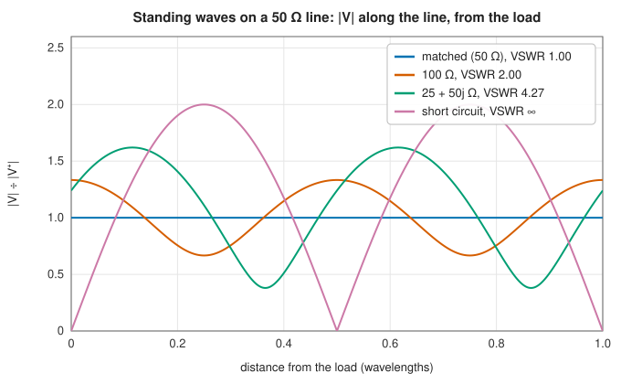
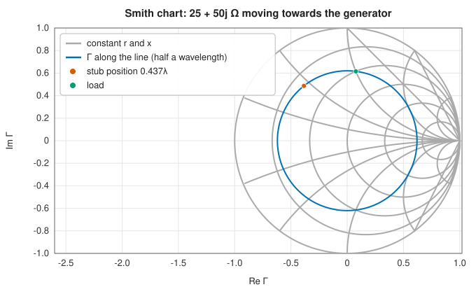
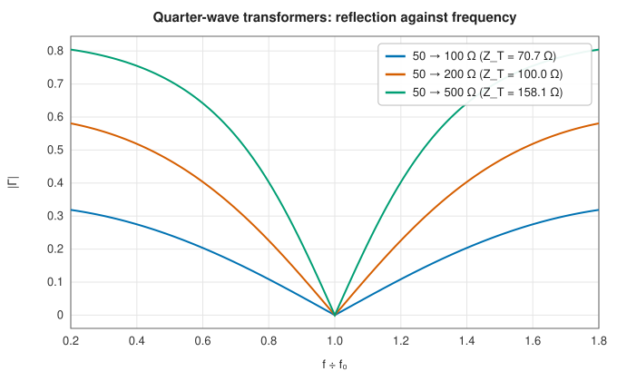

# Transmission lines, two-port networks and the Smith chart

<div class="entry-summary">

| | |
|---|---|
| **Problem** | Find what a load looks like through a length of line, how much power it reflects, how to match it, and how to describe and cascade two-port networks |
| **Devised by** | Oliver Heaviside (1876–87), the telegrapher's equations; Phillip Smith (1939), the Smith chart; Robert Dicke, Carol Montgomery and Edward Purcell (1948), scattering matrices for microwave circuits |
| **Accuracy** | Exact for uniform lines; parameter conversions and cascades agree to rounding (table below) |
| **Cost** | A few complex operations per evaluation |
| **API** | [`TransmissionLine`](../../api/lib_jsl_electromagnetics/networks/transmission_lines/enum.TransmissionLine.html) (`lossless`, `distributed`, `characteristic_impedance`, `propagation_constant`, `input_impedance`, `abcd`, `standing_wave`), [`reflection_coefficient`](../../api/lib_jsl_electromagnetics/networks/transmission_lines/fn.reflection_coefficient.html), [`vswr`](../../api/lib_jsl_electromagnetics/networks/transmission_lines/fn.vswr.html), [`quarter_wave_transformer`](../../api/lib_jsl_electromagnetics/networks/transmission_lines/fn.quarter_wave_transformer.html), [`single_stub_match`](../../api/lib_jsl_electromagnetics/networks/transmission_lines/fn.single_stub_match.html), [`s_parameters`](../../api/lib_jsl_electromagnetics/networks/s_parameters/index.html) (`z_to_s`, `s_to_z`, `s_to_abcd`, `abcd_to_s`, `s_to_t`, `t_to_s`, `cascade`), [`smith_chart`](../../api/lib_jsl_electromagnetics/networks/smith_chart/index.html) |

</div>

## Overview

At high frequencies a pair of wires is not just a connection but a **transmission line**: a guide for waves travelling in both directions. A line is characterised by its **characteristic impedance** $Z_0$ and **propagation constant** $\gamma = \alpha + j\beta$. A load $Z_L$ that differs from $Z_0$ reflects part of the incident wave, with **reflection coefficient** $\Gamma = (Z_L - Z_0)/(Z_L + Z_0)$. The incident and reflected waves
form a **standing wave**, and the impedance seen at the line's input changes with its length. The **Smith chart** draws all this as rotations in the $\Gamma$ plane. Matching networks such as quarter-wave transformers and stubs cancel the reflection. For general circuits, **two-port parameters** (impedance, admittance, chain and scattering) describe any linear network by four numbers per frequency.

## History

Oliver Heaviside derived the telegrapher's equations (1876–87) and showed that adding inductance to telephone cables makes them distortionless. Michael Pupin and George Campbell made that practical with loading coils around 1900. Phillip Smith of Bell Labs published his chart in 1939, a graphical calculator that remains the RF engineer's map. During the Second World War, the MIT Radiation Laboratory's microwave work led Robert Dicke, Carol Montgomery and Edward Purcell to describe
waveguide junctions by scattering matrices (*Principles of Microwave Circuits*, 1948), defined by waves rather than voltages, which can be measured at microwave frequencies. Network analysers measure S-parameters directly to this day.

## The idea

### Lines

At low frequencies a cable is just a pair of wires: the voltage is the same all along it. When
the cable is not short compared with the wavelength, that is no longer true. A signal takes time
to travel along it, and voltage and current become **waves**. Each short piece of the line has
some series inductance and resistance and some shunt capacitance and conductance, and a line is
described by these four quantities per metre: $R$, $L$, $G$ and $C$.

Solving the circuit equations for a chain of such pieces gives waves travelling in both
directions, and two numbers that characterise the line:

$$
Z_0 = \sqrt{\frac{R + j\omega L}{G + j\omega C}}, \qquad \gamma = \sqrt{(R + j\omega L)(G + j\omega C)},
$$

in the $e^{+j\omega t}$ convention.

- The **characteristic impedance** $Z_0$ is the ratio of voltage to current in a wave travelling
  in one direction. It is a property of the line's geometry and materials (50 Ω and 75 Ω are
  the common values for coaxial cable), not of its length.
- The **propagation constant** $\gamma = \alpha + j\beta$ describes how such a wave changes with
  distance, as $e^{-\gamma z}$: its real part $\alpha$ is the attenuation per metre and its
  imaginary part $\beta = 2\pi/\lambda$ the phase change per metre.

A lossless line ($R = G = 0$) has real $Z_0 = \sqrt{L/C}$ and $\gamma = j\beta$, with a phase
velocity that is a fraction of $c$ (0.66 for solid polyethylene coax).

**Reflections.** A wave arriving at the end of the line meets the load impedance $Z_L$. If
$Z_L = Z_0$ the load absorbs the wave completely: the line is **matched**. Otherwise the ratio of
voltage to current that the load demands differs from that of the wave, and part of the wave is
reflected. The reflected fraction is the **reflection coefficient**

$$
\Gamma_L = \frac{Z_L - Z_0}{Z_L + Z_0},
$$

which is 0 for a matched load, $-1$ for a short circuit and $+1$ for an open circuit.

**Input impedance.** The forward and reflected waves combine differently at different points
along the line, so the impedance seen at the input depends on the length. Looking into a length $\ell$ terminated in $Z_L$,

$$
Z_{\text{in}} = Z_0\,\frac{Z_L\cosh\gamma\ell + Z_0\sinh\gamma\ell}{Z_0\cosh\gamma\ell + Z_L\sinh\gamma\ell}.
$$

A half wavelength repeats the load, and a quarter wavelength inverts it, $Z_{\text{in}} = Z_0^2/Z_L$. **Standing waves.** The voltage along the line is the sum of the two waves,
$V^+(e^{\gamma d} + \Gamma_Le^{-\gamma d})$ at distance $d$ from the load. Where they are in phase
the amplitude is $1 + |\Gamma|$ times that of the forward wave, and a quarter wavelength away,
where they are in antiphase, it is $1 - |\Gamma|$. The ratio of the maximum to the minimum is the
**voltage standing wave ratio** (VSWR), 1 for a matched line and infinite for total reflection:



<p class="caption" id="fig-21-1"><strong>Figure 21.1.</strong> Standing waves.</p>

### The Smith chart

The Smith chart is a graphical calculator for these formulas, and still the standard way to
visualise impedance matching. It plots the reflection coefficient instead of the impedance.
Mapping the normalised impedance $z = Z/Z_0$ to $\Gamma = (z - 1)/(z + 1)$ sends the whole right half-plane (every impedance with positive resistance) into the unit disc. Lines of constant resistance and reactance become circles. Moving along a lossless line toward the generator rotates $\Gamma$ clockwise by $4\pi d/\lambda$ about the centre, at constant VSWR. A point where the conductance is one (the admittance $y = 1 + jb$) can be matched with a shunt stub of susceptance $-b$:



<p class="caption" id="fig-21-2"><strong>Figure 21.2.</strong> Smith chart.</p>

{{#include ../generated/em-waves/stub_table.md}}

### Quarter-wave transformers

A quarter-wave section of impedance $\sqrt{Z_SZ_L}$ matches two real impedances at one frequency. Away from it the match degrades, and the larger the ratio, the narrower the bandwidth:



<p class="caption" id="fig-21-3"><strong>Figure 21.3.</strong> Quarter-wave transformers.</p>

### Two-port parameters

A two-port is described by the **Z** matrix ($\mathbf V = \mathbf Z\mathbf I$), its inverse **Y**, the **ABCD** chain matrix (input voltage and current from the output's), or the **S** matrix of power waves $a = (V + Z_0I)/2\sqrt{Z_0}$, $b = (V - Z_0I)/2\sqrt{Z_0}$ with $\mathbf b = \mathbf S\mathbf a$. Cascades multiply ABCD or scattering transfer (**T**) matrices. A reciprocal network has $\mathbf S = \mathbf S^{\mathsf T}$, and a lossless one has $\mathbf S^{\mathsf H}\mathbf S = \mathbf I$.

<p class="caption" id="tab-21-1"><strong>Table 21.1.</strong> Columns: check, largest difference or result.</p>

{{#include ../generated/em-waves/two_port_table.md}}

## Algorithm

**Line parameters**: compute $Z_0$ and $\gamma$ from $R$, $L$, $G$, $C$ and the frequency by the
two square-root formulas, or from a given impedance and velocity factor. Of the two square
roots for $\gamma$, take the one with a non-negative real part, so that a forward wave decays.

**Input impedance** of a length $\ell$ with load $Z_L$: evaluate the formula with $\cosh$ and
$\sinh$. This form is preferred to the equivalent one with $\tanh\gamma\ell$, which is infinite
for a lossless line at odd multiples of a quarter wavelength. An infinite load is treated as
an open circuit, $Z_{\text{in}} = Z_0\coth\gamma\ell$.

**Single-stub matching** of a load to the line.

1. Compute the load's reflection coefficient $\Gamma_L$.
2. Find the distances $d$ from the load at which the admittance has unit conductance, that
   is, where $\Gamma_Le^{-j2\beta d}$ lies on the circle $g = 1$ of the Smith chart. There are
   two in each half wavelength.
3. At each such distance the normalised admittance is $1 + jb$. Compute the length of a
   short-circuited (or open-circuited) stub whose susceptance is $-b$.

**Two-port conversions**: apply the closed-form relations between the Z, Y, ABCD and S
matrices (Pozar, Table 4.2). To cascade networks, convert each to its ABCD matrix, multiply the
matrices in order, and convert the product back.

## Implementation

```rust,ignore
{{#include ../../../crates/electromagnetics/src/networks/transmission_lines.rs:input_impedance}}
```

```rust,ignore
{{#include ../../../crates/electromagnetics/src/networks/s_parameters.rs:abcd_to_s}}
```

- The network modules use the engineering convention $e^{+j\omega t}$ only.
- `smith_chart` provides the impedance–reflection maps, the resistance, reactance and VSWR circles and loci along a line, for drawing charts like the one above.

## In practice

```rust,ignore
{{#include ../../../crates/electromagnetics/examples/transmission_lines.rs}}
```

```text
guided wavelength 197.9 mm; Γ = 0.333, VSWR 2.00, return loss 9.54 dB
  input impedance 0.125λ from the load: 40.0 -30.0j Ω
  input impedance 0.25λ from the load: 25.0 -0.0j Ω
  input impedance 0.5λ from the load: 100.0 +0.0j Ω
quarter-wave transformer: 70.71 Ω
  stub 0.4102λ long, 0.4369λ from the load
  stub 0.0898λ long, 0.2933λ from the load
lossy line: Z₀ = 50.00 -0.031j Ω, α = 0.0202 Np/m
  3 m: insertion loss 0.528 dB; 6 m in cascade 1.055 dB; lossless false
```

The quarter-wave section turns 100 Ω into $50^2/100 = 25$ Ω, and the half wave restores it. Two 3 m sections of matched lossy line lose twice as much as one.

**Strengths**

- Exact, closed-form line and network calculations, with every common parameter set.
- Smith chart geometry for graphical work.

**Weaknesses**

- Uniform lines and single-mode two-ports only; no coupled lines, dispersion models or multi-port networks.
- S-parameters referred to one real impedance on both ports.

## Exercises

1. Derive the input-impedance formula from the voltage and current waves on the line.
2. Show that $|\Gamma|$ is constant along a lossless line, and that the VSWR is $(1 + |\Gamma|)/(1 - |\Gamma|)$.
3. Show that the Smith chart's constant-resistance lines are circles with centre $r/(1 + r)$ and radius $1/(1 + r)$.
4. Find the bandwidth over which a single quarter-wave transformer from 50 to 200 Ω keeps $|\Gamma| < 0.1$.
5. Show that a reciprocal, lossless two-port that is matched at both ports transmits all its power.

## Further reading

- D. M. Pozar, *Microwave Engineering*, 4th ed., Wiley, 2012, chapters 2–5.
- P. H. Smith, "Transmission line calculator", *Electronics* 12 (1939) 29–31.
- C. G. Montgomery, R. H. Dicke and E. M. Purcell (eds.), *Principles of Microwave Circuits*, MIT Radiation Laboratory Series 8, McGraw-Hill, 1948.
