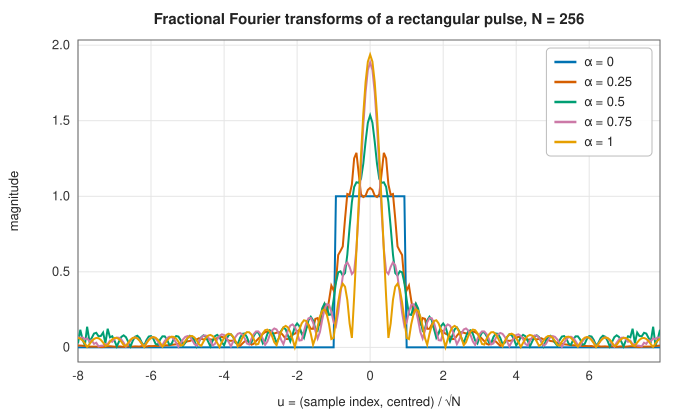

# Bluestein's algorithm and the fractional Fourier transform

<div class="entry-summary">

| | |
|---|---|
| **Problem** | Compute the DFT of any length $n$, including primes, in $O(n\log n)$; compute the fractional Fourier transform, which rotates a signal in the time-frequency plane |
| **Devised by** | Leo Bluestein (1968), the chirp transform; Lawrence Rabiner, Ronald Schafer and Charles Rader (1969), the chirp-z transform; the fractional Fourier transform: Norbert Wiener (1929), Victor Namias (1980), Luís Almeida (1994); its fast digital computation: Haldun Ozaktas, Orhan Arıkan, M. Alper Kutay and Gözde Bozdağı (1996) |
| **Accuracy** | Bluestein: $O(\varepsilon\log n)$ with exactly reduced chirp angles. Fractional transform: a discretisation of the continuous transform, accurate to about $10^{-2}$ for well-sampled signals |
| **Cost** | Three power-of-two FFTs of length at least $2n - 1$ |
| **API** | [`BluesteinFft`](../../api/lib_jsl_ffts/bluestein_fft/struct.BluesteinFft.html) (used by [`Fft`](../../api/lib_jsl_ffts/fft/struct.Fft.html)), [`FractionalFft`](../../api/lib_jsl_ffts/fractional_fft/struct.FractionalFft.html), [`frft`](../../api/lib_jsl_ffts/fractional_fft/fn.frft.html) |

</div>

## Overview

The Cooley-Tukey FFT needs $n$ to factor into small primes. **Bluestein's algorithm** removes that restriction: an identity
for $jk$ turns the DFT into a convolution with a **chirp**, a complex exponential whose frequency rises linearly, and the
convolution is computed with power-of-two FFTs. It costs a few times as much as a power-of-two FFT of similar length, but is
$O(n\log n)$ for every $n$, and computes the more general chirp-z transform, the $z$-transform on a spiral contour, for zooming into
part of a spectrum.

The **fractional Fourier transform** of order $\alpha$ generalises the Fourier transform: order 1 is the Fourier transform, order 2 time
reversal, and intermediate orders rotate the signal by $\alpha \cdot 90°$ in the time-frequency plane. It is used in optics (Fresnel
diffraction is a fractional Fourier transform), in radar and sonar for chirp signals, and in time-frequency filtering. It is computed
with the same chirp-multiply, convolve, chirp-multiply structure as Bluestein's algorithm.

## History

Leo Bluestein, at Sylvania, devised the chirp transform in 1968 for speech analysis, and Lawrence Rabiner, Ronald Schafer and
Charles Rader (1969) generalised it to the chirp-z transform. The fractional powers of the Fourier transform appear in work of Norbert
Wiener (1929) and Edward Condon (1937); Victor Namias (1980) introduced the fractional Fourier transform to quantum mechanics, and Luís
Almeida (1994) brought it to signal processing as a time-frequency rotation. Haldun Ozaktas and colleagues (1996) gave the fast
digital algorithm.

## The idea

### Bluestein's algorithm

The radix-2 FFT works by halving, so it needs $n$ to be a power of two. Bluestein's algorithm
computes a DFT of *any* length using only power-of-two FFTs. It rests on two facts: a DFT can be
rewritten as a convolution, and a convolution can be computed with FFTs of any convenient
length.

**Step 1: turn the product $jk$ into a difference.** In the DFT
$X_k = \sum_jx_je^{-2\pi ijk/n}$, the indices $j$ and $k$ appear multiplied together. The identity

$$
jk = \tfrac12\big(j^2 + k^2 - (k - j)^2\big)
$$

(expand the square to check it) replaces the product by terms that depend on $j$ alone, on $k$
alone, and on the difference $k - j$. Substituting it into the exponent and separating the three
factors,

$$
X_k = e^{-\pi ik^2/n}\sum_j\big(x_je^{-\pi ij^2/n}\big)\,e^{\pi i(k-j)^2/n} .
$$

**Step 2: recognise a convolution.** A sum of the form $\sum_ja_j\,b_{k-j}$ is the
[convolution](../filters/convolution.md) of the sequences $a$ and $b$. Here
$a_j = x_je^{-\pi ij^2/n}$ and $b_m = e^{\pi im^2/n}$. The sequence $b$ is a **chirp**: a complex
exponential whose phase grows quadratically, so its frequency rises linearly, like a bird's
chirp. So the DFT is: multiply the input by a chirp, convolve with a chirp, and multiply the
result by a chirp.

**Step 3: compute the convolution with FFTs.** By the convolution theorem, the DFT of a circular
convolution is the product of the DFTs, so a convolution costs three FFTs: transform both
sequences, multiply, and transform back. The length of these FFTs is ours to choose. The
convolution needs $b_m$ for $m$ from $-(n - 1)$ to $n - 1$, and an FFT computes a *circular*
convolution, in which indices wrap around. Padding with zeros to a length $M \ge 2n - 1$ leaves
enough room that the wrapped-around terms never overlap the wanted ones, so the circular
convolution equals the ordinary one. Choosing $M$ a power of two lets the fast radix-2 engine do
the work.

Altogether: three FFTs of length $M$ (one of them, the transform of $b$, is the same for every
input and is precomputed at planning time) and $O(n)$ multiplications give the DFT of length
$n$. Since $M < 4n$, the cost is still $O(n\log n)$, a few times that of a power-of-two transform.

**Chirp accuracy.** The chirp angle $\pi k^2/n$ reaches $\pi n$ radians. Computed in floating point, its rounding error is about $\varepsilon\pi n$, so for
$n = 10^5$ every chirp value is wrong by $10^{-11}$. Since $e^{\pi im/n}$ has period $2n$ in $m$, the library reduces $k^2 \bmod 2n$ exactly in integer
arithmetic first. An earlier version did not, and lost five digits at $n = 2^{20}$
([figure](index.md#accuracy)); it is now accurate to rounding at every length.

### The fractional Fourier transform

The continuous fractional Fourier transform of order $\alpha$, with $\varphi = \alpha\pi/2$, is

$$
(\mathcal F^\alpha x)(u) = \sqrt{1 - i\cot\varphi}\int e^{i\pi(\cot\varphi\,u^2 - 2\csc\varphi\,uv + \cot\varphi\,v^2)}\,x(v)\,dv .
$$

Its orders add ($\mathcal F^\alpha\mathcal F^\beta = \mathcal F^{\alpha+\beta}$), $\mathcal F^1$ is the Fourier transform, and the Gaussian $e^{-\pi t^2}$ is an eigenfunction of every
order. Writing $-2uv = (u - v)^2 - u^2 - v^2$ splits the kernel into a chirp multiplication, a convolution with a chirp, and another chirp
multiplication. The library samples this at spacing $1/\sqrt n$, so the signal should occupy the central interval of width $\sqrt n$ in
both time and frequency, and computes the convolution with FFTs. Orders are first reduced to $[\tfrac12, \tfrac32]$, using
$\mathcal F^{\alpha\pm1} = \mathcal F^{\pm1}\mathcal F^\alpha$, where the chirps are least oscillatory.



The rectangular pulse turns, as $\alpha$ grows from 0 to 1, through Fresnel-like diffraction patterns into its Fourier transform, a sinc.

The discretisation omits the oversampling step of Ozaktas's algorithm, so it approximates the continuous transform to about
$10^{-2}$: the Gaussian is reproduced to $10^{-3}$ near the integer orders and to $6 \times 10^{-2}$ at $\alpha = \tfrac12$, and energy is preserved to
about 1%. An earlier version also lost a factor of $\sqrt n$ in the convolution, so intermediate orders returned $1/n$ of the input energy;
only the integer orders, computed separately, had been tested.

## Algorithm

**Bluestein's algorithm** for a DFT of any length $n$.

*Planning*, done once for each length:

1. choose $M$, the smallest power of two with $M \ge 2n - 1$;
2. tabulate the chirp $w_k = e^{-\pi i(k^2 \bmod 2n)/n}$ for $k = 0, \ldots, n - 1$, reducing
   $k^2$ modulo $2n$ in integer arithmetic before the angle is formed;
3. build the sequence $b$ of length $M$ holding $\overline{w_k}$ at positions $k$ and $M - k$
   (the negative indices wrap around to the end), zero elsewhere, and compute its FFT $\hat b$.

*Execution*, for each input $x$:

1. multiply: $a_k = x_kw_k$ for $k < n$, and pad $a$ with zeros to length $M$;
2. transform $a$ with an FFT of length $M$;
3. multiply the result by $\hat b$, element by element;
4. transform back with an inverse FFT of length $M$;
5. multiply the first $n$ results by $w_k$ again. These are $X_0, \ldots, X_{n-1}$.

The inverse DFT uses the conjugate chirp and divides by $n$. Each execution costs two FFTs of
length $M < 4n$.

**Fractional Fourier transform** of order $\alpha$.

1. Reduce $\alpha$ modulo 4, since four Fourier transforms are the identity.
2. If $\alpha$ is an integer, return the exact result: the input itself (0), its DFT (1), its
   reversal (2) or its inverse DFT (3).
3. Otherwise bring the order into $[\tfrac12, \tfrac32]$ by applying one ordinary DFT or inverse
   DFT, which changes the order by $\pm1$.
4. Multiply by a chirp, convolve with a chirp using FFTs, and multiply by a chirp again, with
   the chirp rates given by $\cot\varphi$ and $\csc\varphi$ for $\varphi = \alpha\pi/2$.

## Implementation

```rust,ignore
{{#include ../../../crates/ffts/src/bluestein_fft.rs:bluestein}}
```

- `Fft` uses Bluestein automatically for every length that is not a power of two.
- `FractionalFft::execute(input, alpha)` accepts real or complex input (anything implementing `IsAnalytic`); `frft` is the one-shot form.

## In practice

```rust,ignore
{{#include ../../../crates/ffts/examples/fft_any_length.rs}}
```

**Strengths**

- Any length in $O(n\log n)$, accurate to rounding.
- A fast fractional Fourier transform with the integer orders exact.

**Weaknesses**

- Bluestein costs several times a power-of-two FFT; lengths with small prime factors would be faster with a mixed-radix algorithm.
- The fractional transform is a low-accuracy discretisation of the continuous one.

## Exercises

1. Verify the identity $jk = \tfrac12(j^2 + k^2 - (k - j)^2)$ and derive Bluestein's formula.
2. Why must the convolution length be at least $2n - 1$? What goes wrong with $M = n$?
3. Compute the chirp $e^{-\pi ik^2/n}$ for $n = 10^6$ with and without the reduction $k^2 \bmod 2n$, and compare the largest difference.
4. Show that $\mathcal F^2x(t) = x(-t)$ from the integral, using $\cot\pi = \infty$ as a limit.
5. Apply the fractional transform to a linear chirp $e^{i\pi ct^2}$ and find the order that compresses it to a spike.

## Further reading

- L. I. Bluestein, "A linear filtering approach to the computation of discrete Fourier transform", *IEEE Transactions on Audio and
  Electroacoustics* 18 (1970) 451–455.
- L. R. Rabiner, R. W. Schafer and C. M. Rader, "The chirp z-transform algorithm", *IEEE Transactions on Audio and Electroacoustics*
  17 (1969) 86–92.
- L. B. Almeida, "The fractional Fourier transform and time-frequency representations", *IEEE Transactions on Signal Processing* 42
  (1994) 3084–3091.
- H. M. Ozaktas, O. Arıkan, M. A. Kutay and G. Bozdağı, "Digital computation of the fractional Fourier transform", *IEEE Transactions on
  Signal Processing* 44 (1996) 2141–2150.
