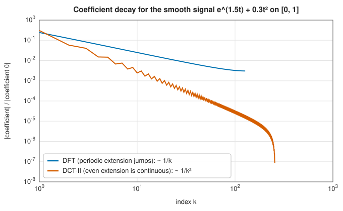

# Discrete cosine and sine transforms

<div class="entry-summary">

| | |
|---|---|
| **Problem** | Expand real data in cosines or sines: the discrete cosine and sine transforms of types I to IV, their inverses and orthonormal forms |
| **Devised by** | Nasir Ahmed, T. Natarajan and K. R. Rao (1974), the DCT-II; Zhongde Wang and others (1984), the classification into types I–IV; the JPEG committee (1992), image compression; John Princen and Alan Bradley (1986), the modified DCT of audio coding |
| **Accuracy** | $O(\varepsilon\log n)$, through complex FFTs |
| **Cost** | One complex FFT of length about $2n$ plus $O(n)$ work |
| **API** | [`dct`](../../api/lib_jsl_ffts/dct/fn.dct.html), [`idct`](../../api/lib_jsl_ffts/dct/fn.idct.html), [`dst`](../../api/lib_jsl_ffts/dct/fn.dst.html), [`idst`](../../api/lib_jsl_ffts/dct/fn.idst.html), [`TrigTransformType`](../../api/lib_jsl_ffts/dct/enum.TrigTransformType.html), [`TrigNormalization`](../../api/lib_jsl_ffts/dct/enum.TrigNormalization.html) |

</div>

## Overview

The DFT implicitly treats data as one period of a periodic signal. For data that is not periodic, the jump between the last
sample and the first produces large high-frequency coefficients, decaying only like $1/k$. The **discrete cosine transform**
instead treats the data as half of an *even* signal, its mirror image appended, which has no jump: for smooth data its coefficients
decay like $1/k^2$ or faster, so a few of them capture most of the signal. That **energy compaction** made the DCT-II the transform of
JPEG images and MPEG video, and its relative the modified DCT the transform of MP3 and AAC audio.

The cosine and sine transforms are also the eigenvector bases of the second-difference matrix with Neumann and Dirichlet boundary
conditions, so they diagonalise Poisson's equation on rectangles and appear in [spectral methods](../integration/spectral-methods.md)
(the Chebyshev transform is a DCT-I).

## History

Nasir Ahmed proposed the cosine transform in 1972 as an approximation of the optimal Karhunen-Loève transform for correlated signals,
and published it with T. Natarajan and K. R. Rao in 1974. Zhongde Wang (1984) classified the eight variants by the symmetry of the
extension (types I to IV of cosines and sines). The JPEG image standard (1992) used the $8 \times 8$ DCT-II, and John Princen and Alan Bradley's
modified DCT (1986), a lapped DCT-IV, underlies MP3, AAC and Vorbis audio.

## The idea

### Symmetric extensions

Each type corresponds to a way of extending the $n$ samples symmetrically (even or odd, about a sample or between samples) into a sequence
whose DFT is real. With the unnormalised conventions of SciPy and FFTW:

| type | cosine transform $y_k$ | sine transform $y_k$ |
|---|---|---|
| I | $x_0 + (-1)^kx_{n-1} + 2\sum_{m=1}^{n-2}x_m\cos\frac{\pi km}{n-1}$ | $2\sum x_m\sin\frac{\pi(k+1)(m+1)}{n+1}$ |
| II | $2\sum x_m\cos\frac{\pi k(2m+1)}{2n}$ | $2\sum x_m\sin\frac{\pi(k+1)(2m+1)}{2n}$ |
| III | $x_0 + 2\sum_{m\ge1}x_m\cos\frac{\pi m(2k+1)}{2n}$ | $(-1)^kx_{n-1} + 2\sum_{m<n-1}x_m\sin\frac{\pi(m+1)(2k+1)}{2n}$ |
| IV | $2\sum x_m\cos\frac{\pi(2m+1)(2k+1)}{4n}$ | $2\sum x_m\sin\frac{\pi(2m+1)(2k+1)}{4n}$ |

Types II and III are inverses of each other (up to $2n$), types I and IV are their own inverses (up to $2(n \mp 1)$ and $2n$). The **orthonormal**
normalisation scales each to an orthogonal matrix, so its inverse is its transpose. "The DCT" usually means the DCT-II, and "the
inverse DCT" the DCT-III.

### Energy compaction

A smooth function on $[0, 1]$ sampled at the midpoints of $n$ cells has DFT coefficients decaying like $1/k$, because of the jump in its periodic
extension, while its DCT-II coefficients decay like $1/k^2$:



Truncating the DCT therefore approximates such signals far better than truncating the DFT; JPEG quantises the high-frequency DCT
coefficients of each $8 \times 8$ block coarsely or discards them.

### Computing through the FFT

Each transform is computed with one complex FFT of length about $2n$: the DCT-I of the even extension of length $2n - 2$; the DCT-II of the even
extension of length $2n$, followed by a twiddle $e^{-\pi ik/2n}$; the DCT-III by the inverse of that; the type IV by twiddled zero-padding to
length $2n$. The DST-I uses the odd extension of length $2n + 2$, the DST-II and DST-III reduce to the cosine transforms by
reversing the order and alternating signs, and the DST-IV takes the imaginary part of the same twiddled FFT as the DCT-IV. All are $O(n\log n)$ and inherit the FFT's
accuracy: compared with a direct sum with exactly reduced angles, the DCT-II is accurate to $2 \times 10^{-15}$ at $n = 4096$.

## Algorithm

`dct(x, kind, norm)`: validate the length (type I needs $n \ge 2$); form the extension or twiddled sequence; FFT; extract and twiddle the
real parts; apply the normalisation. `idct` applies the inverse type with the matching scaling.

## Implementation

```rust,ignore
{{#include ../../../crates/ffts/src/dct.rs:dct_raw}}
```

- `TrigNormalization::Backward` is the unnormalised forward transform with the scaling on the inverse (SciPy's default);
  `Ortho` makes both orthogonal.
- The extensions are transformed with the complex `Fft`, of any length.

## In practice

```rust,ignore
{{#include ../../../crates/ffts/examples/fft_dct.rs}}
```

**Strengths**

- All eight classical transforms, unnormalised or orthonormal, for any length, in $O(n\log n)$.
- Excellent energy compaction for smooth, non-periodic data.

**Weaknesses**

- Computed through complex FFTs of twice the length, about four times the work of a dedicated real-to-real algorithm.
- No modified (lapped) DCT and no multidimensional DCT (apply `dct` along each axis).

## Exercises

1. Show that the DCT-II of $x$ is, up to a twiddle, the DFT of its even extension of length $2n$.
2. Verify numerically that the orthonormal DCT-II matrix is orthogonal for $n = 8$.
3. Compress a sampled smooth function by keeping the $k$ largest DCT-II coefficients and plot the error against $k$; compare with the DFT.
4. Show that the vectors $\sin\frac{\pi jk}{n+1}$ are eigenvectors of the second-difference matrix with zero boundary values, and use the DST-I to
   solve $-u'' = f$ on $(0, 1)$.
5. Implement the $8 \times 8$ two-dimensional DCT-II of an image block with `dct` along rows and columns.

## Further reading

- N. Ahmed, T. Natarajan and K. R. Rao, "Discrete cosine transform", *IEEE Transactions on Computers* C-23 (1974) 90–93.
- G. Strang, "The discrete cosine transform", *SIAM Review* 41 (1999) 135–147.
- K. R. Rao and P. Yip, *Discrete Cosine Transform: Algorithms, Advantages, Applications*, Academic Press, 1990.
- S. A. Martucci, "Symmetric convolution and the discrete sine and cosine transforms", *IEEE Transactions on Signal Processing* 42 (1994)
  1038–1051.
