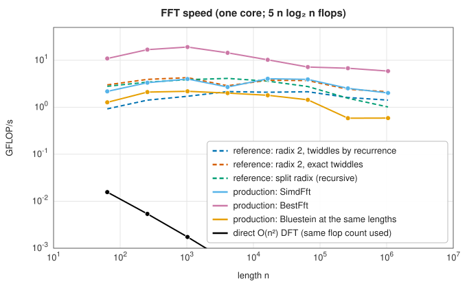

# The fast Fourier transform

<div class="entry-summary">

| | |
|---|---|
| **Problem** | Compute the discrete Fourier transform of $n$ complex samples in $O(n\log n)$ operations |
| **Devised by** | Carl Friedrich Gauss (1805, unpublished); Gordon Danielson and Cornelius Lanczos (1942); James Cooley and John Tukey (1965); split radix: R. Yavne (1968), Pierre Duhamel and Henk Hollmann (1984); cache-oblivious and adaptive FFTs: Matteo Frigo and Steven Johnson (FFTW, 1998) |
| **Accuracy** | Relative error $O(\varepsilon\log n)$ with accurate twiddle factors |
| **Cost** | Radix 2: $5n\log_2n$ real flops; split radix: about $4n\log_2n$; the direct DFT: $8n^2$ |
| **API** | [`Fft`](../../api/lib_jsl_ffts/fft/struct.Fft.html), [`BestFft`](../../api/lib_jsl_ffts/best_fft/struct.BestFft.html), [`SimdFft`](../../api/lib_jsl_ffts/simd_fft/struct.SimdFft.html), [`FftEngine1D`](../../api/lib_jsl_ffts/fft_engine_trait/trait.FftEngine1D.html); reference: [`simple_cooley_tukey`](../../api/lib_jsl_ffts_reference/simple_cooley_tukey/index.html), [`optimized_radix2`](../../api/lib_jsl_ffts_reference/optimized_radix2/index.html), [`optimized_split_radix`](../../api/lib_jsl_ffts_reference/optimized_split_radix/index.html) |

</div>

## Overview

The FFT is a family of algorithms that compute the DFT by splitting it into smaller DFTs. The simplest, the radix-2
**Cooley-Tukey** algorithm, splits a transform of even length $n$ into two of length $n/2$, of the even- and odd-indexed samples,
and combines them with $n/2$ multiplications by **twiddle factors** $\omega^k = e^{-2\pi ik/n}$. Repeating the split down to length 1 gives
$\log_2n$ stages of $n/2$ "butterflies" each. **Split radix** splits more cleverly and does the fewest operations of the classical
algorithms.

On modern processors the operation count is only part of the story: memory access patterns, vector instructions and the
reuse of data in cache decide the speed. The production engine is a radix-2/4 Cooley-Tukey algorithm tuned for all three, and
runs five to ten times faster than the textbook engines, which perform about the same number of operations.

## History

Gauss devised the algorithm in 1805 to interpolate the orbits of the asteroids Pallas and Juno from observations, splitting a
transform of length 12 into transforms of lengths 3 and 4; his notes were published only posthumously, in Latin, in 1866, and
went unnoticed. Several later rediscoveries also passed without impact, including Danielson and Lanczos's doubling method (1942)
for X-ray crystallography. James Cooley of IBM and John Tukey of Princeton published the general algorithm in 1965, prompted by
the need to detect Soviet nuclear tests from seismometer data, and it spread immediately. R. Yavne (1968) found the split-radix
algorithm, rediscovered and analysed by Duhamel and Hollmann (1984). Matteo Frigo and Steven Johnson's FFTW (1998) showed that
generated, adaptively planned code could approach the hardware's peak, and set the standard for FFT libraries.

## The idea

### The radix-2 Cooley-Tukey algorithm

Split the sum into even and odd $m$: with $E_k$ and $O_k$ the DFTs of length $n/2$ of $x_{2m}$ and $x_{2m+1}$,

$$
X_k = E_k + \omega^kO_k, \qquad X_{k+n/2} = E_k - \omega^kO_k, \qquad 0 \le k < n/2,
$$

because $\omega^{n/2} = -1$ and $E$, $O$ have period $n/2$. Each pair of outputs costs one complex multiplication and two additions,
a **butterfly**. Applied recursively, $\log_2n$ levels of $n/2$ butterflies give $\tfrac n2\log_2n$ complex multiplications. Done in place,
the recursion reads the input in **bit-reversed** order (sample $m$ goes to the position whose binary index is $m$'s reversed), and
the iterative algorithm permutes the input once and then runs the stages from short transforms to long.

### Split radix

The even half needs no twiddles at the top level, but the odd half does. **Split radix** splits the odd samples once more, into
those at $4m + 1$ and $4m + 3$:

$$
X_k = U_k + (\omega^kZ_k + \omega^{3k}Z'_k), \qquad X_{k+n/2} = U_k - (\omega^kZ_k + \omega^{3k}Z'_k),
$$

$$
X_{k+n/4} = U_{k+n/4} - i(\omega^kZ_k - \omega^{3k}Z'_k), \qquad X_{k+3n/4} = U_{k+n/4} + i(\omega^kZ_k - \omega^{3k}Z'_k),
$$

with $U$ of length $n/2$ and $Z$, $Z'$ of length $n/4$. The factors $\pm i$ cost nothing, so it needs about $4n\log_2n - 6n + 8$ real
operations, against $5n\log_2n$ for radix 2. For decades this was the lowest known count, until Johnson and Frigo (2007) shaved off a
few per cent more.

### Twiddle factors and accuracy

Each output passes through $\log_2n$ butterflies, so rounding errors accumulate only logarithmically, if each twiddle factor is
accurate to $\varepsilon$. Generating them by the recurrence $\omega^{k+1} = \omega^k\omega$, as many textbooks do, adds a rounding error at every step,
and the error then grows like $n\varepsilon$: the reference crate's textbook engine does exactly that, and its error reaches $10^{-11}$ at
$n = 2^{20}$ (see the [figure in the chapter introduction](index.md#accuracy)). The other engines compute every twiddle from its exact
angle and stay below $10^{-15}$.

### The production engines

`BestFft` is an iterative decimation-in-time algorithm on bit-reversed data, made fast in five ways:

1. **radix-4 passes**: pairs of radix-2 stages are fused, so each pass reads and writes the array once instead of twice and needs
   three twiddle multiplications per four outputs instead of four;
2. **SIMD**: on x86-64 with AVX2 and FMA (detected at run time) two complex values are processed per 256-bit register, with complex
   multiplication by `fmaddsub`;
3. **cache blocking**: all the stages whose butterflies fit in a block are run on one block at a time, so it stays in cache;
4. **bandwidth-saving large passes**: passes over the whole array store only $\omega^j$ and form $\omega^{2j}$ and $\omega^{3j}$ in registers;
5. **a cache-friendly permutation**: the bit reversal is done in $16 \times 16$ tiles, writing straight into the output with any scaling
   folded in.

`SimdFft` provides vectorised radix-2 kernels for ARM (NEON) and RISC-V as well as x86. The default `Fft` uses `BestFft` for powers of
two and [Bluestein's algorithm](bluestein-fractional.md) for every other length.



The three reference engines run at 1 to 4 GFLOP/s; `BestFft` reaches 10 to 20, falling off once the data no longer fit in cache. The
direct DFT, at well under 0.1 GFLOP/s-equivalent, is hopeless beyond a few thousand points.

## Algorithm

**Iterative radix 2**: permute the input into bit-reversed order; for $s = 1, \ldots, \log_2n$, with $m = 2^s$, combine pairs of transforms of
length $m/2$ by butterflies with twiddles $e^{\mp2\pi ij/m}$; scale if requested.

**Split radix** (recursive): transform the even samples (length $n/2$) and the two odd subsequences (length $n/4$), then combine with the
four formulas above.

## Implementation

The stages of the textbook engine, with its twiddle recurrence:

```rust,ignore
{{#include ../../../crates/ffts_reference/src/simple_cooley_tukey.rs:radix2_stages}}
```

The split-radix recursion:

```rust,ignore
{{#include ../../../crates/ffts_reference/src/optimized_split_radix.rs:split_radix}}
```

A radix-4 pass of the production engine (portable version):

```rust,ignore
{{#include ../../../crates/ffts/src/best_fft.rs:radix4_pass}}
```

- `plan(size, scale, direction, ordering)` builds the twiddle tables; `execute(input)` returns a new vector. `FftScaleFactor` is `None`,
  `SqrtN` (unitary) or `N` (for the inverse); `FftOrdering::BitReversed` accepts input already in bit-reversed order.
- The reference split-radix engine replaced an earlier engine of the same name, which repeated its first stage and returned wrong
  results; its tests had computed the error without checking it.

## In practice

```rust,ignore
{{#include ../../../crates/ffts_reference/examples/fft_engines.rs}}
```

**Strengths**

- $O(n\log n)$ and $O(\varepsilon\log n)$: fast and accurate.
- Powers of two run at 10 to 20 GFLOP/s on one core (`cargo bench -p lib_jsl_ffts` compares the engines with RustFFT); any
  length is supported.

**Weaknesses**

- Non-power-of-two lengths go through Bluestein's algorithm, several times slower than a mixed-radix FFT would be for lengths
  with small prime factors.
- One-dimensional engines return a new vector (no in-place API).

## Exercises

1. Count the real flops of radix-2 and split-radix FFTs for $n = 8$ and $n = 16$.
2. Show that the in-place radix-2 algorithm reads its input in bit-reversed order.
3. Measure the error of the textbook engine for $n = 2^{10}, \ldots, 2^{20}$ and fit it to $Cn\varepsilon$. Then replace the recurrence by exact
   twiddles and measure again.
4. Use the FFT to multiply two polynomials of degree 1000, and check against direct multiplication.
5. Compute the DFT of a sampled sine whose frequency is not an integer number of cycles, and explain the spectral leakage.

## Further reading

- J. W. Cooley and J. W. Tukey, "An algorithm for the machine calculation of complex Fourier series", *Mathematics of Computation* 19
  (1965) 297–301.
- M. T. Heideman, D. H. Johnson and C. S. Burrus, "Gauss and the history of the fast Fourier transform", *IEEE ASSP Magazine* 1 (1984)
  14–21.
- P. Duhamel and H. Hollmann, "Split radix FFT algorithm", *Electronics Letters* 20 (1984) 14–16.
- M. Frigo and S. G. Johnson, "The design and implementation of FFTW3", *Proceedings of the IEEE* 93 (2005) 216–231.
- C. Van Loan, *Computational Frameworks for the Fast Fourier Transform*, SIAM, 1992.
