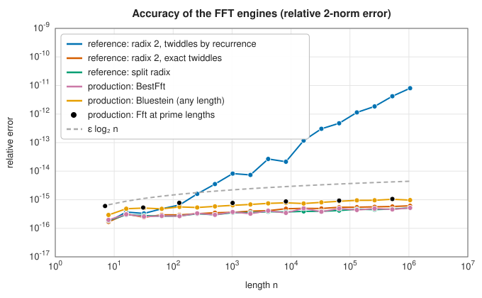

# Fast Fourier transforms

The **discrete Fourier transform** (DFT) of $n$ samples $x_0, \ldots, x_{n-1}$ is

$$
X_k = \sum_{m=0}^{n-1} x_m\,e^{-2\pi i km/n}, \qquad k = 0, \ldots, n - 1,
$$

and its inverse is $x_m = \frac1n\sum_kX_ke^{2\pi i km/n}$. It decomposes a signal into the frequencies it contains, and
turns convolution into multiplication. Computed directly it costs $O(n^2)$ operations; the **fast Fourier transform**
(FFT) computes exactly the same numbers in $O(n\log n)$, which made digital signal processing, spectral analysis,
image compression, fast polynomial and integer multiplication, and [spectral methods](../integration/spectral-methods.md)
for differential equations practical. For a million points the saving is a factor of fifty thousand.

## The central questions

- **What length?** The classical FFTs factor $n$; powers of two are the fastest and simplest. Any length, including
  primes, can be handled in $O(n\log n)$ by turning the DFT into a convolution ([Bluestein's algorithm](bluestein-fractional.md)).
- **Real or complex data?** Real signals have conjugate-symmetric spectra, and a transform that exploits this does
  less work ([real FFTs](real-multidimensional.md)).
- **What symmetry or boundary conditions?** Cosine and sine transforms correspond to even and odd extensions of the
  data, which avoid the artificial jump of the periodic extension ([DCT and DST](dct.md)).
- **One dimension or more?** Multidimensional transforms are one-dimensional transforms along each axis in turn.

## Accuracy

The FFT is not just faster than the direct sum but more accurate: its error grows like $\varepsilon\log n$ rather than $\varepsilon n$, as long as
the **twiddle factors** $e^{-2\pi ik/n}$ are themselves accurate. Every engine in the library is compared below with an exactly known
spectrum (a sum of complex exponentials at integer frequencies):

<strong>Figure 8.1.</strong> FFT accuracy.

The textbook engine whose twiddles are generated by a
recurrence shows the expected $O(n\varepsilon)$ growth, and is kept as a lesson.

## Testing against SciPy

The references come from SciPy 1.17.1's `scipy.fft` (the pocketfft library), written by `book/generator/data/make_fft_refs.py`; the inputs are formulas that the generator repeats. Each entry is the largest difference relative to the largest magnitude of SciPy's result:

<strong>Table 8.1.</strong> Columns: transform (SciPy reference), largest relative difference.

{{#include ../generated/fft/scipy_fft.md}}

<strong>Table 8.2.</strong> Columns: DCT, DST and inverse DCT, 32 points (`fft.dct`, `fft.dst`, `fft.idct`), unnormalised (`backward`), orthonormal (`ortho`).

{{#include ../generated/fft/scipy_trig.md}}

All of them agree to rounding error, including the Bluestein transforms of prime length and every type and normalisation of the trigonometric transforms.

## Two crates

`lib_jsl_ffts` ([API reference](../../api/lib_jsl_ffts/index.html)) is the production crate. Its `Fft` handles any length,
choosing `BestFft` (radix-4 passes, AVX2/FMA kernels, cache blocking) for powers of two and `BluesteinFft` otherwise. It also provides
`SimdFft` (vectorised radix-2 kernels for x86, ARM and RISC-V), `FractionalFft`, `RealFft`, multidimensional transforms and the DCT and
DST of types I to IV. All engines implement the `FftEngine1D` trait: plan once for a length, scaling, direction and input ordering,
then execute repeatedly.

`lib_jsl_ffts_reference` ([API reference](../../api/lib_jsl_ffts_reference/index.html)) holds three readable power-of-two engines for
study (the textbook radix-2 algorithm, radix 2 with exact twiddles, and split radix) that implement the same trait;
`cargo bench -p lib_jsl_ffts_reference` races them against the production engines.

## Choosing a transform

| You need | Use | Entry |
|---|---|---|
| The DFT of complex data, any length | `Fft` | [The fast Fourier transform](fft.md) |
| The DFT of a power-of-two length, a specific engine | `BestFft`, `SimdFft` | [The fast Fourier transform](fft.md#the-production-engines) |
| A prime or awkward length, or a chirp-z transform | `BluesteinFft` (inside `Fft`) | [Bluestein and fractional](bluestein-fractional.md) |
| A rotation in the time-frequency plane | `FractionalFft`, `frft` | [Bluestein and fractional](bluestein-fractional.md#the-fractional-fourier-transform) |
| The spectrum of real data | `RealFft`, `rfft`, `irfft` | [Real and multidimensional](real-multidimensional.md) |
| Images and volumes | `fft2`, `fft3`, `fftn`, `fftshift` | [Real and multidimensional](real-multidimensional.md#multidimensional-transforms) |
| Compression, or smooth non-periodic data | `dct`, `dst` and inverses | [DCT and DST](dct.md) |
