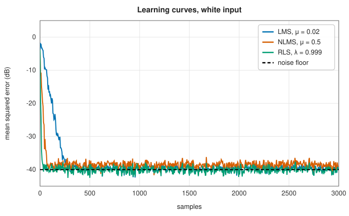
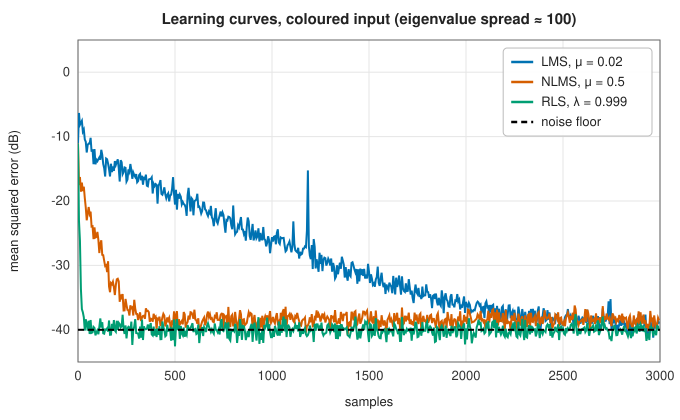

# Adaptive filters: LMS, NLMS and RLS

<div class="entry-summary">

| | |
|---|---|
| **Problem** | Adjust the taps of a filter while it runs, so that its output tracks a desired signal: identify an unknown system, cancel noise or echo, equalise a channel |
| **Devised by** | Bernard Widrow and Marcian Hoff (1960), least mean squares; Jin-ichi Nagumo and Atsuhiko Noda (1967) and Arthur Albert and Leland Gardner (1967), normalised LMS; Robin Plackett (1950) and Dominique Godard (1974), recursive least squares |
| **Accuracy** | LMS converges in the mean for small enough steps, with an excess error proportional to the step; RLS minimises the exponentially weighted squared error exactly at every step |
| **Cost** | LMS and NLMS: $O(M)$ per sample for $M$ taps. RLS: $O(M^2)$ per sample |
| **API** | [`LmsFilter`](../../api/lib_jsl_dsp/discrete/filters/adaptive/lms/struct.LmsFilter.html) (`new(taps, step_size, normalized)`, `adapt`, `adapt_block`, `filter`, `weights`), [`RlsFilter`](../../api/lib_jsl_dsp/discrete/filters/adaptive/rls/struct.RlsFilter.html) (`new(taps, forgetting, initial_inverse_correlation)`, `adapt`, `adapt_block`, `weights`) |

</div>

## Overview

A fixed filter needs the signal's statistics in advance. An **adaptive filter** learns them as it runs. At each sample it forms an output
$y_n = \mathbf w^{\mathsf H}\mathbf u_n$ from the most recent inputs $\mathbf u_n = (x_n, x_{n-1}, \ldots, x_{n-M+1})$, compares it with a desired response $d_n$, and nudges its weights to reduce the error $e_n = d_n - y_n$. Arranged
suitably, the same loop identifies an unknown system (the desired signal is the system's output), cancels noise (the desired signal is
the corrupted one, the input a reference correlated with the noise), cancels echoes on telephone lines, and equalises
communication channels. **LMS** takes one cheap stochastic-gradient step per sample. **RLS** solves the least-squares problem exactly
at every sample, converging far faster at quadratic cost.

## History

Bernard Widrow and his student Marcian Hoff (1960) invented the least-mean-squares rule for their ADALINE adaptive neuron at
Stanford; it became the most widely used adaptive algorithm. Normalising the step by the input power was proposed independently by
Jin-ichi Nagumo and Atsuhiko Noda (1967) and by Arthur Albert and Leland Gardner (1967). Recursive least squares goes back to Robin
Plackett's (1950) recursive form of Gauss's least squares, and to the Kalman filter, of which it is a special case; Dominique Godard (1974)
applied it to channel equalisation. Simon Haykin's *Adaptive Filter Theory* (1986, now in its fifth edition) is the standard text.

## The idea

### The Wiener solution

**The setting.** An adaptive filter is an FIR filter with $M$ taps whose weights are adjusted
while it runs. At each time step $n$ it has three things: the vector $\mathbf u_n$ of the $M$ most
recent input samples; a **desired** signal $d_n$ that its output should match; and its current
weights $\mathbf w$. Its output is the weighted sum $\mathbf w^{\mathsf H}\mathbf u_n$, and the **error** is
$e_n = d_n - \mathbf w^{\mathsf H}\mathbf u_n$. (The superscript $\mathsf H$ is the conjugate transpose, which
allows complex signals; for real signals it is the ordinary transpose.) In system
identification, for example, the input is fed to both an unknown system and the filter, the
desired signal is the unknown system's output, and driving the error to zero makes the filter a
copy of the system.

**The best fixed filter.** If the signals are **stationary** (their statistics do not change
with time), there is a best set of weights: the one that minimises the mean squared error
$J(\mathbf w) = E|d_n - \mathbf w^{\mathsf H}\mathbf u_n|^2$. This is a least-squares problem, and $J$ is a
quadratic function of the weights, a bowl with a single minimum. Setting its gradient to zero
gives the **Wiener-Hopf** equations

$$
R\,\mathbf w_\star = \mathbf p, \qquad R = E[\mathbf u\mathbf u^{\mathsf H}], \qquad \mathbf p = E[\mathbf u\,\bar d],
$$

where $R$ is the **correlation matrix** of the input and $\mathbf p$ the **cross-correlation** of the
input with the desired signal. These are the
[normal equations](../linear_algebra/least-squares.md#the-normal-equations) with averages over
the data replaced by expectations.

Solving them directly would require knowing $R$ and $\mathbf p$, which are properties of the signals
that are not known in advance and may change. Adaptive filters approach $\mathbf w_\star$ using only
the samples as they arrive, and follow it when the statistics drift.

### LMS: stochastic gradient descent

The simplest way to find the bottom of the bowl is
[gradient descent](../optimization/gradient-methods.md#gradient-descent): move the weights a
small step against the gradient of $J$. That gradient is $-2(\mathbf p - R\mathbf w)$, which again
involves the unknown $R$ and $\mathbf p$.

Widrow and Hoff's idea was to replace the expectations by the values at the current instant,
however crude that estimate is. With $\mathbf u\mathbf u^{\mathsf H}$ in place of $R$ and $\mathbf u\bar d$ in
place of $\mathbf p$,

$$
\mathbf p - R\mathbf w \ \approx\ \mathbf u_n\bar d_n - \mathbf u_n\mathbf u_n^{\mathsf H}\mathbf w = \mathbf u_n\,\overline{(d_n - \mathbf w^{\mathsf H}\mathbf u_n)} = \mathbf u_n\bar e_n .
$$

The estimated gradient is just the input vector times the error. This gives the
**least mean squares** (LMS) update

$$
\mathbf w_{n+1} = \mathbf w_n + \mu\,\bar e_n\,\mathbf u_n,
$$

with **step size** $\mu$. It costs one multiply-add per tap, and needs no knowledge of the
signals. Each individual step is noisy, since it is based on a single sample, but the noise
averages out over many steps and the weights drift towards the Wiener solution.

The behaviour of LMS follows from that of gradient descent on a quadratic.

- **Stability.** The weights converge on average when $0 < \mu < 2/\lambda_{\max}(R)$. Since the
  largest eigenvalue is at most the sum of all of them, which is $M$ times the input power $P_x$,
  a safe practical rule is to keep $\mu$ well below $2/(MP_x)$.
- **Speed.** Convergence proceeds independently along each eigenvector of $R$, at a rate set by
  $\mu\lambda_i$. If the **eigenvalue spread** $\lambda_{\max}/\lambda_{\min}$ is large, the step size
  that is safe for the largest eigenvalue is far too small for the smallest, and the slow modes
  dominate. The spread is 1 for white noise and large for strongly correlated ("coloured")
  inputs.
- **Accuracy.** Because the gradient estimates are noisy, the weights never settle exactly; they
  jitter around the optimum. The resulting excess mean squared error is the **misadjustment**,
  and it grows with $\mu$.

The choice of $\mu$ therefore trades speed against final accuracy.

### NLMS: a step normalised by the input power

The stability limit of LMS depends on the input power, so a step size that works for a quiet
signal makes the filter diverge when the signal gets louder. **Normalised LMS** removes the
dependence by dividing the step by the energy of the current input vector:

$$
\mathbf w_{n+1} = \mathbf w_n + \frac{\mu}{\epsilon + \lVert\mathbf u_n\rVert^2}\,\bar e_n\,\mathbf u_n, \qquad 0 < \mu < 2 .
$$

The small constant $\epsilon$ prevents division by zero during silence. The step size $\mu$ is
now a pure number, with the same stability range $0 < \mu < 2$ whatever the input level, and the
filter converges faster when the input power varies. There is a neat interpretation of
$\mu = 1$: the update is then exactly large enough that, if the same input were presented again,
the error would be zero.

### RLS: exact recursive least squares

LMS takes a small step towards the solution at each sample. **Recursive least squares** (RLS)
jumps to the exact least-squares solution at every sample. It minimises

$$
\sum_{i \le n}\lambda^{n-i}\,|d_i - \mathbf w^{\mathsf H}\mathbf u_i|^2,
$$

the sum of squared errors over all the data so far, with older samples weighted down by the
**forgetting factor** $\lambda \le 1$. A sample $k$ steps old has weight $\lambda^k$, so the filter
effectively remembers about $1/(1 - \lambda)$ samples, which lets it track changing statistics.

Solving a new least-squares problem from scratch at every sample would cost $O(M^3)$ each time.
The saving comes from noticing how little changes. The normal equations involve the weighted sum
of the matrices $\mathbf u_i\mathbf u_i^{\mathsf H}$, and each new sample adds one such rank-one term. The
**matrix inversion lemma** (the Sherman-Morrison formula) gives the inverse of a matrix after a
rank-one change in terms of the old inverse, in $O(M^2)$ operations. So RLS maintains the inverse
correlation matrix $P$ directly and updates it together with the weights:

$$
\mathbf k = \frac{P\mathbf u}{\lambda + \mathbf u^{\mathsf H}P\mathbf u}, \qquad e = d - \mathbf w^{\mathsf H}\mathbf u, \qquad \mathbf w \leftarrow \mathbf w + \mathbf k\bar e, \qquad P \leftarrow \frac{P - \mathbf k\mathbf u^{\mathsf H}P}{\lambda} .
$$

The vector $\mathbf k$ is the **gain**: it plays the role of $\mu\mathbf u$ in LMS, but with the input
multiplied by $P \approx R^{-1}$. That multiplication rescales every eigen-direction of the input
to the same size ("whitens" it), so all modes converge at the same rate. In optimisation terms,
RLS takes a [Newton step](../optimization/newton-quasi-newton.md#newtons-method) where LMS takes
a gradient step. It converges in about $2M$ samples whatever the eigenvalue spread.

The cost is $O(M^2)$ per sample instead of $O(M)$. There is also a numerical hazard: in exact
arithmetic $P$ is Hermitian and positive definite, but rounding errors can destroy both
properties, after which the filter diverges. The library updates one triangle of $P$ and mirrors
it, which keeps it exactly Hermitian.

### Learning curves

Identifying an 8-tap system from noisy observations (noise floor −40 dB), averaged over 50 runs:

| | |
|:---:|:---:|
|  |  |

With white input all three reach the noise floor, RLS in a few dozen samples, LMS in a few hundred. With strongly coloured input
(a first-order autoregressive process with coefficient 0.9, eigenvalue spread 113 for 8 taps), LMS needs thousands of samples, while RLS is unaffected.
The price of RLS grows with the square of the length:

<p class="caption" id="tab-14-7"><strong>Table 14.7.</strong> Columns: taps, NLMS (ns per sample), RLS (ns per sample).</p>

{{#include ../generated/filters/adaptive_cost.md}}

## Algorithm

All three filters keep a **regressor** $\mathbf u$, the $M$ most recent input samples, and the
weights $\mathbf w$, initially zero. For each new input sample $x$ with desired value $d$:

**LMS.**

1. Shift $x$ into the regressor, discarding the oldest sample.
2. Compute the output $y = \mathbf w^{\mathsf H}\mathbf u$ and the error $e = d - y$.
3. Update the weights: $\mathbf w \leftarrow \mathbf w + \mu\,\bar e\,\mathbf u$.

**NLMS**: the same, with the step $\mu/(\epsilon + \lVert\mathbf u\rVert^2)$ in place of $\mu$ in
step 3.

Both cost $O(M)$ per sample.

**RLS** also keeps the matrix $P$, initialised to $\delta I$ with a large $\delta$, which
expresses little confidence in the zero initial weights.

1. Shift $x$ into the regressor.
2. Compute $\boldsymbol\pi = P\mathbf u$ and the gain $\mathbf k = \boldsymbol\pi/(\lambda + \mathbf u^{\mathsf H}\boldsymbol\pi)$.
3. Compute the output $y = \mathbf w^{\mathsf H}\mathbf u$ and the error $e = d - y$, using the weights
   *before* the update (the a priori error).
4. Update the weights: $\mathbf w \leftarrow \mathbf w + \mathbf k\,\bar e$.
5. Update $P \leftarrow (P - \mathbf k\boldsymbol\pi^{\mathsf H})/\lambda$, computing one triangle and copying it
   to the other.

The cost is $O(M^2)$ per sample, from the matrix-vector product and the update of $P$.

## Implementation

```rust,ignore
{{#include ../../../crates/dsp/src/discrete/filters/adaptive/lms.rs:lms}}
```

```rust,ignore
{{#include ../../../crates/dsp/src/discrete/filters/adaptive/rls.rs:rls}}
```

- Both filters work on complex samples; pass real signals with zero imaginary parts.
- `adapt` returns the a priori output and error; `filter` (LMS) applies the current weights without adapting.

## In practice

```rust,ignore
{{#include ../../../crates/dsp/examples/dsp_adaptive.rs}}
```

```text
n =   10: |e| NLMS 1.4e-1, RLS 3.7e-3
n =   50: |e| NLMS 1.5e-4, RLS 2.2e-4
n =  200: |e| NLMS 1.8e-14, RLS 7.8e-5
n = 1999: |e| NLMS 0.0e0, RLS 5.2e-7
NLMS weights [0.6000, -0.3000, 0.2000, 0.0500]
RLS weights  [0.6000, -0.3000, 0.2000, 0.0500]
```

Without noise, both recover the system exactly. RLS is far ahead after 10 samples, but its error then shrinks slowly: the initial
$P = 100I$ acts as a weak prior pulling the weights towards zero, and its influence fades only at the rate $\lambda^n$. NLMS with $\mu = 0.5$ converges geometrically to
machine precision.

**Strengths**

- LMS is simple, cheap and robust, and tracks slow changes; NLMS removes the dependence on the input level.
- RLS converges in a few multiples of the filter length, regardless of the input's spectrum.

**Weaknesses**

- LMS slows down with coloured input and trades speed against misadjustment through one parameter.
- RLS costs $O(M^2)$ per sample and needs care to stay numerically stable; both assume a linear FIR model.

## Exercises

1. Derive the Wiener-Hopf equations from $\nabla J = 0$.
2. Show that LMS converges in the mean when $0 < \mu < 2/\lambda_{\max}$, by writing the mean weight error as a linear recursion.
3. Show that NLMS with $\mu = 1$ makes the a posteriori error $d_n - \mathbf w_{n+1}^{\mathsf H}\mathbf u_n$ zero (for $\epsilon = 0$).
4. Derive the RLS update of $P$ from the matrix inversion lemma.
5. Set up a noise canceller: a sinusoid plus noise $v$ as the desired signal, and a filtered copy of $v$ as the input. Show that the error converges to the sinusoid.

## Further reading

- B. Widrow and M. E. Hoff, "Adaptive switching circuits", *IRE WESCON Convention Record* 4 (1960) 96–104.
- S. Haykin, *Adaptive Filter Theory*, 5th ed., Pearson, 2014.
- A. H. Sayed, *Fundamentals of Adaptive Filtering*, Wiley, 2003.
- B. Widrow, J. R. Glover et al., "Adaptive noise cancelling: principles and applications", *Proceedings of the IEEE* 63 (1975) 1692–1716.
