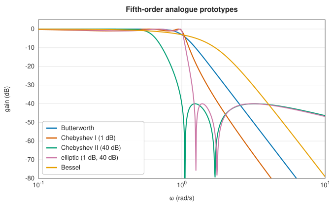
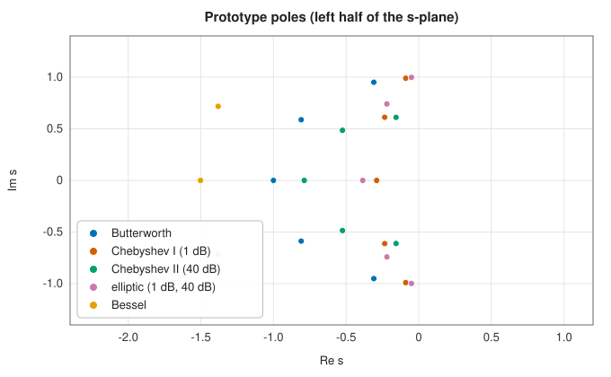
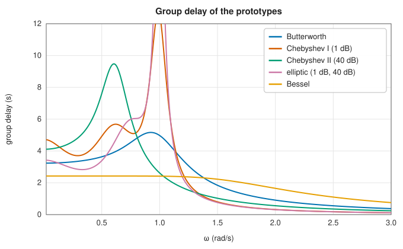
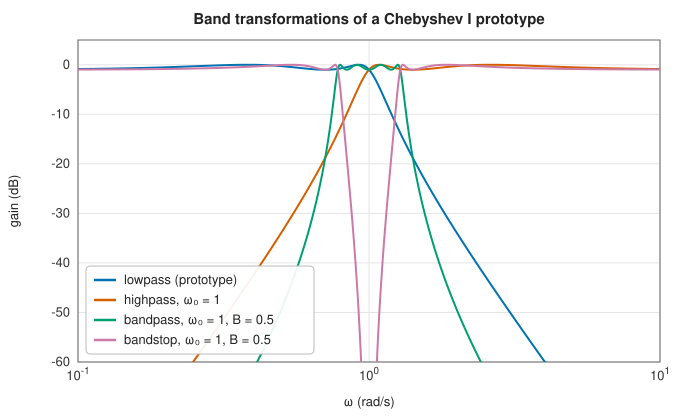

# Analogue prototypes: Butterworth, Chebyshev, elliptic and Bessel

<div class="entry-summary">

| | |
|---|---|
| **Problem** | Find rational transfer functions $H(s)$ that approximate an ideal low-pass filter as closely as possible for a given order, then move them to other cutoffs and band shapes |
| **Devised by** | Stephen Butterworth (1930), maximally flat filters; Pafnuty Chebyshev (1854), equiripple polynomials, applied to filters by Sidney Darlington and others (1930s–1950s); Wilhelm Cauer (1931–1958), elliptic filters; W. E. Thomson (1949), Bessel filters |
| **Accuracy** | Poles and zeros in closed form (Butterworth, Chebyshev), from Jacobi elliptic functions (elliptic) or polynomial roots (Bessel); agree with SciPy to $10^{-15}$–$10^{-13}$ |
| **Cost** | $O(n)$ for the poles and zeros; $O(n^2)$ to expand them into polynomials |
| **API** | [`buttap`](../../api/lib_jsl_dsp/continuous/filter/butterworth/fn.buttap.html), [`cheb1ap`](../../api/lib_jsl_dsp/continuous/filter/chebyshev/fn.cheb1ap.html), [`cheb2ap`](../../api/lib_jsl_dsp/continuous/filter/chebyshev/fn.cheb2ap.html), [`ellipap`](../../api/lib_jsl_dsp/continuous/filter/elliptic/fn.ellipap.html), [`besselap`](../../api/lib_jsl_dsp/continuous/filter/bessel/fn.besselap.html) ([`BesselNorm`](../../api/lib_jsl_dsp/continuous/filter/bessel/enum.BesselNorm.html)), [`Zpk`](../../api/lib_jsl_dsp/continuous/filter/design/struct.Zpk.html), [`zpk_to_tf`](../../api/lib_jsl_dsp/continuous/filter/design/fn.zpk_to_tf.html), [`lp2lp_zpk`](../../api/lib_jsl_dsp/continuous/filter/design/fn.lp2lp_zpk.html), [`lp2hp_zpk`](../../api/lib_jsl_dsp/continuous/filter/design/fn.lp2hp_zpk.html), [`lp2bp_zpk`](../../api/lib_jsl_dsp/continuous/filter/design/fn.lp2bp_zpk.html), [`lp2bs_zpk`](../../api/lib_jsl_dsp/continuous/filter/design/fn.lp2bs_zpk.html), [`freqs`](../../api/lib_jsl_dsp/continuous/spectral/freqs/fn.freqs.html) |

</div>

## Overview

An ideal low-pass filter, with gain 1 below the cutoff and 0 above, cannot be built. Its impulse response is non-causal and infinitely
long. A circuit of $n$ capacitors and inductors, or a digital recursion of order $n$, realises a **rational** transfer function $H(s)$ with $n$ poles, and filter
design asks which rational function of a given order comes closest to the ideal. Four classical answers trade the flatness of the
passband, the steepness of the transition, the ripple, and the phase against one another:

- **Butterworth**: maximally flat, no ripple, and a gentle roll-off.
- **Chebyshev type I**: ripple in the passband buys a steeper roll-off.
- **Chebyshev type II** (inverse Chebyshev): ripple in the stopband instead, with a flat passband.
- **Elliptic** (Cauer): ripple in both bands, giving the steepest roll-off possible for its order.
- **Bessel**: gives up sharpness for a nearly constant time delay, so pulses keep their shape.

Each is designed once, as a normalised **prototype** with cutoff 1 rad/s. **Frequency transformations** then move it to any cutoff or
turn it into a high-pass, band-pass or band-stop filter. Digital filters are made from the same prototypes by the [bilinear transform](iir-design.md).

## History

Stephen Butterworth (1930), a British physicist, described amplifier filters "of the ideal flat-response kind". Chebyshev's
polynomials (1854), which oscillate with equal ripple, gave filters with ripple and sharper cutoffs once network synthesis
matured in the 1930s and 1940s. Wilhelm Cauer, in Germany, developed the theory of network synthesis and elliptic-function
filters between 1931 and his death in 1945; his work was published and patented in the 1930s and appeared in book form in
1958. W. E. Thomson (1949) designed filters with maximally flat delay from Bessel polynomials. Tables of the prototype poles
and zeros filled handbooks (Anatol Zverev's *Handbook of Filter Synthesis*, 1967) until computers made them a few lines of code.

## The idea

### The magnitude-squared function

(The terms used here, transfer function, poles, zeros and decibels, are explained in the
[chapter's background section](index.md#background-frequency-responses-and-transfer-functions).)

A filter is usually specified by its gain as a function of frequency, without regard to phase.
So the classical designs start from the squared magnitude of the frequency response, and all of
them except Bessel choose it in the same form:

$$
|H(j\omega)|^2 = \frac{1}{1 + \varepsilon^2F_n(\omega)^2} .
$$

The idea is simple. Wherever $F_n$ is small, the gain is close to 1; wherever $F_n$ is large,
the gain is close to 0. So a low-pass filter needs a function $F_n$ that is small in the
passband $|\omega| < 1$ and grows as fast as possible beyond it. The constraint is that $F_n$
must be a polynomial or rational function of degree $n$, the order of the filter, because a
circuit with $n$ reactive components can realise nothing else. The families differ in the choice
of $F_n$:

| Family | $F_n(\omega)$ | Passband | Stopband |
|---|---|---|---|
| Butterworth | $\omega^n$ | monotone, maximally flat at 0 | monotone, $-20n$ dB per decade |
| Chebyshev I | $T_n(\omega)$, the Chebyshev polynomial | equiripple, $n$ extrema | monotone |
| Chebyshev II | $1/T_n(1/\omega)$, rescaled | monotone | equiripple |
| Elliptic | a rational Chebyshev function $R_n(\xi, \omega)$ | equiripple | equiripple |

- **Butterworth.** $\omega^n$ is as flat as possible near $\omega = 0$ (its first $n - 1$
  derivatives vanish there), which gives a passband with no ripple. Beyond the cutoff the gain
  falls like $1/\omega^n$, a factor of $10^n$ in amplitude ($20n$ dB) for each tenfold increase
  in frequency.
- **Chebyshev I.** The [Chebyshev polynomial](../interpolation/polynomial.md#chebyshev-series)
  $T_n$ oscillates between $-1$ and $1$ on $[-1, 1]$ and then grows faster than any other
  polynomial of the same degree with that property. Accepting a small ripple in the passband
  therefore buys the steepest possible polynomial roll-off. **Equiripple** means that all the
  ripples have the same height.
- **Chebyshev II** moves the ripple to the stopband by using the reciprocal function.
- **Elliptic** filters use a rational function that ripples equally in both bands, and are the
  steepest of all.

The constant $\varepsilon$ sets the passband ripple: at the passband edge the gain has fallen by
$10\log_{10}(1 + \varepsilon^2)$ dB.

**From the magnitude to the filter.** The formula gives $|H|^2$, not $H$. For a filter with real
coefficients, $|H(j\omega)|^2 = H(s)H(-s)$ evaluated at $s = j\omega$. Replacing $\omega$ by
$s/j$ in the formula therefore gives the product $H(s)H(-s)$, whose poles are the roots of
$1 + \varepsilon^2F_n(s/j)^2 = 0$. These roots come in pairs $\pm s$, placed symmetrically about
the imaginary axis. A stable filter must have its poles in the left half-plane, so $H(s)$ takes
the left-half-plane roots, and the mirror images belong to $H(-s)$.



<p class="caption" id="fig-14-2"><strong>Figure 14.2.</strong> Fifth-order prototypes.</p>

At fifth order, the elliptic filter reaches 40 dB of attenuation within 30% of the cutoff, while the Butterworth filter needs
more than twice the cutoff frequency. Chebyshev II and elliptic filters have zeros on the $j\omega$ axis, the notches in the stopband,
which is why their attenuation stops falling.

### Where the poles are



<p class="caption" id="fig-14-3"><strong>Figure 14.3.</strong> Pole locations.</p>

- **Butterworth** poles are equally spaced on the left half of the unit circle: $s_k = e^{j\pi(2k + n + 1)/2n}$, $k = 0, \ldots, n - 1$.
- **Chebyshev I** poles lie on an ellipse: $s_k = -\sinh(a)\sin\theta_k + j\cosh(a)\cos\theta_k$, where $\theta_k = \pi(2k + 1)/2n$ and $a = \frac1n\operatorname{arsinh}(1/\varepsilon)$. A flatter ellipse means poles closer to the axis and higher resonance.
- **Chebyshev II** poles are the reciprocals of a Chebyshev I set, and its zeros $\pm j/\cos\theta_k$ lie on the imaginary axis.
- **Elliptic** poles and zeros come from Jacobi elliptic functions, with a modulus fixed by the ripple specification. The library
  evaluates them with complete elliptic integrals and the Landen and arithmetic-geometric-mean transformations.
- **Bessel** poles are the roots of the reverse Bessel polynomial $\theta_n(s)$. `BesselNorm::Phase` (SciPy's default) scales them so that the phase reaches half
  its final value at 1 rad/s and the magnitude asymptotes match a Butterworth filter's, `Delay` so that the group delay at DC is 1 s,
  and `Mag` so that the gain is −3 dB at 1 rad/s (used in the figures).

The closer a pole is to the imaginary axis, the sharper the resonance it adds near that frequency. The elliptic and Chebyshev
filters' sharpness comes from such poles, and so does the next problem.

### Phase and group delay

The **group delay** $\tau(\omega) = -d\arg H(j\omega)/d\omega$ is the delay of a narrow-band signal near $\omega$. If it varies across the passband, different frequency components of a pulse
arrive at different times and the pulse is distorted:



<p class="caption" id="fig-14-4"><strong>Figure 14.4.</strong> Group delay of the prototypes.</p>

The sharp filters have large delay peaks at the band edge, caused by their poles near the axis. The Bessel filter's delay is
flat almost to the cutoff, at the price of the slowest magnitude roll-off. No filter is best at both.

### Frequency transformations

A prototype with cutoff 1 rad/s becomes another filter by substituting for $s$:

| Transformation | Substitution | Effect |
|---|---|---|
| `lp2lp_zpk(ω₀)` | $s \to s/\omega_0$ | cutoff at $\omega_0$ |
| `lp2hp_zpk(ω₀)` | $s \to \omega_0/s$ | high-pass, cutoff $\omega_0$ |
| `lp2bp_zpk(ω₀, B)` | $s \to (s^2 + \omega_0^2)/(Bs)$ | band-pass centred on $\omega_0$ (geometric mean of the edges), width $B$ |
| `lp2bs_zpk(ω₀, B)` | $s \to Bs/(s^2 + \omega_0^2)$ | band-stop |

The band transformations double the order: each prototype pole becomes two poles, the roots of $s^2 - Bps + \omega_0^2 = 0$. Working on zeros, poles and gain, rather than on
polynomial coefficients, keeps the transformations accurate for high orders.



<p class="caption" id="fig-14-5"><strong>Figure 14.5.</strong> Band transformations.</p>

### How much order does a specification need?

For a low-pass specification of at most 1 dB passband ripple below the edge and at least 40 dB attenuation from 1.5 times the edge
(digital frequencies 0.2 and 0.3 of Nyquist):

<p class="caption" id="tab-14-3"><strong>Table 14.3.</strong> Columns: family, order for ≤ 1 dB ripple below 0.2 and ≥ 40 dB above 0.3 (× Nyquist).</p>

{{#include ../generated/filters/orders.md}}

Butterworth filters need three times the elliptic order. The [order-selection functions](iir-design.md#choosing-the-order) evaluate closed-form expressions
derived from each $F_n$.

## Algorithm

Every design function returns the zeros, poles and gain of a low-pass prototype with cutoff
1 rad/s.

**Butterworth**, order $n$: place the $n$ poles at $e^{j\pi(2k + n + 1)/2n}$; there are no
zeros; the gain is 1.

**Chebyshev I**, order $n$ and passband ripple $r_p$ dB:

1. $\varepsilon = \sqrt{10^{r_p/10} - 1}$ and $a = \tfrac1n\operatorname{arsinh}(1/\varepsilon)$;
2. poles at $-\sinh a\sin\theta_k + j\cosh a\cos\theta_k$;
3. the gain is the product of the negated poles, which makes the gain at zero frequency 1,
   divided by $\sqrt{1 + \varepsilon^2}$ if $n$ is even, because an even-order response starts at
   the bottom of its ripple.

**Chebyshev II**, order $n$ and stopband attenuation $r_s$ dB:

1. $\varepsilon = 1/\sqrt{10^{r_s/10} - 1}$, and the Chebyshev I poles for this $\varepsilon$;
2. the poles are the reciprocals of those;
3. zeros at $\pm j/\cos\theta_k$ (one fewer pair for odd $n$, whose middle zero is at infinity);
4. the gain is chosen to make the gain at zero frequency 1.

**Elliptic**: solve the **degree equation**, which links the order, the two ripples and the
elliptic modulus, for the modulus; compute the zeros and poles from Jacobi elliptic functions
at equally spaced arguments; normalise the gain as for Chebyshev I.

**Bessel**: compute the roots of the reverse Bessel polynomial of degree $n$ and scale them
according to the chosen normalisation.

**Frequency transformation** of a prototype in zero-pole-gain form:

1. replace each zero and pole by its image, or pair of images, under the substitution in the
   table. For the band transformations, a pole $p$ becomes the two roots of
   $s^2 - Bps + \omega_0^2 = 0$;
2. a prototype with more poles than zeros has zeros "at infinity". They also move: to $s = 0$
   for a high-pass or band-pass filter, and to $\pm j\omega_0$ for a band-stop filter;
3. rescale the gain so that the passband gain is unchanged.

## Implementation

```rust,ignore
{{#include ../../../crates/dsp/src/continuous/filter/butterworth.rs:buttap}}
```

- Every design returns a [`Zpk`](../../api/lib_jsl_dsp/continuous/filter/design/struct.Zpk.html) with complex zeros, poles and gain. [`zpk_to_tf`](../../api/lib_jsl_dsp/continuous/filter/design/fn.zpk_to_tf.html) expands it into numerator and denominator
  polynomials, and [`freqs`](../../api/lib_jsl_dsp/continuous/spectral/freqs/fn.freqs.html) evaluates $H(j\omega)$ from them.
- `lp2hp_zpk` and `lp2bs_zpk` reject prototypes with a pole or zero at the origin, which would map to infinity.

## In practice

```rust,ignore
{{#include ../../../crates/dsp/examples/dsp_analog_prototypes.rs}}
```

```text
Butterworth poles: [-0.5000+0.8660i, -1.0000+0.0000i, -0.5000-0.8660i]
Butterworth denominator: [1.0000, 2.0000, 2.0000, 1.0000]
Butterworth        gain at ω = 0.5, 1, 2:   -0.07   -3.01  -18.13 dB
Chebyshev I, 1 dB  gain at ω = 0.5, 1, 2:   -1.00   -1.00  -22.46 dB
elliptic, 1/40 dB  gain at ω = 0.5, 1, 2:   -1.00   -1.00  -28.27 dB
bandpass: 6 poles, 3 zeros
```

The third-order Butterworth denominator is $s^3 + 2s^2 + 2s + 1$. The Butterworth cutoff is defined at −3 dB, the Chebyshev and elliptic cutoffs at the
edge of the ripple band. The 3 zeros of the band-pass filter sit at $s = 0$, one for each excess pole of the prototype.

**Strengths**

- Closed-form, well-understood designs with known trade-offs; the elliptic filter is optimal in the minimax sense.
- Zero-pole-gain form keeps high-order designs and transformations accurate.

**Weaknesses**

- Sharp filters have nonlinear phase and large delay peaks; only the Bessel family approximates linear phase, and poorly.
- Analogue prototypes describe magnitude only through these five shapes; arbitrary responses need FIR design.

## Exercises

1. Show that the Butterworth response $1/(1 + \omega^{2n})$ has its first $2n - 1$ derivatives zero at $\omega = 0$.
2. Derive the Chebyshev I pole positions from $T_n(\cos\theta) = \cos n\theta$, extended to complex arguments.
3. Show that the band-pass transformation maps $\omega = \pm1$ to two frequencies whose product is $\omega_0^2$ and whose difference is $B$.
4. Show that the group delay of a pole at $s = -\sigma + j\omega_p$ is $\sigma/(\sigma^2 + (\omega - \omega_p)^2)$, and explain the delay peaks.
5. Compute the order a Butterworth filter needs for 60 dB of attenuation one octave above its 3 dB cutoff.

## Further reading

- S. Butterworth, "On the theory of filter amplifiers", *Experimental Wireless and the Wireless Engineer* 7 (1930) 536–541.
- A. I. Zverev, *Handbook of Filter Synthesis*, Wiley, 1967.
- H. J. Orchard and A. N. Willson, "Elliptic functions for filter design", *IEEE Transactions on Circuits and Systems I* 44 (1997) 273–287.
- W. E. Thomson, "Delay networks having maximally flat frequency characteristics", *Proceedings of the IEE* 96 (1949) 487–490.
- A. V. Oppenheim and R. W. Schafer, *Discrete-Time Signal Processing*, 3rd ed., Pearson, 2010, appendix B.
