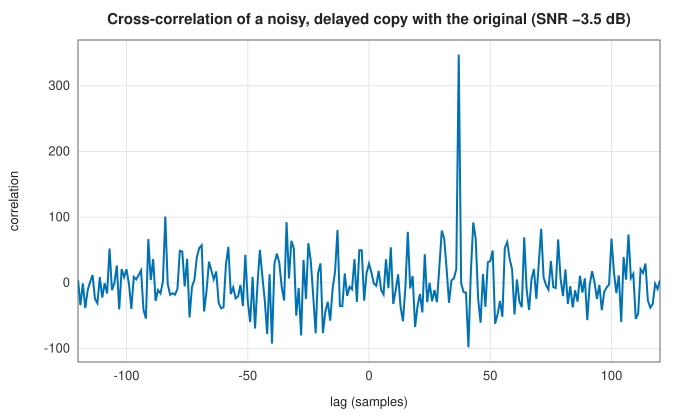

# Convolution and correlation

<div class="entry-summary">

| | |
|---|---|
| **Problem** | Apply a finite impulse response to a signal, in one piece or as a stream; measure the similarity of two signals as a function of their relative shift |
| **Devised by** | The convolution sum is classical (Euler, Laplace, Cauchy); James Cooley and John Tukey (1965), the FFT that makes fast convolution practical; Thomas Stockham (1966), sectioned high-speed convolution (overlap-add and overlap-save); Charles Knapp and G. Clifford Carter (1976), time-delay estimation by correlation |
| **Accuracy** | Direct sums are exact up to rounding; FFT methods agree with them to about $10^{-15}$ relative (tables below) |
| **Cost** | Direct: $O(NM)$ for $N$ samples and $M$ taps. FFT: $O(N\log N)$ for whole signals, $O(\log M)$ per sample for streams |
| **API** | [`convolve`](../../api/lib_jsl_dsp/discrete/convolve/fn.convolve.html) (`ConvolveMode::{Full, Same, Valid}`, `ConvolveMethod::{Direct, Fft, Auto}`), [`fft_convolve`](../../api/lib_jsl_dsp/discrete/fft_convolution/fn.fft_convolve.html), [`cross_correlate`](../../api/lib_jsl_dsp/discrete/cross_correlation/fn.cross_correlate.html), [`fft_cross_correlate`](../../api/lib_jsl_dsp/discrete/fft_cross_correlation/fn.fft_cross_correlate.html), [`fft_correlation_peak`](../../api/lib_jsl_dsp/discrete/fft_cross_correlation/fn.fft_correlation_peak.html), [`OverlapAddFir`](../../api/lib_jsl_dsp/discrete/filters/overlap_and_add_fir/struct.OverlapAddFir.html), [`FftFir`](../../api/lib_jsl_dsp/discrete/filters/fft_fir/struct.FftFir.html), [`StreamOperator`](../../api/lib_jsl_dsp/discrete/stream_operator/trait.StreamOperator.html) |

</div>

## Overview

A **linear time-invariant** system is completely described by its **impulse response** $h$: the output for any input $x$ is the **convolution**

$$
y[n] = (h * x)[n] = \sum_kh[k]\,x[n - k].
$$

When $h$ has finitely many taps, the system is a **finite impulse response** (FIR) filter, and computing $y$ is the most common operation in
digital signal processing. Done directly it costs one multiply-add per tap per sample. By the convolution theorem, the discrete
Fourier transform turns convolution into multiplication, so with the FFT, long filters cost a few operations per sample whatever
their length. **Cross-correlation** is convolution with one signal reversed (and conjugated). Its peak shows the shift at which two
signals best match, which is how echoes, delays and known waveforms are found.

## History

Convolution sums and integrals go back to Euler and Laplace, and the name to the twentieth century. Before the FFT, digital
filtering meant direct sums. James Cooley and John Tukey's FFT (1965) changed that almost at once: Thomas Stockham (1966)
showed that sectioning a long signal into blocks, transforming each, and joining the results by overlap-add or overlap-save
made "high-speed convolution" faster than direct filtering for filters beyond a few dozen taps. Cross-correlation for delay
estimation is older still, in radar and sonar; Charles Knapp and G. Clifford Carter's generalised cross-correlation (1976)
is the standard analysis of it.

## The idea

### Output lengths and modes

Convolving $N$ samples with $M$ taps gives $N + M - 1$ outputs, the **full** convolution, including the partial overlaps at both ends. **Same** keeps the
central $N$ samples, aligned with the input. **Valid** keeps only the $N - M + 1$ samples where the filter lies entirely inside the signal. The modes
follow NumPy and SciPy, and the library's results agree with them to rounding error (see the [chapter's reference table](index.md#testing-against-scipy)).

### Fast convolution

The DFT of a circular convolution is the product of the DFTs. Padding both sequences with zeros to a length $L \ge N + M - 1$ makes the
circular convolution equal the linear one, so

$$
h * x = \mathrm{IDFT}_L\big(\mathrm{DFT}_L(h)\cdot\mathrm{DFT}_L(x)\big),
$$

at a cost of three FFTs, $O(L\log L)$, instead of $NM$ multiply-adds. For a whole signal, [`fft_convolve`](../../api/lib_jsl_dsp/discrete/fft_convolution/fn.fft_convolve.html) does exactly this. `convolve` with
`ConvolveMethod::Auto` chooses direct summation when $NM \le 4096$.

### Streams: overlap-add and overlap-save

A stream cannot be transformed whole. Both sectioned methods cut it into blocks of $B$ samples and use FFTs of length $L \ge B + M - 1$ (a power of two):

- **Overlap-add** convolves each block separately, each result being $B + M - 1$ long, and adds the $M - 1$ samples that spill past each block into the start of the next one.
- **Overlap-save** prefixes each block with the last $M - 1$ input samples, convolves circularly, and discards the first $M - 1$ outputs, which are corrupted by
  wrap-around. The remaining $B$ outputs are exact.

Both cost two FFTs per block (the filter's transform is computed once), about $O(\log L)$ operations per sample. Their outputs are identical
to the direct sum:

{{#include ../generated/filters/convolution_time.md}}

Direct filtering wins for short filters. The crossover lies near a hundred taps, beyond which the streaming FFT filters cost almost nothing
more per tap. Transforming the whole 20 000-sample signal at once needs three FFTs of 32 768 points, and is slower than sectioning
until the filter is thousands of taps long.

### Cross-correlation and delay estimation

The cross-correlation $r_{xy}[\ell] = \sum_nx[n]\,\overline{y[n - \ell]}$ is large where $y$, shifted by $\ell$, resembles $x$. If $x$ is a delayed copy of $y$ plus independent noise, $r_{xy}$ peaks at the delay. The noise
adds a random background whose standard deviation grows only as $\sqrt N$, while the peak grows as $N$:



Here the copy is buried in noise with 1.5 times its amplitude, yet the peak at lag 37 stands far above the background. This is the
principle of the **matched filter** used in radar (pulse compression) and communications (synchronisation).

## Algorithm

1. **Direct**: for each output index, sum $h[k]x[n - k]$ over the overlap; then trim to the requested mode.
2. **FFT**: zero-pad to the next power of two $\ge N + M - 1$, transform, multiply, inverse-transform, trim.
3. **Overlap-save stream**: keep the last $M - 1$ inputs; when $B$ new samples have arrived, transform [history, block], multiply by the filter's
   spectrum, inverse-transform, output the last $B$ values, and update the history. `flush` pads with zeros to emit the remainder
   and the $M - 1$-sample tail, so the stream's total output is the full convolution.

## Implementation

```rust,ignore
{{#include ../../../crates/dsp/src/discrete/filters/fir/fft_fir.rs:overlap_save}}
```

- Both streaming filters implement [`StreamOperator`](../../api/lib_jsl_dsp/discrete/stream_operator/trait.StreamOperator.html): `process` accepts chunks of any size and returns whole blocks as they
  complete, `flush` ends the stream, and `reset` starts a new one.
- The FFT length is rounded up to a power of two. The block length is the rest of it, after the $M - 1$ samples of history.
- `fft_correlation_peak` returns the lag of the largest-magnitude correlation; a positive lag means the first signal lags the second.

## In practice

```rust,ignore
{{#include ../../../crates/dsp/examples/dsp_convolution.rs}}
```

```text
Full: [1.0, 1.0, 1.0, 1.0, 1.0, -5.0]
Same: [1.0, 1.0, 1.0, 1.0, 1.0]
Valid: [1.0, 1.0, 1.0, 1.0]
overlap-save: 1062 outputs (block 450, FFT 512), largest difference 2.7e-15
echo delay: 23 samples (correlation 4.00)
```

Convolving with $[1, -1]$ takes first differences. Feeding the stream in chunks of 137 samples, unrelated to its block size of 450,
changes nothing in the output.

**Strengths**

- Exact linear filtering at a cost per sample that, with FFTs, barely depends on the filter length.
- Correlation finds delays and known waveforms in noise far below the signal level.

**Weaknesses**

- FFT methods add a block of latency and give up a few digits to rounding for very long transforms.
- Sectioned filtering assumes a fixed filter; adaptive or time-varying filters need the direct form.

## Exercises

1. Show that zero-padding to $L \ge N + M - 1$ makes circular convolution equal linear convolution, and that $L = N + M - 2$ does not.
2. Count the real multiplications per output sample of overlap-save with block $B$ and FFT length $L = B + M - 1$, and find the $B$ that minimises it for $M = 255$.
3. Show that cross-correlating with a signal is the same as convolving with its time-reversed conjugate.
4. With white noise of variance $\sigma^2$ added to a delayed copy of a unit-power signal of length $N$, compute the ratio of the correlation peak to the background's standard deviation.
5. Implement overlap-add with FFTs of length $2B$ for a block length $B$, and check it against `convolve`.

## Further reading

- T. G. Stockham, "High-speed convolution and correlation", *Proceedings of the AFIPS Spring Joint Computer Conference* 28 (1966) 229–233.
- A. V. Oppenheim and R. W. Schafer, *Discrete-Time Signal Processing*, 3rd ed., Pearson, 2010, chapters 2 and 8.
- C. H. Knapp and G. C. Carter, "The generalized correlation method for estimation of time delay", *IEEE Transactions on Acoustics,
  Speech, and Signal Processing* 24 (1976) 320–327.
