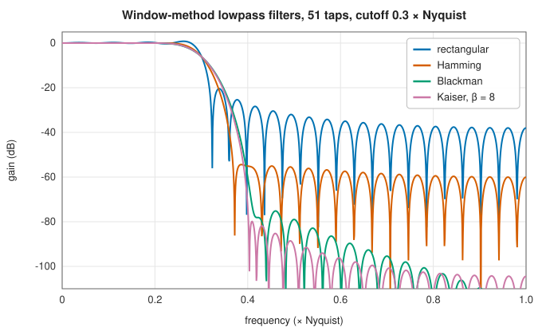
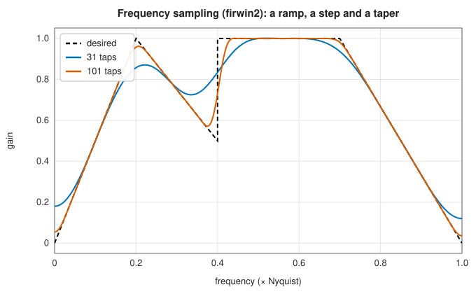
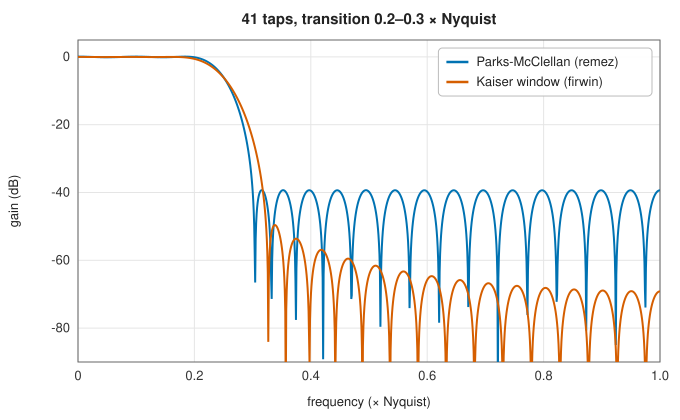
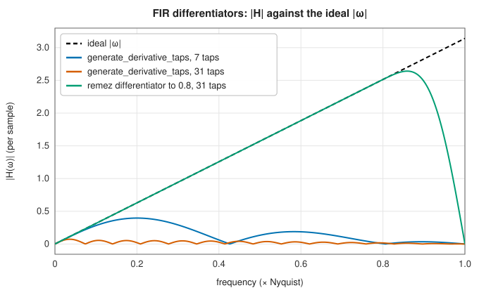

# FIR design: windows, frequency sampling and Parks-McClellan

<div class="entry-summary">

| | |
|---|---|
| **Problem** | Find the taps of a linear-phase finite impulse response filter whose frequency response approximates a desired one |
| **Devised by** | Window method: James Kaiser (1966, 1974), the Kaiser window and design formulas; frequency sampling: Lawrence Rabiner, Bernard Gold and C. A. McGonegal (1970); equiripple design: Thomas Parks and James McClellan (1972), with Lawrence Rabiner (1973), after Evgeny Remez (1934) |
| **Accuracy** | `firwin`, `firwin2` and `remez` agree with SciPy to $10^{-15}$, $10^{-16}$ and $10^{-6}$ (`remez` stops on a grid, as SciPy's does) |
| **Cost** | Window and frequency sampling: $O(N)$ and $O(N\log N)$. Parks-McClellan: $O(N^2)$ per exchange for a grid of $O(N)$ points, typically under ten exchanges |
| **API** | [`firwin`](../../api/lib_jsl_dsp/discrete/filters/fir/firwin/fn.firwin.html), [`firwin2`](../../api/lib_jsl_dsp/discrete/filters/fir/firwin2/fn.firwin2.html), [`remez`](../../api/lib_jsl_dsp/discrete/filters/fir/remez/fn.remez.html) ([`RemezFilterType`](../../api/lib_jsl_dsp/discrete/filters/fir/remez/enum.RemezFilterType.html)), [`kaiser_beta`](../../api/lib_jsl_dsp/discrete/windows/kaiser/fn.kaiser_beta.html), [`kaiser_atten`](../../api/lib_jsl_dsp/discrete/windows/kaiser/fn.kaiser_atten.html), [`kaiser_estimate_numtaps`](../../api/lib_jsl_dsp/discrete/windows/kaiser/fn.kaiser_estimate_numtaps.html), [`generate_derivative_taps`](../../api/lib_jsl_dsp/discrete/filters/fir/derivative_filter/fn.generate_derivative_taps.html), [`BoxcarIntegrator`](../../api/lib_jsl_dsp/discrete/filters/fir/boxcar_integrator/struct.BoxcarIntegrator.html) |

</div>

## Overview

A finite impulse response filter is a set of taps $h[0], \ldots, h[N - 1]$, applied by [convolution](convolution.md). FIR filters are always stable, and when the taps are symmetric
or antisymmetric about their centre they have exactly **linear phase**, a pure delay of $(N - 1)/2$ samples at every frequency, which no causal IIR filter
can achieve. Their cost is length: matching a sharp IIR filter takes many more taps. Three design methods cover most needs:

- **windowing** truncates the ideal (infinite) impulse response and tapers it with a window;
- **frequency sampling** specifies the response on a dense grid and inverts the DFT;
- **Parks-McClellan** finds the taps that minimise the largest weighted error, an equiripple design that is optimal in that sense.

## History

The window method is as old as digital filtering. James Kaiser (1966) introduced the Bessel-function window that bears his name,
whose single parameter trades main-lobe width against side-lobe level, and (1974) empirical formulas for its parameter and the
filter length. Lawrence Rabiner, Bernard Gold and C. A. McGonegal (1970) developed frequency-sampling design. Thomas Parks and
James McClellan (1972), at Rice University, recognised that the optimal linear-phase design is a Chebyshev approximation problem
and solved it with Evgeny Remez's exchange algorithm (1934). Their FORTRAN program, with Lawrence Rabiner (1973), became the
standard design tool, and SciPy's `remez` is a direct descendant.

## The idea

### Linear phase and the four types

**Why symmetry matters.** A filter delays the signals passing through it, and in general it
delays different frequencies by different amounts, which distorts the shape of a pulse. A filter
that delays every frequency by the *same* amount only shifts the signal in time. Such a filter
has a phase that is a linear function of frequency, and is said to have **linear phase**. FIR
filters can achieve this exactly, simply by making their taps symmetric.

To see why, take five symmetric taps, $h_0, h_1, h_2, h_1, h_0$. In the frequency response
$\sum_kh_ke^{-j\omega k}$, factor out the delay to the centre tap, $e^{-2j\omega}$, and pair each
tap with its mirror image:

$$
H(e^{j\omega}) = e^{-2j\omega}\big[h_2 + h_1(e^{j\omega} + e^{-j\omega}) + h_0(e^{2j\omega} + e^{-2j\omega})\big]
= e^{-2j\omega}\big[h_2 + 2h_1\cos\omega + 2h_0\cos2\omega\big].
$$

The bracket is real. So the response is a real **amplitude** $A(\omega)$ times a pure delay of two
samples, half the filter's span. In general a symmetric filter of length $N$ has

$$
H(e^{j\omega}) = e^{-j\omega(N-1)/2}A(\omega),
$$

a delay of $(N - 1)/2$ samples at every frequency. Designing the filter reduces to designing the
real function $A(\omega)$.

**The four types.** The same pairing works when the taps are antisymmetric ($h_k = -h_{N-1-k}$),
giving sines instead of cosines (and an extra factor $j$). The length may be odd or even. These
choices give four **types**, and the symmetry of each forces its amplitude to vanish at certain
frequencies, which limits what it can be used for:

| Type | Taps | Length | $A(\omega)$ is forced to zero at | Suits |
|---|---|---|---|---|
| I | symmetric | odd | nowhere | any response |
| II | symmetric | even | $\omega = \pi$ | low-pass, band-pass |
| III | antisymmetric | odd | $\omega = 0$ and $\pi$ | Hilbert transformers, band-pass |
| IV | antisymmetric | even | $\omega = 0$ | differentiators, Hilbert transformers, high-pass |

A type II filter, for example, cannot be a high-pass filter, because its gain at the Nyquist
frequency is always zero.

Every type can be written $A(\omega) = Q(\omega)P(\omega)$, where $P$ is a polynomial in $\cos\omega$ and
$Q$ is a fixed factor, equal to $1$, $\cos(\omega/2)$, $\sin\omega$ or $\sin(\omega/2)$ for types I to IV,
that accounts for the forced zeros. This is how one optimisation algorithm serves all four: it
always designs the polynomial $P$.

### The window method

The simplest design method starts from the ideal answer and makes it realisable.

**The ideal filter.** An ideal low-pass filter has gain 1 up to the cutoff $\omega_c$ and 0 beyond.
Its impulse response is the inverse Fourier transform of that rectangular shape,

$$
h_d[n] = \frac{\omega_c}{\pi}\operatorname{sinc}\Big(\frac{\omega_cn}{\pi}\Big), \qquad \operatorname{sinc}(x) = \frac{\sin\pi x}{\pi x},
$$

which extends for ever in both directions and decays only like $1/n$. It cannot be used as it
stands.

**Truncation and its cost.** The obvious fix is to keep only the $N$ central taps. Keeping some
taps and discarding the rest is the same as multiplying $h_d$ by a rectangular **window** that is
1 on those taps and 0 elsewhere. Multiplication in time corresponds to convolution in frequency:
the response of the truncated filter is the ideal rectangle smeared by the Fourier transform of
the window. The transform of a rectangular window is a narrow main lobe flanked by side lobes
that decay slowly. Smearing with it has two effects. The sharp edge of the ideal response
becomes a transition band about as wide as the main lobe. And the side lobes produce ripple on
both sides of the edge: an overshoot of 9% however large $N$ is (the Gibbs phenomenon), and a
stopband whose first side lobe is only 21 dB down.

**Better windows.** The side lobes come from the abrupt ends of the rectangular window. A window
that tapers smoothly to zero at its ends has much lower side lobes, at the price of a wider main
lobe. Multiplying by such a window $w[n]$ instead trades a wider transition band for a cleaner
stopband:



<p class="caption" id="fig-14-11"><strong>Figure 14.11.</strong> Window-method filters.</p>

[`firwin`](../../api/lib_jsl_dsp/discrete/filters/fir/firwin/fn.firwin.html) builds the ideal response from sinc functions, one difference of two per band, applies the window, and scales the result to unit gain at the
centre of the first passband. Its window can be any of the library's
[window functions](../spectral/windows.md), which a later chapter treats in detail.

### Kaiser's formulas

The Kaiser window has a parameter $\beta$ that sets the stopband attenuation $A$ (in dB) independently of the length, and the length then sets the
transition width $\Delta\omega$. Kaiser fitted

$$
\beta = \begin{cases} 0.1102(A - 8.7), & A > 50, \\ 0.5842(A - 21)^{0.4} + 0.07886(A - 21), & 21 \le A \le 50, \end{cases} \qquad N - 1 \approx \frac{A - 7.95}{2.285\,\Delta\omega}.
$$

These make window design a recipe: choose $A$ and $\Delta\omega$, read off $\beta$ and $N$. They are accurate to about a decibel:

<p class="caption" id="tab-14-5"><strong>Table 14.5.</strong> Columns: target attenuation (dB), transition width (× Nyquist), taps (kaiser_estimate_numtaps), β (kaiser_beta), and more.</p>

{{#include ../generated/filters/kaiser_design.md}}

The passband ripple of a window design equals its stopband ripple, so a 60 dB filter also has 60 dB passband accuracy, whether that is needed or not.

### Frequency sampling

[`firwin2`](../../api/lib_jsl_dsp/discrete/filters/fir/firwin2/fn.firwin2.html) takes a piecewise-linear desired gain, given at a list of frequencies (with repeated frequencies for jumps). It interpolates it onto a dense grid,
attaches the linear-phase factor, inverse-transforms by FFT, and windows the result. Any shape can be specified:



<p class="caption" id="fig-14-12"><strong>Figure 14.12.</strong> Frequency sampling.</p>

More taps follow the specification more closely, but discontinuities still ring.

### Parks-McClellan: equiripple design

Window designs are simple but not optimal. Their error is spread unevenly: largest near the band
edges, and far smaller than necessary elsewhere. A filter that meets a specification with the
fewest taps should not waste accuracy in this way. The **minimax** design chooses the taps to
minimise the *largest* weighted error over the bands of interest,

$$
\min_{h}\max_{\omega \in \text{bands}}W(\omega)\,\big|D(\omega) - A(\omega)\big|,
$$

where $D$ is the desired amplitude (1 in a passband, 0 in a stopband), $A$ the actual amplitude,
and $W$ a weight that sets the relative importance of the bands. The transition bands are left
out: no error is counted there.

**What the optimum looks like.** A classical theorem of approximation theory describes the
solution. By Chebyshev's **alternation theorem**, a polynomial $P$ of degree $r - 1$ (in
$\cos\omega$) is the minimax approximation if and only if its weighted error reaches its maximum
magnitude $\delta$ at least $r + 1$ times, with alternating signs. Intuitively, if the error
peaks were not all equal, the polynomial could be adjusted to lower the highest peak at the
expense of the others. At the optimum no such improvement is possible: all the peaks are
level. The error is **equiripple**.

**Finding it.** The theorem turns an optimisation problem into a search for the right $r + 1$
frequencies. Remez's **exchange algorithm** does the search:

1. Guess $r + 1$ **reference** frequencies.
2. Solve for the polynomial whose weighted error is exactly $\pm\delta$, with alternating signs,
   at those frequencies. This is a linear problem in the coefficients and $\delta$; a closed
   formula gives $\delta$, and
   [barycentric Lagrange interpolation](../interpolation/polynomial.md#the-barycentric-formula)
   gives the polynomial.
3. Evaluate the error on a dense grid of frequencies. Between the reference points it generally
   exceeds $\delta$ somewhere. Move the reference frequencies to the local extrema of the error.
4. Repeat until the reference stops changing. The error then alternates between equal extremes,
   and by the theorem the filter is optimal.



<p class="caption" id="fig-14-13"><strong>Figure 14.13.</strong> Equiripple against window.</p>

At the same length, the equiripple filter has a sharper transition and an even stopband; the window design's side lobes fall away
where no attenuation was needed. For a fixed transition, Parks-McClellan reaches more attenuation from the same number of taps:

<p class="caption" id="tab-14-6"><strong>Table 14.6.</strong> Columns: taps (transition 0.2–0.3 × Nyquist), Parks-McClellan stopband (dB), Kaiser window stopband (dB).</p>

{{#include ../generated/filters/remez_vs_kaiser.md}}

The implementation follows Parks, McClellan and Rabiner for all four types and matches SciPy on six reference designs. A simplified
exchange stops well short of the optimum: on a 51-tap low-pass filter such a version was 12 times worse than SciPy's (−65 dB against −87 dB).

### Differentiators and integrators

An ideal differentiator has $A(\omega) = \omega$. `remez` with `RemezFilterType::Differentiator` designs one up to a chosen band edge, weighting the error by $1/\omega$ so that it is relative;
its desired value is a slope per cycle per sample, as in SciPy. [`generate_derivative_taps`](../../api/lib_jsl_dsp/discrete/filters/fir/derivative_filter/fn.generate_derivative_taps.html) instead smooths a central difference, for derivatives of noisy
data. It is accurate at low frequencies only, and suppresses the rest:



<p class="caption" id="fig-14-14"><strong>Figure 14.14.</strong> Differentiators.</p>

The [`BoxcarIntegrator`](../../api/lib_jsl_dsp/discrete/filters/fir/boxcar_integrator/struct.BoxcarIntegrator.html) is the opposite case, a moving sum of the last $N$ samples computed with one addition and
one subtraction per sample, whatever $N$.

## Algorithm

**`firwin`** (window method), for $N$ taps and a list of passbands, with frequencies as
fractions of the Nyquist frequency.

1. For each tap $n$, compute its offset from the centre, $m = n - (N - 1)/2$.
2. For each passband $[f_1, f_2]$, add $f_2\operatorname{sinc}(f_2m) - f_1\operatorname{sinc}(f_1m)$ to the tap: the
   ideal response of a band is the difference of two ideal low-pass responses.
3. Multiply the taps by the window.
4. Scale all the taps so that the gain at the centre of the first passband is exactly 1.

**`firwin2`** (frequency sampling), for a desired gain given at a list of frequencies.

1. Interpolate the gain linearly onto a grid of $2^k + 1$ equally spaced frequencies from zero
   to Nyquist.
2. Multiply by the linear-phase factor $e^{-j\pi(N-1)f}$ (and by $j$ for an antisymmetric
   filter), which centres the impulse response on the middle of the $N$ taps.
3. Apply an inverse real FFT and keep the first $N$ values.
4. Multiply by the window.

**`remez`** (Parks-McClellan), for $N$ taps and a desired gain and weight on each band.

1. **Grid.** Lay a dense grid over the bands, about 16 points for each extremal frequency.
2. **Reduce to a polynomial problem.** On the grid, divide the desired response by the type's
   fixed factor $Q(\omega)$ and multiply the weight by it. The remaining problem is to fit a
   polynomial $P$ in $x = \cos\omega$.
3. **Exchange.** Starting from equally spaced reference points, repeat: compute $\delta$ and
   the interpolating polynomial for the current reference; evaluate the weighted error on the
   whole grid; replace the reference by the local extrema of the error. Stop when the
   reference does not change.
4. **Recover the taps.** Sample the optimal amplitude $Q(\omega)P(\cos\omega)$ at $N$ equally
   spaced frequencies and apply an inverse DFT.

## Implementation

```rust,ignore
{{#include ../../../crates/dsp/src/discrete/filters/fir/firwin.rs:firwin}}
```

```rust,ignore
{{#include ../../../crates/dsp/src/discrete/filters/fir/remez.rs:remez_exchange}}
```

- The weighted error's local extrema are found with signed comparisons, so an extremum at a band edge next to a sign change is not missed.
- A reference point whose error rounding puts a hair below $|\delta|$ (possible when $\delta$ is tiny, as for differentiators) is still accepted.
- `remez` frequencies are in the units of `fs`; `firwin` and `firwin2` likewise, with `fs = 2` meaning fractions of Nyquist.

## In practice

```rust,ignore
{{#include ../../../crates/dsp/examples/dsp_fir_design.rs}}
```

```text
Kaiser window: 75 taps, stopband 60.4 dB
Parks-McClellan: 41 taps, stopband 50.2 dB
Parks-McClellan: 51 taps, stopband 58.6 dB
Parks-McClellan: 61 taps, stopband 64.9 dB
firwin2 boost: gains [1.000, 1.027, 1.800] at 0, 0.5 and 0.9 × Nyquist
```

With the stopband weighted ten times the passband, Parks-McClellan meets 60 dB with about 55 taps, where the Kaiser window needs 75.

**Strengths**

- Always stable, exactly linear phase, and simple to apply with FFT methods.
- Arbitrary responses (`firwin2`) and optimal equiripple designs (`remez`), including differentiators and Hilbert transformers.

**Weaknesses**

- Many more taps than an IIR filter of similar sharpness, and a delay of half the length.
- `remez` can fail to converge for very long filters or awkward band specifications; very wide transition bands give poorly
  controlled responses there.

## Exercises

1. Show that a symmetric filter of even length has $A(\pi) = 0$.
2. Derive the window-method taps for an ideal band-pass filter from two low-pass filters.
3. Explain why the passband and stopband ripples of a window design are equal.
4. State the alternation theorem, and check it numerically on a `remez` design by counting the extrema of its weighted error.
5. Design a 31-tap Hilbert transformer with `remez` and compare its magnitude with that of a windowed ideal Hilbert impulse response $2\sin^2(\pi n/2)/(\pi n)$.

## Further reading

- T. W. Parks and J. H. McClellan, "Chebyshev approximation for nonrecursive digital filters with linear phase", *IEEE Transactions on Circuit Theory* 19 (1972) 189–194.
- J. H. McClellan, T. W. Parks and L. R. Rabiner, "A computer program for designing optimum FIR linear phase digital filters", *IEEE Transactions on Audio and Electroacoustics* 21 (1973) 506–526.
- J. F. Kaiser, "Nonrecursive digital filter design using the I₀-sinh window function", *Proceedings of the IEEE International Symposium on Circuits and Systems* (1974) 20–23.
- A. V. Oppenheim and R. W. Schafer, *Discrete-Time Signal Processing*, 3rd ed., Pearson, 2010, sections 7.5–7.8.
