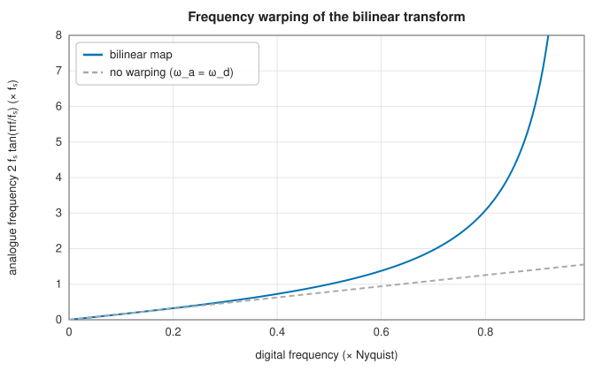
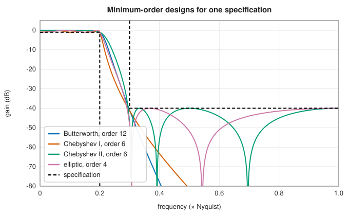
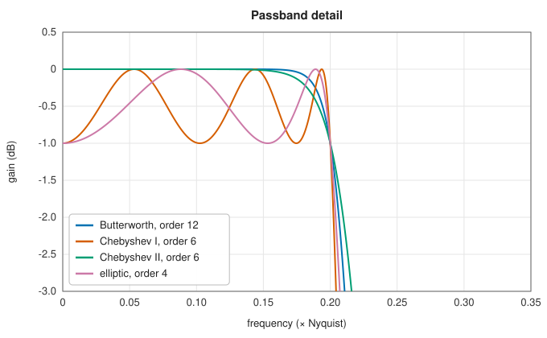
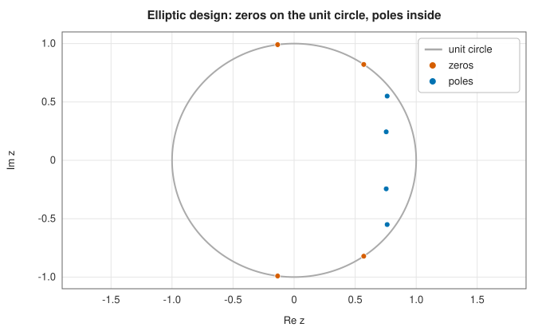
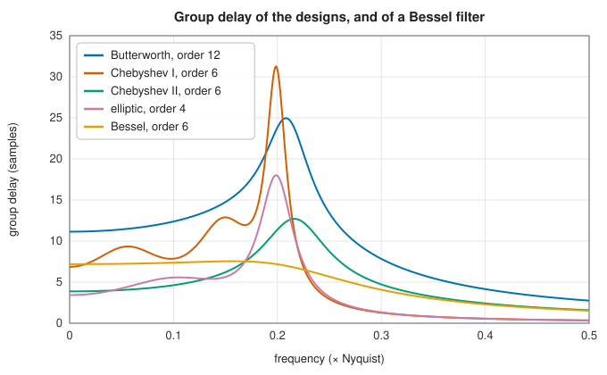

# Digital IIR design by the bilinear transform

<div class="entry-summary">

| | |
|---|---|
| **Problem** | Turn an analogue prototype into a digital recursive (IIR) filter with prescribed cutoffs, and choose the smallest order that meets a passband and stopband specification |
| **Devised by** | Arnold Tustin (1947), the bilinear substitution; James Kaiser (1963) and Charles Rader and Bernard Gold (1967), its use for digital filter design with frequency prewarping |
| **Accuracy** | Designs, order selections and responses agree with SciPy to $10^{-13}$ or better ([reference table](index.md#testing-against-scipy)) |
| **Cost** | $O(n^2)$ for a design of order $n$ |
| **API** | [`butter`](../../api/lib_jsl_dsp/discrete/filters/iir/butterworth/fn.butter.html), [`cheby1`](../../api/lib_jsl_dsp/discrete/filters/iir/chebyshev1/fn.cheby1.html), [`cheby2`](../../api/lib_jsl_dsp/discrete/filters/iir/chebyshev2/fn.cheby2.html), [`ellip`](../../api/lib_jsl_dsp/discrete/filters/iir/elliptic/fn.ellip.html), [`bessel`](../../api/lib_jsl_dsp/discrete/filters/iir/bessel/fn.bessel.html) (`ButterOutputType::{Ba, Zpk}`), [`buttord`](../../api/lib_jsl_dsp/discrete/filters/iir/butterworth/fn.buttord.html), [`cheb1ord`](../../api/lib_jsl_dsp/discrete/filters/iir/chebyshev1/fn.cheb1ord.html), [`cheb2ord`](../../api/lib_jsl_dsp/discrete/filters/iir/chebyshev2/fn.cheb2ord.html), [`ellipord`](../../api/lib_jsl_dsp/discrete/filters/iir/elliptic/fn.ellipord.html), [`bilinear`](../../api/lib_jsl_dsp/continuous/filter/bilinear/fn.bilinear.html), [`bilinear_zpk`](../../api/lib_jsl_dsp/continuous/filter/bilinear_zpk/fn.bilinear_zpk.html), [`freqz`](../../api/lib_jsl_dsp/discrete/spectral/freqz/fn.freqz.html) |

</div>

## Overview

A digital **infinite impulse response** (IIR) filter computes each output from past outputs as well as inputs. Its transfer function is a ratio
of polynomials in $z^{-1}$, and a few coefficients give a sharp frequency response. The usual way to design one is not to start from
scratch, but to take a well-understood [analogue prototype](analog-prototypes.md) and map the $s$-plane to the $z$-plane. The **bilinear transform** does this so that
stable analogue filters become stable digital ones and the analogue frequency axis maps onto the unit circle exactly once, so
ripples and attenuations carry over unchanged. The price is a nonlinear warping of the frequency axis, which is undone by
**prewarping** the critical frequencies before the analogue design. SciPy's `butter`, `cheby1`, `cheby2`, `ellip` and `bessel`, and their
order-selection companions, follow this recipe, and the library reproduces them.

## History

Arnold Tustin (1947) introduced the substitution $s = \frac{2}{T}\frac{z - 1}{z + 1}$ to simulate continuous control systems on sampled data. When digital filtering began at Bell
Labs and MIT Lincoln Laboratory in the 1960s, James Kaiser (1963) and Charles Rader and Bernard Gold (1967) used it to turn
the classical analogue designs into recursive digital filters, with prewarping to place the cutoffs exactly. Other mappings,
impulse invariance and the matched z-transform, were tried and remain in use for special purposes, but the bilinear
transform became the standard for frequency-selective filters.

## The idea

### The bilinear transform

An analogue filter is described by a transfer function $H(s)$ and a digital one by $H(z)$ (see
the [chapter's background section](index.md#background-frequency-responses-and-transfer-functions)).
To convert one into the other we need a rule that replaces $s$ by an expression in $z$.

**Where the rule comes from.** In an analogue circuit, $1/s$ is the transfer function of an
integrator. A digital filter cannot integrate, but it can approximate an integral numerically.
The [trapezoid rule](../integration/newton-cotes.md#the-trapezoid-rule) with sample interval
$T = 1/f_s$ updates a running integral $y$ of the input $x$ by

$$
y_n = y_{n-1} + \frac T2(x_n + x_{n-1}) .
$$

Writing $z^{-1}$ for a delay of one sample, this says $Y(1 - z^{-1}) = \frac T2(1 + z^{-1})X$, so
the digital integrator has the transfer function $\frac T2\frac{1 + z^{-1}}{1 - z^{-1}}$. Using it
in place of every $1/s$ amounts to the substitution

$$
s = 2f_s\,\frac{1 - z^{-1}}{1 + z^{-1}},
$$

the **bilinear transform**. Applied to a rational $H(s)$ of order $n$ it gives a rational $H(z)$
of the same order.

**Its key properties.**

- *Frequencies map to frequencies.* Put $z = e^{j\omega}$, a point on the unit circle. Then
  $\frac{1 - e^{-j\omega}}{1 + e^{-j\omega}} = j\tan(\omega/2)$, so $s = j\Omega$ with

$$
\Omega = 2f_s\tan(\omega/2) .
$$

  The unit circle corresponds to the imaginary axis: the digital filter's response at $\omega$
  *equals* the analogue filter's response at $\Omega$. As $\omega$ runs from 0 to $\pi$ (Nyquist),
  $\Omega$ runs from 0 to $\infty$. The whole infinite analogue frequency axis is compressed onto
  $0 \le \omega < \pi$, each frequency appearing exactly once, so there is no aliasing.
- *Stability is preserved.* The left half of the $s$-plane maps to the inside of the unit
  circle, so the poles of a stable analogue filter become the poles of a stable digital one.
- *Poles and zeros map individually.* A zero or pole at $s = c$ moves to
  $z = (2f_s + c)/(2f_s - c)$. An analogue low-pass filter has more poles than zeros; its response
  falls to zero as $\Omega \to \infty$. Infinite analogue frequency corresponds to $z = -1$, so
  each excess pole of the prototype contributes a zero at $z = -1$, the Nyquist frequency.

### Frequency warping and prewarping



<p class="caption" id="fig-14-6"><strong>Figure 14.6.</strong> Frequency warping.</p>

The tangent is nearly linear at low frequencies but stretches without bound towards Nyquist. A prototype designed for cutoff $\Omega_c$
would therefore land at the wrong digital frequency. **Prewarping** inverts the tangent: to put a digital cutoff at $\omega_c$, design the analogue
prototype for $\Omega_c = 2f_s\tan(\omega_c/2)$. Only the critical frequencies land exactly where requested, but because the map is monotonic, equiripple bands stay
equiripple and the ripple levels are preserved.

### The design recipe

`butter`, `cheby1`, `cheby2`, `ellip` and `bessel` all:

1. prewarp the requested edges (in units of `fs`, Nyquist being `fs/2`; by default `fs = 2`, so edges are fractions of Nyquist);
2. build the normalised prototype in zero-pole-gain form;
3. transform it to the requested low-pass, high-pass, band-pass or band-stop shape;
4. apply the bilinear transform to the zeros, poles and gain;
5. return either the zeros, poles and gain, or the expanded polynomials `b` and `a` with $a_0 = 1$.



<p class="caption" id="fig-14-7"><strong>Figure 14.7.</strong> Minimum-order designs.</p>

| | |
|:---:|:---:|
|  |  |

The four families at the smallest orders that meet the same specification, shown dashed. The elliptic filter's zeros lie on the unit
circle, producing the notches in its stopband, and its poles crowd towards the circle near the passband edge.

### Choosing the order

Each family has a closed form for the smallest order that meets a specification of passband edge $\omega_p$ with ripple $g_p$ dB and stopband
edge $\omega_s$ with attenuation $g_s$ dB. After prewarping, the specification reduces to the prototype's **selectivity** $\Omega_s/\Omega_p$ (for band filters, the worst of the two
sides, through the band transformation). Then, for Butterworth,

$$
n \ge \frac{\log_{10}\big((10^{g_s/10} - 1)/(10^{g_p/10} - 1)\big)}{2\log_{10}(\Omega_s/\Omega_p)},
$$

with $\operatorname{arcosh}$ in place of $\log$ for the Chebyshev types, and a ratio of complete elliptic integrals for the elliptic family. The functions also return the
critical frequency to pass to the design function: for Butterworth, the 3 dB frequency that meets the passband edge exactly;
for Chebyshev II, the stopband edge that meets it. For **band-stop** filters, SciPy also moves each passband edge, within its
allowed range, to the place that minimises the order.

One golden-section search for the optimal edges serves `buttord`, `cheb1ord`, `cheb2ord` and `ellipord`; without it, band-stop
specifications come out one order higher than SciPy's.

### Phase



<p class="caption" id="fig-14-8"><strong>Figure 14.8.</strong> Group delay of the designs.</p>

IIR filters have nonlinear phase. Their group delay peaks at the passband edge, highest for the sharpest filters. A Bessel design
keeps it nearly flat, but the bilinear warping spoils the analogue Bessel filter's flatness away from DC. When linear phase matters, FIR
filters, or IIR filtering applied forwards and then backwards, are the answer.

### Evaluating the response

[`freqz`](../../api/lib_jsl_dsp/discrete/spectral/freqz/fn.freqz.html) evaluates $H(e^{j\omega}) = B(e^{j\omega})/A(e^{j\omega})$ at chosen frequencies or on a uniform grid, in radians per sample by default or in the units of `fs`.
Unlike SciPy, its uniform grid includes the Nyquist frequency unless `include_nyquist` is `Some(false)`, and `whole = true` returns the
axis on $[-f_s/2, f_s/2)$ rather than $[0, f_s)$.

## Algorithm

`butter`, `cheby1`, `cheby2`, `ellip` and `bessel` share one procedure. Input: the order, the
ripple parameters of the family, the band edges and the band type.

1. **Validate and prewarp.** Check that the edges lie between zero and the Nyquist frequency
   and are in increasing order. Replace each edge $f$ by the analogue frequency
   $\Omega = 2f_s\tan(\pi f/f_s)$.
2. **Prototype.** Build the family's [analogue prototype](analog-prototypes.md#algorithm) of
   the requested order, as zeros, poles and gain.
3. **Frequency transformation.** Transform the prototype to the requested band type at the
   prewarped edges. For a band-pass or band-stop filter with edges $\Omega_1 < \Omega_2$, the
   centre is $\omega_0 = \sqrt{\Omega_1\Omega_2}$ and the width $B = \Omega_2 - \Omega_1$.
4. **Bilinear transform.** Map each zero and pole $c$ to $(2f_s + c)/(2f_s - c)$. Add a zero
   at $z = -1$ for each pole in excess of the zeros. Multiply the gain by
   $\prod(2f_s - z_i)/\prod(2f_s - p_i)$, taken over the analogue zeros and poles, which keeps
   the response's level the same.
5. **Output.** Return the zeros, poles and gain; or, if coefficients are requested, multiply
   out the factors into the polynomials $b$ and $a$, with $a_0 = 1$.

**Order selection** (`buttord` and its companions): prewarp the passband and stopband edges;
reduce the specification to the selectivity of the equivalent low-pass prototype; evaluate
the family's closed-form expression for the order and round it up; and compute the critical
frequency to pass to the design function.

## Implementation

```rust,ignore
{{#include ../../../crates/dsp/src/discrete/filters/iir/butterworth.rs:butter}}
```

```rust,ignore
{{#include ../../../crates/dsp/src/continuous/filter/bilinear_zpk.rs:bilinear_zpk}}
```

- Designs are carried out on zeros, poles and gain; only the final step multiplies out polynomials, whose coefficients are
  ill-conditioned for high orders (see [IIR structures](iir-structures.md#coefficient-sensitivity)).
- `ButterOutput` holds either form; the `Ba` coefficients are complex numbers with negligible imaginary parts for real designs.

## In practice

```rust,ignore
{{#include ../../../crates/dsp/examples/dsp_iir_design.rs}}
```

```text
elliptic order 7 (critical frequency 1000.0 Hz)
   500 Hz:   -0.06 dB
  1000 Hz:   -0.50 dB
  1300 Hz:  -63.39 dB
  2000 Hz:  -74.54 dB
RMS in 1.000 (two unit tones), out 0.679 (one tone: 0.707)
```

The design meets the specification with margin to spare at the stopband edge, because the order is rounded up. The 400 Hz tone
passes with a gain inside the 0.5 dB ripple band (0.679 of 0.707), and the 2 kHz tone is gone.

**Strengths**

- Sharp responses at low order and low cost per sample; exact placement of the critical frequencies.
- Systematic order selection; stability is inherited from the prototype.

**Weaknesses**

- Nonlinear phase, with delay peaks at the band edges.
- Only the shapes of the classical families; arbitrary magnitude responses need FIR methods.
- High-order designs in polynomial form are numerically fragile.

## Exercises

1. Show that the bilinear transform maps the left half $s$-plane onto the interior of the unit disc.
2. Derive $\Omega = 2f_s\tan(\omega/2)$ from the substitution with $z = e^{j\omega}$.
3. Design a first-order low-pass filter by hand from $H(s) = 1/(s + 1)$ with $f_s = 2$, and compare with the reference row "bilinear 1/(s+1) fs 2".
4. Explain why impulse invariance aliases a high-pass prototype but the bilinear transform does not.
5. Derive the Butterworth order formula from $|H|^2 = 1/(1 + (\Omega/\Omega_c)^{2n})$.

<details>
<summary>Hints and answers</summary>

1. $s = \dfrac{2}{T}\dfrac{z - 1}{z + 1}$ gives $z = \dfrac{1 + sT/2}{1 - sT/2}$. Then $|z|^2 = \dfrac{(1 + \sigma T/2)^2 + (\omega T/2)^2}{(1 - \sigma T/2)^2 + (\omega T/2)^2} < 1$ iff $\sigma < 0$.
2. With $s = j\Omega$ and $z = e^{j\omega}$: $j\Omega = 2f_s\dfrac{e^{j\omega} - 1}{e^{j\omega} + 1} = 2jf_s\tan(\omega/2)$, so $\Omega = 2f_s\tan(\omega/2)$.
3. $H(z) = \dfrac1{2f_s\frac{z - 1}{z + 1} + 1}$ with $f_s = 2$: $\dfrac{z + 1}{5z - 3}$; check the first coefficients against the reference.
4. Impulse invariance samples the analogue response, whose spectrum periodically repeats at $f_s$; a high-pass response does not vanish at $f_s/2$, so the copies overlap (alias). The bilinear transform maps the whole $j\Omega$ axis onto one turn of the unit circle, so there is nothing to alias.
5. Require $|H(\Omega_s)|^2 \le 10^{-A_s/10}$ at the stopband edge: $1 + (\Omega_s/\Omega_c)^{2n} \ge 10^{A_s/10}$, so $n \ge \dfrac{\ln(10^{A_s/10} - 1)}{2\ln(\Omega_s/\Omega_c)}$, rounded up.

</details>

## Further reading

- A. V. Oppenheim and R. W. Schafer, *Discrete-Time Signal Processing*, 3rd ed., Pearson, 2010, section 7.2.
- C. M. Rader and B. Gold, "Digital filter design techniques in the frequency domain", *Proceedings of the IEEE* 55 (1967) 149–171.
- T. W. Parks and C. S. Burrus, *Digital Filter Design*, Wiley, 1987, chapter 7.
- A. Tustin, "A method of analysing the behaviour of linear systems in terms of time series", *Journal of the IEE, Part IIA* 94 (1947) 130–142.
