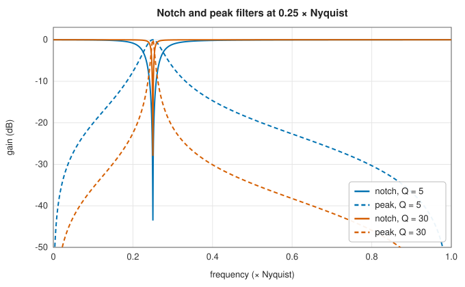
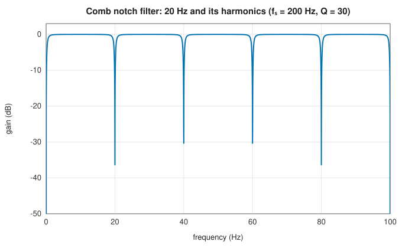

# IIR structures: direct forms, biquads, notch, peak and comb filters

<div class="entry-summary">

| | |
|---|---|
| **Problem** | Run a recursive filter sample by sample; design the small special-purpose filters that remove or isolate single frequencies and their harmonics |
| **Devised by** | The direct forms and their transposes date from the first digital filters (James Kaiser, 1960s); Leland Jackson (1970), roundoff analysis; Robert Bristow-Johnson (1990s), the "audio EQ cookbook" biquads; Sophocles Orfanidis (1996), the notch, peak and comb designs used by SciPy |
| **Accuracy** | Notch, peak and comb coefficients agree with SciPy exactly; filtering agrees with SciPy's `lfilter` to $10^{-13}$ |
| **Cost** | $O(n)$ multiply-adds per sample for order $n$ |
| **Read first** | [Digital IIR design by the bilinear transform](iir-design.md) |
| **API** | [`DiscreteLinearFilter`](../../api/lib_jsl_dsp/discrete/filters/iir/discrete_linear_filter/struct.DiscreteLinearFilter.html) (`new(b, a)`, `step`, `StreamOperator`), [`BiquadFilter`](../../api/lib_jsl_dsp/discrete/filters/iir/biquad/struct.BiquadFilter.html), [`BiquadCoefficients`](../../api/lib_jsl_dsp/discrete/filters/iir/biquad/struct.BiquadCoefficients.html) (`lowpass`), [`iirnotch`](../../api/lib_jsl_dsp/discrete/filters/iir/iir_notch/fn.iirnotch.html), [`iirpeak`](../../api/lib_jsl_dsp/discrete/filters/iir/iir_peak/fn.iirpeak.html), [`iircomb`](../../api/lib_jsl_dsp/discrete/filters/iir/iir_comb/fn.iircomb.html) |

</div>

## Overview

A transfer function $H(z) = B(z)/A(z)$ says what a filter does, not how to compute it. The same $H$ can be realised by different arrangements of
delays, multipliers and adders, called **structures**. In exact arithmetic they are equivalent; in floating point they differ in rounding error,
in sensitivity to the coefficients, and in memory. This entry covers the direct forms, the second-order section (biquad) from which
robust high-order filters are built, and three small designs that are widely used on their own: the **notch** that removes one frequency,
the **peak** that isolates one, and the **comb** that acts on a frequency and all its harmonics.

## History

The first digital filters, in the 1960s at Bell Labs and MIT, were programmed directly from the difference equation. Analysis of
their finite-precision behaviour followed quickly: James Kaiser (1965) showed how sensitive high-order direct forms are to coefficient
quantisation, and Leland Jackson (1970) analysed roundoff noise and recommended cascades of second-order sections. Second-order
sections remain the standard, from SciPy's `sosfilt` to audio equalisers built from Robert Bristow-Johnson's "cookbook" formulas.
The notch, peak and comb designs in SciPy follow Sophocles Orfanidis's *Introduction to Signal Processing* (1996).

## The idea

### Direct forms

The difference equation

$$
y[n] = \sum_{k=0}^Mb_kx[n - k] - \sum_{k=1}^Na_ky[n - k] \qquad (a_0 = 1)
$$

can be computed literally, with delay lines for past inputs and past outputs (**direct form I**), or by sharing a single delay line of length
$\max(M, N)$ (**direct form II**). [`DiscreteLinearFilter`](../../api/lib_jsl_dsp/discrete/filters/iir/discrete_linear_filter/struct.DiscreteLinearFilter.html) uses the **transposed direct form II**, the structure of SciPy's `lfilter`, which keeps $\max(M, N)$ state
variables and updates them as

$$
y = b_0x + d_0, \qquad d_k \leftarrow d_{k+1} + b_{k+1}x - a_{k+1}y.
$$

The state is a running sum of partial products. Each new input and output enters every state variable in one step, which keeps
intermediate values small. `new` divides all coefficients by $a_0$, as `lfilter` does. (Before this chapter was written it assumed $a_0 = 1$ silently.)

### Coefficient sensitivity

The poles are the roots of $A(z)$, and the roots of a polynomial can be extremely sensitive to its coefficients. This is worst when poles
cluster, as they do near $z = 1$ in a narrow low-pass filter. Rounding the denominator of Butterworth designs to single precision:

<p class="caption" id="tab-14-4"><strong>Table 14.4.</strong> Pole movement of Butterworth filters when the coefficients are rounded to single precision.</p>

{{#include ../generated/filters/sensitivity.md}}

A narrow eighth-order filter becomes unstable from rounding in the seventh significant digit. The same problem appears in double
precision for higher orders: NumPy's `roots` puts a pole of the 16th-order design at radius 1.07, outside the unit circle, from the
exact double-precision coefficients. The remedy is to factor the filter into **second-order sections** $H = \prod_iH_i$, each with two poles, so that every
pole is set by a quadratic, whose roots are well conditioned. The library designs filters in zero-pole-gain form, but it has no
second-order-section filter; [`BiquadFilter`](../../api/lib_jsl_dsp/discrete/filters/iir/biquad/struct.BiquadFilter.html) runs one section in direct form I, and only its low-pass coefficients are provided.
For high-order or narrow-band IIR filters, cascade biquads built from the zeros and poles rather than filtering with `b` and `a`.

### Notch and peak filters

A **notch** at $\omega_0$ places a pair of zeros on the unit circle at $e^{\pm j\omega_0}$ and a pair of poles just inside them, at radius $r < 1$. Away from $\omega_0$ the poles cancel the
zeros' effect and the gain is 1; near $\omega_0$ the zeros win. The closer $r$ is to 1, the narrower the notch. In Orfanidis's design, the 3 dB bandwidth $\Delta\omega$
is set by the quality factor $Q = \omega_0/\Delta\omega$:

$$
H(z) = b\,\frac{1 - 2\cos\omega_0z^{-1} + z^{-2}}{1 - 2b\cos\omega_0z^{-1} + (2b - 1)z^{-2}}, \qquad b = \frac{1}{1 + \tan(\Delta\omega/2)}.
$$

The **peak** filter is its complement, $1 - H_{\text{notch}}$, a resonator with unit gain at $\omega_0$.



<p class="caption" id="fig-14-9"><strong>Figure 14.9.</strong> Notch and peak filters.</p>

### Comb filters

Replacing $z^{-1}$ by $z^{-N}$ repeats a response $N$ times around the unit circle. A **comb** notch filter with $N = f_s/f_0$ removes $f_0$ and every harmonic of it, the shape
of mains hum and of other periodic interference:



<p class="caption" id="fig-14-10"><strong>Figure 14.10.</strong> Comb filter.</p>

`iircomb` requires $f_0$ to divide $f_s$ exactly, since $N$ must be an integer, and by default it also places a notch at DC (set `pass_zero` to pass DC instead).

## Algorithm

**Filtering in transposed direct form II.** The state is $N$ numbers $d_0, \ldots, d_{N-1}$,
where $N$ is the larger of the two orders, initially zero. Missing coefficients count as zero.
For each input sample $x$:

1. compute the output $y = b_0x + d_0$;
2. update the state, for $k = 0, \ldots, N - 1$ in increasing order:
   $d_k \leftarrow d_{k+1} + b_{k+1}x - a_{k+1}y$, with $d_N$ taken as zero.

Each sample costs about $2N$ multiplications. The order of the updates matters: each $d_k$ is
computed from the old $d_{k+1}$, which has not yet been overwritten.

**Notch filter** at frequency $f_0$ with quality factor $Q$:

1. convert to radians per sample, $\omega_0 = 2\pi f_0/f_s$, and compute the bandwidth
   $\Delta\omega = \omega_0/Q$;
2. compute $b = 1/(1 + \tan(\Delta\omega/2))$;
3. the numerator is $b\,(1, -2\cos\omega_0, 1)$ and the denominator
   $(1, -2b\cos\omega_0, 2b - 1)$.

The **peak** filter has the same denominator and the numerator $(1 - b)(1, 0, -1)$.

**Comb filter** removing $f_0$ and its harmonics:

1. $N = f_s/f_0$, which must be an integer;
2. compute the bandwidth as above and $\beta = \tan(N\Delta\omega/4)$;
3. form a numerator and a denominator that are nonzero only at the powers $z^0$ and
   $z^{-N}$, with constants that depend on $\beta$ and on whether a notch or a peak comb is
   wanted.

## Implementation

```rust,ignore
{{#include ../../../crates/dsp/src/discrete/filters/iir/discrete_linear_filter.rs:direct_form}}
```

```rust,ignore
{{#include ../../../crates/dsp/src/discrete/filters/iir/iir_notch.rs:iirnotch}}
```

- `DiscreteLinearFilter` works for real and complex samples, and as a [`StreamOperator`](../../api/lib_jsl_dsp/discrete/stream_operator/trait.StreamOperator.html) for blocks.
- The designs return [`BilinearResult`](../../api/lib_jsl_dsp/continuous/filter/bilinear/struct.BilinearResult.html) with complex coefficients; take the real parts for real filtering.
- `BiquadCoefficients::lowpass` uses the cookbook formulas with the cutoff in cycles per sample, in $(0, 0.5)$.

## In practice

```rust,ignore
{{#include ../../../crates/dsp/examples/dsp_iir_structures.rs}}
```

```text
RMS error: input 0.381, after a 50 Hz notch 0.142
comb filter: 21 numerator taps
after a 50 Hz comb (all harmonics): 0.005
```

The notch removes the 50 Hz hum but leaves its 150 Hz harmonic, whose RMS amplitude, 0.14, is all the remaining error. The comb, with
a 20-sample delay at 1 kHz, removes both.

**Strengths**

- Cheap, sample-by-sample filtering with little memory; notch, peak and comb filters have a single intuitive parameter, $Q$.

**Weaknesses**

- Direct forms of high-order or narrow-band filters are numerically fragile; the library lacks a second-order-section filter.
- Combs need an integer period; poles near the unit circle ring for a long time after transients.

## Exercises

1. Draw the signal-flow graphs of direct forms I and II and the transposed direct form II, and count delays and multipliers.
2. Show that the notch filter's gain is exactly 1 at DC and Nyquist and exactly 0 at $\omega_0$.
3. Show that the peak filter equals one minus the notch filter for the same $\omega_0$ and $Q$.
4. Factor a sixth-order Butterworth design into three second-order sections by pairing conjugate poles, and compare its response under single-precision coefficients with the direct form.
5. Estimate how long (in samples) the notch filter's impulse response takes to decay by 60 dB for $Q = 30$ at $\omega_0 = \pi/4$.

<details>
<summary>Hints and answers</summary>

1. Direct form I has two delay lines ($N + M$ delays), direct form II shares them ($\max(N, M)$ delays); both have $N + M + 1$ multipliers, and the transposed form II has the same counts as form II.
2. $H(1) = b\dfrac{2 - 2\cos\omega_0}{1 - 2b\cos\omega_0 + 2b - 1} = b\dfrac{2(1 - \cos\omega_0)}{2b(1 - \cos\omega_0)} = 1$, and likewise $H(-1) = b\dfrac{2(1 + \cos\omega_0)}{2b(1 + \cos\omega_0)} = 1$. At $z = e^{j\omega_0}$ the numerator $1 - 2\cos\omega_0z^{-1} + z^{-2}$ is zero.
3. The denominator minus $b$ times the notch numerator is $(1 - b) + (-2b\cos\omega_0 + 2b\cos\omega_0)z^{-1} + (2b - 1 - b)z^{-2} = (1 - b)(1 - z^{-2})$, so $1 - H_{\text{notch}}$ has numerator $(1 - b)(1, 0, -1)$ over the same denominator: the peak filter.
4. Group the six poles into conjugate pairs and form three biquads; with single-precision coefficients the direct form's poles move much more than the biquads' because sensitivity of the roots to the coefficients grows with the order.
5. The denominator $z^2 - 2b\cos\omega_0z + (2b - 1)$ has poles of radius $r = \sqrt{2b - 1}$. For $Q = 30$ and $\omega_0 = \pi/4$: $\Delta\omega = 0.02618$, $b = 0.98708$, $r = 0.98699$. The response decays like $r^n$, so $r^n = 10^{-3}$ gives $n = \ln10^{-3}/\ln r \approx 530$ samples.

</details>

## Further reading

- L. B. Jackson, "Roundoff-noise analysis for fixed-point digital filters realized in cascade or parallel form", *IEEE Transactions on Audio and Electroacoustics* 18 (1970) 107–122.
- S. J. Orfanidis, *Introduction to Signal Processing*, Prentice Hall, 1996, chapters 6 and 8.
- R. Bristow-Johnson, "Cookbook formulae for audio EQ biquad filter coefficients", W3C Audio Working Group note.
- A. V. Oppenheim and R. W. Schafer, *Discrete-Time Signal Processing*, 3rd ed., Pearson, 2010, chapter 6.
