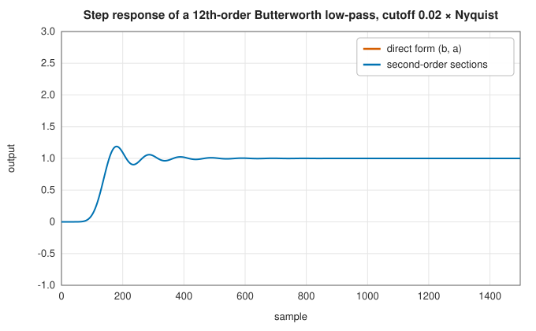
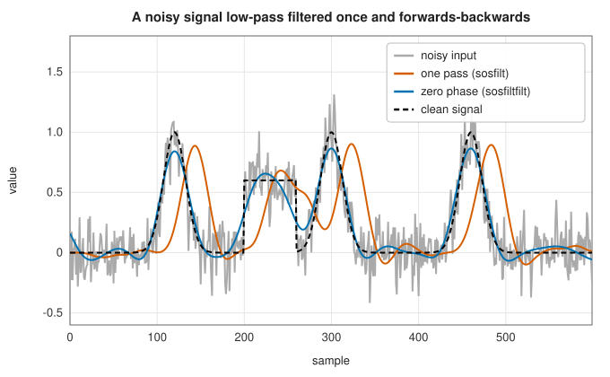

# Second-order sections and zero-phase filtering

<div class="entry-summary">

| | |
|---|---|
| **Problem** | Apply a high-order IIR filter without numerical failure; filter a recorded signal without shifting its features in time |
| **Devised by** | Cascade (second-order-section) realisations: James Kaiser (1966) and Leland Jackson (1970); forward-backward filtering: a standard offline technique, with the choice of initial states analysed by Fredrik Gustafsson (1996) |
| **Accuracy** | Sections, their steady states and both kinds of filtering agree with SciPy to $10^{-13}$ or better |
| **Cost** | $5$ multiply-adds per section per sample; zero-phase filtering costs two passes over the signal plus a short padding at each end |
| **Read first** | [IIR structures: direct forms, biquads, notch, peak and comb filters](iir-structures.md), [Digital IIR design by the bilinear transform](iir-design.md) |
| **API** | [`zpk2sos`](../../api/lib_jsl_dsp/discrete/filters/iir/sos/fn.zpk2sos.html), [`tf2sos`](../../api/lib_jsl_dsp/discrete/filters/iir/sos/fn.tf2sos.html), [`sos2tf`](../../api/lib_jsl_dsp/discrete/filters/iir/sos/fn.sos2tf.html), [`sosfilt`](../../api/lib_jsl_dsp/discrete/filters/iir/sos/fn.sosfilt.html), [`sosfilt_zi`](../../api/lib_jsl_dsp/discrete/filters/iir/sos/fn.sosfilt_zi.html), [`lfilter`](../../api/lib_jsl_dsp/discrete/filters/iir/zero_phase/fn.lfilter.html), [`lfilter_zi`](../../api/lib_jsl_dsp/discrete/filters/iir/zero_phase/fn.lfilter_zi.html), [`filtfilt`](../../api/lib_jsl_dsp/discrete/filters/iir/zero_phase/fn.filtfilt.html), [`sosfiltfilt`](../../api/lib_jsl_dsp/discrete/filters/iir/zero_phase/fn.sosfiltfilt.html), [`Padding`](../../api/lib_jsl_dsp/discrete/filters/iir/zero_phase/enum.Padding.html) |

</div>

## Overview

Two practical problems arise as soon as IIR filters are used on real data.

The first is numerical. A filter of order $N$ written as one ratio of polynomials, $B(z)/A(z)$, has its poles determined by the $N + 1$
coefficients of $A$. For narrow or high-order filters those poles are packed close together near $z = 1$, and then they depend so sensitively
on the coefficients that rounding error alone can push one outside the unit circle: the filter becomes unstable although the design is
not. The cure is to write the filter as a product of **second-order sections**, $H(z) = \prod_k H_k(z)$, each with two poles and two zeros.
Every pole is then the root of a quadratic, which is well conditioned, and the cascade works at orders where the single polynomial fails.

The second is the phase. Any causal filter delays its output; an IIR filter delays different frequencies by different amounts, which
distorts the shape of a pulse and moves its peak. When the whole record is available (a measurement, an image row, a sound file), the
delay can be removed: filter the signal forwards, then filter the result backwards. The second pass undoes the phase shift of the first, so
the overall filter has **zero phase** and the magnitude response $|H|^2$. The ends of the record need care, and the second half of this
entry is about how to start each pass so that its transient is small.

## History

The sensitivity of high-order recursive filters to their coefficients was recognised with the first digital filters. James Kaiser (1966)
showed how quickly pole positions degrade as the order grows and recommended realising a filter as a cascade or parallel combination of
first- and second-order sections. Leland Jackson (1970) analysed the roundoff noise of these structures and how the pairing of poles with
zeros and the ordering of the sections affect it; the rules used here (pair each pole with the nearest zeros, put the sections with poles
nearest the unit circle last) follow that line of work and are those of SciPy's `zpk2sos`.

Forward-backward filtering is older than digital computers in spirit (it is how an optical or mechanical system with a symmetric impulse
response behaves) and became standard in offline signal processing with MATLAB's `filtfilt`. Fredrik Gustafsson (1996) showed how to choose
the initial states of the two passes so that the forward-backward result matches what a longer record would have given; SciPy's
`lfilter_zi`, used here, starts each pass in the steady state of a step, which removes most of the start-up transient at much lower cost.

## The idea

### Why the direct form fails

Let $p$ be a simple root of $A(z) = 1 + a_1z^{-1} + \cdots + a_Nz^{-N}$, and perturb one coefficient, $a_k \to a_k + \delta$. To first order the
root moves by

$$
\delta p \approx -\frac{\delta\,p^{N-k}}{A'(p)}, \qquad A'(p) \propto \prod_{q \ne p}(p - q),
$$

where the product runs over the other roots. When the poles cluster, every factor $p - q$ is small, the product is tiny, and $\delta p$ is
huge. A Butterworth low-pass with cutoff $0.02\times$ Nyquist and order 12 has all twelve poles within about $0.06$ of $z = 1$; a relative
error of $10^{-16}$ in one coefficient is enough to move a pole by more than the distance to the unit circle. The table shows the step
response computed from the coefficients $b$ and $a$ (in double precision, with the exact algorithm) against the same filter as sections:

<p class="caption" id="tab-14-5"><strong>Table 14.5.</strong> Step response of Butterworth low-pass filters in direct form and as second-order sections.</p>

{{#include ../generated/filters/sos_vs_ba.md}}

The direct form loses accuracy steadily with the order and then diverges; the cascade is accurate to rounding error in every case.



<p class="caption" id="fig-14-11"><strong>Figure 14.11.</strong> Step responses in direct form and as sections.</p>

The two agree for the first 150 samples. Then the direct form, whose computed poles include one outside the unit circle, grows without
bound, while the cascade settles at 1.

### Second-order sections

Write each section with its poles $re^{\pm j\theta}$ and zeros $z_1, z_2$:

$$
H_k(z) = \frac{b_0 + b_1z^{-1} + b_2z^{-2}}{1 + a_1z^{-1} + a_2z^{-2}}, \qquad a_1 = -2r\cos\theta, \quad a_2 = r^2 .
$$

Now the pole radius is $r = \sqrt{a_2}$, and an error $\delta$ in $a_2$ changes it by only $\delta/(2r)$: no product of small distances appears,
whatever the order of the whole filter. Filtering is the composition of the sections, each a five-coefficient recursion. Following SciPy,
a filter is stored as rows $[b_0, b_1, b_2, a_0, a_1, a_2]$, and a design is converted from its zeros, poles and gain by three rules:

1. **Pair poles with nearby zeros.** Take the poles in order of closeness to the unit circle, each with its conjugate (or with the next
   real pole), and give that section the zeros nearest to the poles. A pole and a nearby zero partly cancel, so each section's gain stays
   moderate.
2. **Put the sharpest sections last.** Poles near the unit circle make a large resonant peak. Placed last, that peak does not amplify the
   signal that the other sections still have to process, which limits overflow in fixed-point arithmetic and noise amplification in floating
   point.
3. **Put the overall gain in the first section**, so that the signal is scaled down before any resonance amplifies it.

An odd number of poles leaves one real pole; it gets a section of its own with a pole and a zero at the origin. Designing in zero-pole-gain
form and converting with `zpk2sos` avoids ever forming the fragile polynomial. `tf2sos` exists for filters given only as $b$ and $a$, but it
must first find their roots, and repeated roots (the Butterworth numerator has an $N$-fold root at $z = -1$) are ill conditioned: two
correct implementations split them differently, so their sections can differ in the fourth significant digit while describing the same
filter.

### Starting in steady state

A filter that starts from rest sees its input jump from 0 to $x[0]$ at the first sample, and responds with a transient. If instead the
input had been constant at $x[0]$ for ever, the filter would be in a steady state, and that state can be computed. In transposed direct form II
the state $\mathbf z$ evolves as

$$
y[n] = b_0x[n] + z_1[n], \qquad z_i[n + 1] = b_ix[n] - a_iy[n] + z_{i+1}[n] .
$$

With a constant input $x = 1$ the output is constant too, $y = H(1)$, and the state stops changing. Substituting $y = b_0 + z_1$ into the
update and setting $\mathbf z[n + 1] = \mathbf z[n]$ gives the linear system

$$
(I - C^{\mathsf T})\,\mathbf z = \mathbf b_{1:} - \mathbf a_{1:}\,b_0,
$$

where $C$ is the companion matrix of $A$. For example, $y[n] = 0.5x[n] + 0.5y[n-1]$ has $b = (0.5, 0)$ and $a = (1, -0.5)$; its steady state for a
unit input is $z_1 = 0.5$, and indeed $y = 0.5 + 0.5 = 1 = H(1)$. Scaling this state by $x[0]$ starts the filter as if the signal had always
been at its first value. For a cascade, each section's state is scaled also by the DC gain of the sections before it, since that is the
size of the step that reaches it.

### Zero phase

Filtering a real signal with impulse response $h$ multiplies its spectrum by $H(e^{j\omega})$. Reversing a signal in time conjugates its
spectrum, so filtering forwards, reversing, filtering again and reversing back multiplies the spectrum by

$$
H(e^{j\omega})\;\overline{H(e^{j\omega})} = |H(e^{j\omega})|^2 ,
$$

a real, non-negative response: **zero phase**, and the magnitude squared. In decibels the attenuation doubles, so a filter whose
response is $-3$ dB at its cutoff is $-6$ dB there after two passes. The equivalent impulse response, $h[n] * h[-n]$, is symmetric about 0,
which is why the result is not causal: the output at time $n$ uses samples after $n$, so the whole record must be available.



<p class="caption" id="fig-14-12"><strong>Figure 14.12.</strong> One pass against zero phase.</p>

A fourth-order low-pass removes the noise in both cases. One pass delays every pulse by about 20 samples and rounds the step at 200 into
a slow rise; the forward-backward result keeps the pulses in place and the step symmetric.

### The ends of the record

Each pass starts with a transient, and the backward pass starts at the end of the record. Two devices keep these small:

- **Padding.** The signal is extended by `padlen` samples at each end before filtering (by default three times the filter length), and the
  extension is discarded afterwards. The default **odd** extension reflects the signal through its end point, $x[-k] = 2x[0] - x[k]$, which
  keeps both the value and the slope continuous; an **even** extension (a mirror) keeps the value but makes a corner; a **constant**
  extension makes a corner in the slope too.
- **Steady-state initial conditions.** Each pass starts from the steady state for its own first sample, as above.

The table measures both on a slowly rising signal whose low-pass output is known, with a third-order filter:

<p class="caption" id="tab-14-6"><strong>Table 14.6.</strong> Error at the ends of the record for each padding, and without steady-state initial conditions.</p>

{{#include ../generated/filters/filtfilt_edges.md}}

In the middle of the record every variant has the same small error, set by the filter itself. At the ends, odd padding is best because
the signal's trend continues into the padding. Without the steady-state start, the backward pass begins from rest at a value near 2 and
its transient reaches the last samples: an error of order one.

## Algorithm

**`zpk2sos`**, from zeros $Z$, poles $P$ and gain $k$:

1. If there are no poles and no zeros, return the single section $[k, 0, 0, 1, 0, 0]$.
2. Pad $Z$ and $P$ with roots at the origin until they have the same, even, length; there will be $\lceil \max(|Z|, |P|)/2\rceil$ sections.
3. Split each set into conjugate pairs (one representative with positive imaginary part) and real roots.
4. For each section from the last to the first:
   - take the pole $p_1$ nearest the unit circle; its partner $p_2$ is $\bar p_1$, or for a real pole the next real pole nearest the circle;
   - choose the zeros: the zero nearest $p_1$, with its conjugate if it is complex, or with the nearest remaining real zero if it is real
     (two special cases keep real and complex roots paired consistently, as in SciPy);
   - the section is $(z - z_1)(z - z_2)$ over $(z - p_1)(z - p_2)$, expanded into real coefficients.
5. Multiply the numerator of the first section by $k$.

**`sosfilt`**, with sections normalised by $a_0$: for each section in order, run every sample through
$y = b_0x + s_1$, $s_1 \leftarrow b_1x - a_1y + s_2$, $s_2 \leftarrow b_2x - a_2y$, starting from the given state; the output of one section is the
input of the next.

**`lfilter_zi`**: normalise by $a_0$, pad $b$ and $a$ to the same length $m + 1$, and solve the $m \times m$ system
$(I - C^{\mathsf T})\mathbf z = b_{1:} - a_{1:}b_0$ by Gaussian elimination. **`sosfilt_zi`**: for each section, its `lfilter_zi` times the
product of the DC gains $\sum b/\sum a$ of the earlier sections.

**`filtfilt`** and **`sosfiltfilt`**:

1. Choose the padding length: `padlen`, or $3\max(|a|, |b|)$ for `filtfilt` and $3(2n_s + 1 - t)$ for `sosfiltfilt` with $n_s$ sections, where $t$
   counts the trailing zero coefficients that all sections share (SciPy's rule). Require the signal to be longer than the padding.
2. Extend the signal by the chosen padding.
3. Filter forwards, starting from the steady state times the first padded sample.
4. Reverse, filter again starting from the steady state times the (new) first sample, and reverse back.
5. Remove the padding.

The cost is two filtering passes over $n + 2\,$`padlen` samples.

## Implementation

Converting zeros and poles to sections:

```rust,ignore
{{#include ../../../crates/dsp/src/discrete/filters/iir/sos.rs:zpk2sos}}
```

Filtering through the cascade:

```rust,ignore
{{#include ../../../crates/dsp/src/discrete/filters/iir/sos.rs:sosfilt}}
```

The steady state:

```rust,ignore
{{#include ../../../crates/dsp/src/discrete/filters/iir/zero_phase.rs:lfilter_zi}}
```

Forward-backward filtering through sections:

```rust,ignore
{{#include ../../../crates/dsp/src/discrete/filters/iir/zero_phase.rs:sosfiltfilt}}
```

- Sections are rows `[b0, b1, b2, a0, a1, a2]` (`Section = [f64; 6]`), as in SciPy; states are two values per section.
- `tf2sos` finds roots as eigenvalues of the companion matrix, so complex roots come in exact conjugate pairs.
- Padding choices are `Padding::Odd` (default in SciPy), `Even`, `Constant` and `None`; `padlen` overrides the default length.
- Only real signals and coefficients are supported.

## In practice

```rust,ignore
{{#include ../../../crates/dsp/examples/dsp_sos_zero_phase.rs}}
```

```text
5 sections; the last holds the poles nearest the unit circle:
  b = [+7.686e-16, +1.537e-15, +7.686e-16]  a = [1, -1.879492, +0.883208]
  b = [+1.000e0, +2.000e0, +1.000e0]  a = [1, -1.890297, +0.894035]
  b = [+1.000e0, +2.000e0, +1.000e0]  a = [1, -1.911197, +0.914976]
  b = [+1.000e0, +2.000e0, +1.000e0]  a = [1, -1.940730, +0.944568]
  b = [+1.000e0, +2.000e0, +1.000e0]  a = [1, -1.976638, +0.980546]
RMS error against the slow sine: one pass 0.847, zero phase 0.0001
one pass delays the slow sine by about 102 samples; zero phase by none
```

The overall gain of about $10^{-15}$ sits in the first section, and $a_2$ (the squared pole radius) rises towards 1 from section to section.
Filtered once, the slow sine comes out about 102 samples late, so it disagrees with the original by almost its full amplitude; filtered
forwards and backwards it is reproduced to $10^{-4}$ while the fast component is gone.

**Strengths**

- Sections make high-order and narrow-band IIR filters usable; the cost per sample is the same as the direct form's.
- Zero-phase filtering keeps peaks, edges and pulse shapes in place, with a magnitude response that is simply $|H|^2$.
- Steady-state starts and odd padding make the ends of a record almost as accurate as its middle.

**Weaknesses**

- Zero-phase filtering needs the whole record and is not causal, so it cannot run in real time.
- The squared magnitude response moves the $-3$ dB point inwards; design for the response wanted after two passes.
- `tf2sos` on coefficients with repeated roots is ill conditioned; design in zero-pole-gain form instead.
- Signals shorter than the padding are rejected.

## Exercises

1. Show that a section with poles $re^{\pm j\theta}$ has $a_1 = -2r\cos\theta$ and $a_2 = r^2$, and find how much an error $\delta$ in $a_1$ moves $\theta$ when $r$
   is close to 1 and $\theta$ is small. Why is this still much better than the direct form?
2. Derive the steady state of the second-order section $y[n] = x[n] - a_1y[n-1] - a_2y[n-2]$ (in transposed direct form II) directly from the
   recurrence, and check it against `lfilter_zi`.
3. Show that forward-backward filtering with a filter whose response is $-3$ dB at $\omega_c$ gives $-6$ dB there. What cutoff should a
   Butterworth design of order $N$ have so that the zero-phase result is $-3$ dB at $\omega_c$?
4. Filter a step with `sosfiltfilt` using each padding and no padding, and plot the first 50 samples. Which padding preserves the step best,
   and why does odd padding make the result symmetric about the step?
5. Design a 16th-order Butterworth low-pass at $0.05\times$ Nyquist, compute its frequency response from $b$ and $a$ and from the sections, and
   compare. Is the direct form's response wrong, or only its filtering? Explain.

<details>
<summary>Hints and answers</summary>

1. Expand $(1 - re^{j\theta}z^{-1})(1 - re^{-j\theta}z^{-1})$. From $a_1 = -2r\cos\theta$, $\delta\theta = \delta/(2r\sin\theta)$, which is large when $\theta$ is small, but it
   involves only this section's two poles; in the direct form the corresponding factor is a product over all the other poles, each close.
2. In steady state with $x = 1$, $y = 1/(1 + a_1 + a_2)$; the transposed form has $y = x + s_1$, $s_1 = -a_1y + s_2$, $s_2 = -a_2y$, so
   $s_2 = -a_2y$ and $s_1 = -(a_1 + a_2)y$.
3. The two passes give $|H|^2$, so $-3$ dB becomes $-6$ dB. For a Butterworth response $|H|^2 = 1/(1 + (\omega/\omega_c)^{2N})$, the zero-phase power response is
   $|H|^4 = 1/(1 + (\omega/\omega_c)^{2N})^2$, which is $-3$ dB at $\omega = \omega_c(\sqrt2 - 1)^{1/(2N)}$; so design with cutoff $\omega_c/(\sqrt2 - 1)^{1/(2N)}$
   (after prewarping).
4. Odd padding continues the trend of each end, so the padded signal is flat on both sides of a step; the result is symmetric about the
   step's midpoint because the equivalent impulse response $h * h(-\cdot)$ is symmetric. Constant padding is also exact for a step far from
   the ends; no padding leaves a transient at each end.
5. The frequency response is a ratio of polynomial values and is computed accurately either way; the failure is in the recursion, whose
   computed poles (implied by the rounded coefficients during filtering) leave the unit circle.

</details>

## Further reading

- J. F. Kaiser, "Digital filters", chapter 7 in F. F. Kuo and J. F. Kaiser (eds.), *System Analysis by Digital Computer*, Wiley, 1966.
- L. B. Jackson, "Roundoff-noise analysis for fixed-point digital filters realized in cascade or parallel form", *IEEE Transactions on Audio and Electroacoustics* 18 (1970) 107–122.
- F. Gustafsson, "Determining the initial states in forward-backward filtering", *IEEE Transactions on Signal Processing* 44 (1996) 988–992.
- A. V. Oppenheim and R. W. Schafer, *Discrete-Time Signal Processing*, 3rd ed., Pearson, 2010, chapter 6 (structures for discrete-time systems).
