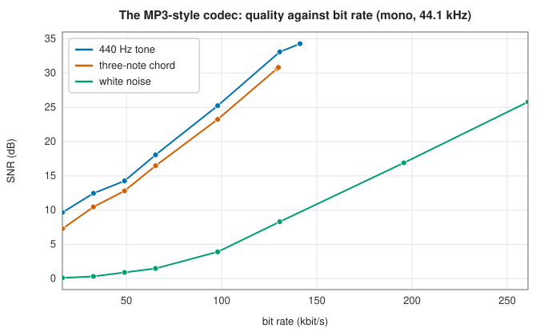

# Audio files: WAV and a perceptual codec

<div class="entry-summary">

| | |
|---|---|
| **Problem** | Store sampled sound: losslessly as PCM in RIFF/WAVE files, and compactly with a perceptual codec that hides its errors where the ear cannot hear them |
| **Devised by** | IBM and Microsoft (1991), RIFF/WAVE; Karlheinz Brandenburg and the Fraunhofer IIS team (1980s–1993), MPEG-1 Audio Layer III; John Princen, Alan Johnson and Alan Bradley (1987), the MDCT |
| **Accuracy** | WAV files from Python's `wave` module and hand-built headers read exactly; SciPy reads the library's WAV files to within half a quantisation step (tables below) |
| **Cost** | WAV $O(n)$; the codec $O(n \log n)$ per granule transform plus a rate search |
| **API** | [`parse_wav`](../../api/lib_jsl_file_io/wav/fn.parse_wav.html), [`encode_wav`](../../api/lib_jsl_file_io/wav/fn.encode_wav.html), [`read_wav_file`](../../api/lib_jsl_file_io/wav/fn.read_wav_file.html), [`write_wav_file`](../../api/lib_jsl_file_io/wav/fn.write_wav_file.html), [`WavAudio`](../../api/lib_jsl_file_io/wav/struct.WavAudio.html), [`WavSampleFormat`](../../api/lib_jsl_file_io/wav/enum.WavSampleFormat.html), [`mp3_encode`](../../api/lib_jsl_file_io/mp3/fn.mp3_encode.html), [`mp3_encode_with_model`](../../api/lib_jsl_file_io/mp3/fn.mp3_encode_with_model.html), [`mp3_decode`](../../api/lib_jsl_file_io/mp3/fn.mp3_decode.html), [`PsychoacousticModel`](../../api/lib_jsl_file_io/mp3/trait.PsychoacousticModel.html), [`GenericPsychoacousticModel`](../../api/lib_jsl_file_io/mp3/struct.GenericPsychoacousticModel.html) |

</div>

## Overview

A **WAV** file is the plainest way to keep sound: a short header saying how many channels, how many samples per second and how many bits per sample, then the samples themselves, interleaved frame by frame. Nothing is lost, and nothing is saved: CD-quality stereo takes 1411 kbit/s.

**Perceptual codecs** such as MP3 shrink audio ten times or more by discarding what the ear cannot detect. A loud tone **masks** quieter sounds at nearby frequencies, and very quiet sounds fall below the **absolute threshold of hearing**. A perceptual coder transforms the sound into frequency bands, estimates how much noise each band can hide, and quantizes each band just coarsely enough to put its error there.

The library's codec follows the structure of MPEG-1 Layer III, but it is a readable worked example, **not** bitstream-compatible with real MP3 files.

## History

The RIFF container and its WAVE form were defined by IBM and Microsoft in 1991 for Windows multimedia. Later extensions added a "WAVE_FORMAT_EXTENSIBLE" header for more channels and sample formats. Perceptual coding grew from psychoacoustic research on critical bands by Harvey Fletcher (1940) and Eberhard Zwicker (1961). Karlheinz Brandenburg's doctoral work at Erlangen and the Fraunhofer Institute led to MPEG-1 Audio Layer III, standardised in 1993, which with the MP3 player transformed music distribution. Its transform, the modified discrete cosine transform (MDCT) of Princen, Johnson and Bradley (1987), is a lapped transform with perfect reconstruction that also underlies AAC, Vorbis and Opus.

## The idea

### WAV files

A WAV file is a list of **chunks**, each with a four-character identifier and a length. The `fmt ` chunk gives the sample format (integer PCM or IEEE float), the channel count, the sample rate and the bits per sample. The `data` chunk holds the samples, little-endian. Other chunks, such as metadata, are skipped. The reader accepts 8-bit unsigned, 16-, 24- and 32-bit signed integer and 32- and 64-bit float samples, in plain or extensible headers. It returns them as `f32` values scaled by $2^{-(b-1)}$ for $b$-bit integers, so full scale is $[-1, 1)$. A truncated final chunk is tolerated, as many recorders leave one.

```rust,ignore
{{#include ../../../crates/file_io/src/wav.rs:parse_wav}}
```

Writing reverses this and clips integer formats to their range. Files written by Python and read by the library:

{{#include ../generated/foundations/reading_wav.md}}

And files written by the library, read by SciPy's `wavfile`:

{{#include ../generated/foundations/interop_wav.md}}

The 32-bit and double-precision files differ by about $3 \times 10^{-8}$ because the library holds samples as `f32`, with a 24-bit significand.

### A perceptual codec

The encoder follows the stages of Layer III:
1. **Transform.** Granules of 576 samples go through a sine-windowed MDCT with 50% overlap, which gives 576 frequency lines per granule and reconstructs exactly. Layer III uses a polyphase filter bank followed by a smaller MDCT.
2. **Psychoacoustic model.** The lines are grouped into Layer III's 22 scale-factor bands. A [`PsychoacousticModel`](../../api/lib_jsl_file_io/mp3/trait.PsychoacousticModel.html) returns the noise energy each band can hide. The default spreads masking across bands, masks less behind tonal bands than noisy ones, and never goes below the threshold of hearing. Any other model can be plugged in.
3. **Quantization.** Each band gets a step size $2^{e/4}$ (1.5 dB resolution) that puts its quantization noise at its threshold, using Layer III's power law $q = \operatorname{round}(|x/\Delta|^{0.75} - 0.0946)$.
4. **Rate control.** A bisection over a global noise scale finds the best quality that fits each granule's share of the bit rate. Unused bits accumulate in a reservoir for later granules.
5. **Entropy coding.** Each band's values get an Exp-Golomb code of the order that minimises its length, standing in for Layer III's Huffman tables. Trailing all-zero bands are dropped, and similar stereo channels are coded as mid and side.



The signal-to-noise ratio is not what a perceptual codec optimises: it deliberately leaves noise where it is masked. Still, the curves show its behaviour. A pure tone and a chord need few spectral lines, so their quality rises quickly with rate. The encoder stops raising quality once the noise is 30 dB under the masking threshold, which is why those curves end before the highest target rates. White noise has energy in every line and needs far more bits for the same SNR, although at low rates its errors are themselves noise-like and hard to hear.

## Algorithm

1. **WAV read**: check `RIFF` and `WAVE`; walk the chunks; parse `fmt ` (following the extensible sub-format); convert the `data` samples to `f32`.
2. **WAV write**: a 44-byte canonical header and interleaved little-endian samples.
3. **Encode**: MDCT per granule; masking thresholds; mid/side decision; bisection on the noise scale for the bit budget; Exp-Golomb coding.
4. **Decode**: undo the coding and quantization, inverse MDCT and overlap-add.

## Implementation

- `WavAudio` holds the sample rate, channel count and interleaved `f32` samples; `channel(i)` extracts one channel.
- The codec takes and returns interleaved 16-bit PCM, 1 or 2 channels, 8 to 192 kHz, 8 to 320 kbit/s.

## In practice

```rust,ignore
{{#include ../../../crates/file_io/examples/file_io_audio.rs}}
```

```text
Pcm8: 44144 bytes, largest error 3.9e-3
Pcm16: 88244 bytes, largest error 1.5e-5
Pcm24: 132344 bytes, largest error 6.0e-8
Float32: 176444 bytes, largest error 0.0e0
file: 44100 Hz, 2 channels, 22050 frames; left channel peak 0.800
64 kbit/s target: 4194 bytes (67 kbit/s), SNR 13.3 dB
128 kbit/s target: 8369 bytes (134 kbit/s), SNR 18.6 dB
```

Each extra 8 bits per sample cuts the WAV round-trip error by $2^8$.

**Strengths**

- WAV reading and writing for every common PCM and float layout, checked against Python's `wave` and SciPy.
- A perceptual codec that shows the whole Layer III pipeline in a few hundred lines, with a pluggable psychoacoustic model.

**Weaknesses**

- The codec cannot read or write real MP3 files, and has no block switching, so sharp transients pre-echo.
- WAV samples are held as `f32`, so 32-bit integer and 64-bit float data lose precision beyond 24 bits.

## Exercises

1. Compute the bit rate of 16-bit stereo audio at 44.1 kHz, and the compression ratio of a 128 kbit/s stream.
2. Show that the sine-windowed MDCT with 50% overlap reconstructs perfectly (time-domain alias cancellation).
3. Explain why a $b$-bit quantizer gives about $6.02 b + 1.76$ dB SNR on a full-scale sine wave.
4. Why does masking extend further above a masker's frequency than below it?
5. Show that mid/side coding, $m = (l + r)/\sqrt 2$, $s = (l - r)/\sqrt 2$, preserves energy.

## Further reading

- K. Brandenburg, "MP3 and AAC explained", *AES 17th International Conference on High-Quality Audio Coding*, 1999.
- J. P. Princen, A. W. Johnson and A. B. Bradley, "Subband/transform coding using filter bank designs based on time domain aliasing cancellation", *Proceedings of ICASSP* (1987) 2161–2164.
- T. Painter and A. Spanias, "Perceptual coding of digital audio", *Proceedings of the IEEE* 88 (2000) 451–515.
- ISO/IEC 11172-3:1993, *Coding of moving pictures and associated audio — Part 3: Audio*.
