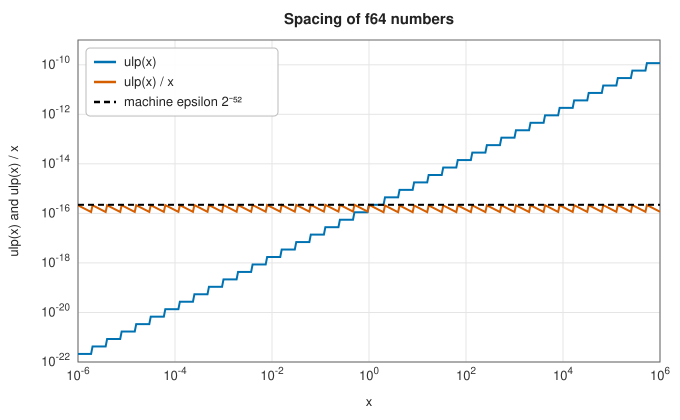

# Shared types, constants and utilities

<div class="entry-summary">

| | |
|---|---|
| **Problem** | Give every crate a common error type, numeric traits, aliases and physical and mathematical constants, and provide small helpers: floating-point spacing, unit conversion and plots drawn in a terminal |
| **Devised by** | CODATA Task Group on Fundamental Constants (2022 adjustment); IEEE 754 (1985), floating-point arithmetic; the Unicode Braille Patterns block (1999), terminal plots |
| **Accuracy** | 88 constants checked: mathematical ones to within $3 \times 10^{-16}$ of mpmath; physical ones within CODATA's uncertainties; unit factors exact or to double precision (tables below) |
| **Cost** | Constants are compile-time values; conversions and spacing helpers $O(1)$; a plot $O(\text{points} + \text{cells})$ |
| **API** | [`ErrorsJSL`](../../api/lib_jsl_core/types/enum.ErrorsJSL.html), [`IsLinearOperatable`](../../api/lib_jsl_core/traits/trait.IsLinearOperatable.html), [`IsAnalytic`](../../api/lib_jsl_core/traits/trait.IsAnalytic.html), [`constants`](../../api/lib_jsl_core/constants/index.html) (`math`, `physics`, `em`, `dsp`, `ml`, `units`), [`ulp`](../../api/lib_jsl_utils/machine_epsilon/fn.ulp.html), [`ulps_between`](../../api/lib_jsl_utils/machine_epsilon/fn.ulps_between.html), [`approx_eq_ulps`](../../api/lib_jsl_utils/machine_epsilon/fn.approx_eq_ulps.html), [`machine_epsilon`](../../api/lib_jsl_utils/machine_epsilon/fn.machine_epsilon.html), [`unit_conversion`](../../api/lib_jsl_utils/unit_conversion/fn.unit_conversion.html), [`render_terminal_plot`](../../api/lib_jsl_utils/terminal_plot/fn.render_terminal_plot.html), [`render_polar_plot`](../../api/lib_jsl_utils/terminal_plot/fn.render_polar_plot.html) |

</div>

## Overview

Two crates hold what the rest of the library shares. `lib_jsl_core` defines the error enum every fallible function returns, the numeric traits that let routines work on real and complex numbers alike, array aliases, and about three hundred named constants: mathematical, physical (CODATA 2022), electromagnetic, signal-processing, machine-learning and unit-conversion values. `lib_jsl_utils` adds small tools:
- the spacing of floating-point numbers, for setting tolerances and comparing results;
- conversion between units of measure, refusing mixed dimensions;
- line and polar plots drawn with Braille characters, for quick looks at data in a terminal.

## History

Physical constants are adjusted every four years by CODATA's Task Group on Fundamental Constants, which fits all relevant measurements together. Since the 2019 redefinition of the SI, the speed of light, Planck's constant, the elementary charge, Boltzmann's constant and Avogadro's number are exact by definition. Others, such as the gravitational constant and the electron mass, are measured, with stated uncertainties. IEEE 754 (1985), led by William Kahan, standardised binary floating point, including the machine epsilon and the "unit in the last place" used to judge accuracy. Unit-conversion tables go back to the 1959 international yard and pound agreement, which fixed the inch at exactly 25.4 mm. Text plots are as old as line printers. Using the 2×4-dot Braille cells added to Unicode in 1999 gives eight sub-pixels per character, the trick behind modern terminal plotting tools.

## The idea

### Errors and numeric traits

Every fallible function in the workspace returns `Result<T, ErrorsJSL>`. The variants say what went wrong: input out of range, mismatched array sizes, a runtime failure (such as a negative cycle or a singular matrix), a misconfiguration or a missing feature. Each carries a short message.

```rust,ignore
{{#include ../../../crates/core/src/types.rs:errors}}
```

Generic numerical code is written against two traits. [`IsLinearOperatable`](../../api/lib_jsl_core/traits/trait.IsLinearOperatable.html) bundles the arithmetic operators. [`IsAnalytic`](../../api/lib_jsl_core/traits/trait.IsAnalytic.html) adds conjugation, exponentials, powers, magnitude and phase. Both are implemented for `f64` and `Complex<f64>`, so one FFT or filter routine serves real and complex data.

### Constants

The constants are grouped by field. Physical ones follow CODATA 2022. Exact ones are written exactly, and derived ones (the reduced Planck constant, the gas constant, the Bohr radius) are computed at compile time from their definitions, so the set is self-consistent. The book's generator checks the mathematical constants against 40-digit mpmath values, and the physical and unit constants against SciPy's CODATA 2022 tables:

<p class="caption" id="tab-26-1"><strong>Table 26.1.</strong> Physical constants against their reference values.</p>

{{#include ../generated/foundations/constants.md}}

The physical differences are those between constants derived from the exact definitions and CODATA's separately adjusted values, well inside CODATA's uncertainties (the Bohr radius, for example, is known to $1.6 \times 10^{-10}$).

### Machine epsilon and ULPs

A double-precision number has a 53-bit significand. Its neighbours are therefore $\operatorname{ulp}(x) = 2^{e - 52}$ apart, where $2^e \le |x| < 2^{e+1}$: the **unit in the last place**. The relative spacing $\operatorname{ulp}(x)/x$ lies between $2^{-53}$ and $2^{-52}$, the **machine epsilon**, whatever the magnitude:



<p class="caption" id="fig-26-1"><strong>Figure 26.1.</strong> ULP.</p>

{{#include ../generated/foundations/epsilon.md}}

Comparing results by the number of representable numbers between them, rather than by a fixed tolerance, adapts to their magnitude. Mapping the bit patterns of IEEE doubles onto a line of integers makes that count a subtraction:

```rust,ignore
{{#include ../../../crates/utils/src/machine_epsilon.rs:ulps}}
```

### Unit conversion

Each unit has a dimension, a scale to its SI base unit and, for temperatures, an offset. Converting goes through the base unit, $v_{\text{to}} = (v\, s_{\text{from}} + o_{\text{from}} - o_{\text{to}}) / s_{\text{to}}$, and units of different dimensions are refused. Symbols are matched exactly first and then, if that is unambiguous, ignoring case. Ignoring case blindly would make `mW` a megawatt and `kb` a kilobyte, so ambiguous spellings such as `mw` are refused.

<p class="caption" id="tab-26-2"><strong>Table 26.2.</strong> Unit conversions against exact values.</p>

{{#include ../generated/foundations/units.md}}

### Terminal plots

Each character cell of a Braille plot holds a 2×4 grid of dots, so a 60×16-character plot has 120×64 addressable points. Curves are drawn by joining successive points with line segments in dot space. Axes carry minimum, middle and maximum labels, and several series are told apart by a legend and, optionally, ANSI colours. The polar version draws antenna patterns in dB with rings every few dB.

## Algorithm

**The ULP of $x$**: take the bit pattern of $|x|$ as an integer, add 1 to obtain the next
representable number, convert back, and subtract $|x|$.

**The distance in ULPs between two numbers.** The bit patterns of positive doubles, read as
integers, increase with the numbers themselves, but those of negative doubles run the other
way, because the sign is a separate bit.

1. Read each number's bits as a signed 64-bit integer.
2. If the integer is negative, replace it by the most negative integer minus itself. The
   integers now increase with the numbers across the whole range, with $-0$ and $+0$ mapped to
   the same value.
3. Return the absolute difference of the two integers: the number of representable numbers
   between the two.

**Unit conversion** of a value:

1. look up both unit symbols, first exactly, then ignoring case if that gives a single match;
2. check that the two units measure the same dimension;
3. convert to the base unit, $v\,s_{\text{from}} + o_{\text{from}}$, and from it to the target,
   subtracting $o_{\text{to}}$ and dividing by $s_{\text{to}}$.

**Braille plot**: each character cell of the terminal holds a $2 \times 4$ grid of dots.

1. Scale the data to dot coordinates, for a canvas of twice the width and four times the
   height in characters.
2. Draw each line segment by setting the dots along it.
3. For each character cell, collect its eight dots into the bit pattern that selects the
   corresponding Braille character.
4. Add the axes, tick labels and legend as ordinary text.

## Implementation

- Constants are `f64` throughout, with SI units unless the name says otherwise (`_DB`, `_HZ`, …); the constants module uses only `core`, so it also suits `no_std` code.
- `ErrorsJSL` carries `&'static str` messages, so errors are cheap and allocation-free.

## In practice

```rust,ignore
{{#include ../../../crates/utils/examples/utils_tour.rs}}
```

```text
wavelength of 2.4 GHz: 0.1249 m
free-space impedance: 376.730313 ohm, Euler's gamma 0.5772156649015329
ulp(1) = 2.220446049250313e-16, ulp(1e6) = 1.1641532182693481e-10
0.1 + 0.2 is Some(1) representable steps from 0.3; equal within 1 ulp: true
55 mph = 88.51 km/h; 20 C = 68.0 F
25 mW = 13.98 dBm; converting kg to m is refused: true
                        damped oscillation                         
        1 │⢹⠲⢄⡀                                                    
          │ ⡇ ⠈⠑⠲⢤⣀⡀                                               
          │ ⢸      ⡏⢳⠲⠤⣄⣀⡀                                         
          │ ⢸     ⡸ ⠈⡆   ⠉⠉⢲⠖⣦⠤⢤⣀⣀⡀                                
          │  ⡇    ⡇  ⢸    ⢀⠎ ⠈⡆   ⠉⢉⡝⠛⢶⠒⠒⠢⠤⠤⠤⣤⣄⣀⣀⣀⣀⣀⣀⡀             
   0.1041 │  ⢇   ⢸   ⠈⡆   ⡸   ⠘⡄  ⢀⡎   ⢣⡀  ⣠⠎  ⠙⢦⡀ ⢀⡴⠛⠉⠉⠛⢭⣉⣉⣩⠽⠛⠛⠒⠲⠶
          │  ⢸   ⡸    ⢱  ⢠⠃    ⢱⡀⢀⡞     ⠑⠦⠞⠁     ⠉⠉⠉               
          │  ⠈⡆ ⢀⠇    ⠈⣆⢀⡎      ⠉⠉                                 
          │   ⢇ ⢸      ⠈⠋                                          
  -0.7919 │   ⠘⣤⠃                                                  
          └────────────────────────────────────────────────────────
           0                        9.975                     19.95
          1 signal
          2 envelope
```

**Strengths**

- One error type and one set of numeric traits across the workspace.
- Constants checked against independent references, with exact values exact.
- Unit conversion that refuses dimension errors and ambiguous prefixes.

**Weaknesses**

- Unit conversion has a fixed table: no compound units (such as N·m) and no SI prefixes on arbitrary units.
- Error messages are fixed strings, without the values that caused them.

## Exercises

1. Show that $\operatorname{ulp}(x)/x$ lies in $(2^{-53}, 2^{-52}]$ for normal doubles, and explain the sawtooth in the figure.
2. Show that $0.1 + 0.2 \ne 0.3$ in double precision, and that they differ by one ulp.
3. Derive the Bohr radius $a_0 = \hbar/(m_e c \alpha)$ from the exact SI constants and $\alpha$, and estimate its uncertainty from that of $\alpha$.
4. Explain why temperature conversion needs an offset, and why converting temperature *differences* must not use it.
5. Count the dots in a Braille cell and design the bit layout for a 2×4 grid.

<details>
<summary>Hints and answers</summary>

1. $\operatorname{ulp}(x) = 2^{e - 52}$ for $2^e \le |x| < 2^{e+1}$, so $\operatorname{ulp}(x)/x \in (2^{-53}, 2^{-52}]$; the ratio is largest just above each power of two and falls to half that just below the next, a sawtooth.
2. $0.1 + 0.2 = 0.30000000000000004$ in double precision, which differs from $0.3$ (stored as $0.299999999999999989\ldots$) by $5.55\times10^{-17}$, one ulp at that magnitude.
3. $a_0 = \hbar/(m_ec\alpha)$; its relative uncertainty combines those of $m_e$ and $\alpha$ (the SI constants $\hbar$ and $c$ are exact), and is dominated by $\alpha$, about $1.6\times10^{-10}$.
4. Celsius to kelvin has an offset, because the scales have different zero points; a temperature difference of 1 °C equals 1 K, with no offset, since the offset cancels in a difference.
5. A Braille cell has 6 or 8 dots: the Unicode block uses 8, with dot 1–8 mapped to bits 0–7 (offset $0\mathrm{x}2800$).

</details>

## Further reading

- E. Tiesinga, P. J. Mohr, D. B. Newell and B. N. Taylor, "CODATA recommended values of the fundamental physical constants: 2018", *Reviews of Modern Physics* 93 (2021) 025010; and the 2022 adjustment at physics.nist.gov/constants.
- D. Goldberg, "What every computer scientist should know about floating-point arithmetic", *ACM Computing Surveys* 23 (1991) 5–48.
- *IEEE Standard for Floating-Point Arithmetic*, IEEE 754-2019.
- A. Thompson and B. N. Taylor, *Guide for the Use of the International System of Units (SI)*, NIST Special Publication 811, 2008.
