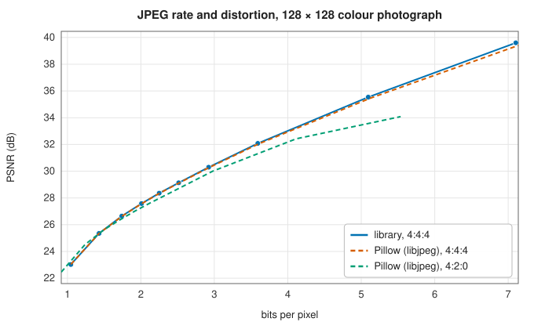

# Image files: PNG, JPEG and Netpbm

<div class="entry-summary">

| | |
|---|---|
| **Problem** | Store raster images losslessly (PNG, with its DEFLATE compression, and the plain Netpbm formats) and compactly with controlled loss (baseline JPEG) |
| **Devised by** | Thomas Boutell and the PNG group (1996); Phil Katz (1993), DEFLATE; Jef Poskanzer (1988), Netpbm; the Joint Photographic Experts Group (1992), JPEG; Nasir Ahmed (1974), the DCT |
| **Accuracy** | Every PNG and Netpbm variant written by Pillow decodes identically, and Pillow reads the library's files identically; JPEG quality matches Pillow's within 0.1 dB at the same size (tables below) |
| **Cost** | $O(\text{pixels})$ for each; the DEFLATE encoder's hash-chain search grows with the compression level |
| **API** | [`png_decode`](../../api/lib_jsl_file_io/png/fn.png_decode.html), [`png_encode`](../../api/lib_jsl_file_io/png/fn.png_encode.html), [`RasterImage`](../../api/lib_jsl_file_io/png/struct.RasterImage.html), [`read_png_file`](../../api/lib_jsl_file_io/png/fn.read_png_file.html), [`write_png_file`](../../api/lib_jsl_file_io/png/fn.write_png_file.html), [`ppm_decode`](../../api/lib_jsl_file_io/ppm/fn.ppm_decode.html), [`ppm_encode`](../../api/lib_jsl_file_io/ppm/fn.ppm_encode.html), [`jpeg_encode`](../../api/lib_jsl_file_io/jpeg/fn.jpeg_encode.html), [`jpeg_decode`](../../api/lib_jsl_file_io/jpeg/fn.jpeg_decode.html), [`JpegImage`](../../api/lib_jsl_file_io/jpeg/struct.JpegImage.html), [`read_jpeg_file`](../../api/lib_jsl_file_io/jpeg_files/fn.read_jpeg_file.html), [`write_jpeg_file`](../../api/lib_jsl_file_io/jpeg_files/fn.write_jpeg_file.html), [`zlib_compress`](../../api/lib_jsl_file_io/deflate/fn.zlib_compress.html), [`zlib_decompress`](../../api/lib_jsl_file_io/deflate/fn.zlib_decompress.html), [`inflate`](../../api/lib_jsl_file_io/deflate/fn.inflate.html), [`deflate`](../../api/lib_jsl_file_io/deflate/fn.deflate.html) |

</div>

## Overview

Image files trade size against fidelity in three ways.
- **Netpbm** files (PBM, PGM, PPM) are a text header and the raw samples. They are trivial to read and write, and large.
- **PNG** is lossless. Each row is first transformed by a **filter** that predicts each byte from its neighbours, which turns smooth images into small numbers, and the result is compressed with **DEFLATE**, the algorithm of zip and gzip.
- **JPEG** is lossy. It transforms 8×8 blocks with the discrete cosine transform, quantizes the coefficients (coarsely at high frequencies, where the eye is least sensitive), and entropy-codes the result. It typically stores a photograph in a tenth of the raw size with little visible change.

The library reads and writes all three. The [image-processing chapter](../image/index.md) uses its PNG writer for every figure with pictures in it.

## History

Jef Poskanzer created the portable bitmap formats in the late 1980s as a lowest common denominator for converting between image formats. PNG was designed in 1995, after Unisys began enforcing its patent on the LZW compression in GIF. Thomas Boutell's first draft became a W3C recommendation in 1996, built on Phil Katz's patent-free DEFLATE (1993), which pairs Lempel–Ziv matching (1977) with Huffman coding (1952). JPEG came from the Joint Photographic Experts Group, standardised in 1992, building on Nasir Ahmed's discrete cosine transform (1974). Its baseline profile, sequential 8-bit Huffman-coded DCT, is still the most used image format in the world.

## The idea

### PNG and DEFLATE

A PNG file is a signature and a series of **chunks** (`IHDR` for the header, `PLTE` for a palette, `IDAT` for the compressed data, `IEND`), each with a CRC-32 checksum. Before compression, each row is filtered with one of five predictors. A byte is coded as its difference from the byte to the left ($a$), above ($b$), their average, nothing, or **Paeth's** predictor: whichever of $a$, $b$ and the upper-left byte $c$ is closest to $a + b - c$. The encoder picks, for each row, the filter whose output has the smallest sum of absolute values, the heuristic recommended by the standard. Decoding reverses the filters:

```rust,ignore
{{#include ../../../crates/file_io/src/png.rs:unfilter}}
```

The decoder handles every colour type (greyscale, RGB, palette, each with or without alpha) at every bit depth, palette transparency and Adam7 interlacing. Low bit depths are scaled to 8 bits, and 16-bit images stay 16-bit.

DEFLATE replaces repeated strings by (length, distance) references to earlier text, up to 32 KiB back. It then codes literals, lengths and distances with Huffman codes. The library's encoder finds matches with **hash chains**: each position is filed under a hash of its next three bytes, so earlier occurrences of the same three bytes are linked in a list, searched further at higher levels. It writes them with DEFLATE's fixed Huffman code, and falls back to stored blocks when compression would expand the data. Writing this chapter added that fallback; before it, random data grew by 6%. The decoder handles all three block types, including dynamic Huffman codes.

```rust,ignore
{{#include ../../../crates/file_io/src/deflate.rs:lz77}}
```

{{#include ../generated/foundations/deflate.md}}

zlib does 7–13% better on compressible data because it builds a Huffman code for each block from that block's symbol frequencies, and defers a match by one byte when the next position has a longer one ("lazy matching"). The library's fixed code is simpler, and all its output is valid zlib.

### Baseline JPEG

1. Convert RGB to $Y C_b C_r$: brightness and two colour differences.
2. Cut each component into 8×8 blocks and take the two-dimensional DCT of each, which concentrates a smooth block's energy in a few low-frequency coefficients.
3. Divide each coefficient by an entry of a **quantization table** and round. Higher frequencies get larger divisors, and the tables are scaled by the quality setting.
4. Code the DC coefficient as its difference from the previous block's. Read the AC coefficients in zig-zag order, from low to high frequency, and code them as (run of zeros, value) pairs.
5. Huffman-code everything with the standard tables of the JPEG specification's Annex K.

```rust,ignore
{{#include ../../../crates/file_io/src/jpeg.rs:dct}}
```

The encoder writes 4:4:4 (no chroma subsampling) with the Annex K tables scaled by the IJG quality formula. That is libjpeg's convention too, so the library and Pillow at the same quality make files of almost the same size and quality:



{{#include ../generated/foundations/jpeg_rate.md}}

Chroma subsampling (4:2:0, Pillow's default) stores colour at half resolution. At the same quality setting it saves 13–22% of the bytes here. PSNR, which weighs colour errors like brightness errors, rates it no better at equal size; its advantage is perceptual, because the eye resolves colour less finely than brightness. The library's decoder accepts any subsampling, custom tables and restart intervals. It upsamples chroma by replication, where libjpeg interpolates, which costs it about 0.6 dB on subsampled files. Progressive, arithmetic-coded, 12-bit and multi-scan files are refused with an error.

### Netpbm

A Netpbm header is a magic number (`P1` to `P6`), the width, height and (except for bitmaps) the maximum value, separated by whitespace, with `#` comments allowed. The samples follow as ASCII numbers (`P1`–`P3`) or raw bytes (`P4`–`P6`, 16-bit big-endian when the maximum exceeds 255). Bitmaps store 1 for black, and are read as 8-bit greyscale with black 0 and white 255.

### Reading and writing other programs' files

Files written by Python's libraries, read by this one:

{{#include ../generated/foundations/reading_images.md}}

Files written by this library, read by Python's:

{{#include ../generated/foundations/interop_images.md}}

Writing this chapter fixed a robustness problem in all three image decoders. Fuzz testing found no panics in about 36 000 truncated or corrupted files, but a header claiming an enormous image made each allocate before checking the data. A 24-byte Netpbm file asked for 320 GB and aborted the process. Each decoder now checks the claim against the data first.

## Algorithm

1. **PNG decode**: verify chunk CRCs; concatenate `IDAT`; inflate; check the length; unfilter each pass's rows; unpack bit depths; expand palettes.
2. **PNG encode**: per row, try all five filters and keep the smallest sum; zlib-compress; write `IHDR`, `IDAT`, `IEND`.
3. **JPEG encode**: colour transform; DCT; quantize; zig-zag; DC differences and AC run-lengths; Huffman code with byte stuffing.
4. **JPEG decode**: parse markers; check the frame against the scan size; Huffman-decode each MCU; dequantize; inverse DCT; upsample; convert to RGB.

## Implementation

- [`RasterImage`](../../api/lib_jsl_file_io/png/struct.RasterImage.html) holds interleaved `u16` samples with 1 to 4 channels at 8 or 16 bits, shared by PNG and Netpbm; [`JpegImage`](../../api/lib_jsl_file_io/jpeg/struct.JpegImage.html) holds 8-bit greyscale or RGB.
- `png_encode` takes a zlib level 0 to 9; `jpeg_encode` a quality 1 to 100.

## In practice

```rust,ignore
{{#include ../../../crates/file_io/examples/file_io_images.rs}}
```

```text
PNG: 269 bytes for 9216 raw, decodes identically: true
PNG file round trip identical: true
PPM: 9229 bytes, header "P6\n64 48\n255\n", identical: true
JPEG quality 25: 1113 bytes, PSNR 20.6 dB
JPEG quality 75: 2091 bytes, PSNR 28.9 dB
JPEG quality 95: 4404 bytes, PSNR 39.2 dB
```

The test card's ramps and stripes are almost perfectly predictable after filtering, so PNG stores 9216 bytes of pixels in 269.

**Strengths**

- Complete PNG decoding, Netpbm in all six forms, and baseline JPEG equal to libjpeg's at the same quality.
- Robust decoders: no panics on damaged files, and no huge allocations from forged headers.

**Weaknesses**

- The DEFLATE encoder uses only the fixed Huffman code and greedy matching, so PNG files are 5–10% larger than zlib's.
- No progressive JPEG, no chroma subsampling when encoding, and no metadata (EXIF, colour profiles, text chunks) beyond what decoding needs.

## Exercises

1. Show that the Paeth predictor gives exact predictions on a linear ramp in either direction.
2. Explain why PNG filters work on bytes rather than on pixel values, and what `bpp` means for 16-bit or sub-byte images.
3. Show that the 8×8 DCT is orthogonal, and that quantization error in the coefficients equals the pixel error in the mean-square sense.
4. Show that the IJG quality scaling halves the table entries going from quality 50 to 75.
5. Design a DEFLATE input on which lazy matching beats greedy matching.

## Further reading

- *Portable Network Graphics (PNG) Specification*, 3rd ed., W3C Recommendation, 2025; and RFC 1950–1951 for zlib and DEFLATE.
- G. K. Wallace, "The JPEG still picture compression standard", *Communications of the ACM* 34 (1991) 30–44.
- W. B. Pennebaker and J. L. Mitchell, *JPEG: Still Image Data Compression Standard*, Van Nostrand Reinhold, 1993.
- N. Ahmed, T. Natarajan and K. R. Rao, "Discrete cosine transform", *IEEE Transactions on Computers* C-23 (1974) 90–93.
