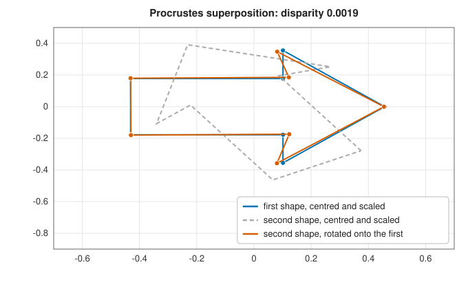

# Rotation fitting, Procrustes analysis and Hausdorff distance

<div class="entry-summary">

| | |
|---|---|
| **Problem** | Find the rotation that best maps one set of vectors onto another; average rotations; compare shapes up to position, size and orientation; interpolate on a sphere; measure how far apart two point sets are; and search point clouds for close pairs, including in periodic boxes |
| **Devised by** | Grace Wahba (1965), the attitude problem; Wolfgang Kabsch (1976); F. Landis Markley et al. (2007), averaging quaternions; John Gower (1975), Procrustes analysis; Ken Shoemake (1985, 1992), slerp and uniform random rotations; Felix Hausdorff (1914); Abdel Aziz Taha and Allan Hanbury (2015), the early-break algorithm |
| **Accuracy** | To rounding; the same results as `scipy.spatial` |
| **Cost** | Alignment: $O(N)$ plus a 3 × 3 SVD; mean: $O(N)$ plus a 4 × 4 eigenproblem; Procrustes: $O(md^2 + d^3)$; Hausdorff: $O(mn)$ worst case, typically near $O(m + n)$; pair search: $O(n\log n + \text{pairs})$ |
| **Read first** | [Rotations, Euler angles and quaternions](rotations.md), [Spatial trees](spatial-trees.md) |
| **API** | [`align_vectors`](../../api/lib_jsl_geometry/algorithms/alignment/fn.align_vectors.html), [`rotation_mean`](../../api/lib_jsl_geometry/algorithms/alignment/fn.rotation_mean.html), [`procrustes`](../../api/lib_jsl_geometry/algorithms/alignment/fn.procrustes.html), [`orthogonal_procrustes`](../../api/lib_jsl_geometry/algorithms/alignment/fn.orthogonal_procrustes.html), [`geometric_slerp`](../../api/lib_jsl_geometry/algorithms/alignment/fn.geometric_slerp.html); [`Rotation3`](../../api/lib_jsl_geometry/algorithms/rotations/struct.Rotation3.html) (`from_rotvec`, `as_rotvec`, `from_mrp`, `as_mrp`, `random`); [`directed_hausdorff`](../../api/lib_jsl_geometry/algorithms/hausdorff/fn.directed_hausdorff.html); [`KdTree::query_pairs`](../../api/lib_jsl_geometry/algorithms/kd_trees/struct.KdTree.html), [`PeriodicKdTree`](../../api/lib_jsl_geometry/algorithms/kd_trees/struct.PeriodicKdTree.html) |

</div>

## Overview

This entry fills the remaining gaps between the geometry chapter and `scipy.spatial`:

- **Rotation fitting** (`Rotation.align_vectors`). Given vectors measured in two frames, such as star directions seen by a spacecraft and catalogued, or atom positions in two molecules, find the rotation between the frames. This is **Wahba's problem**, solved by **Kabsch's algorithm**.
- **Averaging rotations** (`Rotation.mean`), for example to fuse several attitude estimates.
- **Rotation representations**: rotation vectors and modified Rodrigues parameters, and uniformly distributed **random rotations**.
- **Procrustes analysis** (`procrustes`, `orthogonal_procrustes`), which compares two shapes after removing translation, scale and rotation. It is the basis of shape statistics in biology and of point-set registration.
- **Geometric slerp**: points along a great circle of a sphere in any dimension.
- **The Hausdorff distance**, the largest distance from a point of one set to the nearest point of the other, a standard measure for comparing segmentations and curves.
- **k-d tree extras**: all pairs within a distance (`query_pairs`), pair counts between two sets (`count_neighbors`, the basis of correlation functions in cosmology), and **periodic boxes**, where distances wrap round as in simulations with periodic boundary conditions.

## History

Grace Wahba (1965) posed the problem of finding a spacecraft's attitude from vector observations, and Paul Davenport soon solved it with quaternions (the q-method). Wolfgang Kabsch (1976) gave the SVD solution for superimposing molecular structures, now standard in structural biology. F. Landis Markley, Yang Cheng, John Crassidis and Yaakov Oshman (2007) showed that the average of rotations is the leading eigenvector of a quadratic form in their quaternions.

John Gower (1975) introduced generalised Procrustes analysis for comparing configurations in statistics. Ken Shoemake (1985) introduced slerp to computer animation, and later (1992) gave the method for uniform random rotations used here. Felix Hausdorff (1914) defined the distance between sets in his *Grundzüge der Mengenlehre*. Abdel Aziz Taha and Allan Hanbury (2015) gave the early-break algorithm that SciPy uses.

## The idea

### Wahba's problem and Kabsch's algorithm

Minimising $\sum w_i\|\mathbf a_i - C\mathbf b_i\|^2$ over rotations $C$ is the same as maximising $\operatorname{tr}(C^\top B)$ with $B = \sum w_i\mathbf a_i\mathbf b_i^\top$. If $B = USV^\top$, the maximum over orthogonal matrices is at $C = UV^\top$. That matrix may be a reflection. Flipping the sign of the last singular direction,
$$C = U\operatorname{diag}(1, 1, \det UV^\top)V^\top,$$
gives the best proper rotation. The minimum is $\sum w_i(\|\mathbf a_i\|^2 + \|\mathbf b_i\|^2) - 2(s_1 + s_2 \pm s_3)$, whose square root is the reported `rssd`.

With a single pair, or one pair weighted infinitely (the **primary**), the primary is aligned exactly by the smallest rotation. The one remaining degree of freedom, a rotation by $\varphi$ about $\hat{\mathbf a}_1$, is chosen to best align the others. Its optimum is an `atan2` of two weighted sums.

### The mean rotation

The chordal distance between rotations is $\|R - R_i\|_F^2 = 8(1 - (\mathbf q\cdot\mathbf q_i)^2)$ for unit quaternions. Minimising the weighted sum of these distances therefore maximises $\mathbf q^\top K\mathbf q$ with $K = \sum w_i\mathbf q_i\mathbf q_i^\top$. The mean is the leading eigenvector of this symmetric 4 × 4 matrix. Because $\mathbf q_i$ enters squared, the sign ambiguity $\mathbf q \sim -\mathbf q$ does not matter.

### Representations and random rotations

- **Rotation vector:** a rotation by $\theta$ about the unit axis $\mathbf n$ is $\theta\mathbf n$. Its quaternion is $(\cos\frac\theta2, \frac{\sin(\theta/2)}\theta\,\theta\mathbf n)$, and the ratio is evaluated by its series near $\theta = 0$.
- **Modified Rodrigues parameters:** $\mathbf n\tan\frac\theta4$, a three-parameter form that is non-singular for every $\theta < 2\pi$.
- **Random rotations:** Shoemake's construction maps three uniform numbers to a uniformly distributed unit quaternion, through a uniformly chosen point on $S^3$ written in two orthogonal planes.

### Procrustes analysis

Both configurations are centred and scaled to unit Frobenius norm. The orthogonal matrix minimising $\|X_1 - X_2R\|_F$ is $R = UV^\top$ from the SVD $X_2^\top X_1 = USV^\top$. Unlike Kabsch, reflections are allowed here, as in SciPy. The best scale is $\sum s_i$. The **disparity** is what remains, $\|X_1 - sX_2R\|_F^2 = 1 - (\sum s_i)^2$: 0 for identical shapes and at most 1.

### The Hausdorff distance

$h(U, V) = \max_{\mathbf u\in U}\min_{\mathbf v\in V}\|\mathbf u - \mathbf v\|$, and the Hausdorff distance is $\max(h(U, V), h(V, U))$. Computed directly it costs $mn$ distances. Taha and Hanbury's observation is that the inner minimum for $\mathbf u$ only matters if it exceeds the current maximum. The inner loop can therefore stop at the first $\mathbf v$ closer than that maximum. For similar sets this happens almost at once, and the cost is close to linear.

### Periodic boxes

On a torus $[0, L)^D$, the distance between two points is the distance to the nearest periodic image. A query point within the box has its nearest image among its $3^D$ translates by $\{-L, 0, L\}$ in each coordinate. Querying an ordinary k-d tree with each translate and merging the results gives the periodic answer.

## Implementation

```rust,ignore
{{#include ../../../crates/geometry/src/algorithms/alignment.rs:align_vectors}}
```

```rust,ignore
{{#include ../../../crates/geometry/src/algorithms/alignment.rs:procrustes}}
```

```rust,ignore
{{#include ../../../crates/geometry/src/algorithms/hausdorff.rs:directed_hausdorff}}
```

- The SVDs are of 3 × 3, 4 × 4 or $d \times d$ matrices, computed by one-sided Jacobi rotations inside the geometry crate, so it does not depend on the linear-algebra crate.
- `Rotation3::random` takes a source of uniform numbers, so any generator can be used; the rotations are not SciPy's for the same seed.
- SciPy shuffles the points in `directed_hausdorff` to make early breaks likely. The library keeps their order, which gives the same distance and, without ties, the same pair.
- `align_vectors` does not return SciPy's sensitivity matrix.

## In practice

The references are from SciPy 1.17.1, written by `book/generator/data/make_geograph_refs.py`. Rotations are compared by the angle of the rotation between them:

<p class="caption" id="tab-24-9"><strong>Table 24.9.</strong> Rotation fitting, representations, Procrustes analysis, slerp, Hausdorff distance and k-d tree extras against `scipy.spatial`.</p>

{{#include ../generated/geometry/geograph_geometry.md}}

Every result agrees with SciPy's to rounding. The Hausdorff distance picks the same pair of points, the pair searches find the same pairs and counts, and the periodic queries find the same neighbours.



<p class="caption" id="fig-24-15"><strong>Figure 24.15.</strong> Procrustes superposition of an outline and a copy that was rotated by 120°, scaled by 1.7, moved and perturbed. After centring and scaling (grey), the rotation found from the SVD brings the copy onto the original. The disparity, 0.0019, measures only the perturbation.</p>

**Strengths**

- The SVD solution is optimal and needs no starting guess, unlike iterative registration.
- The mean rotation is unaffected by the sign ambiguity of quaternions, and is exact for the chordal metric.
- The Hausdorff computation is near-linear for similar sets.

**Weaknesses**

- The chordal mean is not the geodesic (Karcher) mean, though it is close for clustered rotations.
- Periodic queries cost $3^D$ ordinary queries.
- No `HalfspaceIntersection`, `SphericalVoronoi`, or Delaunay triangulations and hulls beyond three dimensions.

## Exercises

1. Why does $C = UV^\top$ maximise $\operatorname{tr}(C^\top B)$ over orthogonal $C$? (Hint: write $\operatorname{tr}(C^\top USV^\top) = \operatorname{tr}(SV^\top C^\top U)$.)
2. Show that $\|R(\mathbf q) - R(\mathbf p)\|_F^2 = 8(1 - (\mathbf q\cdot\mathbf p)^2)$ for unit quaternions.
3. A shape and its mirror image: what is their Procrustes disparity (reflections allowed), and what does `align_vectors` return for them?
4. Give an example of sets with $h(U, V) = 0$ but $h(V, U) > 0$.

<details>
<summary>Hints and answers</summary>

1. $Z = V^\top C^\top U$ is orthogonal, so its diagonal entries are at most 1, and $\operatorname{tr}(SZ) = \sum s_iZ_{ii} \le \sum s_i$, with equality at $Z = I$.
2. Use $\operatorname{tr}(R(\mathbf q)^\top R(\mathbf p)) = 4(\mathbf q\cdot\mathbf p)^2 - 1$ and $\|R\|_F^2 = 3$.
3. The disparity is 0. `align_vectors` returns the best proper rotation, with a positive `rssd`.
4. $U = \{0\}$, $V = \{0, 1\}$: every point of $U$ is in $V$, but $1 \in V$ is at distance 1 from $U$.

</details>

## Further reading

- G. Wahba, "A least squares estimate of satellite attitude", *SIAM Review* 7 (1965) 409.
- W. Kabsch, "A solution for the best rotation to relate two sets of vectors", *Acta Crystallographica A* 32 (1976) 922–923.
- F. L. Markley, Y. Cheng, J. L. Crassidis and Y. Oshman, "Averaging quaternions", *Journal of Guidance, Control, and Dynamics* 30 (2007) 1193–1197.
- J. C. Gower, "Generalized Procrustes analysis", *Psychometrika* 40 (1975) 33–51.
- K. Shoemake, "Uniform random rotations", in *Graphics Gems III*, Academic Press (1992) 124–132.
- A. A. Taha and A. Hanbury, "An efficient algorithm for calculating the exact Hausdorff distance", *IEEE Transactions on Pattern Analysis and Machine Intelligence* 37 (2015) 2153–2163.
