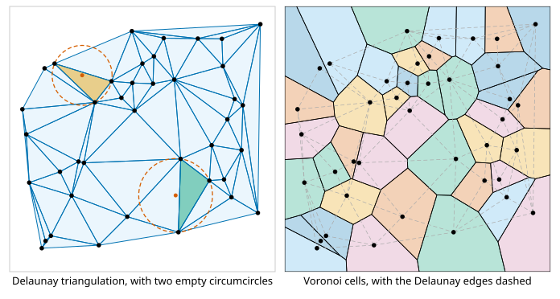
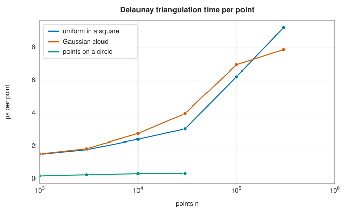

# Delaunay triangulations and Voronoi diagrams

<div class="entry-summary">

| | |
|---|---|
| **Problem** | Join scattered points in the plane into triangles that are as well shaped as possible, and divide the plane into the regions closest to each point |
| **Devised by** | Georgy Voronoy (1908), Boris Delaunay (1934); Charles Lawson (1977), edge flips; Adrian Bowyer and David Watson (1981), incremental insertion |
| **Accuracy** | Exact combinatorics from floating-point predicates with a rounding-error threshold; identical triangles to Qhull on random points, and Voronoi cell areas within $2 \times 10^{-16}$ (see the [chapter overview](index.md#testing-against-scipy-and-shapely)) |
| **Cost** | $O(n \log n)$ in practice for the triangulation; the Voronoi cells $O(n)$ more from it |
| **API** | [`delaunay_triangulation`](../../api/lib_jsl_geometry/algorithms/delaunay_triangulation/fn.delaunay_triangulation.html), [`Triangulation`](../../api/lib_jsl_geometry/algorithms/delaunay_triangulation/struct.Triangulation.html) (`triangles`, `edges`, `locate`, `circumcenter`, `area`, `is_delaunay`), [`voronoi_diagram`](../../api/lib_jsl_geometry/algorithms/voronoi/fn.voronoi_diagram.html), [`VoronoiDiagram`](../../api/lib_jsl_geometry/algorithms/voronoi/struct.VoronoiDiagram.html), [`polygon_signed_area`](../../api/lib_jsl_geometry/algorithms/voronoi/fn.polygon_signed_area.html) |

</div>

## Overview

A **triangulation** of a point set divides its convex hull into triangles whose corners are the points. There are many; the **Delaunay triangulation** is the one in which no point lies inside the circle through any triangle's three corners (its **circumcircle**). Of all triangulations it maximises the smallest angle, so it avoids long thin slivers. That is why it is the standard mesh for interpolating scattered data, for finite elements and for terrain models.

Its dual is the **Voronoi diagram**. The Voronoi cell of a point (a **site**) is the region of the plane closer to it than to any other site. Two sites have neighbouring cells exactly when they are joined by a Delaunay edge, and the cell corners are the triangles' circumcentres. Voronoi cells answer "which is nearest?" for every location at once: nearest hospital, nearest mobile mast, the territory of a crystal grain.

## History

Georgy Voronoy defined the cells in 1908, for quadratic forms in any dimension. René Descartes had drawn similar regions for the vortices of his cosmology in 1644, and John Snow used them in 1854 to tie a cholera outbreak to the Broad Street pump. Boris Delaunay, Voronoy's student, gave the empty-circle triangulation in 1934. Algorithms came with computer graphics and finite elements. Charles Lawson (1977) showed that flipping edges that fail the empty-circle test always reaches the Delaunay triangulation. Adrian Bowyer and David Watson (1981) independently gave incremental insertion with a "cavity" of conflicting triangles. Steven Fortune's sweep-line algorithm (1987) builds the Voronoi diagram directly in $O(n \log n)$.

## The idea

### Delaunay triangulation

A set of points in the plane can be joined into triangles in many ways. The
**Delaunay triangulation** is the one in which no point lies inside the circumcircle of any
triangle (the circle through its three corners). Among all triangulations of the points it
makes the smallest angle as large as possible, so it avoids thin sliver triangles wherever it
can, which is why it is the standard choice for interpolation and for finite-element meshes.

The definition suggests a local test and a local repair. Two triangles $abc$ and $bad$ sharing the edge $ab$ form a quadrilateral. The edge is **legal** if $d$ lies outside the circumcircle of $abc$. If it is illegal, replacing $ab$ by the other diagonal $cd$ (a **flip**) makes both new edges legal and raises the smaller of the two triangles' smallest angles. A triangulation in which every edge is legal is Delaunay. Whether $d$ is inside the circle through $a$, $b$ and $c$ (counter-clockwise) is the sign of one determinant:

$$
\operatorname{incircle}(a, b, c, d) = \begin{vmatrix} a_x - d_x & a_y - d_y & (a_x - d_x)^2 + (a_y - d_y)^2 \\ b_x - d_x & b_y - d_y & (b_x - d_x)^2 + (b_y - d_y)^2 \\ c_x - d_x & c_y - d_y & (c_x - d_x)^2 + (c_y - d_y)^2 \end{vmatrix} > 0.
$$

The library inserts the points in lexicographic order of $(x, y)$. Each new point is then outside everything triangulated so far. It is joined to every hull edge it can see, which adds a fan of triangles, and the edges opposite the new point are checked and flipped until all are legal again. Sorting removes the need to find which triangle contains a point. It also avoids the "super-triangle" around the data that Bowyer–Watson implementations use, whose finite corners can cut off sliver triangles at the hull.



<p class="caption" id="fig-24-3"><strong>Figure 24.3.</strong> Delaunay triangulation and Voronoi diagram.</p>

Both predicates are computed in floating point. When four points are nearly on a circle, or three nearly on a line, the sign can come out wrong, and an algorithm that trusts it can loop or produce overlapping triangles. Here each determinant is compared with the sum of the magnitudes of its terms, which bounds its rounding error. Values below $10^{-12}$ of that bound count as zero: as collinear for the hull, and as cocircular (no flip) for the empty-circle test. Exactly cocircular points, such as a square grid, have several Delaunay triangulations, and the library returns one of them.

A plain Bowyer–Watson insertion with a super-triangle fails both ways: 41 points on a shallow arc gave triangles overlapping to 2.4 times the hull's area, and points close to a line lost the hull's slivers to the super-triangle.

<p class="caption" id="tab-24-2"><strong>Table 24.2.</strong> Columns: 30 000 points, triangles, time.</p>

{{#include ../generated/geometry/delaunay_timing.md}}



<p class="caption" id="fig-24-4"><strong>Figure 24.4.</strong> Delaunay timing.</p>

The time per point grows slowly with $n$, as sorting and hash lookups do. Points on a circle are fast: each is seen from just one hull edge, and no flips are needed.

### Voronoi diagrams

The **Voronoi diagram** of a set of points (sites) divides the plane into cells, one per site:
the cell of a site is the region closer to it than to any other. It is the **dual** of the
Delaunay triangulation: two sites are joined by a Delaunay edge exactly when their cells share
a boundary, and that boundary lies on the perpendicular bisector of the edge.

The library builds each cell directly from the triangulation. Start with the bounding box. For each Delaunay neighbour $t$ of site $s$, keep the half-plane closer to $s$, bounded by the perpendicular bisector of $st$. A cell is the intersection of these half-planes, and only Delaunay neighbours contribute edges, so clipping by them alone gives the exact cell. Unbounded cells, on the hull, are closed off by the box.

## Algorithm

**Delaunay triangulation.**

1. **Prepare.** Discard points with non-finite coordinates and duplicates. Scale the rest
   into the unit square, so that the tolerances of the predicates are relative to the size of
   the data. Sort the points by $x$, breaking ties by $y$.
2. **Start.** Take points from the sorted list for as long as they are collinear with the
   first two; they form a chain. The first point off that line, joined to each segment of the
   chain, gives the first fan of triangles. Their outer edges form the initial convex hull.
3. **Insert** each further point in order. Because of the sorting, it lies outside the
   current hull. Find the hull edges it can "see" (those with the point on their outer side),
   starting the search beside the previously inserted point, which is nearby. Add a triangle
   on each visible edge, and replace those edges in the hull by the two edges from the new
   point to the ends of the visible chain.
4. **Legalise.** Push the outer edge of each new triangle (the edge opposite the new point) on
   a stack. While the stack is not empty: pop an edge; find the vertex opposite it in the
   neighbouring triangle; if that vertex lies inside the circumcircle, and the two triangles
   form a convex quadrilateral, flip the edge and push the two outer edges of the new pair of
   triangles.

Sorting costs $O(n\log n)$, and for points in general position the insertions and flips cost
about the same in total.

**Voronoi diagram.** For each site:

1. start with the bounding box as the cell;
2. for each Delaunay neighbour of the site, cut the cell by the perpendicular bisector of the
   segment joining them, keeping the side that contains the site.

## Implementation

```rust,ignore
{{#include ../../../crates/geometry/src/algorithms/delaunay_triangulation.rs:lawson}}
```

- Triangles are counter-clockwise index triples into the input. `edges` lists each edge once, `locate` finds a triangle containing a point by scanning, and `is_delaunay` checks the empty-circle property against every point, for tests.
- `voronoi_diagram` returns the cells in input order (empty for duplicates), the triangulation and the circumcentres, which are the Voronoi vertices.

## In practice

```rust,ignore
{{#include ../../../crates/geometry/examples/geometry_delaunay.rs}}
```

```text
8 triangles: [[3, 0, 4], [3, 4, 6], [1, 4, 0], [6, 4, 5], [1, 5, 4], [5, 1, 2], [6, 5, 2], [3, 6, 2]]
area 12 (the convex hull's), Delaunay: true
14 edges; the point (3, 0.5) is in triangle Some(4)
cell of [0.0, 0.0]: 5 corners, area 5.074
cell of [4.0, 0.0]: 6 corners, area 5.507
cell of [4.0, 3.0]: 5 corners, area 4.262
cell of [0.0, 3.0]: 5 corners, area 4.723
cell of [1.5, 1.2]: 5 corners, area 4.287
cell of [2.8, 1.9]: 4 corners, area 2.749
cell of [2.0, 2.6]: 5 corners, area 3.397
total 30.000 = the 6 × 5 box
```

The cells tile the box exactly, and the sites near the middle have the smallest cells.

**Strengths**

- Robust on degenerate input: collinear starts, cocircular points, duplicates and thin point sets.
- Voronoi cells as explicit polygons, clipped to a box.

**Weaknesses**

- Two dimensions only, and no constrained edges (forced boundaries) or point removal.
- `locate` scans every triangle; repeated queries should walk from a nearby triangle or use a [spatial tree](spatial-trees.md).

## Exercises

1. Show that flipping an illegal edge increases the smallest of the six angles of the two triangles.
2. Show that the incircle determinant is positive exactly when $d$ is inside the circle through counter-clockwise $a$, $b$, $c$. (Lift the points onto the paraboloid $z = x^2 + y^2$.)
3. Prove that every Delaunay edge has a circle through its endpoints containing no other point, and deduce the Voronoi duality.
4. Use Euler's formula to show that a triangulation of $n$ points with $h$ on the hull has $2n - h - 2$ triangles.
5. Construct a point set where Lawson's flips, started from an arbitrary triangulation, need $\Theta(n^2)$ flips.

## Further reading

- B. Delaunay, "Sur la sphère vide", *Bulletin de l'Académie des Sciences de l'URSS* 6 (1934) 793–800.
- C. L. Lawson, "Software for $C^1$ surface interpolation", in *Mathematical Software III*, Academic Press, 1977, 161–194.
- M. de Berg, O. Cheong, M. van Kreveld and M. Overmars, *Computational Geometry: Algorithms and Applications*, 3rd ed., Springer, 2008, chapters 7 and 9.
- J. R. Shewchuk, "Adaptive precision floating-point arithmetic and fast robust geometric predicates", *Discrete & Computational Geometry* 18 (1997) 305–363.
