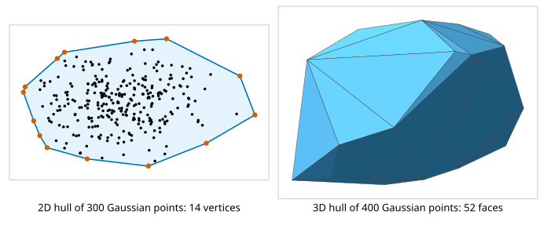
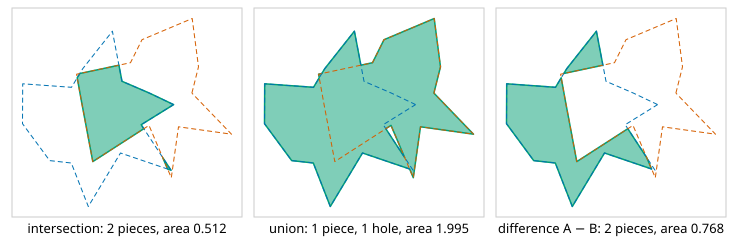

# Convex hulls and polygon booleans

<div class="entry-summary">

| | |
|---|---|
| **Problem** | Find the smallest convex polygon or polyhedron containing a set of points, and combine polygons by intersection, union and difference |
| **Devised by** | Ronald Graham (1972) and Andrew (1979), planar hulls; C. Bradford Barber, David Dobkin and Hannu Huhdanpaa (1996), Quickhull; Günther Greiner and Kai Hormann (1998), polygon clipping |
| **Accuracy** | Hull vertex sets identical to Qhull's, volumes and areas within $10^{-13}$; boolean areas within $10^{-14}$ of Shapely's (see the [chapter overview](index.md#testing-against-scipy-and-shapely)) |
| **Cost** | Planar hull $O(n \log n)$; Quickhull $O(n \log n)$ typical, $O(n^2)$ worst case; booleans $O(nm)$ for polygons of $n$ and $m$ vertices |
| **API** | [`convex_hull_2d`](../../api/lib_jsl_geometry/algorithms/convex_hull/fn.convex_hull_2d.html), [`polygon_area_2d`](../../api/lib_jsl_geometry/algorithms/convex_hull/fn.polygon_area_2d.html), [`convex_polygon_contains_2d`](../../api/lib_jsl_geometry/algorithms/convex_hull/fn.convex_polygon_contains_2d.html), [`convex_hull_3d`](../../api/lib_jsl_geometry/algorithms/convex_hull/fn.convex_hull_3d.html), [`Hull3D`](../../api/lib_jsl_geometry/algorithms/convex_hull/struct.Hull3D.html) (`vertices`, `volume`, `surface_area`, `contains`), [`polygon_boolean`](../../api/lib_jsl_geometry/algorithms/polygon_boolean/fn.polygon_boolean.html), [`BooleanOperation`](../../api/lib_jsl_geometry/algorithms/polygon_boolean/enum.BooleanOperation.html), [`point_in_polygon`](../../api/lib_jsl_geometry/algorithms/polygon_boolean/fn.point_in_polygon.html) |

</div>

## Overview

The **convex hull** of a point set is the smallest convex set containing it: in the plane, the shape a rubber band takes around nails at the points. It gives a fast first test for collision and containment, the extreme points of data, bounding shapes for meshes, and appears inside other algorithms (the Delaunay triangulation is a convex hull one dimension up). In the plane the library uses Andrew's **monotone chain**; in space, **Quickhull**.

**Boolean operations** combine two polygons into their intersection, union or difference. They are the core of computer-aided design, map overlay in geographic information systems, and clipping in graphics. The library uses the **Greiner–Hormann** algorithm, which walks around both outlines and switches from one to the other at each crossing.

## History

Ronald Graham (1972) gave the first $O(n \log n)$ planar hull, sorting points by angle around an interior point, for a Bell Labs problem with thousands of points. A. M. Andrew (1979) simplified it to sorting by $x$ and building the lower and upper chains separately. In three dimensions Franco Preparata and S. J. Hong (1977) gave a divide-and-conquer $O(n \log n)$ algorithm. Barber, Dobkin and Huhdanpaa's Quickhull (1996) is the basis of Qhull, used by SciPy, MATLAB and R. Polygon clipping began with Sutherland and Hodgman (1974) for convex clip windows. Weiler and Atherton (1977) handled general polygons, and Greiner and Hormann (1998) gave the simple linked-list version used here.

## The idea

### The monotone chain

Sort the points by $x$, then $y$. Walk left to right building the **lower chain**. Before adding each point, remove the last chain point while the last two chain points and the new one make a clockwise or straight turn: such a point cannot be on the lower boundary. A right-to-left walk builds the **upper chain** the same way, and together they are the hull, counter-clockwise. The turn test is the sign of the cross product $(b - a) \times (c - a)$. Removing straight turns too leaves points in the middle of hull edges out.

### Quickhull in three dimensions

Start with a tetrahedron of four extreme points. Each face keeps an **outside set**: the remaining points above its plane, each assigned to one face. Points above no face are inside and are discarded. Repeatedly take a face with a non-empty outside set and its farthest point, the **apex**. The apex is certainly a hull vertex. The faces it can see form a connected cap. Their boundary, the **horizon**, is found by a search across shared edges from the starting face. The cap is replaced by a cone of new faces from the horizon to the apex, and the cap's outside points are shared out among the new faces. When no face has outside points, the remaining faces are the hull.



Points far inside are discarded early, so on typical data most of the work is the first few passes. The worst case is every point on the hull, such as points on a sphere, and even that is fast:

{{#include ../generated/geometry/hull_timing.md}}

Inserting points in input order and rebuilding a map of every face edge for each one is slow: 10 000 points on a sphere took 46 s. Quickhull, which takes the farthest point first, is far faster and also keeps points that lie on a face or an edge of the hull from becoming vertices. A $5 \times 5 \times 5$ grid gives its 8 corners, where the naive insertion kept 32.

### The Greiner–Hormann algorithm

1. Find every crossing of an edge of polygon A with an edge of polygon B, and insert it into both vertex lists, linked to its twin.
2. Walking around A, the crossings alternate between **entries** into B and **exits** from it. Whether the first is an entry depends on whether A's first vertex is inside B, decided by the even–odd ray test.
3. Trace the result: start at an unvisited crossing and follow its polygon, forwards from an entry and backwards from an exit, to the next crossing; jump to the twin and continue on the other polygon, until back at the start. That traces the intersection. Swapping the entry and exit labels on both polygons gives the union, and on A alone gives A minus B.

If a vertex lies exactly on the other polygon's boundary, or two edges overlap, the entry/exit labels become ambiguous. The library then moves the clip polygon by a random relative $10^{-9}$ and retries, so results are exact up to that tolerance. If the outlines never cross, the answer follows from whether one contains the other.



Results are counter-clockwise outer boundaries and clockwise holes, so signed areas add up to the true area. A union can enclose a hole, as here.

## Algorithm

**Convex hull in the plane** (monotone chain).

1. Sort the points by $x$, then $y$.
2. **Lower chain.** For each point in order: while the chain has at least two points and the
   last two together with the new point do not make a counter-clockwise turn, remove the last
   point of the chain; then append the new point.
3. **Upper chain.** Do the same through the points in reverse order.
4. Join the two chains, omitting the endpoint each shares with the other.

The sort costs $O(n\log n)$ and the two walks $O(n)$, since each point is appended once and
removed at most once.

**Convex hull in space** (quickhull).

1. **Initial tetrahedron.** Choose four extreme points that are not coplanar.
2. **Outside sets.** Assign each remaining point to one face that it lies above; discard the
   points that lie above no face, which are inside.
3. Take a face with a non-empty outside set, and its farthest point, the apex.
4. **Visible cap.** Starting from that face, search across shared edges for all the faces the
   apex lies above. The edges between a visible and an invisible face form the horizon.
5. **Replace.** Delete the visible faces. Create a new face from each horizon edge to the
   apex. Reassign the outside points of the deleted faces among the new faces, discarding
   those now inside.
6. Repeat from step 3 until no face has outside points.

**Polygon boolean operations** (Greiner-Hormann), on polygons A and B.

1. **Crossings.** Test every edge of A against every edge of B. Insert each crossing point
   into both vertex lists, in order along its edge, and link the two copies.
2. **Labels.** Decide by the even-odd test whether the first vertex of A is inside B. Walking
   round A, label the crossings alternately as entries and exits, starting accordingly. Do the
   same for B with respect to A. Reverse the labels as the operation requires: neither for
   the intersection, both for the union, and those of A alone for A minus B.
3. **Trace.** While an unvisited crossing remains: start a new loop there. Follow the current
   polygon, forwards from an entry and backwards from an exit, adding vertices to the loop,
   until the next crossing; jump to its copy on the other polygon; continue until the loop
   returns to its start.
4. **Orient.** A loop nested inside an odd number of other loops is a hole, and is made
   clockwise; the others are outer boundaries, counter-clockwise.

If no crossings are found, the result follows from whether one polygon contains the other.

## Implementation

```rust,ignore
{{#include ../../../crates/geometry/src/algorithms/convex_hull.rs:quickhull}}
```

- `convex_hull_2d` returns counter-clockwise indices from the lexicographically smallest point, without duplicates or points in the middle of edges.
- `convex_hull_3d` returns `None` for fewer than four points or coplanar input; its faces wind counter-clockwise seen from outside.
- `polygon_boolean` takes simple polygons in either orientation.

## In practice

```rust,ignore
{{#include ../../../crates/geometry/examples/geometry_hulls.rs}}
```

```text
2D hull [0, 2, 4, 6], area 16
3D hull: 12 faces, vertices [0, 1, 2, 3, 4, 5, 6, 7], volume 0.9999999999999999, area 6
contains (0.2, 0.9, 0.5): true
Intersection: 1 piece(s), area 3.5000
Union: 1 piece(s), area 5.0000
Difference: 4 piece(s), area 0.5000
```

The cube's centre and the point in its top face are not hull vertices, and the square minus the diamond leaves four corner triangles.

**Strengths**

- Hulls agreeing with Qhull, and a 3D hull fast even when every point is on it.
- Boolean operations on concave polygons, with several pieces and holes.

**Weaknesses**

- No hulls in more than three dimensions, and no Delaunay triangulation in 3D.
- Booleans take simple polygons only (no self-intersections, no polygons with holes as input), and resolve degeneracies by perturbation rather than exactly.

## Exercises

1. Show that the monotone chain's turn test removes exactly the points that are not lower-hull vertices.
2. Prove that the point farthest above a hull face is a vertex of the final hull.
3. Show that the faces visible from a point outside a convex polyhedron form a connected set bounded by a single cycle of edges.
4. Find a set of $n$ points in the plane on which any comparison-based hull algorithm needs $\Omega(n \log n)$ time. (Reduce sorting to it.)
5. Work out the entry/exit rules for union and difference from those for intersection.

## Further reading

- A. M. Andrew, "Another efficient algorithm for convex hulls in two dimensions", *Information Processing Letters* 9 (1979) 216–219.
- C. B. Barber, D. P. Dobkin and H. Huhdanpaa, "The Quickhull algorithm for convex hulls", *ACM Transactions on Mathematical Software* 22 (1996) 469–483.
- G. Greiner and K. Hormann, "Efficient clipping of arbitrary polygons", *ACM Transactions on Graphics* 17 (1998) 71–83.
- J. O'Rourke, *Computational Geometry in C*, 2nd ed., Cambridge University Press, 1998, chapters 3 and 4.
