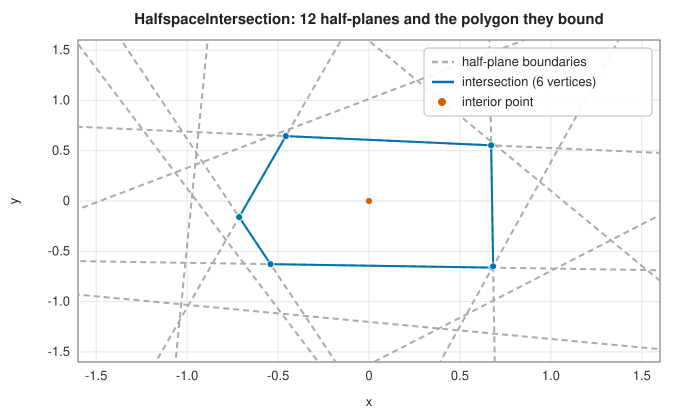

# Geometry in any dimension: hulls, Delaunay, Voronoi and half-spaces

<div class="entry-summary">

| | |
|---|---|
| **Problem** | Compute convex hulls, Delaunay triangulations and Voronoi diagrams of points in any number of dimensions; intersect half-spaces; build Voronoi diagrams on a sphere; and interpolate scattered data linearly in three or more dimensions |
| **Devised by** | Bradford Barber, David Dobkin and Hannu Huhdanpaa (1996), Quickhull and Qhull; Kenneth Brown (1979) and Herbert Edelsbrunner and Raimund Seidel (1986), Delaunay triangulations as lifted hulls; Boris Delaunay (1934); Georgy Voronoi (1908); Robert Renka (1997), spherical Delaunay and Voronoi |
| **Accuracy** | Combinatorially identical to SciPy's (Qhull's) results on points in general position; volumes, areas and vertices to rounding |
| **Cost** | Hulls: about $O(n \log n)$ for $d \le 3$ and $O(n^{\lfloor d/2 \rfloor})$ in the worst case, as Qhull; Delaunay in $d$ dimensions: a hull in $d + 1$ |
| **Read first** | [Convex hulls and polygon booleans](hulls-booleans.md), [Delaunay triangulations and Voronoi diagrams](delaunay-voronoi.md) |
| **API** | [`ConvexHullNd`](../../api/lib_jsl_geometry/algorithms/hull_nd/struct.ConvexHullNd.html), [`DelaunayNd`](../../api/lib_jsl_geometry/algorithms/hull_nd/struct.DelaunayNd.html) (`find_simplex`, `barycentric`), [`VoronoiNd`](../../api/lib_jsl_geometry/algorithms/hull_nd/struct.VoronoiNd.html), [`HalfspaceIntersection`](../../api/lib_jsl_geometry/algorithms/hull_nd/struct.HalfspaceIntersection.html), [`SphericalVoronoi`](../../api/lib_jsl_geometry/algorithms/hull_nd/struct.SphericalVoronoi.html) (`calculate_areas`); [`LinearNdInterpolator`](../../api/lib_jsl_interpolation/nd/linear_nd/struct.LinearNdInterpolator.html) |

</div>

## Overview

The library's earlier geometry routines are specialised to the plane and to space. `scipy.spatial` wraps Qhull, which works in any dimension, and this entry brings the same reach to the library:

- **`ConvexHullNd`**: hulls of points in $\mathbb R^d$ for any $d \ge 2$, with facet hyperplanes, neighbours, volume and boundary area.
- **`DelaunayNd`**: Delaunay triangulations into simplices, with point location (`find_simplex`) and barycentric coordinates.
- **`VoronoiNd`**: Voronoi diagrams as duals of the triangulations.
- **`HalfspaceIntersection`**: the polytope where a set of linear inequalities holds, its vertices and its non-redundant constraints.
- **`SphericalVoronoi`**: Voronoi diagrams of points on a sphere, with region areas.
- **`LinearNdInterpolator`**: SciPy's `LinearNDInterpolator` in three and more dimensions.

## History

Quickhull grew out of the planar "quicksort-like" hull algorithms of the 1970s. Barber, Dobkin and Huhdanpaa (1996) generalised it to any dimension, made it robust to rounding by merging nearly coplanar facets, and released it as Qhull, which MATLAB, R, Octave and SciPy all use. Brown (1979) observed that projecting points onto a paraboloid turns circles into planes, so that Delaunay triangulations are lower convex hulls one dimension up; Edelsbrunner and Seidel (1986) made that the standard construction. The duality between half-spaces and points, used to intersect half-spaces by computing a hull, is classical projective geometry.

## The idea

### Quickhull

Start from a simplex of $d + 1$ points, and give every remaining point to a facet it lies outside of. Then repeat:

1. Take a facet with outside points and its farthest point $p$.
2. Find all facets $p$ can see (those with $p$ on their outer side) by a search over facet neighbours.
3. The boundary of the visible region is the *horizon*: a set of ridges (faces of dimension $d - 2$). Delete the visible facets and join $p$ to each horizon ridge, making a cone of new facets.
4. Give the outside points of the deleted facets to the new facets.

When no facet has outside points, the facets form the hull. Each new facet's hyperplane comes from the null space of its $d - 1$ edge vectors, and its orientation from a point inside the first simplex. Points within a small tolerance of a facet count as inside, which is Qhull's default behaviour for coplanar points.

### Delaunay triangulations by lifting

Lift each point $x \in \mathbb R^d$ to $(x, \|x\|^2) \in \mathbb R^{d+1}$. A sphere $\|x - c\|^2 = r^2$ becomes the hyperplane $x_{d+1} = 2c\cdot x - \|c\|^2 + r^2$. So a simplex has an empty circumsphere exactly when its lifted vertices span a lower facet of the lifted hull, a facet with no lifted point beneath it. The Delaunay triangulation is the projection of the lower hull.

Grids and other sets with four or more cospherical points have many valid triangulations. The library breaks such ties with a perturbation of the lifted coordinate of order $10^{-11}$ in a unit box, as Qhull's "joggle" does, so it always returns one of them.

### Voronoi diagrams and point location

The Voronoi vertex of each Delaunay simplex is its circumcentre. Each Delaunay edge between two points is a Voronoi ridge between their regions, whose vertices are the circumcentres of the simplices around the edge; a ridge reaches infinity when the edge lies on the hull. `find_simplex` walks from simplex to simplex towards the query point, always crossing the face opposite the most negative barycentric coordinate.

### Half-spaces and spheres

Given half-spaces $a_i \cdot x + b_i \le 0$ and an interior point $c$, the dual point of each half-space is $a_i / (-(a_i\cdot c + b_i))$. A facet of the dual points' hull with hyperplane $n \cdot y + \beta = 0$ corresponds to the vertex $c - n/\beta$ of the intersection. Half-spaces whose dual points are not hull vertices are redundant.

On a sphere, the convex hull of the points is their Delaunay triangulation on the sphere, because every hull facet's plane cuts the sphere in a circle with no point beyond it. Each facet's outward normal, scaled by the radius, is the Voronoi vertex. Region areas follow from the spherical excess of the triangles fanned from each generator.

## Implementation

```rust,ignore
{{#include ../../../crates/geometry/src/algorithms/hull_nd.rs:quickhull}}
```

```rust,ignore
{{#include ../../../crates/geometry/src/algorithms/hull_nd.rs:delaunay_nd}}
```

```rust,ignore
{{#include ../../../crates/interpolation/src/nd/linear_nd.rs:linear_nd}}
```

- Facets are always simplices: SciPy's `Qt` (triangulated output) convention. Qhull's facet merging for nearly coplanar points is replaced by the tolerance that treats such points as inside.
- `ConvexHullNd::vertices` is sorted; SciPy's is sorted in 3-D and above and counter-clockwise in 2-D.
- In three or more dimensions `VoronoiNd` leaves out ridges from Delaunay edges that belong to a single simplex. Such a ridge has one finite vertex, and Qhull omits it.
- The routines are written for clarity in dense arithmetic; Qhull is faster on large sets.

## In practice

The references are from SciPy 1.17.1 (Qhull 2020.2), written by `book/generator/data/make_geo217_refs.py`:

<p class="caption" id="tab-24-10"><strong>Table 24.10.</strong> Hulls, triangulations, Voronoi diagrams, half-space intersections and scattered-data interpolation against SciPy.</p>

{{#include ../generated/geometry/geo217.md}}

Every combinatorial result agrees with Qhull's: hull facets in two to six dimensions, Delaunay simplices, Voronoi ridges and non-redundant half-spaces. Every computed coordinate agrees to rounding.



<p class="caption" id="fig-24-16"><strong>Figure 24.16.</strong> Twelve random half-planes around the origin and their intersection. Six of them bound the polygon, and the other six are redundant: their dual points fall inside the dual hull.</p>

**Strengths**

- One algorithm serves hulls, triangulations, Voronoi diagrams and half-spaces in any dimension.
- The same combinatorial results as Qhull on points in general position, and a valid triangulation of degenerate sets.
- Point location and barycentric coordinates make the triangulation directly usable for interpolation.

**Weaknesses**

- The size of hulls and triangulations grows like $n^{\lfloor d/2 \rfloor}$ in the worst case, which limits practical use to about eight dimensions.
- Floating-point predicates with a tolerance, not exact arithmetic: badly degenerate inputs can produce slivers that Qhull's facet merging would avoid.
- No incremental insertion, and no furthest-site Delaunay or Voronoi diagrams.

## Exercises

1. Show that a point $q$ lies inside the circumsphere of a simplex exactly when its lift lies below the hyperplane through the simplex's lifted vertices.
2. Why does the dual of a redundant half-space fall inside the convex hull of the other dual points?
3. A Delaunay triangulation of $n$ points in the plane with $h$ of them on the hull has how many triangles?
4. Why is the convex hull of points on a sphere their spherical Delaunay triangulation?

<details>
<summary>Hints and answers</summary>

1. Subtract the hyperplane's equation from $\|x\|^2$: the difference is $\|x - c\|^2 - r^2$.
2. Its constraint is implied by the others, so moving its dual point onto their hull would not change the polytope; it can only be strictly inside.
3. $2n - h - 2$, from Euler's formula.
4. A facet's plane cuts the sphere in a small circle, and all other points lie on the far side of the plane, which is outside the circle on the sphere.

</details>

## Further reading

- C. B. Barber, D. P. Dobkin and H. Huhdanpaa, "The Quickhull algorithm for convex hulls", *ACM Transactions on Mathematical Software* 22 (1996) 469–483.
- K. Q. Brown, "Voronoi diagrams from convex hulls", *Information Processing Letters* 9 (1979) 223–228.
- H. Edelsbrunner and R. Seidel, "Voronoi diagrams and arrangements", *Discrete & Computational Geometry* 1 (1986) 25–44.
- R. J. Renka, "Algorithm 772: STRIPACK: Delaunay triangulation and Voronoi diagram on the surface of a sphere", *ACM Transactions on Mathematical Software* 23 (1997) 416–434.
- M. de Berg, O. Cheong, M. van Kreveld and M. Overmars, *Computational Geometry: Algorithms and Applications*, 3rd ed., Springer, 2008.
