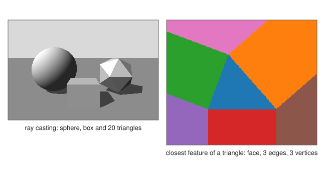

# Intersections and closest points

<div class="entry-summary">

| | |
|---|---|
| **Problem** | Decide whether and where simple shapes meet (segments, lines, circles, rays, planes, triangles, spheres and boxes), and find the point of a shape nearest to a given point |
| **Devised by** | Classical analytic geometry; Tomas Möller and Ben Trumbore (1997), ray–triangle; Timothy Kay and James Kajiya (1986), ray–box slabs; Christer Ericson (2005), closest-point methods |
| **Accuracy** | Exact up to rounding, with relative tolerances near $10^{-12}$ for parallel and touching cases; closest points never farther than a brute-force search (table below) |
| **Cost** | $O(1)$ for each test; $O(n)$ for polylines and meshes |
| **API** | Intersections: [`segment_segment_2d`](../../api/lib_jsl_geometry/algorithms/intersection/fn.segment_segment_2d.html), [`Intersection2D`](../../api/lib_jsl_geometry/algorithms/intersection/enum.Intersection2D.html), `line_line_2d`, `circle_circle`, `line_plane_parameter`, `ray_plane`, `segment_plane`, `plane_plane`, [`ray_triangle`](../../api/lib_jsl_geometry/algorithms/intersection/fn.ray_triangle.html), `segment_triangle`, [`TriangleHit`](../../api/lib_jsl_geometry/algorithms/intersection/struct.TriangleHit.html), `ray_sphere`, `ray_aabb`, `aabb_aabb`, `sphere_sphere`, `triangle_plane`. Closest points: [`closest_point_on_triangle`](../../api/lib_jsl_geometry/algorithms/nearest_point_finding/fn.closest_point_on_triangle.html), [`Closest`](../../api/lib_jsl_geometry/algorithms/nearest_point_finding/struct.Closest.html), `closest_point_on_segment`, `_line`, `_ray`, `_plane`, `_aabb`, `_sphere`, `_polyline`, `_polygon_boundary`, `_mesh`, `closest_points_between_segments`, `distance_point_to_line_3d` |

</div>

## Overview

Almost every geometric program asks the same small questions over and over. Does this ray hit that triangle, and where? Do these two segments cross? Which point of this mesh is nearest? Ray tracing, collision detection, picking objects with a mouse, snapping in drawing programs and mesh slicing are built from them. Each test is a few lines of vector algebra. The care goes into the special cases (parallel lines, touching shapes, degenerate triangles) and into returning enough information, such as parameters along the ray and barycentric coordinates, for the caller to use the answer.

## History

Most of these formulas are as old as analytic geometry, from Descartes and Fermat in the 17th century. Their efficient computer forms came with computer graphics. Ray casting was introduced by Arthur Appel (1968), and ray tracing by Turner Whitted (1980). Timothy Kay and James Kajiya's slab method (1986) intersects rays with boxes. Tomas Möller and Ben Trumbore's algorithm (1997) intersects a ray with a triangle without first computing its plane. Christer Ericson's *Real-Time Collision Detection* (2005) collected robust closest-point and intersection routines, including the triangle method used here.

## The idea

### Intersection tests

**Segments in the plane.** Write the segments as $a + t\,r$ and $c + u\,s$ for $t, u \in [0, 1]$. With the 2D cross product $v \times w = v_x w_y - v_y w_x$,

$$
t = \frac{(c - a) \times s}{r \times s}, \qquad u = \frac{(c - a) \times r}{r \times s}.
$$

If $r \times s$ is zero the segments are parallel. They meet only if they are collinear, and then they may share a whole sub-segment, which is returned as `Overlap`.

**Rays and triangles (Möller–Trumbore).** Solve $o + t\,d = (1 - u - v)\,a + u\,b + v\,c$ for $(t, u, v)$ by Cramer's rule, using the edge vectors $e_1 = b - a$ and $e_2 = c - a$. The hit is inside the triangle when $u, v \ge 0$ and $u + v \le 1$. The result carries $t$ and the barycentric weights, which interpolate normals, colours or texture coordinates.

**Rays and boxes (slabs).** A box is the intersection of three slabs $\text{min}_k \le x_k \le \text{max}_k$. The ray is inside each slab for a parameter interval, and inside the box for the intersection of the three. It hits the box if that intersection is non-empty and not entirely behind the origin.

**Rays and spheres.** Substituting the ray into $|x - c|^2 = r^2$ gives a quadratic in $t$, whose two roots are the entry and exit.



The left image was made entirely with these tests. One ray per pixel finds the nearest of a sphere, a box and the 20 triangles of an icosahedron. A second ray from the floor towards the light decides whether that point is in shadow.

### Closest points

The closest point of a segment to $p$ is the projection of $p$ onto its line, clamped to the segment. For a triangle there are seven cases: the closest point may be inside the face, on one of the three edges, or at one of the three corners. The plane around a triangle divides into seven **Voronoi regions of its features**, shown on the right. Ericson's method decides the region with a handful of dot products, testing the corners first, then the edges, and computes the point only for that region. It returns the barycentric coordinates too, so the zero weights tell which feature was closest.

The closest points between two segments minimise $|p_1 + s\,d_1 - p_2 - t\,d_2|^2$ over the unit square of $(s, t)$. The unconstrained minimum is clamped to the square, one parameter at a time, recomputing the other after each clamp. Shapes made of pieces, such as polylines, polygon boundaries and meshes, take the best of their pieces.

{{#include ../generated/geometry/intersection_checks.md}}

## Algorithm

**Two segments in the plane**, $a + t\,r$ and $c + u\,s$.

1. Compute $r \times s$. If it is not zero (to within the tolerance): compute $t$ and $u$ from
   the two formulas above. The segments cross if both lie in $[0, 1]$, at the point
   $a + t\,r$.
2. If $r \times s$ is zero the segments are parallel. If $(c - a) \times r$ is not zero they lie
   on different lines and do not meet. Otherwise they are collinear: project the ends of the
   second onto the first to get an interval of the parameter $t$, and intersect it with
   $[0, 1]$. An empty intersection means no contact; a single value, a point; a longer
   interval, an overlap.

**A ray and a triangle** (Möller-Trumbore), for the ray $o + t\,d$ and the triangle $a, b, c$
with $e_1 = b - a$ and $e_2 = c - a$.

1. Compute $h = d \times e_2$ and $\det = e_1 \cdot h$. If $\det$ is zero, the ray is parallel
   to the triangle's plane: no hit.
2. Compute $u = (o - a) \cdot h/\det$. If $u < 0$ or $u > 1$: no hit.
3. Compute $q = (o - a) \times e_1$ and $v = d \cdot q/\det$. If $v < 0$ or $u + v > 1$: no hit.
4. Compute $t = e_2 \cdot q/\det$. If $t$ is negative the triangle is behind the ray's origin:
   no hit. Otherwise return $t$, $u$ and $v$.

Each test can reject the ray early, before the later quantities are computed.

**A ray and a box** (slabs): start with the parameter interval $[0, \infty)$. For each axis,
compute the two values of $t$ at which the ray crosses the slab's planes, order them as entry
and exit, and intersect the interval with $[\text{entry}, \text{exit}]$. If the interval
becomes empty, there is no hit; otherwise its lower end is the hit.

**The closest point of a triangle** to a point $p$ (Ericson).

1. Test the three corner regions: for corner $a$, if the dot products of $p - a$ with both
   edges leaving $a$ are non-positive, $a$ is the closest point. Similarly for $b$ and $c$.
2. Test the three edge regions: for each edge, if $p$ projects onto the interior of the edge
   and lies on its outer side, the closest point is that projection.
3. Otherwise $p$ projects inside the triangle: return the projection onto its plane, computed
   from the barycentric coordinates.

## Implementation

```rust,ignore
{{#include ../../../crates/geometry/src/algorithms/nearest_point_finding.rs:closest_triangle}}
```

- Directions need not be unit vectors; ray parameters are in units of the direction given.
- `ray_triangle` hits both faces; `triangle_plane` gives the segment where a plane cuts a triangle, which is the step behind [mesh slicing](meshes.md#slicing).
- Closest-point functions take any dimension `D` where the shape makes sense, and return a `Closest` with the point and its distance.

## In practice

```rust,ignore
{{#include ../../../crates/geometry/examples/geometry_intersections.rs}}
```

```text
segments: Point([1.0, 1.0])
collinear overlap: Overlap([1.0, 0.0], [3.0, 0.0])
circles: Some([[0.5, 0.8660254037844386], [0.5, -0.8660254037844386]])
ray hits the triangle at t = 1, barycentric [0.5, 0.2, 0.3]
ray-sphere (entry, exit): Some((2.0, 4.0))
ray-box (entry, exit): Some((3.0, 4.0))
planes z = 0 and x = 1 meet along Some(([1.0, 0.0, 0.0], [0.0, 1.0, 0.0]))
closest point of the triangle to (2, 2, 1): [0.5, 0.5, 0.0] at distance 2.3452, barycentric [0.0, 0.5, 0.5]
skew segments come closest at [0.5, 0.0, 0.0] and [0.5, 0.0, 1.0], distance 1
```

**Strengths**

- Each routine handles its degenerate cases and returns parameters or barycentric weights, not just a yes or no.
- Closest-point routines in any dimension.

**Weaknesses**

- Tolerances are fixed and relative; there are no exact predicates, so nearly parallel or grazing cases are decided to about $10^{-12}$.
- Meshes are searched by scanning every triangle; large scenes need a bounding-volume hierarchy or a [spatial tree](spatial-trees.md) on top.

## Exercises

1. Derive the Möller–Trumbore formulas from Cramer's rule.
2. Show that the slab method gives the correct entry and exit even when the ray direction has zero components.
3. Sketch the seven feature regions of a triangle and show that their boundaries are lines perpendicular to the edges.
4. Show that clamping one parameter and recomputing the other finds the closest points of two segments.
5. Find the intersection line of two planes given by a point and a normal each, and handle the parallel case.

## Further reading

- T. Möller and B. Trumbore, "Fast, minimum storage ray–triangle intersection", *Journal of Graphics Tools* 2 (1997) 21–28.
- T. L. Kay and J. T. Kajiya, "Ray tracing complex scenes", *SIGGRAPH Computer Graphics* 20 (1986) 269–278.
- C. Ericson, *Real-Time Collision Detection*, Morgan Kaufmann, 2005, chapter 5.
- P. Schneider and D. Eberly, *Geometric Tools for Computer Graphics*, Morgan Kaufmann, 2003.
