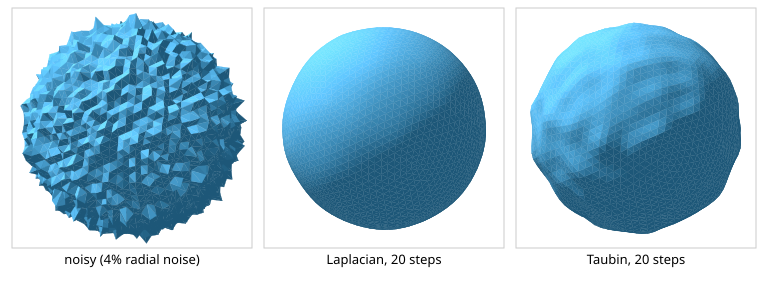
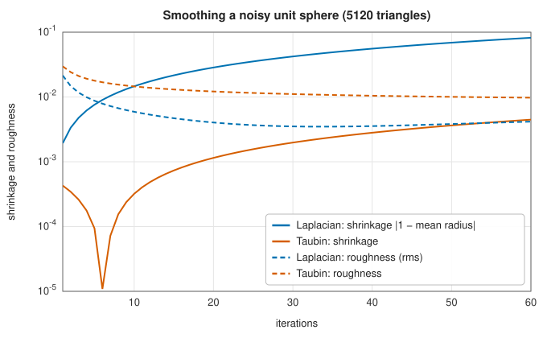
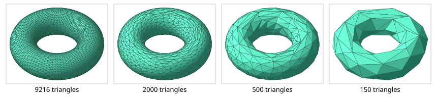
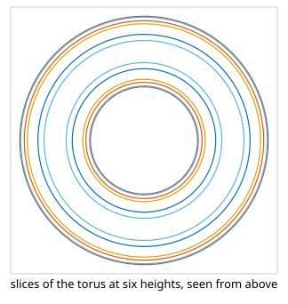

# Triangle meshes: smoothing, decimation and slicing

<div class="entry-summary">

| | |
|---|---|
| **Problem** | Remove noise from a triangle mesh without shrinking it, reduce its triangle count while keeping its shape, and cut it with planes into contours |
| **Devised by** | Leonard Herrmann (1976), Laplacian smoothing; Gabriel Taubin (1995), λ\|μ smoothing; Michael Garland and Paul Heckbert (1997), quadric error decimation |
| **Accuracy** | Taubin smoothing keeps the mean radius of a noisy sphere within 0.1%; decimation to 2000 of 9216 triangles stays within 0.003 of a torus of tube radius 0.4; slices match the exact lengths to the mesh's own discretisation error (tables below) |
| **Cost** | Smoothing $O(E)$ per iteration; decimation $O(E \log E)$; slicing $O(T)$ per plane |
| **API** | [`laplacian_smoothing`](../../api/lib_jsl_geometry/algorithms/mesh_processing/fn.laplacian_smoothing.html), [`taubin_smoothing`](../../api/lib_jsl_geometry/algorithms/mesh_processing/fn.taubin_smoothing.html), [`decimate`](../../api/lib_jsl_geometry/algorithms/mesh_processing/fn.decimate.html), [`vertex_neighbours`](../../api/lib_jsl_geometry/algorithms/mesh_processing/fn.vertex_neighbours.html), [`boundary_vertices`](../../api/lib_jsl_geometry/algorithms/mesh_processing/fn.boundary_vertices.html), [`slice_mesh`](../../api/lib_jsl_geometry/algorithms/slicing/fn.slice_mesh.html), [`slice_mesh_levels`](../../api/lib_jsl_geometry/algorithms/slicing/fn.slice_mesh_levels.html), [`Contour`](../../api/lib_jsl_geometry/algorithms/slicing/struct.Contour.html) (`length`, `simplified`) |

</div>

## Overview

Surfaces from 3D scanners, medical imaging and simulations arrive as **triangle meshes**: a list of vertex positions and a list of triangles indexing them. Meshes from measurement are noisy, often far denser than needed, and must be turned into other forms for manufacturing. This entry covers three operations on such **indexed meshes**. **Smoothing** moves each vertex towards its neighbours to remove noise. **Decimation** collapses edges to cut the triangle count while keeping the shape. **Slicing** cuts the mesh with a plane into closed contours, which is the first step of 3D printing and of cross-sectional views.

The functions take plain slices of `[f64; 3]` vertices and `[usize; 3]` triangles, rather than the table-based [mesh types](types.md#meshes), so they work on data from any source.

## History

Leonard Herrmann (1976) smoothed finite-element meshes by moving each node to the average of its neighbours. On closed surfaces that process shrinks the shape towards a point. Gabriel Taubin (1995) explained smoothing as low-pass filtering of the surface signal and removed the shrinkage by alternating a shrinking and an inflating step. Mesh simplification grew with laser scanning in the 1990s. Hoppe's progressive meshes (1996) used edge collapses, and Michael Garland and Paul Heckbert (1997) made them fast with quadric error metrics, still the standard in modelling tools. Slicing is the core of the STL-based 3D-printing pipeline that followed Chuck Hull's stereolithography (1986).

## The idea

### Laplacian and Taubin smoothing

The **umbrella operator** at vertex $i$ is the vector from the vertex to the mean of its neighbours,

$$
L(v_i) = \frac{1}{|N(i)|} \sum_{j \in N(i)} v_j - v_i .
$$

A **Laplacian** step moves every vertex by $\lambda L(v_i)$ with $0 < \lambda < 1$. On a mesh the umbrella operator acts like a second derivative. Each step damps a surface wave of frequency $k$ by a factor $1 - \lambda k$, where $k$ runs from 0 (a uniform shift) up to 2 (alternating vertices). High frequencies, the noise, die quickly. The low frequencies that make up the overall shape are damped too, only more slowly, so a closed surface shrinks.

**Taubin's** method follows each step $\lambda > 0$ with a step $\mu < -\lambda$. One pair multiplies frequency $k$ by $(1 - \lambda k)(1 - \mu k)$. That is 1 at $k = 0$ and also at the **pass-band frequency** $k_{PB} = 1/\lambda + 1/\mu$ (0.11 for the usual $\lambda = 0.5$, $\mu = -0.53$). It stays close to 1 in between, and falls off above. The result is a low-pass filter that removes noise but leaves the overall shape, and its size, nearly alone.



<p class="caption" id="fig-24-10"><strong>Figure 24.10.</strong> Smoothing.</p>

{{#include ../generated/geometry/smoothing.md}}



<p class="caption" id="fig-24-11"><strong>Figure 24.11.</strong> Smoothing curves.</p>

Laplacian smoothing removes more roughness, because it also flattens the bumps whose wavelength is several triangles, but the sphere keeps shrinking: by 3% after 20 steps and 8% after 60. Taubin's sphere keeps its radius to 0.1% and stays a little lumpy, since long-wavelength noise is in its pass band.

### Quadric error decimation

Collapsing an edge $(a, b)$ merges its two vertices into one and removes the two triangles on the edge. Garland and Heckbert measure the error of placing the merged vertex at $x$ by the sum of squared distances from $x$ to the planes of the original triangles around $a$ and $b$. For a plane $n \cdot x + d = 0$ with unit $n$, the squared distance is $(n \cdot x + d)^2 = \widetilde{x}^{\mathsf T} Q \widetilde{x}$, where $\widetilde{x} = (x, 1)$ and $Q = p p^{\mathsf T}$ with $p = (n, d)$. Sums of planes are sums of these $4 \times 4$ **quadrics**, so each vertex carries one matrix, and a collapse adds two. The best position minimises the quadratic form, which takes solving a $3 \times 3$ linear system.

Edges wait in a priority queue ordered by error, and the cheapest is collapsed first. In the library each plane is weighted by its triangle's area. A collapse is skipped if it would flip a triangle's normal or create a non-manifold surface (the **link condition**). Boundary vertices never move, so open edges stay where they were.



<p class="caption" id="fig-24-12"><strong>Figure 24.12.</strong> Decimation.</p>

{{#include ../generated/geometry/decimation.md}}

The vertices of the full mesh lie exactly on the torus, but its flat triangles fall short of it by up to 0.0014 in between, which is why its volume is 0.36% low. Decimation to 2000 triangles roughly triples that error. At 150 triangles the torus is still recognisable.

### Slicing

A plane cuts each triangle it crosses along a segment, between the two points where the triangle's edges pass through the plane. Chaining the segments end to end, by matching their endpoints, gives the contours: closed loops for a closed surface. A vertex exactly on the plane (within a tolerance) counts as a crossing. An edge lying in the plane is reported by both of its triangles and is kept once. Without that rule, a plane through a ring of vertices produces duplicate segments that chain into hundreds of tiny loops.



<p class="caption" id="fig-24-13"><strong>Figure 24.13.</strong> Slices.</p>

Every horizontal cut of a torus with radii $R$ and $r$ is two circles of radii $R \pm \sqrt{r^2 - z^2}$, so the total length is $4\pi R$ at every height:

<p class="caption" id="tab-24-6"><strong>Table 24.6.</strong> Columns: height z, contours, all closed, total length, and more.</p>

{{#include ../generated/geometry/slicing.md}}

The relative error $-4.46 \times 10^{-5}$ is that of the mesh itself: a regular 192-gon is shorter than its circumscribed circle by the factor $\sin(\pi/192)/(\pi/192)$. The plane at $z = -0.2$ passes exactly through a ring of vertices.

## Algorithm

**Smoothing.**

1. From the list of triangles, build for each vertex the set of its neighbours (the vertices
   it shares an edge with).
2. For each step: compute the umbrella vector of every vertex from the *current* positions;
   then move every free vertex by the step's factor times its vector. Computing all the
   vectors before moving any vertex makes the result independent of the order of the
   vertices.
3. Laplacian smoothing uses the factor $\lambda$ at every step. Taubin smoothing alternates
   $\lambda$ and $\mu$.

Each step costs time proportional to the number of edges.

**Decimation** to a target number of triangles.

1. **Quadrics.** For each triangle, form the quadric of its plane, weighted by its area, and
   add it to the quadrics of its three vertices.
2. **Costs.** For each edge, add the quadrics of its two ends, find the position that
   minimises the sum (or use the midpoint of the edge if the $3 \times 3$ system is singular), and push the edge on a min-heap with the error at that position as its key.
3. **Collapse.** Pop the cheapest edge. Skip it if it is stale (one of its ends has since
   been merged or its cost changed), or if the collapse would flip a triangle's normal or
   break the link condition. Otherwise merge its two vertices at the optimal position, add
   their quadrics, remove the two triangles on the edge, and push the edges of the merged
   vertex with their new costs.
4. Repeat step 3 until the target is reached or the heap is empty.
5. **Compact.** Remove the unused vertices and renumber the triangles.

**Slicing** by a plane.

1. Compute the signed distance of every vertex from the plane.
2. For each triangle whose vertices are not all on one side, find the two points where its
   edges cross the plane, by linear interpolation of the distances, and record the segment
   between them.
3. Remove duplicate segments (from edges lying in the plane).
4. Chain the segments: snap their endpoints to a grid of the tolerance, so that endpoints
   that should coincide do, and follow each segment to the one that shares its end, until
   each chain closes or runs out.

## Implementation

```rust,ignore
{{#include ../../../crates/geometry/src/algorithms/mesh_processing.rs:taubin}}
```

```rust,ignore
{{#include ../../../crates/geometry/src/algorithms/slicing.rs:slice}}
```

- Smoothing can hold boundary vertices fixed (`keep_boundary`), so open patches keep their outline.
- `decimate` returns new, compacted vertex and triangle arrays; the target is approximate, since collapses that would damage the surface are skipped.
- `slice_mesh_levels` slices at several heights along an axis; `Contour::simplified` removes points that lie on straight runs.

## In practice

```rust,ignore
{{#include ../../../crates/geometry/examples/geometry_meshes.rs}}
```

```text
2304 triangles, mean tube radius 0.3200
Laplacian, 10 steps: mean tube radius 0.2824
Taubin, 10 steps:    mean tube radius 0.3218
decimated to 400 triangles on 200 vertices, mean tube radius 0.3298
slice at z = 0: 48 points, closed true, length 8.3721
slice at z = 0: 48 points, closed true, length 4.4277
```

The bumps are $0.01$ to $0.04$ on a tube of radius $0.3$. Laplacian smoothing removes them but shrinks the tube by 12%, while Taubin's changes it by under 1%. The cut at $z = 0$ gives the outer and inner circles of the torus.

**Strengths**

- Standard, robust mesh operations on plain arrays.
- Decimation that respects boundaries and manifoldness, and slicing that handles vertices and edges lying in the plane.

**Weaknesses**

- Uniform (umbrella) weights: on irregular meshes they also slide vertices along the surface; cotangent weights would not.
- No remeshing, hole filling, or attribute (normal, colour) preservation during decimation.

## Exercises

1. Show that one Taubin pair multiplies the frequency-$k$ component by $(1 - \lambda k)(1 - \mu k)$, and find the pass-band frequency.
2. Show that the squared distance from a point to a plane is a quadratic form in homogeneous coordinates, and that sums of such forms are minimised by solving a $3 \times 3$ system.
3. State the link condition for an edge collapse, and draw a mesh where violating it makes the surface non-manifold.
4. Prove that every horizontal cut of a torus has total length $4\pi R$.
5. Explain why chaining slice segments needs a tolerance, and what goes wrong if it is too large.

<details>
<summary>Hints and answers</summary>

1. A Laplacian smoothing step multiplies the frequency-$k$ component by $(1 - \lambda k)$, so a pair with $\lambda > 0$ and $\mu < 0$ multiplies it by $(1 - \lambda k)(1 - \mu k)$; the pass-band frequency satisfies $1/\lambda + 1/\mu = k_{\mathrm{pb}}$ (where the factor is 1).
2. The squared distance to the plane $\mathbf n^{\mathsf T}\mathbf x + d = 0$ with unit normal is $(\mathbf n^{\mathsf T}\mathbf x + d)^2 = \mathbf v^{\mathsf T}\mathbf p\mathbf p^{\mathsf T}\mathbf v$ with $\mathbf v = (\mathbf x, 1)$ and $\mathbf p = (\mathbf n, d)$, a quadratic form $Q$. A sum of such forms is minimised by setting the gradient to zero, which is a $3\times3$ linear system in $\mathbf x$.
3. The link condition: the vertex neighbourhoods of the edge's endpoints intersect exactly in the two opposite vertices of its adjacent triangles. If other common neighbours exist, the collapse glues unrelated parts of the surface and makes it non-manifold.
4. A torus with major radius $R$ and minor radius $r$ cut at height $z$ gives two circles of radii $R + s$ and $R - s$ with $s = \sqrt{r^2 - z^2}$, whose circumferences add to $4\pi R$.
5. Slice segments from different triangles meet at endpoints that agree only to rounding; a tolerance matches them. If it is too large, distinct nearby endpoints merge and the contour acquires false connections.

</details>

## Further reading

- G. Taubin, "A signal processing approach to fair surface design", *Proceedings of SIGGRAPH 95*, 351–358.
- M. Garland and P. S. Heckbert, "Surface simplification using quadric error metrics", *Proceedings of SIGGRAPH 97*, 209–216.
- M. Botsch, L. Kobbelt, M. Pauly, P. Alliez and B. Lévy, *Polygon Mesh Processing*, A K Peters, 2010.
- L. R. Herrmann, "Laplacian-isoparametric grid generation scheme", *Journal of the Engineering Mechanics Division* 102 (1976) 749–756.
