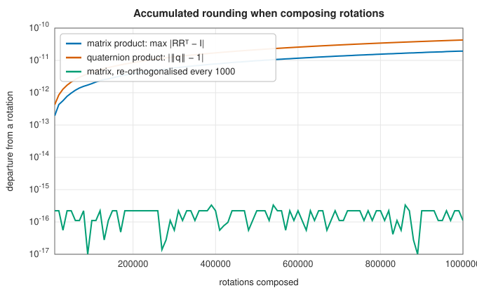
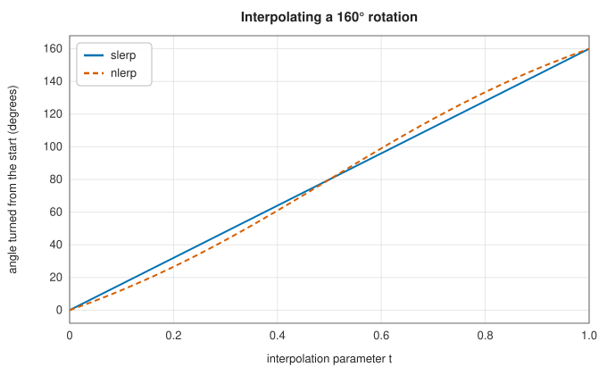

# Rotations, Euler angles and quaternions

<div class="entry-summary">

| | |
|---|---|
| **Problem** | Represent, compose, convert and interpolate rotations of three-dimensional space |
| **Devised by** | Leonhard Euler (1775), angles and the rotation theorem; Olinde Rodrigues (1840), axis–angle formula; William Rowan Hamilton (1843), quaternions; Ken Shoemake (1985), spherical interpolation |
| **Accuracy** | Matrices and Euler angles agree with SciPy's `Rotation` to $10^{-14}$, and slerp to $10^{-15}$ (see the [chapter overview](index.md#testing-against-scipy-and-shapely)) |
| **Cost** | Composing: 27 multiplications for matrices, 16 for quaternions; conversions $O(1)$ |
| **API** | [`Rotation3`](../../api/lib_jsl_geometry/algorithms/rotations/struct.Rotation3.html) (`from_axis_angle`, `from_euler`, `from_matrix`, `from_two_vectors`, `matrix`, `axis_angle`, `to_euler`, `rotate`, `inverse`, `slerp`, `angle_to`), [`Rotation2`](../../api/lib_jsl_geometry/algorithms/rotations/struct.Rotation2.html), [`EulerSequence`](../../api/lib_jsl_geometry/algorithms/rotations/struct.EulerSequence.html), [`Axis`](../../api/lib_jsl_geometry/algorithms/rotations/enum.Axis.html), [`Quaternion`](../../api/lib_jsl_geometry/algorithms/quaternions/struct.Quaternion.html), [`nearest_rotation_matrix`](../../api/lib_jsl_geometry/algorithms/rotations/fn.nearest_rotation_matrix.html), [`rotation_matrix_axis_angle`](../../api/lib_jsl_geometry/algorithms/rotations/fn.rotation_matrix_axis_angle.html) |

</div>

## Overview

Spacecraft attitude, robot arms, camera orientation and molecular conformations all need rotations: changes of direction that keep lengths and handedness. There are several ways to write one down, each with uses and pitfalls.
- A **rotation matrix** is a $3 \times 3$ orthogonal matrix of determinant 1. It acts on vectors directly, but has nine numbers for three degrees of freedom and drifts away from orthogonality under repeated products.
- **Euler angles** are three successive turns about coordinate axes. They are compact and intuitive (roll, pitch and yaw), but have singular **gimbal lock** orientations.
- An **axis and angle** describe a single turn about a fixed axis, which by Euler's rotation theorem every rotation is.
- A **unit quaternion** $q = \cos(\theta/2) + \sin(\theta/2)(n_x i + n_y j + n_z k)$ packs the axis–angle into four numbers. Quaternions compose by multiplication, renormalise trivially, have no singularities, and interpolate smoothly.

The library's [`Rotation3`](../../api/lib_jsl_geometry/algorithms/rotations/struct.Rotation3.html) stores a unit quaternion and converts to and from the others.

## History

Leonhard Euler showed in 1775 that every rotation of a rigid body about a fixed point is a single turn about some axis, and used three angles to describe orientation. Olinde Rodrigues (1840) gave the composition of rotations in terms of their axes and half-angles, in effect the quaternion product before quaternions. William Rowan Hamilton discovered the quaternions on 16 October 1843, walking along the Royal Canal in Dublin, and carved $i^2 = j^2 = k^2 = ijk = -1$ into Brougham Bridge. Vector algebra displaced them in physics, but they returned in spacecraft attitude control in the 1960s, where gimbal lock had real consequences: Apollo's guidance platform had to avoid it. Ken Shoemake (1985) introduced quaternion interpolation (slerp) to computer animation.

## The idea

### Rotation matrices and Euler angles

The rotations about the coordinate axes are

$$
R_x(\alpha) = \begin{pmatrix} 1 & 0 & 0 \\ 0 & \cos\alpha & -\sin\alpha \\ 0 & \sin\alpha & \cos\alpha \end{pmatrix},
$$

with $R_y$ and $R_z$ alike. Rodrigues' formula gives the matrix of a turn by $\theta$ about a unit axis $n$: $R = \cos\theta\, I + \sin\theta\, [n]_\times + (1 - \cos\theta)\, n n^{\mathsf T}$, where $[n]_\times$ is the cross-product matrix.

An **Euler sequence** names three axes, consecutive ones different: twelve sequences in all. The six with all three different (XYZ, ZYX, …) are **Tait–Bryan** angles, such as roll–pitch–yaw. The six repeating the first axis (ZXZ, …) are **proper Euler** angles, used for orbits and spinning tops. The library's sequences are **intrinsic**: each turn is about an axis of the already-turned body, so XYZ with angles $(\alpha, \beta, \gamma)$ is $R = R_x(\alpha)\,R_y(\beta)\,R_z(\gamma)$. Recovering the angles from a matrix reads $\beta$ from one entry, and $\alpha$ and $\gamma$ from pairs of others with `atan2`. Each rotation has two angle triples, related by $(\alpha + \pi, \pi - \beta, \gamma + \pi)$ for Tait–Bryan sequences. The library returns the one with $\beta \in [-\pi/2, \pi/2]$ (or $[0, \pi]$ for proper sequences), as SciPy does. Writing this chapter fixed this: before, either triple could come back, whatever the documentation said.

At **gimbal lock** ($\beta = \pm\pi/2$ for Tait–Bryan, $0$ or $\pi$ for proper), the first and third axes line up and only $\alpha \pm \gamma$ is determined. The library then sets $\gamma = 0$. The same convention applies to [`Quaternion::to_euler`](../../api/lib_jsl_geometry/algorithms/quaternions/struct.Quaternion.html#method.to_euler) (Z–Y–X roll, pitch and yaw). Writing this chapter fixed that function at a pitch of $-90°$, where it negated the roll and so returned a different rotation.

### Quaternions

Quaternions $w + xi + yj + zk$ multiply by the rules $i^2 = j^2 = k^2 = ijk = -1$. A unit quaternion rotates a vector $v$ by $v \mapsto q\,v\,q^{-1}$, treating $v$ as $0 + v_x i + v_y j + v_z k$. Composition is multiplication: $q_2 q_1$ applies $q_1$ first. $q$ and $-q$ give the same rotation, a double cover that matters for interpolation. A matrix becomes a quaternion by **Shepperd's method**, which takes the square root of whichever of $1 + \operatorname{tr} R$ and $1 + 2R_{kk} - \operatorname{tr} R$ is largest, so it never divides by a small number.

Rounding accumulates when many rotations are composed. A matrix product slowly stops being orthogonal, and a quaternion product slowly stops having unit norm:



Both drift by about $10^{-11}$ after a million steps, but repairing them differs in cost. A quaternion is renormalised by dividing by its norm, which `Rotation3` does on every product. A matrix needs [`nearest_rotation_matrix`](../../api/lib_jsl_geometry/algorithms/rotations/fn.nearest_rotation_matrix.html), which computes the orthogonal polar factor by Newton's iteration $R \leftarrow \tfrac12 (R + R^{-\mathsf T})$.

### Spherical linear interpolation

Unit quaternions lie on a sphere in four dimensions, and rotations interpolate along its great circles. With $\cos\Omega = q_0 \cdot q_1$,

$$
\operatorname{slerp}(q_0, q_1; t) = \frac{\sin((1 - t)\Omega)}{\sin\Omega}\, q_0 + \frac{\sin(t\Omega)}{\sin\Omega}\, q_1 ,
$$

which turns at a constant angular rate about a fixed axis. If $q_0 \cdot q_1 < 0$, $q_1$ is negated first so the shorter of the two arcs is taken. Normalised linear interpolation (**nlerp**) blends and renormalises. It is cheaper and follows the same path, but not at a uniform rate:



## Algorithm

1. **Euler to matrix**: multiply the three axis matrices in order.
2. **Matrix to Euler**: read the middle angle and the outer pairs with `atan2`; map to the documented range; at gimbal lock fold the third angle into the first.
3. **Matrix to quaternion**: Shepperd's method, sign chosen so $w \ge 0$.
4. **Slerp**: dot product; flip sign for the short arc; near-parallel inputs fall back to nlerp; otherwise the formula above.

## Implementation

```rust,ignore
{{#include ../../../crates/geometry/src/algorithms/quaternions.rs:slerp}}
```

- Matrices are row-major `[[f64; 3]; 3]` acting on column vectors.
- `Rotation3` multiplication `a * b` applies `b` first; `angle_to` gives the angle of the rotation between two orientations.
- [`Rotation2`](../../api/lib_jsl_geometry/algorithms/rotations/struct.Rotation2.html) covers the plane, with rotation about a pivot.

## In practice

```rust,ignore
{{#include ../../../crates/geometry/examples/geometry_rotations.rs}}
```

```text
matrix rows [[0.000, 0.000, 1.000], [1.000, 0.000, 0.000], [0.000, 1.000, 0.000]]
is a rotation: true, x axis goes to [0.000, 1.000, 0.000]
axis [0.5774, 0.5774, 0.5774], angle 2.0944 rad
as intrinsic X-Y-Z angles: [1.5708, 1.5708, 0.0000]
quaternion of a then b: 0.5000 +0.5000i -0.5000j +0.5000k
rotates (1, 0, 0) to [0.000, 0.000, 1.000]
slerp halfway: 1.0472 rad from the start, 1.0472 from the end
roll, pitch, yaw of a: (0.0000, 0.0000, 1.5708)
```

The two quarter turns combine into a third of a turn ($2\pi/3$) about the diagonal $(1, 1, 1)/\sqrt3$, which cycles the axes: $x \to y \to z \to x$.

**Strengths**

- All twelve Euler sequences, in SciPy's ranges, with gimbal lock handled.
- Quaternion-based rotations that stay normalised, with slerp, nlerp, exponential and logarithm.

**Weaknesses**

- Extrinsic sequences must be expressed as intrinsic ones (an extrinsic XYZ is an intrinsic ZYX with the angles reversed).
- No rotation averaging, spline (squad) interpolation or random sampling of rotations.

## Exercises

1. Show that $v \mapsto q v q^{-1}$ with $q = \cos(\theta/2) + \sin(\theta/2)\, n$ is a rotation by $\theta$ about $n$.
2. Derive the formulas for intrinsic XYZ angles from the matrix entries, and the second solution $(\alpha + \pi, \pi - \beta, \gamma + \pi)$.
3. Show that at $\beta = \pi/2$ the XYZ matrix depends only on $\alpha + \gamma$.
4. Show that an extrinsic rotation sequence equals the intrinsic one with the axes in reverse order.
5. Show that slerp has constant angular velocity, and that nlerp is fastest in the middle.

## Further reading

- K. Shoemake, "Animating rotation with quaternion curves", *SIGGRAPH Computer Graphics* 19 (1985) 245–254.
- J. Diebel, "Representing attitude: Euler angles, unit quaternions, and rotation vectors", Stanford University technical report, 2006.
- S. W. Shepperd, "Quaternion from rotation matrix", *Journal of Guidance and Control* 1 (1978) 223–224.
- S. L. Altmann, *Rotations, Quaternions, and Double Groups*, Oxford University Press, 1986.
