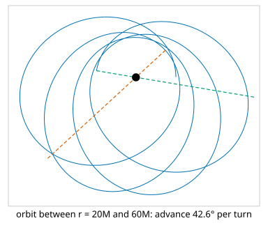

# Space-time: four-vectors, Lorentz boosts and Christoffel symbols

<div class="entry-summary">

| | |
|---|---|
| **Problem** | Compute with events and four-vectors in special relativity, and with the connection coefficients that give free-fall motion in curved space-time |
| **Devised by** | Hendrik Lorentz (1904) and Albert Einstein (1905), the transformations; Hermann Minkowski (1908), space-time geometry; Elwin Christoffel (1869), the symbols; Karl Schwarzschild (1916), the field of a mass |
| **Accuracy** | Boosts preserve intervals to rounding; Christoffel symbols from finite differences agree with the exact Schwarzschild ones to $10^{-6}$ or better; an orbit integrated with them precesses by the exact amount to five digits (tables below) |
| **Cost** | $O(1)$ per operation; $O(4^3)$ for the symbols at a point |
| **API** | [`SpaceTimeVector4D`](../../api/lib_jsl_geometry/dim_4/space_time_vector/struct.SpaceTimeVector4D.html) (`new`, `from_time`, `interval_squared`, `causality`, `proper_time`, `boost_matrix`, `boosted`, `four_velocity`, `gamma`, `rapidity`, `add_collinear_velocities`), [`Causality`](../../api/lib_jsl_geometry/dim_4/space_time_vector/enum.Causality.html), [`ChristoffelSymbols4D`](../../api/lib_jsl_geometry/dim_4/christoffel_symbols/struct.ChristoffelSymbols4D.html) (`from_metric_derivatives`, `from_metric_function`, `schwarzschild`, `minkowski`, `geodesic_acceleration`), [`invert_4x4`](../../api/lib_jsl_geometry/dim_4/christoffel_symbols/fn.invert_4x4.html) |

</div>

## Overview

In relativity, space and time form a single four-dimensional **space-time**. A point in it is an **event**, written $(t, x, y, z)$ with time measured in units of length ($ct$, so the speed of light is 1). Observers moving relative to each other disagree about times and distances separately. They agree on the **interval** $s^2 = -t^2 + x^2 + y^2 + z^2$, as observers related by a rotation agree on lengths. The transformations between moving observers are **Lorentz boosts**. In **general relativity** gravity curves space-time. A freely falling body follows a **geodesic**, the straightest possible path, whose equation contains the **Christoffel symbols** of the metric.

These are the tools behind GPS clock corrections, particle-accelerator kinematics and the orbits near compact objects.

## History

Hendrik Lorentz (1904) found the transformations that leave Maxwell's equations unchanged, and Albert Einstein (1905) derived them from the relativity principle and the constancy of the speed of light. Hermann Minkowski (1908) recast the theory as the geometry of a four-dimensional space with the interval as its "distance", famously declaring that space and time by themselves would "fade away into mere shadows". Elwin Christoffel (1869) had introduced his symbols in differential geometry, long before Einstein's field equations (1915) needed them. Weeks later Karl Schwarzschild, serving on the Russian front, found the exact field outside a spherical mass. General relativity's first triumph was explaining the 43 arcseconds per century by which Mercury's perihelion advances beyond what Newtonian perturbations predict.

## The idea

### Minkowski space and Lorentz boosts

The library uses the signature $(-, +, +, +)$, so the interval $s^2 = -t^2 + |\mathbf{x}|^2$ is negative for **timelike** separations (one event can influence the other), positive for **spacelike** ones (none can), and zero on the **light cone**. A boost with velocity $\boldsymbol\beta$ (as a fraction of $c$) and Lorentz factor $\gamma = 1/\sqrt{1 - \beta^2}$ maps components as

$$
t' = \gamma\,(t - \boldsymbol\beta \cdot \mathbf{x}), \qquad \mathbf{x}' = \mathbf{x} + \left(\frac{\gamma - 1}{\beta^2}\, \boldsymbol\beta \cdot \mathbf{x} - \gamma t\right) \boldsymbol\beta .
$$

A particle with velocity $\boldsymbol\beta$ has **four-velocity** $u = \gamma(1, \boldsymbol\beta)$, whose interval is always $-1$. Collinear velocities add as $(u + v)/(1 + uv)$, never reaching 1.

{{#include ../generated/geometry/relativity_checks.md}}

### Christoffel symbols and geodesics

In curved space-time with metric $g_{\mu\nu}(x)$, the geodesic equation is

$$
\frac{d^2 x^\lambda}{d\tau^2} = -\Gamma^\lambda_{\mu\nu}\, \frac{dx^\mu}{d\tau}\, \frac{dx^\nu}{d\tau}, \qquad \Gamma^\lambda_{\mu\nu} = \tfrac12\, g^{\lambda\sigma} \left(\partial_\mu g_{\sigma\nu} + \partial_\nu g_{\sigma\mu} - \partial_\sigma g_{\mu\nu}\right),
$$

where $\tau$ is proper time. The library computes the symbols from the metric and its derivatives at a point. It can take the derivatives from the caller, or estimate them by fourth-order central differences of a metric function. It also has the exact symbols of the **Schwarzschild metric**

$$
ds^2 = -\left(1 - \frac{2M}{r}\right) dt^2 + \left(1 - \frac{2M}{r}\right)^{-1} dr^2 + r^2\, d\theta^2 + r^2 \sin^2\theta\, d\phi^2 ,
$$

the field outside a non-rotating mass $M$ (in units $G = c = 1$).

{{#include ../generated/geometry/christoffel.md}}

The finite-difference error is below 4 parts in $10^{8}$ of the largest symbol, as expected for a fourth-order formula with step $10^{-3} r$.

A bound orbit in the Schwarzschild field does not close: each turn its perihelion advances. Integrating the geodesic equation with the library's symbols and a fourth-order Runge–Kutta step, for an orbit between $r = 20M$ and $60M$, gives the exact advance:



{{#include ../generated/geometry/precession.md}}

{{#include ../generated/geometry/precession_facts.md}} The weak-field formula $6\pi M / p$, with $p$ the semi-latus rectum, is the one that gives Mercury's 43″ per century. Here it underestimates by about 16%, because this orbit is deep in the field, at 20 to 60 times the mass's gravitational radius.

## Algorithm

1. **Boost**: build the $4 \times 4$ matrix from $\boldsymbol\beta$; multiply.
2. **Christoffel symbols**: invert the metric by Gauss–Jordan elimination with pivoting; contract with the derivative combination.
3. **Finite differences**: $\partial_\sigma g \approx \bigl(g(x - 2h) - 8g(x - h) + 8g(x + h) - g(x + 2h)\bigr)/(12h)$ along each coordinate.
4. **Geodesic acceleration**: $-\Gamma^\lambda_{\mu\nu} u^\mu u^\nu$, for the caller's integrator.

## Implementation

```rust,ignore
{{#include ../../../crates/geometry/src/dim_4/christoffel_symbols.rs:christoffel}}
```

- `causality` classifies a separation as timelike, spacelike or lightlike with a tolerance; `proper_time` and `proper_distance` take the square root of the interval of the right sign.
- `schwarzschild` returns `None` inside the horizon $r \le 2M$ or at the poles, where the coordinates are singular.

## In practice

```rust,ignore
{{#include ../../../crates/geometry/examples/geometry_spacetime.rs}}
```

```text
interval 9, Spacelike
seen from a frame moving at 0.5c: t = 1.7321, x = 3.4641, interval 9.0000
seen from a frame moving at 0.8c: t = 0.0000, x = 3.0000, interval 9.0000
0.8c + 0.8c = 0.9756c, gamma(0.8c) = 1.6667
radial acceleration of a particle at rest: -0.01000 (Newton: -1/r² = -0.01)
torsion free: true
```

The two flashes are spacelike-separated, so their time order depends on the observer. From a frame moving at $0.8c$ they are simultaneous, and from faster frames their order reverses. A particle held at rest at $r = 10M$ has a coordinate acceleration of exactly $-M/r^2$, Newton's value, because the $(1 - 2M/r)$ factors cancel.

**Strengths**

- Lorentz boosts in any direction, with the standard derived quantities.
- Christoffel symbols for any metric, from a function or from derivatives, with an exact reference case.

**Weaknesses**

- No Riemann or Ricci curvature, no geodesic integrator (the caller supplies one), and no Kerr metric for rotating masses.
- The relativity types use `f64` while the rest of the primitive types use `f32`.

## Exercises

1. Show that a boost preserves the interval.
2. Derive the velocity-addition formula by composing two boosts along $x$, and show that rapidities $\operatorname{atanh}\beta$ add.
3. Compute the Christoffel symbols of flat space in spherical coordinates and check them with `from_metric_function`.
4. Show that $g_{\mu\nu} u^\mu u^\nu$ is conserved along a geodesic, and use it to test an integrator.
5. Derive the orbit equation $(dw/d\phi)^2 = 2M w^3 - w^2 + 2Mw/L^2 + (E^2 - 1)/L^2$ for $w = 1/r$, and from it the perihelion advance.

## Further reading

- E. F. Taylor and J. A. Wheeler, *Spacetime Physics*, 2nd ed., W. H. Freeman, 1992.
- S. M. Carroll, *Spacetime and Geometry: An Introduction to General Relativity*, Addison-Wesley, 2004, chapters 3 and 5.
- B. F. Schutz, *A First Course in General Relativity*, 2nd ed., Cambridge University Press, 2009.
- C. W. Misner, K. S. Thorne and J. A. Wheeler, *Gravitation*, W. H. Freeman, 1973, chapter 25.
