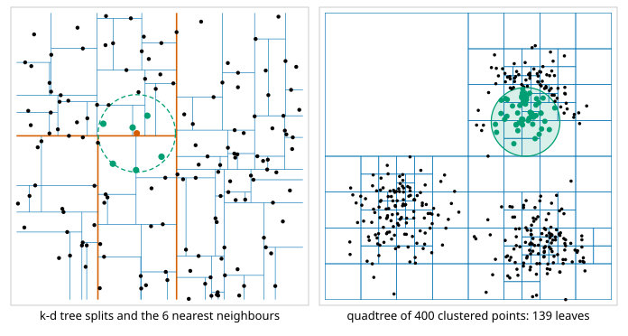
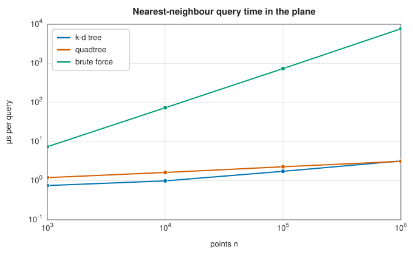

# Spatial trees: k-d trees, quadtrees and octrees

<div class="entry-summary">

| | |
|---|---|
| **Problem** | Organise points so that the nearest ones to a query, or all of those within a distance or a box, are found without examining every point |
| **Devised by** | Jon Bentley (1975), k-d trees; Raphael Finkel and Jon Bentley (1974), quadtrees; Donald Meagher (1980), octrees |
| **Accuracy** | Exact: the same 8 nearest neighbours as SciPy's `cKDTree` for 200 of 200 queries, and the same counts within a radius (see the [chapter overview](index.md#testing-against-scipy-and-shapely)) |
| **Cost** | Build $O(n \log n)$; a nearest-neighbour query about $O(\log n)$ for well-spread points in low dimensions, against $O(n)$ for a scan |
| **API** | [`KdTree`](../../api/lib_jsl_geometry/algorithms/kd_trees/struct.KdTree.html) (`new`, `nearest`, `k_nearest`, `within_radius`, `range_query`), [`RegionTree`](../../api/lib_jsl_geometry/algorithms/region_tree/struct.RegionTree.html) (`new`, `with_limits`, `from_points`, `insert`, `remove`, `nearest`, `k_nearest`, `query_radius`, `query_box`, `depth`), [`QuadTree`](../../api/lib_jsl_geometry/algorithms/quad_trees/type.QuadTree.html), [`OctTree`](../../api/lib_jsl_geometry/algorithms/oct_trees/type.OctTree.html) |

</div>

## Overview

Finding the point nearest to a query by checking every point costs $O(n)$. Repeated for $n$ queries, as in clustering, point-cloud registration, collision detection or interpolation of scattered data, that is $O(n^2)$. **Spatial trees** divide space hierarchically, so that whole regions can be ruled out at once because they are farther than the best point found so far. A **k-d tree** splits the points at the median along alternating axes, so its cells adapt to the points. A **quadtree** (in 2D) or **octree** (in 3D) splits space into equal quadrants or octants, so its cells are regular, and it accepts insertions and removals.

## History

Jon Bentley introduced the k-d tree as an undergraduate project at Stanford, published in 1975, and with Jerome Friedman and Raphael Finkel (1977) gave the logarithmic expected time of its nearest-neighbour search. Raphael Finkel and Bentley described the point quadtree in 1974, and region quadtrees became standard in image processing and geographic data through the 1980s, surveyed by Hanan Samet. Donald Meagher (1980) introduced the octree for solid modelling. Their limits in high dimensions, where every query visits most of the tree, led to approximate methods such as locality-sensitive hashing and graph-based search.

## The idea

### k-d trees

To build, find the median of the points along $x$; it becomes the root, with the points to its left and right as subtrees. Split those at their medians along $y$, then $x$ again, and so on. The library stores the tree implicitly: a permutation of the point indices in which each subslice's middle element is the node and its halves are the subtrees, arranged with a linear-time selection at each level.

To find the $k$ nearest neighbours of $q$, descend first into the side of each split containing $q$, keeping the best $k$ points so far in a max-heap. On the way back, the other side can hold a closer point only if the splitting line is nearer to $q$ than the current $k$-th best distance, $(q_a - s)^2 < d_k^2$. Usually it is not, and half the tree is skipped. Radius and box queries prune the same way.



<p class="caption" id="fig-24-7"><strong>Figure 24.7.</strong> Spatial trees.</p>

### Quadtrees and octrees

A quadtree covers a box. Each leaf holds up to a fixed number of points (8 by default). When a leaf overflows, it splits into four equal quadrants (eight octants in 3D) and hands its points down. Dense regions therefore get small cells, as in the clustered example above, and empty regions stay as single large leaves. A depth limit stops coincident points from splitting forever. Searches visit the children of each cell nearest first and skip any cell whose box is farther from the query than the current $k$-th best.

The library's [`RegionTree`](../../api/lib_jsl_geometry/algorithms/region_tree/struct.RegionTree.html) is generic over the dimension; `QuadTree` and `OctTree` are its 2D and 3D forms. Each entry carries an id chosen by the caller, so the same tree can index moving objects by removing and reinserting them.

<p class="caption" id="tab-24-4"><strong>Table 24.4.</strong> Columns: points, k-d build, quadtree build, k-d query, and more.</p>

{{#include ../generated/geometry/tree_timing.md}}



<p class="caption" id="fig-24-8"><strong>Figure 24.8.</strong> Query timing.</p>

For uniformly spread points both trees answer a nearest-neighbour query in a few microseconds even among a million points, where a scan takes milliseconds. The k-d tree is a little faster for static data. The quadtree costs about the same to build and allows updates.

## Algorithm

**Building a k-d tree** on a list of point indices. `build(slice, depth)`:

1. if the slice is empty, return;
2. choose the axis `depth mod D`, cycling through the $D$ coordinates;
3. rearrange the slice with a linear-time selection so that its middle element is the median
   along that axis, with the smaller points before it and the larger after;
4. the middle element is the node; call `build` on the two halves with `depth + 1`.

The cost is $O(n\log n)$, and the tree needs no storage beyond the permuted indices.

**Searching a k-d tree** for the $k$ nearest neighbours of $q$. `search(slice, depth)`:

1. visit the node: compute its distance to $q$, and if it is among the best $k$ so far,
   insert it into the max-heap of results (removing the worst when the heap is full);
2. compare $q$ with the node along the splitting axis to find which half contains $q$, and
   search that half first;
3. search the other half only if the distance from $q$ to the splitting plane is less than
   the current $k$-th best distance (or fewer than $k$ points have been found).

**Inserting into a region tree** (quadtree or octree): descend from the root, at each cell
choosing the child whose box contains the point, until a leaf is reached; add the point to the
leaf. If the leaf now holds more than its capacity and is above the depth limit, divide it
into $2^D$ equal children and move its points into them.

**Nearest neighbours in a region tree**: as for the k-d tree, with the children of each cell
visited in order of the distance from $q$ to their boxes, and a child skipped when that
distance exceeds the current $k$-th best.

## Implementation

```rust,ignore
{{#include ../../../crates/geometry/src/algorithms/kd_trees.rs:k_nearest}}
```

- Both trees work in any dimension `D` and return `(index or id, distance)` pairs, nearest first, with ties broken by index.
- Points with non-finite coordinates are not indexed; a region tree refuses points outside its box.

## In practice

```rust,ignore
{{#include ../../../crates/geometry/examples/geometry_trees.rs}}
```

```text
nearest to (2, 2): Some((6, 0.5))
3 nearest to (0, 0): [(0, 0.0), (4, 1.4142135623730951), (2, 2.23606797749979)]
within 2.5 of the origin: [0, 2, 4]
in the box [0, 3] × [0, 4]: [0, 1, 4, 6]
quadtree nearest to (2, 2) after removing id 104: Some((106, 0.5))
octree of a helix: 1000 points, depth 5, nearest to (1, 0, 5): Some((673, 4.34962905756289))
```

**Strengths**

- Exact queries, fast in two and three dimensions.
- A dynamic quadtree and octree with caller-chosen ids.

**Weaknesses**

- The k-d tree is static: adding points means rebuilding it.
- In high dimensions (say above 10–20) pruning stops working and queries approach a scan; there are no approximate methods.

## Exercises

1. Show that the k-d tree built by median splits has depth $\lceil \log_2(n + 1) \rceil$.
2. Explain why the far side of a split need not be searched when $(q_a - s)^2 \ge d_k^2$, and why this test is conservative.
3. Construct a point set on which a quadtree with capacity 1 reaches depth $n - 1$ (or its depth limit).
4. For points uniform in the unit cube in $D$ dimensions, estimate the fraction of cells a nearest-neighbour search must examine as $D$ grows.
5. Use a k-d tree to find all pairs of points closer than $r$ in $O(n \log n + m)$ time, where $m$ is the number of pairs.

## Further reading

- J. L. Bentley, "Multidimensional binary search trees used for associative searching", *Communications of the ACM* 18 (1975) 509–517.
- J. H. Friedman, J. L. Bentley and R. A. Finkel, "An algorithm for finding best matches in logarithmic expected time", *ACM Transactions on Mathematical Software* 3 (1977) 209–226.
- R. A. Finkel and J. L. Bentley, "Quad trees: a data structure for retrieval on composite keys", *Acta Informatica* 4 (1974) 1–9.
- H. Samet, *Foundations of Multidimensional and Metric Data Structures*, Morgan Kaufmann, 2006.
