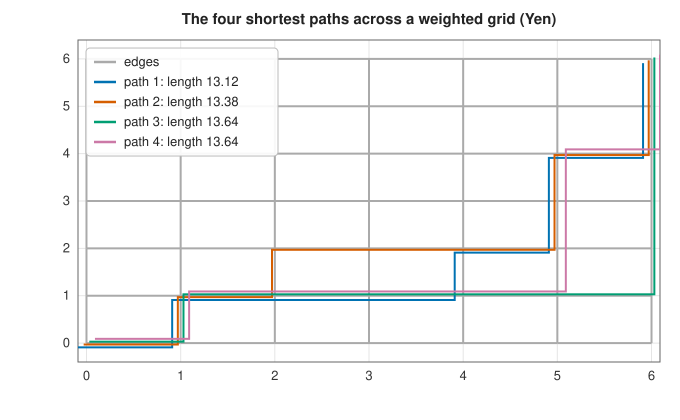

# Matchings, k shortest paths and Laplacians

<div class="entry-summary">

| | |
|---|---|
| **Problem** | All-pairs shortest paths on sparse graphs with negative edges; the $K$ shortest loopless paths between two vertices; the largest matching and the cheapest complete matching in a bipartite graph; the structural rank of a sparse matrix; and the Laplacian matrix of a graph |
| **Devised by** | Donald Johnson (1977); Jin Yen (1971); John Hopcroft and Richard Karp (1973); Harold Kuhn (1955), James Munkres (1957), Jack Edmonds and Richard Karp (1972), and Roy Jonker and Anton Volgenant (1987), shortest augmenting paths; Gustav Kirchhoff (1847), Miroslav Fiedler (1973), the Laplacian |
| **Accuracy** | Exact up to rounding; the same distances, path lengths, matching sizes, assignments and matrices as `scipy.sparse.csgraph` |
| **Cost** | Johnson: $O(VE\log V)$; Yen: $O(KV(E + V)\log V)$; Hopcroft-Karp: $O(E\sqrt V)$; minimum-weight matching: $O(VE\log V)$; Laplacian: $O(V^2)$ dense |
| **Read first** | [Shortest paths](shortest-paths.md), [Maximum flow and minimum cut](max-flow.md) |
| **API** | [`johnson`](../../api/lib_jsl_graph/all_pairs/fn.johnson.html), [`yen`](../../api/lib_jsl_graph/k_shortest/fn.yen.html), [`maximum_bipartite_matching`](../../api/lib_jsl_graph/matching/fn.maximum_bipartite_matching.html), [`min_weight_full_bipartite_matching`](../../api/lib_jsl_graph/matching/fn.min_weight_full_bipartite_matching.html), [`structural_rank`](../../api/lib_jsl_graph/matching/fn.structural_rank.html), [`laplacian`](../../api/lib_jsl_graph/laplacian/fn.laplacian.html) |

</div>

## Overview

This entry completes the library's coverage of `scipy.sparse.csgraph`:

- **Johnson's algorithm** gives all-pairs shortest paths with negative edges. On sparse graphs it is faster than Floyd-Warshall.
- **Yen's algorithm** gives the $K$ shortest loopless paths, for alternative routes in transport and networks.
- **Maximum bipartite matching** (Hopcroft-Karp) pairs as many rows with columns as possible. Applications include assigning workers to jobs they can do. In sparse linear algebra it finds a zero-free diagonal by permuting rows, and the **structural rank** of a sparsity pattern is the size of such a matching: the largest rank any matrix with that pattern can have.
- **Minimum-weight full bipartite matching** is the sparse assignment problem: match every row to a column at least total cost, using only allowed pairs.
- **The graph Laplacian** $L = D - A$ underlies spectral clustering and graph partitioning, diffusion on graphs, and Kirchhoff's matrix-tree theorem.

## History

Donald Johnson (1977) combined Bellman-Ford and Dijkstra by reweighting the edges. Jin Yen (1971) found the $K$ shortest loopless paths with a deviation scheme that later variants still follow. John Hopcroft and Richard Karp (1973) showed that augmenting along many shortest paths at once gives an $O(E\sqrt V)$ bipartite matching algorithm.

The assignment problem goes back to Harold Kuhn's Hungarian method (1955), named for the work of Dénes Kőnig and Jenő Egerváry. Jack Edmonds and Richard Karp (1972) introduced potentials that make Dijkstra's algorithm usable for its augmenting paths. Roy Jonker and Anton Volgenant (1987) gave the fast variant that SciPy's sparse LAPJVsp builds on.

Gustav Kirchhoff (1847) used the Laplacian to count spanning trees in electrical networks. Miroslav Fiedler (1973) showed that its second eigenvalue measures how well connected a graph is.

## The idea

### Johnson's algorithm

Add a vertex joined to every vertex by an edge of weight 0, and run Bellman-Ford from it to get potentials $h$. The triangle inequality $h(v) \le h(u) + w(u, v)$ makes the reweighted edges $w'(u, v) = w(u, v) + h(u) - h(v)$ non-negative. The weight of every path from $s$ to $t$ changes by the same amount, $h(s) - h(t)$, so shortest paths stay shortest. Dijkstra's algorithm from each vertex then finishes the job, and the distances are recovered as $d(s, t) = d'(s, t) - h(s) + h(t)$.

### Yen's k shortest paths

The first path is the shortest. Each later path deviates from an earlier one at some vertex, the **spur**. The prefix up to the spur, the **root**, is shared. For every vertex of the last path found:

1. Remove the root's vertices, and the next edge of every found path that shares this root.
2. Find the shortest spur path to the target.
3. Root plus spur is a candidate.

The cheapest candidate is the next path. Removing those edges forces the new path to differ from all earlier ones, and removing the root's vertices keeps it loopless.

### Hopcroft-Karp

An augmenting path alternates between unmatched and matched edges from a free row to a free column. Flipping it enlarges the matching by one, and a matching is maximum exactly when no augmenting path exists (Berge). Each Hopcroft-Karp phase does two things:

1. A breadth-first search from all free rows finds the length of the shortest augmenting paths.
2. Depth-first searches along the breadth-first layers augment along a maximal set of vertex-disjoint paths of that length.

Only $O(\sqrt V)$ phases are needed.

### Minimum-weight matching by shortest augmenting paths

Keep dual potentials $u(r)$ and $v(c)$ with reduced costs $w(r, c) - u(r) - v(c) \ge 0$, zero on matched edges. The cheapest augmenting path from a new row is then a shortest path on non-negative reduced costs, which Dijkstra's algorithm finds. Updating the potentials by the shortest-path distances keeps every reduced cost non-negative and the matched ones zero. After every row has been matched, the matching is optimal by linear-programming duality.

### The Laplacian

$L = D - A$, with $A$ the weighted adjacency matrix and $D$ the diagonal of degrees: in-degrees by default in SciPy, out-degrees on request. For an undirected graph, $\mathbf x^\top L\mathbf x = \sum_{\text{edges}} w_{ij}(x_i - x_j)^2 \ge 0$, so $L$ is positive semi-definite, with one zero eigenvalue per connected component. The normalised form $I - D^{-1/2}AD^{-1/2}$ has eigenvalues in $[0, 2]$.

## Implementation

```rust,ignore
{{#include ../../../crates/graph/src/all_pairs.rs:johnson}}
```

```rust,ignore
{{#include ../../../crates/graph/src/k_shortest.rs:yen}}
```

```rust,ignore
{{#include ../../../crates/graph/src/matching.rs:min_weight}}
```

- Bipartite graphs are given as their biadjacency pattern, `(row, column)` pairs, as SciPy takes a sparse matrix.
- Maximum matchings are not unique, and the library's may differ from SciPy's. The sizes agree, and so do the minimum-weight assignments when, as generically, the optimum is unique.
- `laplacian` returns a dense matrix. Parallel edges are summed and loops ignored, as SciPy does with a sparse adjacency matrix.

## In practice

The references are from SciPy 1.17.1, written by `book/generator/data/make_geograph_refs.py`:

<p class="caption" id="tab-23-3"><strong>Table 23.3.</strong> Johnson, Yen, bipartite matchings, structural rank and Laplacians against `scipy.sparse.csgraph`.</p>

{{#include ../generated/graph/geograph_graph.md}}

All results agree with SciPy to rounding, including Johnson's distances with 42 negative edges and the full assignments, both minimum and maximum.



<p class="caption" id="fig-23-4"><strong>Figure 23.4.</strong> The four shortest paths across a weighted grid, by Yen's algorithm (offset slightly to keep them apart). Each later path deviates from an earlier one at a spur vertex. Paths 3 and 4 have equal length.</p>

**Strengths**

- Johnson's algorithm handles negative edges at nearly the cost of repeated Dijkstra.
- Hopcroft-Karp and the shortest-augmenting-path assignment work directly on sparse patterns, at a cost close to linear in the number of edges per phase or row.
- Yen's paths are loopless, which simple $K$-best variants of Dijkstra do not guarantee.

**Weaknesses**

- Yen's algorithm runs a Dijkstra search for every vertex of every path found, so it is slow for large $K$ on large graphs.
- No minimum-weight matching in general (non-bipartite) graphs (Edmonds' blossom algorithm), and no sparse Laplacian.

## Exercises

1. Why can't Dijkstra's algorithm be used directly with negative edges, even without negative cycles?
2. Show that reweighting by potentials changes every $s$–$t$ path weight by the same amount.
3. A 3 × 3 matrix has non-zeros only in its first column and first row. What is its structural rank?
4. Show that the Laplacian of a connected undirected graph has a one-dimensional null space spanned by $\mathbf 1$.

<details>
<summary>Hints and answers</summary>

1. Dijkstra's algorithm settles a vertex for good when it is popped. A negative edge found later could still lower its distance.
2. Along a path $s = v_0, \dots, v_k = t$, the potentials telescope: $\sum(h(v_{i-1}) - h(v_i)) = h(s) - h(t)$.
3. 2: rows 1 and 2 have non-zeros only in column 0, so at most one of them can be matched.
4. $\mathbf x^\top L\mathbf x = \sum w_{ij}(x_i - x_j)^2 = 0$ forces $x_i = x_j$ along every edge, hence everywhere in a connected graph.

</details>

## Further reading

- D. B. Johnson, "Efficient algorithms for shortest paths in sparse networks", *Journal of the ACM* 24 (1977) 1–13.
- J. Y. Yen, "Finding the K shortest loopless paths in a network", *Management Science* 17 (1971) 712–716.
- J. E. Hopcroft and R. M. Karp, "An n^{5/2} algorithm for maximum matchings in bipartite graphs", *SIAM Journal on Computing* 2 (1973) 225–231.
- R. Jonker and A. Volgenant, "A shortest augmenting path algorithm for dense and sparse linear assignment problems", *Computing* 38 (1987) 325–340.
- M. Fiedler, "Algebraic connectivity of graphs", *Czechoslovak Mathematical Journal* 23 (1973) 298–305.
- F. R. K. Chung, *Spectral Graph Theory*, American Mathematical Society (1997).
