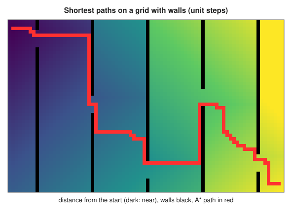
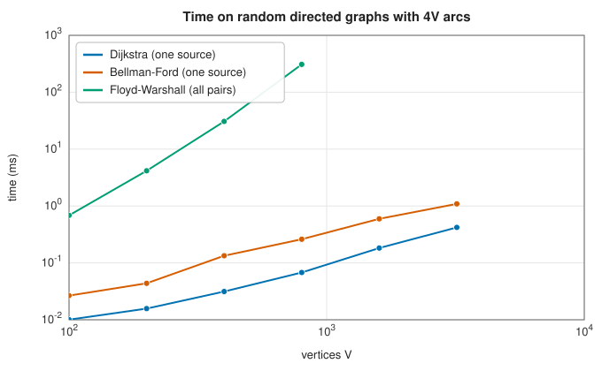

# Shortest paths: Dijkstra, Bellman–Ford, A* and Floyd–Warshall

<div class="entry-summary">

| | |
|---|---|
| **Problem** | Find the cheapest path from a source to every vertex, or to one target, or between every pair of vertices, in a weighted graph |
| **Devised by** | Edsger Dijkstra (1959); Richard Bellman (1958), Lester Ford (1956) and Edward Moore (1959); Peter Hart, Nils Nilsson and Bertram Raphael (1968), A*; Robert Floyd (1962) and Stephen Warshall (1962) |
| **Accuracy** | Exact; distances agree with SciPy's `csgraph` to the last digit (see the [chapter overview](index.md#testing-against-scipy-and-networkx)) |
| **Cost** | Dijkstra $O((V + E)\log V)$; Bellman–Ford $O(VE)$, often far less with early exit; A* at most Dijkstra's, usually much less; Floyd–Warshall $O(V^3)$ time and $O(V^2)$ memory |
| **API** | [`dijkstra`](../../api/lib_jsl_graph/shortest_paths/fn.dijkstra.html), [`bellman_ford`](../../api/lib_jsl_graph/shortest_paths/fn.bellman_ford.html), [`a_star`](../../api/lib_jsl_graph/shortest_paths/fn.a_star.html), [`ShortestPaths`](../../api/lib_jsl_graph/shortest_paths/struct.ShortestPaths.html) (`distance`, `predecessor`, `path_to`), [`floyd_warshall`](../../api/lib_jsl_graph/all_pairs/fn.floyd_warshall.html), [`AllPairsShortestPaths`](../../api/lib_jsl_graph/all_pairs/struct.AllPairsShortestPaths.html) (`distance`, `path`) |

</div>

## Overview

The length of a path is the sum of its edge weights, and a **shortest path** minimises it. Every algorithm here rests on **relaxation**: if reaching $u$ costs $d_u$ and the edge $u \to v$ costs $w$, then $v$ costs at most $d_u + w$. **Dijkstra's algorithm** settles vertices in order of distance, which is correct when no weight is negative. **Bellman–Ford** relaxes every edge repeatedly, which handles negative weights and detects negative cycles. **A\*** is Dijkstra steered toward a single target by an estimate of the remaining distance. **Floyd–Warshall** finds all pairs at once by allowing paths through one more intermediate vertex at each stage.
Each returns predecessors, so the paths themselves can be reconstructed.

## History

Lester Ford (1956), Richard Bellman (1958) and Edward Moore (1959) found the repeated-relaxation algorithm independently, in the context of network flows, dynamic programming and maze routing. Edsger Dijkstra devised his algorithm in 1956, in twenty minutes at a café in Amsterdam, to demonstrate the ARMAC computer. He published it in 1959; the heap-based version is due to later work, and Michael Fredman and Robert Tarjan's Fibonacci heap (1984) gave its best bound. Peter Hart, Nils Nilsson and Bertram Raphael (1968) developed A* for the Shakey robot's path planning. Robert Floyd and Stephen Warshall (both 1962) published the all-pairs dynamic programme. Bernard Roy had found it in 1959.

## The idea

### Dijkstra

All four algorithms share one operation. Each vertex $v$ has a **tentative distance** $d_v$, the
length of the best path to it found so far (infinite at the start, 0 for the source). To
**relax** an edge $u \to v$ of weight $w$ is to ask whether going through $u$ improves on that:
if $d_u + w < d_v$, set $d_v = d_u + w$ and record $u$ as the predecessor of $v$. The algorithms
differ in the order in which they relax edges.

Dijkstra's algorithm processes the vertices in order of their distance from the source, like a
wave spreading outwards.

1. Among the vertices not yet finished, pick the one with the smallest tentative distance. Call
   it $u$, and declare it **settled**: its tentative distance is final.
2. Relax every edge leaving $u$.
3. Repeat until every vertex is settled (or the target is).

**Why step 1 is safe.** Suppose $u$ has the smallest tentative distance among the unsettled
vertices. Any other route to $u$ must leave the settled set at some point, through some other
unsettled vertex $x$, and $d_x \ge d_u$ already. If no edge has negative weight, the rest of that
route can only add to its length, so it cannot be shorter than $d_u$. Hence $d_u$ is the true
distance. The argument fails with negative weights, and so does the algorithm.

The vertex of smallest tentative distance is supplied by a binary heap, which makes the cost
$O((V + E)\log V)$. When a vertex's distance improves, a new entry is pushed and the old one is
left in the heap; such stale entries are skipped when they are popped.

### Bellman–Ford

When some weights are negative (a cost that can also be a gain, such as a currency exchange),
Dijkstra's greedy choice is no longer valid. Bellman-Ford makes no such choice. It simply
relaxes *every* edge, and repeats.

The reason this works: a shortest path never needs to visit a vertex twice, so it has at most
$V - 1$ edges. After the first pass over all the edges, every vertex whose shortest path has one
edge has its correct distance. After the second pass, so does every vertex whose shortest path
has two edges, and so on. After $V - 1$ passes all the distances are correct, at a cost of
$O(VE)$.

The one exception is a reachable **negative cycle**, a loop whose weights sum to less than zero.
Going round it again always lowers the cost, so no shortest path exists. Such a cycle betrays
itself: if a $V$-th pass still improves some distance, there must be one, and the library returns
an error. It also stops early as soon as a pass changes nothing, which on typical graphs takes a
few passes, not $V$. In undirected graphs a negative edge is itself a negative cycle, walked back
and forth.

### A*

Dijkstra's wave spreads equally in all directions, although we may want the path to just one
target. A* aims the search. It needs a **heuristic** $h(v)$, an estimate of the remaining cost
from $v$ to the target, and it orders the heap by $d_v + h(v)$: the cost so far plus the
estimated cost to go. Vertices that lie in the direction of the target are tried first.

The result is still guaranteed optimal under two conditions on $h$. It must never overestimate
the true remaining cost (it is **admissible**), and it must satisfy
$h(u) \le w(u, v) + h(v)$ for every edge (it is **consistent**), which says that the estimate
cannot drop by more than the cost of the step taken. Then the first time the target is popped
from the heap, its path is optimal. Straight-line distance on a map and Manhattan distance on a
grid are consistent heuristics, since no path can be shorter than the direct one. Good heuristics
explore far fewer vertices than Dijkstra; $h = 0$ is Dijkstra itself.



<p class="caption" id="fig-23-1"><strong>Figure 23.1.</strong> Grid paths.</p>

{{#include ../generated/graph/grid_facts.md}} In this maze the walls force a long detour, so the heuristic saves little.

### Floyd–Warshall

To find the shortest paths between *all* pairs of vertices, Floyd-Warshall uses
[dynamic programming](../optimization/dynamic-programming.md) over a cleverly chosen family of
subproblems: restrict which vertices a path may pass through. Let $d^{(k)}_{ij}$ be the shortest
distance from $i$ to $j$ using only the vertices $0, \ldots, k - 1$ as intermediate stops. With
$k = 0$ no stops are allowed, and $d^{(0)}_{ij}$ is just the weight of the edge from $i$ to $j$.
Now allow vertex $k$ as well. The best path either does not use $k$, or goes from $i$ to $k$ and
then from $k$ to $j$, each part using only earlier vertices:

$$
d^{(k+1)}_{ij} = \min\big(d^{(k)}_{ij},\ d^{(k)}_{ik} + d^{(k)}_{kj}\big) .
$$

After all $V$ vertices have been allowed, the matrix holds the true distances. The update can be
done in place in a single $V \times V$ matrix, with three nested loops, for a cost of $O(V^3)$. A
successor matrix records the first step of each path, from which the paths can be read off.
Negative weights are allowed, and a negative diagonal entry at the end reveals a negative cycle.



<p class="caption" id="fig-23-2"><strong>Figure 23.2.</strong> Shortest path timings.</p>

Floyd–Warshall's cubic cost limits it to graphs of a few thousand vertices. For all pairs on sparse graphs, running Dijkstra from every source is cheaper.

## Algorithm

**Dijkstra** from a source.

1. Set every distance to infinity, except the source's, which is 0. Push (0, source) on a
   min-heap ordered by distance.
2. Pop the entry (d, u) of smallest distance. If $d$ is larger than the distance now recorded
   for $u$, the entry is stale: discard it and repeat this step.
3. For each edge from $u$ to $v$ with weight $w$: if $d + w$ is less than the recorded
   distance of $v$, record it, set the predecessor of $v$ to $u$, and push $(d + w, v)$.
4. Repeat from step 2 until the heap is empty.

With a binary heap the cost is $O((V + E)\log V)$.

**Bellman-Ford** from a source.

1. Set the distances as above.
2. Make a pass over all the edges (in both directions, for an undirected graph), relaxing
   each.
3. If the pass changed nothing, stop: the distances are final.
4. After $V - 1$ passes, make one more. If it would still improve some distance, report a
   negative cycle.

The cost is $O(VE)$ in the worst case.

**A\*** from a source to a target, with a heuristic $h$: as Dijkstra, with these differences.
The heap is ordered by $d + h(v)$. A vertex is **closed** when it is popped, and closed
vertices are not reopened. The search stops as soon as the target is popped.

**Floyd-Warshall** for all pairs.

1. Initialise the matrix: 0 on the diagonal, the weight for each edge, infinity elsewhere.
   Initialise the successor matrix to the edge's endpoint.
2. For each $k$, and for each pair $(i, j)$: if $d_{ik} + d_{kj} < d_{ij}$, replace $d_{ij}$ by
   the sum, and the successor of $(i, j)$ by the successor of $(i, k)$. The loop over $k$ must
   be the outermost.
3. If any diagonal entry is negative, report a negative cycle.

The cost is $O(V^3)$ time and $O(V^2)$ memory.

**Recovering a path**: from the predecessors, walk back from the target to the source and
reverse the list; from the successor matrix, walk forward from the source.

## Implementation

```rust,ignore
{{#include ../../../crates/graph/src/shortest_paths.rs:dijkstra}}
```

```rust,ignore
{{#include ../../../crates/graph/src/all_pairs.rs:floyd}}
```

- `dijkstra` and `a_star` reject negative weights; unreachable vertices have distance `f64::INFINITY`.
- `ShortestPaths::path_to` follows predecessors back to the source.

## In practice

```rust,ignore
{{#include ../../../crates/graph/examples/graph_shortest_paths.rs}}
```

```text
Dijkstra from 0: [0.0, 7.0, 9.0, 20.0, 20.0, 11.0]
path to 4: [0, 2, 5, 4]
A* to 4: Some((20.0, [0, 2, 5, 4]))
Bellman-Ford: [0.0, 2.0, 5.0, 5.0], path to 3 [0, 2, 1, 3]
with a negative cycle: Err(RuntimeError("A negative cycle is reachable from the source."))
Floyd-Warshall: 3 → 0 costs 20, via [3, 2, 0]
```

**Strengths**

- The standard algorithms with path reconstruction, negative-weight support and negative-cycle detection.
- A* accepts any heuristic as a closure.

**Weaknesses**

- A* closes vertices, so an admissible but inconsistent heuristic can return a suboptimal path.
- No bidirectional search, contraction hierarchies or other speed-ups for very large road networks.

## Exercises

1. Show that Dijkstra's algorithm fails with a negative edge, using a three-vertex example.
2. Prove that $V - 1$ Bellman–Ford passes suffice without negative cycles.
3. Show that a consistent heuristic is admissible, and that A* with it never reopens a vertex.
4. Prove the Floyd–Warshall recurrence, and explain why updating in place is safe.
5. Use Johnson's reweighting $w'(u, v) = w(u, v) + p(u) - p(v)$, with $p$ from one Bellman–Ford run, to apply Dijkstra to a graph with negative edges.

<details>
<summary>Hints and answers</summary>

1. Take edges $s \to a$ of weight 2, $s \to b$ of weight 3 and $b \to a$ of weight $-2$. Dijkstra fixes $a$ at distance 2 (smaller than 3) but the path $s \to b \to a$ has weight 1.
2. A shortest path without negative cycles has at most $V - 1$ edges, and pass $k$ makes all shortest paths with at most $k$ edges correct (induction on $k$), so $V - 1$ passes suffice.
3. Consistency, $h(u) \le w(u, v) + h(v)$ with $h(\text{goal}) = 0$, gives by induction along a path $h(u) \le$ the true distance to the goal: admissible. With a consistent $h$ the values $f = g + h$ along a path never decrease, so the first time a vertex is popped its $g$ is final and it is never reopened.
4. $d^{(k)}_{ij} = \min(d^{(k-1)}_{ij}, d^{(k-1)}_{ik} + d^{(k-1)}_{kj})$, where $d^{(k)}$ allows intermediate vertices $1..k$. In-place updating is safe because $d_{ik}$ and $d_{kj}$ do not change in iteration $k$ (the diagonal entry $d_{kk} = 0$).
5. For any path from $u$ to $v$ the reweighting adds $p(u) - p(v)$, which depends only on the endpoints, so shortest paths stay shortest. With $p$ the Bellman-Ford distances from a virtual source, $w' \ge 0$ for every edge, so Dijkstra applies; add $p(v) - p(u)$ to recover true distances.

</details>

## Further reading

- E. W. Dijkstra, "A note on two problems in connexion with graphs", *Numerische Mathematik* 1 (1959) 269–271.
- P. E. Hart, N. J. Nilsson and B. Raphael, "A formal basis for the heuristic determination of minimum cost paths", *IEEE Transactions on Systems Science and Cybernetics* 4 (1968) 100–107.
- R. W. Floyd, "Algorithm 97: Shortest path", *Communications of the ACM* 5 (1962) 345.
- T. H. Cormen, C. E. Leiserson, R. L. Rivest and C. Stein, *Introduction to Algorithms*, 4th ed., MIT Press, 2022, chapters 22–23.
