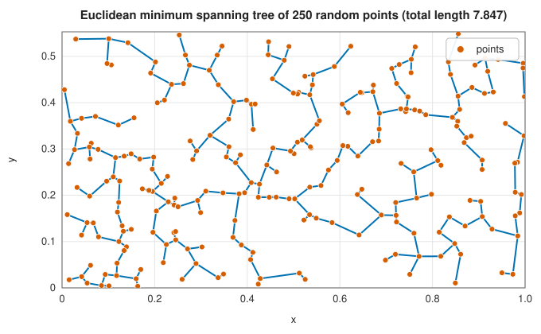

# Minimum spanning trees and union-find

<div class="entry-summary">

| | |
|---|---|
| **Problem** | Connect all the vertices of a weighted undirected graph with the least total edge weight, and keep track of which vertices are already connected |
| **Devised by** | Otakar Borůvka (1926); Joseph Kruskal (1956); Vojtěch Jarník (1930), Robert Prim (1957) and Edsger Dijkstra (1959); Bernard Galler and Michael Fischer (1964) and Robert Tarjan (1975), union-find |
| **Accuracy** | Exact; Kruskal and Prim agree with SciPy's `minimum_spanning_tree` (see the [chapter overview](index.md#testing-against-scipy-and-networkx)) |
| **Cost** | Kruskal $O(E\log E)$; Prim $O(E\log V)$; union-find operations in near-constant amortised time, $O(\alpha(n))$ |
| **Read first** | [Graphs, traversal and orderings](traversal.md) |
| **API** | [`kruskal`](../../api/lib_jsl_graph/spanning_trees/fn.kruskal.html), [`prim`](../../api/lib_jsl_graph/spanning_trees/fn.prim.html), [`SpanningForest`](../../api/lib_jsl_graph/spanning_trees/struct.SpanningForest.html), [`UnionFind`](../../api/lib_jsl_graph/graph/struct.UnionFind.html) (`find`, `union`, `connected`, `set_count`) |

</div>

## Overview

A **spanning tree** of a connected graph is a set of $V - 1$ edges that connects every vertex without cycles. A **minimum spanning tree** (MST) has the smallest total weight. It is the cheapest way to wire a network, and appears inside clustering ([single linkage](../unsupervised/hierarchical.md) is an MST cut into pieces), approximation algorithms and image segmentation. Two greedy algorithms find it. **Kruskal's** adds edges from cheapest to dearest, skipping any that would close a cycle. **Prim's** grows one tree from a root by always adding the cheapest edge leaving it.
Kruskal's needs to know quickly whether two vertices are already connected, which is the job of the **union-find** (disjoint-set) structure. For a disconnected graph both return a minimum spanning **forest**, one tree per component.

## History

Otakar Borůvka (1926) solved the problem to plan Moravia's electrical network. Vojtěch Jarník (1930) gave the vertex-growing algorithm, rediscovered by Robert Prim (1957) at Bell Labs and by Edsger Dijkstra (1959). Joseph Kruskal (1956) published the edge-sorting algorithm while a graduate student. The union-find structure was introduced by Bernard Galler and Michael Fischer (1964). Robert Tarjan (1975) proved that with union by rank and path compression its operations cost $O(\alpha(n))$ amortised, where $\alpha$, the inverse Ackermann function, is below 5 for any conceivable $n$.

## The idea

### The cut property

A **spanning tree** of a connected graph is a set of edges that connects all the vertices
without forming a cycle; it has exactly $V - 1$ edges. A **minimum spanning tree** (MST) is one
of least total weight: the cheapest network that links everything. Both classical algorithms are
greedy, and both are justified by a single fact.

> **Cut property.** Divide the vertices into two sets in any way. The cheapest edge crossing
> between the two sets belongs to some minimum spanning tree.

*Proof.* Take any minimum spanning tree and suppose it does not contain that cheapest crossing
edge $e$. Adding $e$ to the tree creates a cycle. The cycle crosses from one set to the other
along $e$, so it must cross back along some other edge $e'$ of the tree, and $e'$ costs at least
as much as $e$. Removing $e'$ leaves a spanning tree again, no more expensive than before and
containing $e$. $\blacksquare$

So an edge that is the cheapest across some cut is always safe to choose. Both algorithms only
ever add such an edge. If the weights are all distinct, the MST is unique.

### Kruskal

Kruskal's algorithm grows a forest. Sort the edges by weight, and take each in turn, cheapest
first. If its endpoints are in different components of the forest built so far, keep it, which
merges the two components. If they are already connected, discard it: it would close a cycle.

Each edge kept is safe by the cut property: it is the cheapest edge leaving the component of
one of its endpoints, since every cheaper edge has already been considered. The test "are these
two vertices already connected?" is answered by the [union-find](#union-find) structure below.
The cost is dominated by the sort, $O(E\log E)$.

### Prim

Prim's algorithm grows a single tree from a root. At each step it adds the cheapest edge that
leads from the tree to a vertex outside it, which is safe by the cut property applied to the cut
between the tree and the rest. A heap holds the candidate edges leaving the tree. Pop the
cheapest; if it reaches a new vertex, add the vertex and push its edges. Edges that lead to
vertices already in the tree have gone stale and are skipped. On dense graphs Prim is preferred,
since Kruskal must sort every edge.



<p class="caption" id="fig-23-3"><strong>Figure 23.3.</strong> Euclidean MST.</p>

{{#include ../generated/graph/mst_facts.md}}

### Union-find

Kruskal's algorithm needs to keep track of a collection of disjoint sets (the components) under
two operations: find which set an element belongs to, and merge two sets. The **union-find**
structure does both in almost constant time.

Each set is stored as a tree of parent pointers, and the root of the tree serves as the name of
the set. `find` follows parent pointers up to the root; two elements are in the same set exactly
when they have the same root. `union` makes one root the child of the other. Two refinements
keep the trees shallow, which is what keeps `find` fast.

- **Union by rank.** `union` hangs the root of lower **rank** (an upper bound on the tree's
  height) under the other, so the height grows only when two trees of equal rank are merged.
- **Path halving.** As `find` walks up, it points each node it visits at its grandparent, so the
  path is half as long the next time.

Together these make a sequence of operations cost almost constant time each: the average is
bounded by the inverse Ackermann function, which is at most 4 for any conceivable input size.

## Algorithm

**Kruskal.**

1. Sort the edges by increasing weight.
2. Start a union-find structure with every vertex in its own set.
3. For each edge $(u, v)$ in order: if $u$ and $v$ are in different sets, add the edge to the
   tree and merge the two sets.
4. When the edges run out, the kept edges are the tree (a connected graph yields exactly
   $V - 1$ of them). In a disconnected graph the result is a spanning tree of each component,
   a spanning **forest**.

The cost is $O(E\log E)$, dominated by the sort.

**Prim.** For each vertex not yet in a tree, start a new tree there:

1. mark the vertex as in the tree and push its edges on a min-heap ordered by weight;
2. pop the cheapest edge. If it leads to a vertex already in the tree, it is stale: discard
   it. Otherwise add the edge to the tree, mark the new vertex, and push its edges;
3. repeat from step 2 until the heap is empty.

The cost is $O(E\log E)$ for the heap operations.

**Union-find.**

- `find(x)`: while $x$ is not its own parent, set the parent of $x$ to its grandparent, and
  move to it. Return $x$, the root.
- `union(x, y)`: find the two roots. If they are the same, return false. Otherwise make the
  root of lower rank a child of the other; if the ranks are equal, choose either and increase
  the rank of the new root by one. Return true.

## Implementation

```rust,ignore
{{#include ../../../crates/graph/src/spanning_trees.rs:kruskal}}
```

```rust,ignore
{{#include ../../../crates/graph/src/graph.rs:union_find}}
```

- Both algorithms require an undirected graph and return the forest's edges and total weight.
- `Graph::connected_components` uses the same union-find structure.

## In practice

```rust,ignore
{{#include ../../../crates/graph/examples/graph_spanning_trees.rs}}
```

```text
Kruskal: weight 37, edges [(6, 7), (2, 8), (5, 6), (0, 1), (2, 5), (2, 3), (0, 7), (3, 4)]
Prim:    weight 37, 8 edges
union-find: 0 and 2 connected true, 0 and 5 connected false, 3 sets
```

Kruskal lists its edges in the order it accepts them, cheapest first.

**Strengths**

- Simple, fast greedy algorithms; minimum spanning forests for disconnected graphs.
- A union-find structure useful well beyond spanning trees.

**Weaknesses**

- No Borůvka (parallel-friendly) variant, and no maximum or degree-constrained trees.
- Kruskal sorts all edges even when the graph is dense.

## Exercises

1. Prove the cut property, and deduce the correctness of Kruskal's and Prim's algorithms.
2. Show that with distinct weights the minimum spanning tree is unique.
3. Show that the heaviest edge of any cycle is in no minimum spanning tree (with distinct weights).
4. Show that single-linkage clustering into $k$ clusters is the MST with its $k - 1$ heaviest edges removed.
5. Show that union by rank alone keeps tree heights at most $\log_2 n$.

<details>
<summary>Hints and answers</summary>

1. Let $e$ be the lightest edge crossing a cut. Any minimum spanning tree $T$ not containing $e$ must contain a path between its endpoints that crosses the cut by another edge $f$; swapping $f$ for $e$ gives a spanning tree no heavier. Kruskal adds the lightest edge joining two components (a cut separating the components) and Prim the lightest edge leaving the tree; both are instances of the property.
2. If two different trees were minimum, the lightest edge in their symmetric difference would be in only one of them, and swapping it into the other would give a strictly lighter tree.
3. If the heaviest edge $e$ of a cycle were in a tree, removing it splits the tree into two parts; some other edge of the cycle crosses the cut and is lighter, so exchanging gives a lighter tree.
4. Kruskal merges components in order of increasing weight; stopping when $k$ components remain leaves exactly the $k - 1$ heaviest MST edges unused, and single linkage merges the closest clusters first in the same order.
5. Union by rank links the tree with smaller rank below the other, so a tree of rank $r$ has at least $2^r$ nodes (induction); a tree with $n$ nodes therefore has rank, and hence height, at most $\log_2n$.

</details>

## Further reading

- J. B. Kruskal, "On the shortest spanning subtree of a graph and the traveling salesman problem", *Proceedings of the American Mathematical Society* 7 (1956) 48–50.
- R. C. Prim, "Shortest connection networks and some generalizations", *Bell System Technical Journal* 36 (1957) 1389–1401.
- R. E. Tarjan, "Efficiency of a good but not linear set union algorithm", *Journal of the ACM* 22 (1975) 215–225.
- R. L. Graham and P. Hell, "On the history of the minimum spanning tree problem", *Annals of the History of Computing* 7 (1985) 43–57.
